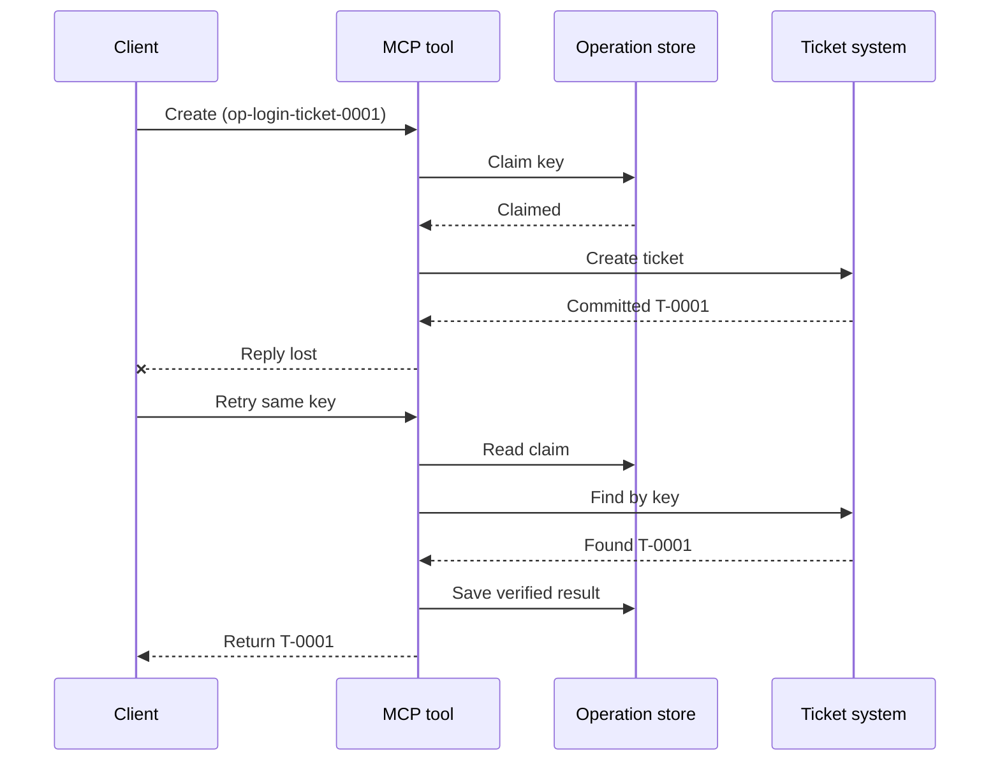
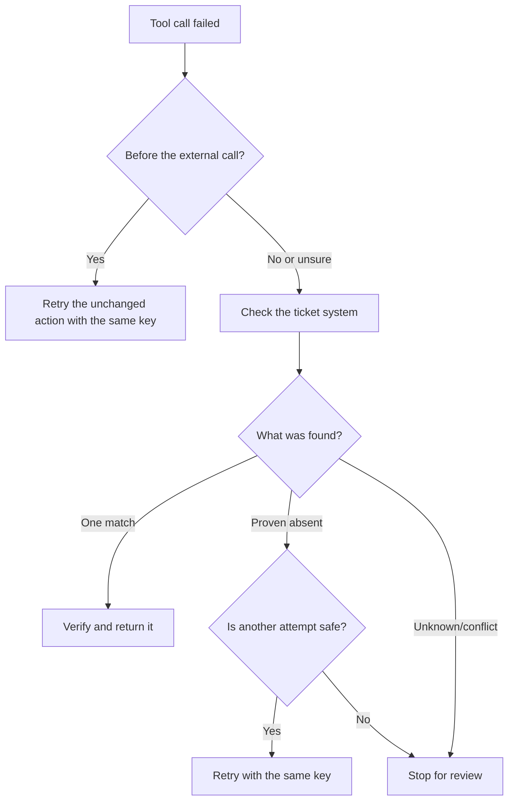

# Coba Ulang Aman untuk Alat MCP: Pola Sidecar Keandalan

Respon yang hilang tidak berarti tindakan hilang. Sebuah alat tiket dukungan
mungkin membuat tiket `T-0001` kemudian kehilangan koneksi sebelum klien melihat
hasilnya. Jika klien mencoba lagi tanpa pandang bulu, mungkin membuat `T-0002`.

Pelajaran ini menunjukkan cara mengenali hasil yang tidak pasti itu, mempertahankan satu identitas
yang stabil untuk tindakan yang dimaksud, dan memeriksa sistem tiket sebelum mencoba
lagi. Latihan Python yang menyertainya berjalan secara lokal dengan pustaka standar
dan SQLite.

## Mengapa Timeout Berarti "Hasil Tidak Diketahui"

Misalkan klien memanggil `create_support_ticket` dengan kunci operasi
`op-login-ticket-0001`:



Koneksi gagal setelah tiket dikomit tetapi sebelum hasil tiba.
Klien hanya tahu bahwa balasan hilang. Ia tidak tahu apakah
tiket hilang. Menggunakan kembali kunci operasi memungkinkan alat menemukan dan mengembalikan
`T-0001` daripada membuat `T-0002`.

## Apa yang Dilakukan Sidecar Keandalan

Sidecar keandalan adalah kode aplikasi yang menyimpan status pemulihan di sekitar
alat. Itu mungkin sebuah pustaka, middleware, layanan yang didukung basis data, atau sekadar
bagian dari implementasi alat. Tidak harus menjadi proses terpisah,
dan itu bukan fitur protokol MCP.

Sidecar memiliki empat tugas:

1. menyimpan tindakan yang dimaksud sebelum memanggil sistem eksternal;
2. membiarkan hanya satu pekerja mengklaim tindakan itu;
3. mengingat cukup status untuk pulih setelah kerusakan; dan
4. memeriksa sistem eksternal ketika hasil tidak pasti.

Pelajaran ini menargetkan spesifikasi MCP final `2026-07-28`. MCP tidak memiliki
sesi tingkat protokol, jadi kunci operasi adalah argumen alat biasa
yang didukung oleh status aplikasi yang tahan lama. Pola yang sama juga berhasil dengan versi
MCP sebelumnya.

## Empat ID yang Memecahkan Masalah yang Berbeda

Pengidentifikasi ini terkait, tetapi tidak dapat saling dipertukarkan:

| Identifier | Apa yang diidentifikasi | Bertahan di coba ulang? |
| --- | --- | --- |
| JSON-RPC ID | Satu permintaan dan balasan | Tidak; gunakan ID permintaan baru |
| MCP Task ID | Satu tugas yang berjalan lama | Ya; simpan untuk polling |
| Kunci operasi | Satu tindakan yang dimaksud | Ya; gunakan kembali untuk tindakan itu |
| ID Tiket | Hasil yang disimpan | Ya; kembalikan setelah verifikasi |

Notifikasi kemajuan dan konteks jejak membantu Anda mengamati permintaan.
Pembatalan meminta pekerjaan berhenti. Tidak ada yang mencegah tiket duplikat.

## Bangun Pelindung

Buat kunci operasi sebelum panggilan alat pertama dan simpan dengan
alur kerja. Setiap upaya untuk membuat tiket yang sama menggunakan kunci yang sama:

```json
{
  "operation_key": "op-login-ticket-0001",
  "title": "Cannot sign in"
}
```

Tiket yang dimaksud berbeda mendapat kunci baru. Dalam produksi, hasilkan nilai buram,
yang tidak dapat ditebak sebagai ganti menempatkan data pelanggan ke dalam kunci.

Berikut adalah skema alat MCP lengkap yang digunakan dalam pelajaran ini:

```json
{
  "name": "create_support_ticket",
  "title": "Create support ticket",
  "description": "Creates or recovers one support ticket for an operation key.",
  "inputSchema": {
    "$schema": "https://json-schema.org/draft/2020-12/schema",
    "type": "object",
    "properties": {
      "operation_key": {
        "type": "string",
        "minLength": 16,
        "maxLength": 128,
        "description": "Stable key reused for the same intended action."
      },
      "title": {
        "type": "string",
        "minLength": 1,
        "maxLength": 200
      }
    },
    "required": ["operation_key", "title"],
    "additionalProperties": false
  },
  "outputSchema": {
    "$schema": "https://json-schema.org/draft/2020-12/schema",
    "type": "object",
    "properties": {
      "ticket_id": {
        "type": "string"
      },
      "operation_key": {
        "type": "string"
      },
      "status": {
        "type": "string",
        "const": "verified"
      }
    },
    "required": ["ticket_id", "operation_key", "status"],
    "additionalProperties": false
  }
}
```

Identitas pemanggil yang diautentikasi berasal dari konteks server, bukan dari
input alat yang disediakan oleh model. Batasi setiap operasi yang disimpan pada:

- pemanggil itu, penyewa, atau akun layanan;
- nama dan versi alat; dan
- hash dari input terormalisasi yang mendefinisikan aksi eksternal.

Hash input menjawab pertanyaan sederhana: "Apakah percobaan ulang ini meminta
tiket yang sama?" Jika kunci sudah milik judul yang berbeda, tolak panggilan.
Mengembalikan hasil sebelumnya untuk input yang berubah akan menyembunyikan kesalahan kontrak.

Simpan klaim dengan satu operasi basis data atomik. "Atomik" berarti dua pekerja
tidak dapat sama-sama mengamati catatan kosong dan kedua menjadi pemilik. Kunci lokal
proses tidak cukup saat instance server lain bisa menerima percobaan ulang.

Alur kerja membuat kunci saat aksi adalah `planned`. Contoh kemudian
menyimpan status ini:

- `claimed`: satu pekerja telah memesan operasi;
- `completed`: sistem tiket mengembalikan hasil; dan
- `verified`: pembacaan dari sistem tiket mengonfirmasi hasil.

Kerusakan dapat meninggalkan status tersimpan pada `claimed` meskipun tiket sudah
dibuat. Perlakukan setiap klaim nonterminal sebagai tidak pasti hingga bukti eksternal
menentukannya. Jangan mengasumsikan bahwa `claimed` berarti "tidak terjadi apa-apa."

## Pulihkan Sebelum Anda Mencoba Ulang

Ketika panggilan alat gagal, tentukan apa yang diketahui sebelum mengirim penulisan eksternal
lain:



Validasi yang gagal sebelum API tiket dipanggil adalah kegagalan yang diketahui.
Coba ulang aksi yang tidak berubah dengan kunci operasi yang sama. Jika memperbaiki input
mengubah tiket yang dimaksud, buat kunci baru untuk aksi baru itu.

Jika permintaan mungkin sudah mencapai sistem tiket, rekonsiliasikan terlebih dahulu.
Rekonsiliasi berarti membandingkan klaim yang disimpan dengan catatan tiket
yang otoritatif. Kembalikan tiket yang ada bila ditemukan tepat satu catatan yang cocok.
Coba ulang hanya jika tiket benar-benar tidak ada dan kontrak hilir
membuat percobaan lain aman.

"Tidak ditemukan" tidak selalu konklusif. Penyedia dengan pencarian yang konsisten secara
bertahap mungkin memerlukan waktu tunggu terbatas dan pemeriksaan ulang. Jika sistem tidak bisa
dicari, memberikan hasil bertentangan, atau tidak bisa dengan aman menduplikasi
percobaan lain, hentikan dan laporkan `outcome unknown`. Berhenti di sini kadang disebut
"gagal tertutup": alur kerja menolak menebak.

## Bukti, Tugas, dan Pembatalan

Respon alat mengatakan apa yang dilaporkan alat. Checkpoint yang tersimpan mengatakan apa yang
dicatat alur kerja. Bukti terkuat berasal dari sistem yang memiliki
hasil: untuk contoh ini, pembacaan dari sistem tiket yang menemukan tepat satu
tiket yang cocok.

Cocokkan bukti dengan risiko. ID pesan penyedia mungkin cukup untuk
pemberitahuan risiko rendah. Pembayaran, penempatan, dan aksi destruktif mungkin
memerlukan bukti status penyedia, buku besar, atau review manual.

Ekstensi Tugas MCP melengkapi pola ini untuk pekerjaan yang berjalan lama. ID Tugas
membiarkan klien melanjutkan polling setelah terputus, tapi tidak mengidentifikasi
atau menduplikasi tiket itu sendiri. Ketika Tugas digunakan, identitas dihubungkan
seperti ini:

```text
operation key -> Task ID -> ticket ID -> verification evidence
```

Pembatalan bersifat koperatif, bukan rollback. Tiket mungkin masih dibuat
setelah pembatalan diakui, jadi hasil tidak pasti masih perlu
rekonsiliasi.

## Jalankan Latihan Penyisipan Kegagalan

Contoh menggunakan dua file SQLite: satu mewakili penyimpanan operasi dan
lainnya mewakili sistem tiket eksternal. Tidak ada transaksi yang melingkupi
kedua file. Kegagalan disisipkan setelah tiket dikomit tetapi sebelum
sidecar mencatat penyelesaian.

Metode python langsung menerima `caller_id` sebagai pengganti konteks server yang diautentikasi.
Jangan tambahkan `caller_id` ke skema input MCP yang dikontrol model.


| --- | --- | --- |
| Percobaan ulang buta | Membuat `T-0002` setelah kehilangan respons untuk `T-0001` | 2 |
| Percobaan ulang dikawal | Menemukan dan mengembalikan `T-0001` | 1 |


```bash
cd 08-BestPractices/reliability-sidecars/python
python -m unittest discover -p "test_*.py" -v
```

Enam pengujian menunjukkan bahwa:

1. percobaan ulang buta menciptakan duplikat;
2. kehilangan respons plus restart memulihkan satu tiket dari klaim yang tahan lama;
3. percobaan ulang yang terverifikasi menggunakan kembali hasil yang disimpan;
4. input yang berubah atau bukti eksternal yang bertentangan ditolak;
5. klaim yang ada tanpa bukti eksternal berhenti dengan aman; dan
6. klaim bersamaan menerima satu pemilik tanpa mundur pada hasil yang terverifikasi.

Buka contoh:

- [Implementasi Python](../../../../08-BestPractices/reliability-sidecars/python/reliability_sidecar.py)
- [Tes deterministik](../../../../08-BestPractices/reliability-sidecars/python/test_reliability_sidecar.py)

Contoh ini sengaja menghilangkan sewa klaim kadaluwarsa. Kebijakan pengambilalihan produksi
membutuhkan sewa yang terbatas, transfer kepemilikan atomik, dan pemeriksaan eksternal lain
sebelum mengeksekusi.

## Implementasi Komunitas Opsional

Agent Enhancer Utilities adalah salah satu implementasi komunitas dari pola tingkat aplikasi ini.
Perencanaannya memilih pendekatan pemulihan, sementara
checkpoint mencatat status klaim dan hasil yang tidak pasti. Alat domain atau server MCP
masih melakukan dan memverifikasi tindakan nyata. Layanan ini bukan bagian
dari spesifikasi MCP dan tidak diwajibkan untuk pelajaran ini.

| Konsep pelajaran | Bagian Agent Enhancer | Batasan penting |
| --- | --- | --- |
| Rencana pemulihan | `workflow-guard-planner` | Tidak memanggil alat domain |
| Klaim dan pemulihan | `workflow-checkpoint` | `external_proof` tetap `false` |
| Putar ulang sidecar yang tepat | `lab.invoke_tool` | Menggunakan kunci idempoten yang terpisah |
| Verifikasi aksi nyata | Pencarian/pembacaan tujuan | Domain MCP memilikinya |

Untuk percobaan ulang yang tepat dari satu panggilan sidecar, `lab.invoke_tool` menerima
`idempotency_key` luar. Kunci itu mengidentifikasi pemanggilan sidecar; itu bukan
`operation_key` bisnis yang digunakan untuk tiket.

Kontrak publik yang ditandai dan contoh jaringan opsional tersedia
di sini:

- [Kontrak Sidecar Keandalan v1](https://github.com/artiehinz/Agent-Enhancer-Utilities/blob/v1.6.0/docs/RELIABILITY_SIDECAR_CONTRACT_V1.md)
- [Contoh perencana dan contoh domain tiruan](https://github.com/artiehinz/Agent-Enhancer-Utilities/tree/v1.6.0/examples/reliability-sidecar)

Tautan-tautan ini menggambarkan pola aplikasi. Mereka tidak mengklaim bahwa
layanan yang dihosting sesuai dengan MCP `2026-07-28`, dan status checkpoint tidak pernah dihitung
sebagai bukti eksternal tiket.

## Daftar Periksa Produksi

- [ ] Buat dan simpan kunci operasi sebelum upaya eksternal pertama.
- [ ] Kaitkan kunci ke pemanggil, versi alat, dan hash input yang dinormalisasi.
- [ ] Tolak input yang berubah di bawah kunci yang sudah ada.
- [ ] Terima satu pemilik dengan operasi toko bersama atomik.
- [ ] Teruskan kunci ke penyedia hilir saat mendukung idempoten.
- [ ] Rekonsiliasi hasil yang tidak pasti sebelum menulis ulang.
- [ ] Simpan hasil dan bukti yang terverifikasi selama jendela percobaan ulang penuh.
- [ ] Berhenti untuk tinjauan ketika hasil eksternal tidak dapat ditentukan dengan aman.

## Referensi

- [Spesifikasi MCP `2026-07-28`](https://modelcontextprotocol.io/specification/2026-07-28)
- [Panduan alat MCP `2026-07-28`](https://modelcontextprotocol.io/specification/2026-07-28/server/tools)
- [Ekstensi Tugas MCP](https://modelcontextprotocol.io/extensions/tasks/overview)
- [Spesifikasi JSON-RPC 2.0](https://www.jsonrpc.org/specification)

---

<!-- CO-OP TRANSLATOR DISCLAIMER START -->
**Penafian**:
Dokumen ini telah diterjemahkan menggunakan layanan terjemahan AI [Co-op Translator](https://github.com/Azure/co-op-translator). Meskipun kami berupaya untuk mencapai akurasi, harap diketahui bahwa terjemahan otomatis mungkin mengandung kesalahan atau ketidakakuratan. Dokumen asli dalam bahasa aslinya harus dianggap sebagai sumber yang sah. Untuk informasi penting, disarankan menggunakan terjemahan profesional oleh manusia. Kami tidak bertanggung jawab atas kesalahpahaman atau penafsiran yang keliru yang timbul dari penggunaan terjemahan ini.
<!-- CO-OP TRANSLATOR DISCLAIMER END -->