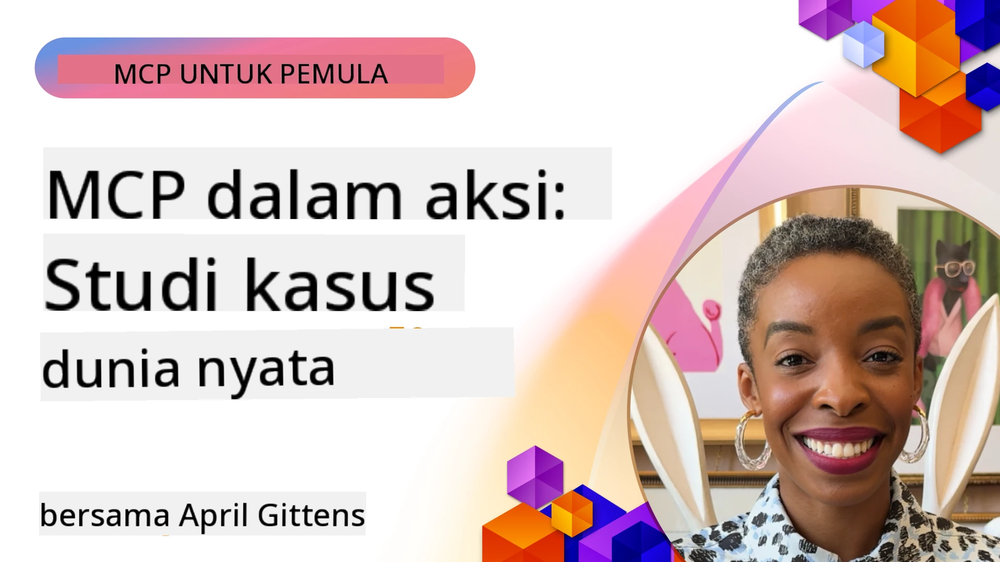

# MCP dalam Tindakan: Studi Kasus Dunia Nyata

_(Klik gambar di atas untuk melihat video pelajaran ini)_

Model Context Protocol (MCP) mengubah cara aplikasi AI berinteraksi dengan data, alat, dan layanan. Bagian ini menyajikan studi kasus dunia nyata yang menunjukkan aplikasi praktis MCP dalam berbagai skenario perusahaan.

## Ikhtisar

Bagian ini menampilkan contoh konkret implementasi MCP, menyoroti bagaimana organisasi memanfaatkan protokol ini untuk menyelesaikan tantangan bisnis yang kompleks. Dengan memeriksa studi kasus ini, Anda akan memperoleh wawasan tentang fleksibilitas, skalabilitas, dan manfaat praktis MCP dalam skenario dunia nyata.

## Tujuan Pembelajaran Utama

Dengan mengeksplorasi studi kasus ini, Anda akan:

- Memahami bagaimana MCP dapat diterapkan untuk menyelesaikan masalah bisnis tertentu
- Mempelajari pola integrasi dan pendekatan arsitektural yang berbeda
- Mengenali praktik terbaik untuk menerapkan MCP di lingkungan perusahaan
- Mendapatkan wawasan tentang tantangan dan solusi yang dihadapi dalam implementasi dunia nyata
- Mengidentifikasi peluang untuk menerapkan pola serupa dalam proyek Anda sendiri

## Studi Kasus Unggulan

### 1. [Azure AI Travel Agents – Implementasi Referensi](./travelagentsample.md)

Studi kasus ini meneliti solusi referensi komprehensif dari Microsoft yang menunjukkan cara membangun aplikasi perencanaan perjalanan bertenaga AI multi-agen menggunakan MCP, Azure OpenAI, dan Azure AI Search. Proyek ini menampilkan:

- Orkestrasi multi-agen melalui MCP
- Integrasi data perusahaan dengan Azure AI Search
- Arsitektur aman dan skalabel menggunakan layanan Azure
- Alat yang dapat diperluas dengan komponen MCP yang dapat digunakan kembali
- Pengalaman pengguna percakapan yang didukung oleh Azure OpenAI

Detail arsitektur dan implementasi memberikan wawasan berharga tentang membangun sistem multi-agen yang kompleks dengan MCP sebagai lapisan koordinasi.

### 2. [Memperbarui Item Azure DevOps dari Data YouTube](./UpdateADOItemsFromYT.md)

Studi kasus ini menunjukkan aplikasi praktis MCP untuk mengotomatiskan proses alur kerja. Ini menunjukkan bagaimana alat MCP dapat digunakan untuk:

- Mengekstrak data dari platform online (YouTube)
- Memperbarui item kerja di sistem Azure DevOps
- Membuat alur kerja otomatisasi yang dapat diulang
- Mengintegrasikan data di berbagai sistem yang berbeda

Contoh ini menggambarkan bagaimana implementasi MCP yang relatif sederhana pun dapat memberikan peningkatan efisiensi signifikan dengan mengotomatiskan tugas rutin dan meningkatkan konsistensi data di seluruh sistem.

### 3. [Pengambilan Dokumentasi Waktu Nyata dengan MCP](./docs-mcp/README.md)

Studi kasus ini membimbing Anda melalui menghubungkan klien konsol Python ke server Model Context Protocol (MCP) untuk mengambil dan mencatat dokumentasi Microsoft yang kontekstual dan waktu nyata. Anda akan mempelajari cara:

- Terhubung ke server MCP menggunakan klien Python dan SDK resmi MCP
- Menggunakan klien HTTP streaming untuk pengambilan data waktu nyata yang efisien
- Memanggil alat dokumentasi di server dan langsung mencatat respons ke konsol
- Mengintegrasikan dokumentasi Microsoft terbaru ke dalam alur kerja Anda tanpa keluar dari terminal

Bab ini mencakup tugas praktek, contoh kode kerja minimal, dan tautan ke sumber daya tambahan untuk pembelajaran lebih dalam. Lihat walkthrough dan kode lengkap di bab terkait untuk memahami bagaimana MCP dapat mengubah akses dokumentasi dan produktivitas pengembang dalam lingkungan berbasis konsol.

### 4. [Aplikasi Web Generator Rencana Studi Interaktif dengan MCP](./docs-mcp/README.md)

Studi kasus ini menunjukkan cara membangun aplikasi web interaktif menggunakan Chainlit dan Model Context Protocol (MCP) untuk menghasilkan rencana studi personalisasi untuk topik apa pun. Pengguna dapat menentukan subjek (seperti "sertifikasi AI-900") dan durasi belajar (misalnya, 8 minggu), dan aplikasi akan memberikan rincian mingguan konten yang direkomendasikan. Chainlit memungkinkan antarmuka chat percakapan, membuat pengalaman menjadi menarik dan adaptif.

- Aplikasi web percakapan yang didukung Chainlit
- Prompt yang dikendalikan pengguna untuk topik dan durasi
- Rekomendasi konten mingguan menggunakan MCP
- Respons adaptif waktu nyata dalam antarmuka chat

Proyek ini menggambarkan bagaimana AI percakapan dan MCP dapat digabungkan untuk menciptakan alat pendidikan dinamis yang dikendalikan pengguna di lingkungan web modern.

### 5. [Dokumentasi Dalam Editor dengan Server MCP di VS Code](./docs-mcp/README.md)

Studi kasus ini menunjukkan bagaimana Anda dapat membawa Microsoft Learn Docs langsung ke lingkungan VS Code Anda menggunakan server MCP—tidak perlu lagi berganti tab browser! Anda akan melihat bagaimana cara:

- Mencari dan membaca dokumen di dalam VS Code menggunakan panel MCP atau palet perintah
- Mereferensikan dokumentasi dan memasukkan tautan langsung ke README atau file markdown kursus Anda
- Menggunakan GitHub Copilot dan MCP bersama untuk alur kerja dokumentasi dan kode yang mulus dan bertenaga AI
- Memvalidasi dan meningkatkan dokumentasi Anda dengan umpan balik waktu nyata dan akurasi yang bersumber dari Microsoft
- Mengintegrasikan MCP dengan alur kerja GitHub untuk validasi dokumentasi berkelanjutan

Implementasi mencakup:

- Contoh konfigurasi `.vscode/mcp.json` untuk pengaturan mudah
- Walkthrough berbasis tangkapan layar dari pengalaman dalam editor
- Tips untuk menggabungkan Copilot dan MCP demi produktivitas maksimum

Skenario ini ideal untuk penulis kursus, penulis dokumentasi, dan pengembang yang ingin tetap fokus di editor mereka sambil bekerja dengan dokumen, Copilot, dan alat validasi—semua didukung oleh MCP.

### 6. [Pembuatan Server MCP APIM](./apimsample.md)

Studi kasus ini memberikan panduan langkah demi langkah tentang cara membuat server MCP menggunakan Azure API Management (APIM). Ini mencakup:

- Menyiapkan server MCP di Azure API Management
- Mengekspos operasi API sebagai alat MCP
- Mengonfigurasi kebijakan untuk pembatasan laju dan keamanan
- Menguji server MCP menggunakan Visual Studio Code dan GitHub Copilot

Contoh ini menggambarkan cara memanfaatkan kemampuan Azure untuk membuat server MCP yang andal yang dapat digunakan dalam berbagai aplikasi, meningkatkan integrasi sistem AI dengan API perusahaan.

### 7. [GitHub MCP Registry — Mempercepat Integrasi Agentik](https://github.com/mcp)

Studi kasus ini meneliti bagaimana GitHub MCP Registry, yang diluncurkan pada September 2025, mengatasi tantangan kritis di ekosistem AI: penemuan dan penyebaran Model Context Protocol (MCP) server yang terfragmentasi.

#### Ikhtisar
**MCP Registry** memecahkan masalah yang semakin meningkat dari tersebarnya server MCP di berbagai repositori dan registry, yang sebelumnya memperlambat integrasi dan rawan kesalahan. Server ini memungkinkan agen AI untuk berinteraksi dengan sistem eksternal seperti API, basis data, dan sumber dokumentasi.

#### Pernyataan Masalah
Pengembang yang membangun alur kerja agentik menghadapi beberapa tantangan:
- **Penemuan yang buruk** dari server MCP di berbagai platform
- **Pertanyaan pengaturan berulang** yang tersebar di forum dan dokumentasi
- **Risiko keamanan** dari sumber yang tidak diverifikasi dan tidak terpercaya
- **Kurangnya standardisasi** dalam kualitas dan kompatibilitas server

#### Arsitektur Solusi
GitHub MCP Registry memusatkan server MCP tepercaya dengan fitur utama:
- **Integrasi instalasi satu-klik** melalui VS Code untuk pengaturan yang efisien
- **Penyortiran sinyal terhadap gangguan** berdasarkan bintang, aktivitas, dan validasi komunitas
- **Integrasi langsung** dengan GitHub Copilot dan alat lain yang kompatibel dengan MCP
- **Model kontribusi terbuka** yang memungkinkan komunitas dan mitra perusahaan berkontribusi

#### Dampak Bisnis
Registry ini telah memberikan peningkatan yang dapat diukur:
- **Onboarding lebih cepat** untuk pengembang menggunakan alat seperti Microsoft Learn MCP Server, yang menyiarkan dokumentasi resmi langsung ke agen
- **Produktivitas meningkat** melalui server khusus seperti `github-mcp-server`, memungkinkan otomatisasi GitHub berbahasa alami (pembuatan PR, pengulangan CI, pemindaian kode)
- **Kepercayaan ekosistem lebih kuat** melalui daftar kurasi dan standar konfigurasi yang transparan

#### Nilai Strategis
Untuk praktisi yang mengkhususkan diri dalam manajemen siklus hidup agen dan alur kerja dapat direproduksi, MCP Registry menyediakan:
- **Kemampuan penerapan agen modular** dengan komponen standar
- **Pipeline evaluasi berbasis registry** untuk pengujian dan validasi yang konsisten
- **Interoperabilitas lintas alat** yang memungkinkan integrasi mulus di berbagai platform AI

Studi kasus ini menunjukkan bahwa MCP Registry lebih dari sekadar direktori—ini adalah platform dasar untuk integrasi model skala besar dan penerapan sistem agentik dunia nyata.

### 8. [Mempublikasikan ke Jejaring Sosial dari Agen](./publora-social-publishing.md)

Studi kasus ini memandu melalui **server MCP jarak jauh dengan kemampuan penulisan** — yang alatnya mengambil tindakan tidak dapat dibatalkan atas nama pengguna — dengan penerbitan sosial sebagai contoh yang dikerjakan. Sebuah agen menyusun posting, manusia menyetujuinya, dan server menjadwalkannya di berbagai jejaring.

Bagian menariknya adalah batasan desain yang diberlakukan oleh penerbitan, yang berlaku untuk server apa pun yang menulis alih-alih membaca:

- **Penemuan terbuka, eksekusi terautentikasi** — `tools/list` dijawab tanpa kredensial sehingga registri dan klien dapat introspeksi, sementara setiap `tools/call` memerlukan token dan sebaliknya mengembalikan `401` dengan header `WWW-Authenticate`
- **Pendaftaran OAuth tanpa langkah keluar-band** — pendaftaran klien dinamis hari ini, dengan Dokumen Metadata Client ID sebagai arah yang diarahkan oleh spesifikasi `2026-07-28`
- **Anotasi alat** (`readOnlyHint`, `destructiveHint`, `idempotentHint`) yang digunakan klien untuk memutuskan apa yang dikonfirmasi — petunjuk bukan penegakan, dan sesuatu yang kini diharapkan direktori konektor pada tinjauan
- **Pengidentifikasi yang tidak dapat dibuat-buat**, sehingga nilai halusinasi gagal keras alih-alih bertindak pada nilai yang tampak masuk akal
- **Kunci idempoten pada alat penciptaan posting**, sehingga pengulangan waktu jalan agen tidak menjadi publikasi ganda
- **Target tanpa-op yang dijelaskan dalam skema alat** yang menguji jalur penulisan penuh dan tidak mempublikasikan apa pun, untuk peninjau dan CI

Bab ini ditutup dengan daftar periksa singkat yang dapat diterapkan pada server yang sedang Anda bangun.

## Kesimpulan

Delapan studi kasus komprehensif ini menunjukkan fleksibilitas luar biasa dan aplikasi praktis Model Context Protocol di berbagai skenario dunia nyata. Dari sistem perencanaan perjalanan multi-agen yang kompleks dan manajemen API perusahaan hingga alur kerja dokumentasi yang dipermudah dan revolusioner GitHub MCP Registry, contoh-contoh ini menampilkan bagaimana MCP menyediakan cara yang distandarisasi dan dapat diskalakan untuk menghubungkan sistem AI dengan alat, data, dan layanan yang mereka butuhkan untuk memberikan nilai luar biasa.

Studi kasus mencakup berbagai dimensi implementasi MCP:
- **Integrasi Perusahaan**: Manajemen API Azure dan otomasi Azure DevOps
- **Orkestrasi Multi-Agen**: Perencanaan perjalanan dengan agen AI yang terkoordinasi
- **Produktivitas Pengembang**: Integrasi VS Code dan akses dokumentasi waktu nyata
- **Pengembangan Ekosistem**: GitHub MCP Registry sebagai platform dasar
- **Aplikasi Pendidikan**: Generator rencana studi interaktif dan antarmuka percakapan

Dengan mempelajari implementasi ini, Anda mendapatkan wawasan penting tentang:
- **Pola arsitektural** untuk skala dan kasus penggunaan yang berbeda
- **Strategi implementasi** yang menyeimbangkan fungsionalitas dengan keterpeliharaan
- **Pertimbangan keamanan dan skalabilitas** untuk penerapan produksi
- **Praktik terbaik** untuk pengembangan server MCP dan integrasi klien
- **Pemikiran ekosistem** untuk membangun solusi bertenaga AI yang saling terhubung

Contoh-contoh ini secara kolektif membuktikan bahwa MCP bukan hanya kerangka teoritis tetapi protokol matang siap produksi yang memungkinkan solusi praktis untuk tantangan bisnis kompleks. Apakah Anda membangun alat otomatisasi sederhana atau sistem multi-agen canggih, pola dan pendekatan yang diilustrasikan di sini menyediakan dasar yang kuat untuk proyek MCP Anda sendiri.

## Sumber Daya Tambahan

- [Repositori GitHub Azure AI Travel Agents](https://github.com/Azure-Samples/azure-ai-travel-agents)
- [Alat MCP Azure DevOps](https://github.com/microsoft/azure-devops-mcp)
- [Alat MCP Playwright](https://github.com/microsoft/playwright-mcp)
- [Server MCP Microsoft Docs](https://github.com/MicrosoftDocs/mcp)
- [GitHub MCP Registry — Mempercepat Integrasi Agentik](https://github.com/mcp)
- [Contoh Komunitas MCP](https://github.com/microsoft/mcp)

## Selanjutnya

- Sebelumnya: [Modul 8: Praktik Terbaik](../08-BestPractices/README.md)
- Berikutnya: [Modul 10: Memperlancar Alur Kerja AI: Membuat Server MCP dengan Microsoft Foundry Toolkit](../10-StreamliningAIWorkflowsBuildingAnMCPServerWithAIToolkit/README.md)

---

<!-- CO-OP TRANSLATOR DISCLAIMER START -->
**Penafian**:
Dokumen ini telah diterjemahkan menggunakan layanan terjemahan AI [Co-op Translator](https://github.com/Azure/co-op-translator). Meskipun kami berupaya untuk mencapai akurasi, harap diketahui bahwa terjemahan otomatis mungkin mengandung kesalahan atau ketidakakuratan. Dokumen asli dalam bahasa aslinya harus dianggap sebagai sumber yang sah. Untuk informasi penting, disarankan menggunakan terjemahan profesional oleh manusia. Kami tidak bertanggung jawab atas kesalahpahaman atau penafsiran yang keliru yang timbul dari penggunaan terjemahan ini.
<!-- CO-OP TRANSLATOR DISCLAIMER END -->