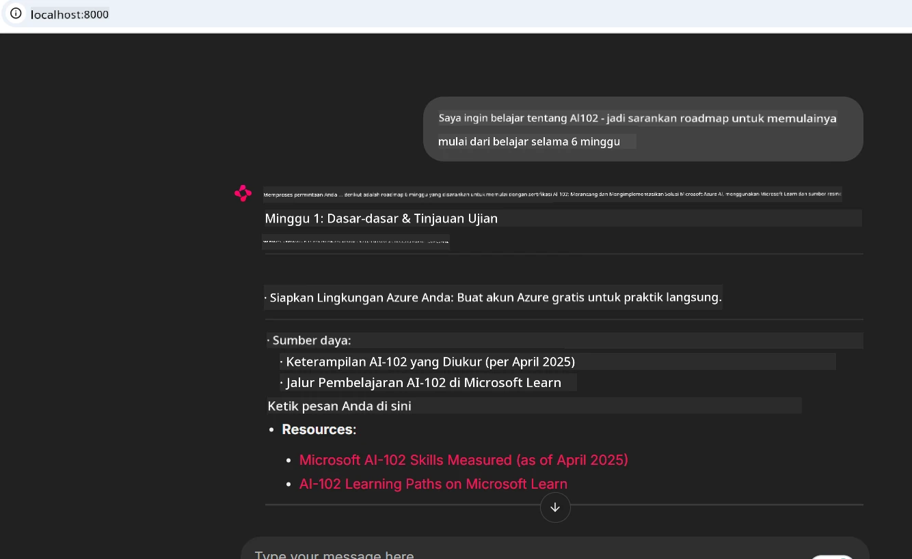
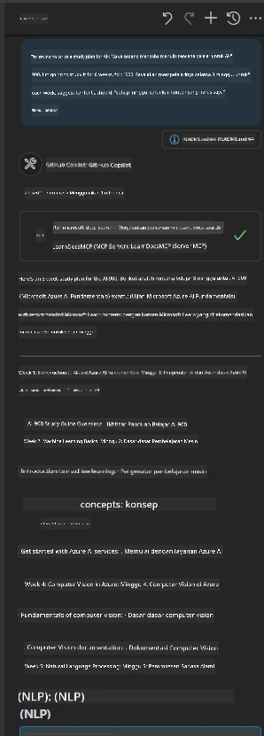

# Studi Kasus: Menghubungkan ke Server MCP Microsoft Learn Docs dari Klien

Pernahkah Anda merasa sibuk berpindah-pindah antara situs dokumentasi, Stack Overflow, dan tab mesin pencari yang tak ada habisnya, sambil mencoba menyelesaikan masalah dalam kode Anda? Mungkin Anda memiliki monitor kedua hanya untuk dokumentasi, atau Anda terus-menerus melakukan alt-tab antara IDE dan browser. Bukankah akan lebih baik jika Anda bisa membawa dokumentasi langsung ke dalam alur kerja Anda—terintegrasi ke dalam aplikasi Anda, IDE Anda, atau bahkan alat khusus Anda sendiri? Dalam studi kasus ini, kita akan mengeksplorasi bagaimana melakukan hal itu dengan menghubungkan langsung ke server Microsoft Learn Docs MCP dari aplikasi klien Anda sendiri.

## Ikhtisar

Pengembangan modern lebih dari sekadar menulis kode—ini tentang menemukan informasi yang tepat pada waktu yang tepat. Dokumentasi ada di mana-mana, tetapi jarang ada di tempat yang paling Anda butuhkan: di dalam alat dan alur kerja Anda. Dengan mengintegrasikan pengambilan dokumentasi langsung ke aplikasi Anda, Anda dapat menghemat waktu, mengurangi pergantian konteks, dan meningkatkan produktivitas. Di bagian ini, kami akan menunjukkan cara menghubungkan klien ke server Microsoft Learn Docs MCP, sehingga Anda dapat mengakses dokumentasi real-time yang peka konteks tanpa pernah meninggalkan aplikasi Anda.

Kami akan membahas proses membangun koneksi, mengirim permintaan, dan menangani respons streaming secara efisien. Pendekatan ini tidak hanya menyederhanakan alur kerja Anda tetapi juga membuka pintu untuk membangun alat pengembang yang lebih cerdas dan lebih membantu.

## Tujuan Pembelajaran

Mengapa kita melakukan ini? Karena pengalaman pengembang terbaik adalah yang menghilangkan gesekan. Bayangkan dunia di mana editor kode Anda, chatbot, atau aplikasi web bisa menjawab pertanyaan dokumentasi Anda secara instan, menggunakan konten terbaru dari Microsoft Learn. Di akhir bab ini, Anda akan mengetahui cara:

- Memahami dasar komunikasi server-klien MCP untuk dokumentasi
- Mengimplementasikan aplikasi konsol atau web untuk terhubung ke server Microsoft Learn Docs MCP
- Menggunakan klien HTTP streaming untuk pengambilan dokumentasi real-time
- Mencatat dan menginterpretasikan respons dokumentasi di aplikasi Anda

Anda akan melihat bagaimana keterampilan ini dapat membantu Anda membangun alat yang tidak hanya reaktif, tapi benar-benar interaktif dan peka konteks.

## Skenario 1 - Pengambilan Dokumentasi Real-Time dengan MCP

Dalam skenario ini, kami akan menunjukkan cara menghubungkan klien ke server Microsoft Learn Docs MCP, sehingga Anda dapat mengakses dokumentasi real-time yang peka konteks tanpa meninggalkan aplikasi Anda.

Mari kita praktikkan. Tugas Anda adalah menulis aplikasi yang terhubung ke server Microsoft Learn Docs MCP, memanggil alat `microsoft_docs_search`, dan mencatat respons streaming ke konsol.

### Mengapa pendekatan ini?
Karena ini adalah dasar untuk membangun integrasi yang lebih maju—apakah Anda ingin menggerakkan chatbot, ekstensi IDE, atau dasbor web.

Anda akan menemukan kode dan instruksi untuk skenario ini di dalam folder [`solution`](./solution/README.md) dalam studi kasus ini. Langkah-langkahnya akan memandu Anda untuk menyiapkan koneksi:
- Menggunakan SDK MCP resmi dan klien HTTP yang dapat streaming untuk koneksi
- Memanggil alat `microsoft_docs_search` dengan parameter kueri untuk mengambil dokumentasi
- Menerapkan pencatatan yang tepat dan penanganan error
- Membuat antarmuka konsol interaktif untuk memungkinkan pengguna memasukkan beberapa kueri pencarian

Skenario ini menunjukkan bagaimana:
- Terhubung ke server Docs MCP
- Mengirim kueri
- Mengurai dan mencetak hasilnya

Berikut adalah contoh bagaimana solusi ini dijalankan:

```
Prompt> What is Azure Key Vault?
Answer> Azure Key Vault is a cloud service for securely storing and accessing secrets. ...
```

Di bawah ini adalah contoh solusi minimal. Kode lengkap dan detail tersedia di folder solusi.

<details>
<summary>Python</summary>

```python
import asyncio
from mcp.client.streamable_http import streamablehttp_client
from mcp import ClientSession

async def main():
    async with streamablehttp_client("https://learn.microsoft.com/api/mcp") as (read_stream, write_stream, _):
        async with ClientSession(read_stream, write_stream) as session:
            await session.initialize()
            result = await session.call_tool("microsoft_docs_search", {"query": "Azure Functions best practices"})
            print(result.content)

if __name__ == "__main__":
    asyncio.run(main())
```

- Untuk implementasi penuh dan pencatatan, lihat [`scenario1.py`](../../../../09-CaseStudy/docs-mcp/solution/python/scenario1.py).
- Untuk instruksi pemasangan dan penggunaan, lihat file [`README.md`](./solution/python/README.md) di folder yang sama.
</details>


## Skenario 2 - Aplikasi Web Generator Rencana Studi Interaktif dengan MCP

Dalam skenario ini, Anda akan belajar cara mengintegrasikan Docs MCP ke dalam proyek pengembangan web. Tujuannya adalah memungkinkan pengguna mencari dokumentasi Microsoft Learn langsung dari antarmuka web, sehingga dokumentasi langsung dapat diakses dalam aplikasi atau situs Anda.

Anda akan melihat bagaimana cara:
- Menyiapkan aplikasi web
- Terhubung ke server Docs MCP
- Menangani input pengguna dan menampilkan hasil

Berikut adalah contoh bagaimana solusi ini dijalankan:

```
User> I want to learn about AI102 - so suggest the roadmap to get it started from learn for 6 weeks

Assistant> Here’s a detailed 6-week roadmap to start your preparation for the AI-102: Designing and Implementing a Microsoft Azure AI Solution certification, using official Microsoft resources and focusing on exam skills areas:

---
## Week 1: Introduction & Fundamentals
- **Understand the Exam**: Review the [AI-102 exam skills outline](https://learn.microsoft.com/en-us/credentials/certifications/exams/ai-102/).
- **Set up Azure**: Sign up for a free Azure account if you don't have one.
- **Learning Path**: [Introduction to Azure AI services](https://learn.microsoft.com/en-us/training/modules/intro-to-azure-ai/)
- **Focus**: Get familiar with Azure portal, AI capabilities, and necessary tools.

....more weeks of the roadmap...

Let me know if you want module-specific recommendations or need more customized weekly tasks!
```

Di bawah ini adalah contoh solusi minimal. Kode lengkap dan detail tersedia di folder solusi.



<details>
<summary>Python (Chainlit)</summary>

Chainlit adalah kerangka kerja untuk membangun aplikasi web AI percakapan. Ini memudahkan pembuatan chatbot interaktif dan asisten yang dapat memanggil alat MCP dan menampilkan hasil secara real time. Ini ideal untuk prototipe cepat dan antarmuka yang ramah pengguna.

```python
import chainlit as cl
import requests

MCP_URL = "https://learn.microsoft.com/api/mcp"

@cl.on_message
def handle_message(message):
    query = {"question": message}
    response = requests.post(MCP_URL, json=query)
    if response.ok:
        result = response.json()
        cl.Message(content=result.get("answer", "No answer found.")).send()
    else:
        cl.Message(content="Error: " + response.text).send()
```

- Untuk implementasi lengkap, lihat [`scenario2.py`](../../../../09-CaseStudy/docs-mcp/solution/python/scenario2.py).
- Untuk instruksi pengaturan dan menjalankan, lihat [`README.md`](./solution/python/README.md).
</details>


## Skenario 3: Dokumen Dalam Editor dengan Server MCP di VS Code

Jika Anda ingin mendapatkan Microsoft Learn Docs langsung di dalam VS Code (alih-alih berganti tab browser), Anda dapat menggunakan server MCP di editor Anda. Ini memungkinkan Anda untuk:
- Mencari dan membaca dokumen di VS Code tanpa meninggalkan lingkungan pengkodean Anda.
- Merujuk dokumentasi dan menyisipkan tautan langsung ke file README atau kursus Anda.
- Memanfaatkan GitHub Copilot dan MCP bersama untuk alur kerja dokumentasi yang mulus dan didukung AI.

**Anda akan melihat bagaimana:**
- Menambahkan file `.vscode/mcp.json` yang valid ke root workspace Anda (lihat contoh di bawah).
- Membuka panel MCP atau menggunakan palet perintah di VS Code untuk mencari dan menyisipkan dokumen.
- Merujuk dokumentasi langsung di file markdown saat Anda bekerja.
- Menggabungkan alur kerja ini dengan GitHub Copilot untuk produktivitas yang lebih tinggi.

Berikut ini adalah contoh cara menyiapkan server MCP di VS Code:

```json
{
  "servers": {
    "LearnDocsMCP": {
      "url": "https://learn.microsoft.com/api/mcp"
    }
  }
}
```

</details>

> Untuk panduan detail dengan tangkapan layar dan langkah demi langkah, lihat [`README.md`](./solution/scenario3/README.md).



Pendekatan ini ideal untuk siapa saja yang membangun kursus teknis, menulis dokumentasi, atau mengembangkan kode dengan kebutuhan referensi yang sering.

## Poin Penting

Mengintegrasikan dokumentasi langsung ke dalam alat Anda bukan hanya kenyamanan—ini adalah pengubah permainan untuk produktivitas. Dengan menghubungkan ke server Microsoft Learn Docs MCP dari klien Anda, Anda dapat:

- Menghilangkan pergantian konteks antara kode dan dokumentasi Anda
- Mengambil dokumen yang mutakhir dan peka konteks secara real time
- Membangun alat pengembang yang lebih cerdas dan interaktif

Keterampilan ini akan membantu Anda membuat solusi yang tidak hanya efisien, tetapi juga menyenangkan digunakan.

## Sumber Daya Tambahan

Untuk memperdalam pemahaman Anda, jelajahi sumber daya resmi berikut:

- [Microsoft Learn Docs MCP Server (GitHub)](https://github.com/MicrosoftDocs/mcp)
- [Mulai dengan Azure MCP Server (mcp-python)](https://learn.microsoft.com/en-us/azure/developer/azure-mcp-server/get-started#create-the-python-app)
- [Apa itu Azure MCP Server?](https://learn.microsoft.com/en-us/azure/developer/azure-mcp-server/)
- [Pengenalan Model Context Protocol (MCP)](https://modelcontextprotocol.io/introduction)
- [Menambahkan plugin dari Server MCP (Python)](https://learn.microsoft.com/en-us/semantic-kernel/concepts/plugins/adding-mcp-plugins)

## Selanjutnya

- Kembali ke: [Ikhtisar Studi Kasus](../README.md)
- Lanjut ke: [Modul 10: Menyederhanakan Alur Kerja AI dengan Microsoft Foundry Toolkit](../../10-StreamliningAIWorkflowsBuildingAnMCPServerWithAIToolkit/README.md)

---

<!-- CO-OP TRANSLATOR DISCLAIMER START -->
**Penafian**:
Dokumen ini telah diterjemahkan menggunakan layanan terjemahan AI [Co-op Translator](https://github.com/Azure/co-op-translator). Meskipun kami berupaya untuk mencapai akurasi, harap diketahui bahwa terjemahan otomatis mungkin mengandung kesalahan atau ketidakakuratan. Dokumen asli dalam bahasa aslinya harus dianggap sebagai sumber yang sah. Untuk informasi penting, disarankan menggunakan terjemahan profesional oleh manusia. Kami tidak bertanggung jawab atas kesalahpahaman atau penafsiran yang keliru yang timbul dari penggunaan terjemahan ini.
<!-- CO-OP TRANSLATOR DISCLAIMER END -->