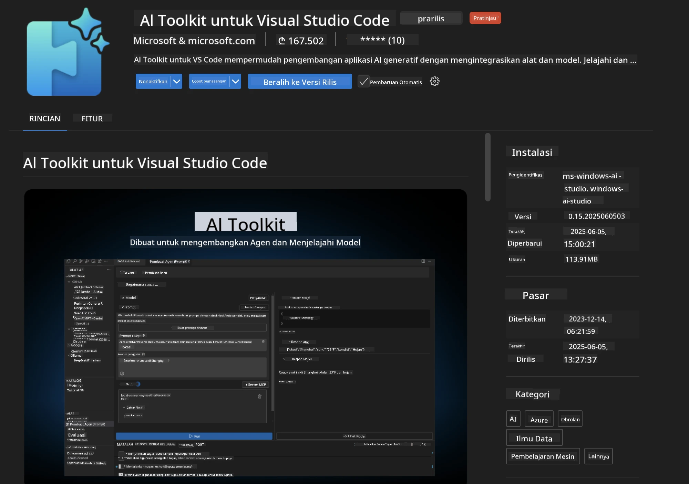
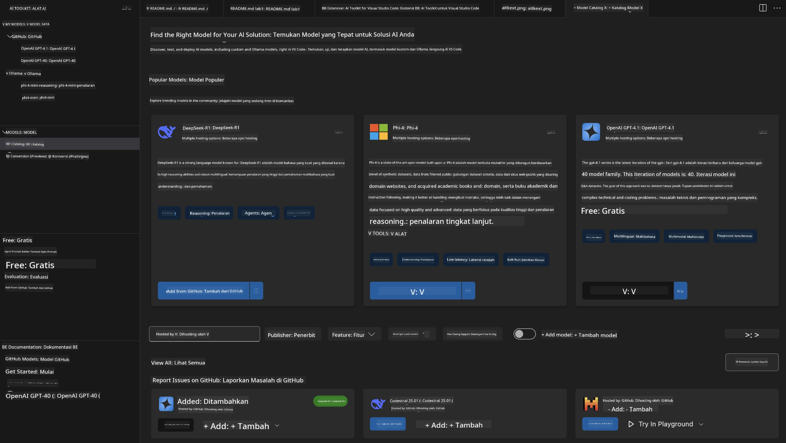
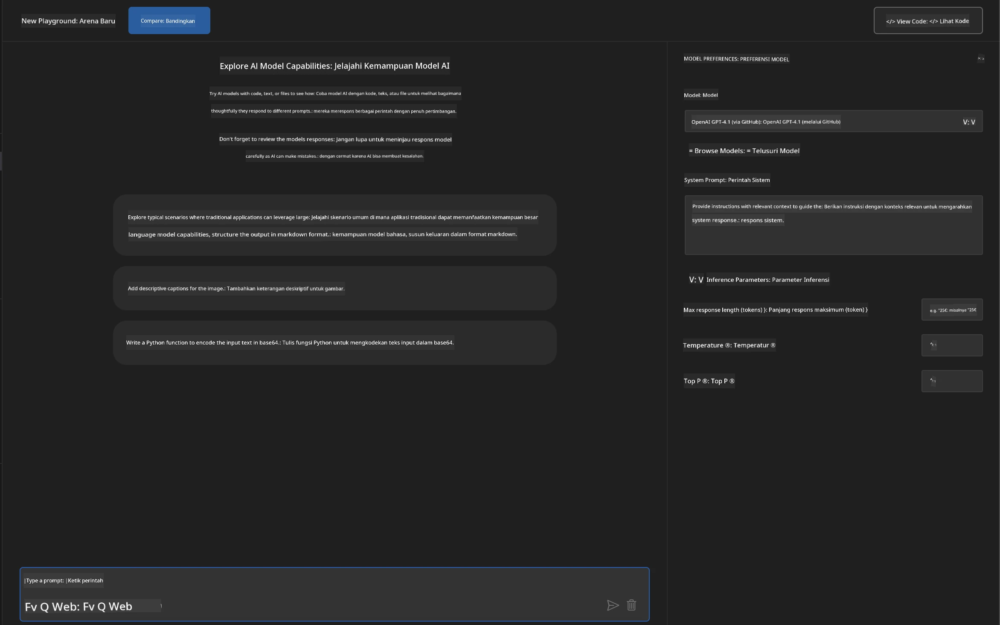
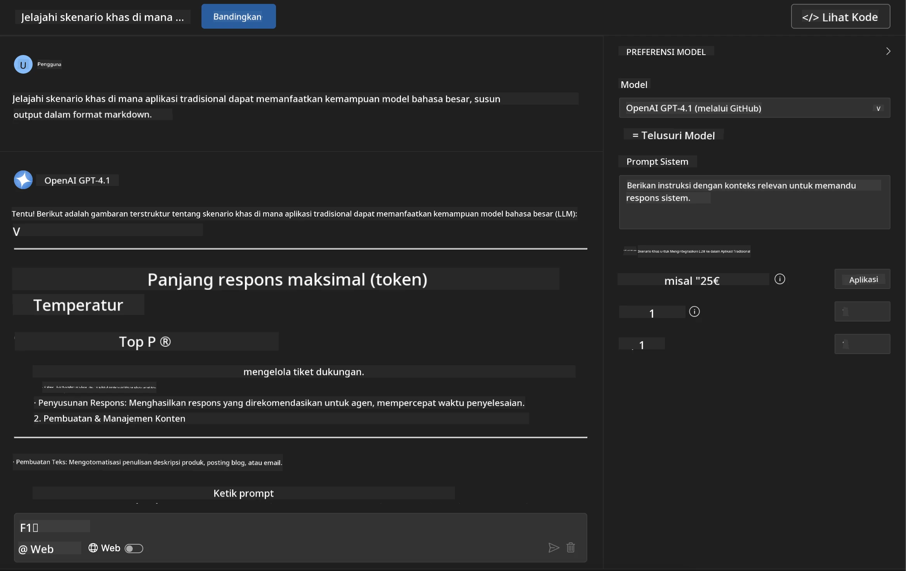
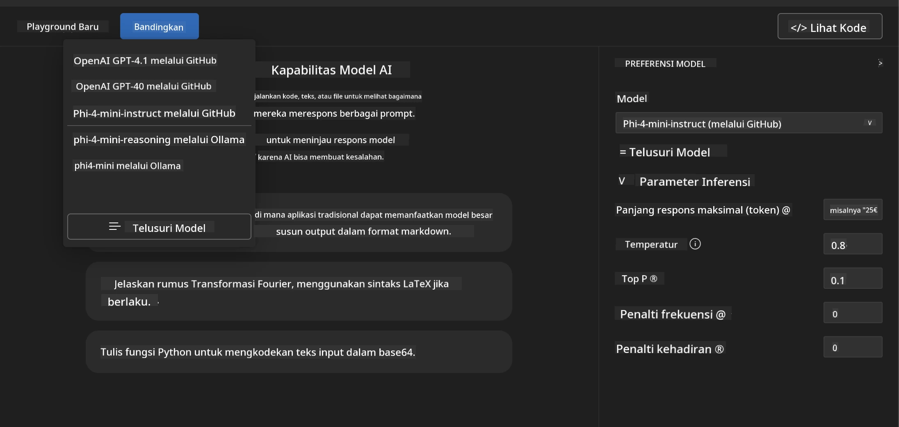
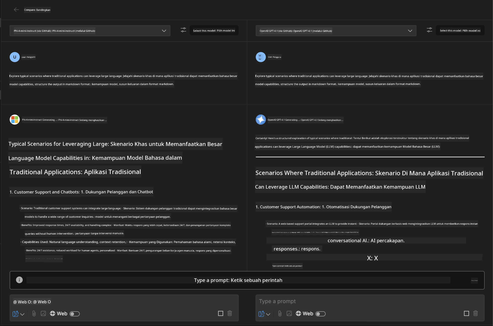
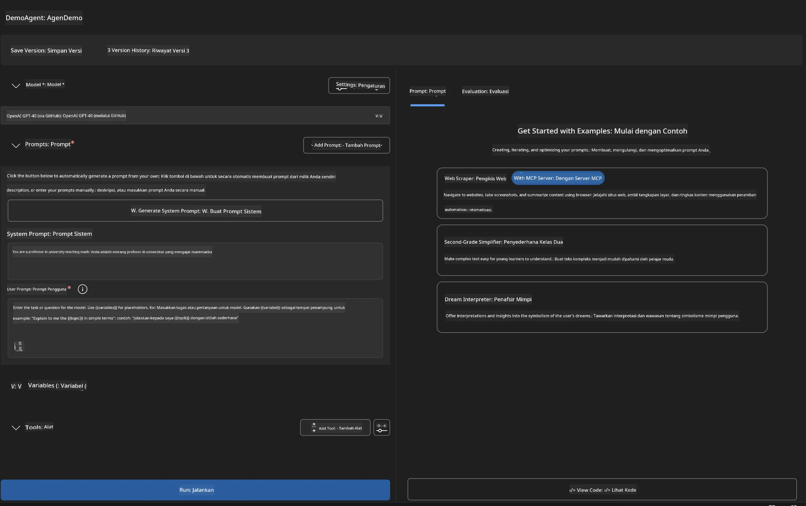
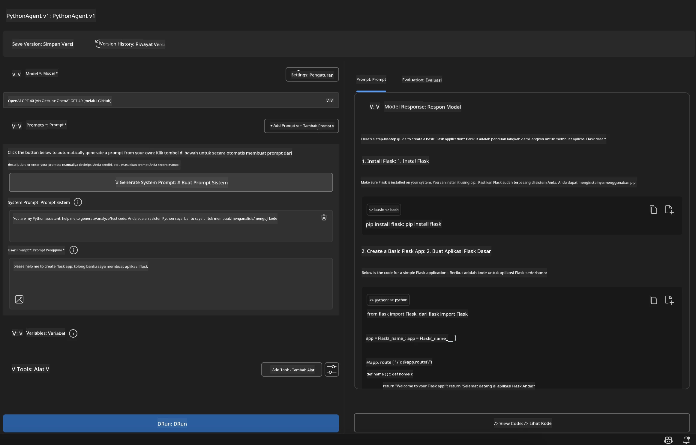

# 🚀 Modul 1: Dasar-dasar Microsoft Foundry Toolkit

[]()
[]()
[]()

## 📋 Tujuan Pembelajaran

Pada akhir modul ini, Anda akan dapat:
- ✅ Menginstal dan mengonfigurasi Ekstensi Microsoft Foundry Toolkit untuk VS Code
- ✅ Menjelajahi Katalog Model dan memahami berbagai sumber model
- ✅ Menggunakan Playground untuk pengujian dan eksperimen model
- ✅ Membuat agen AI khusus menggunakan Agent Builder
- ✅ Membandingkan kinerja model dari berbagai penyedia
- ✅ Menerapkan praktik terbaik untuk rekayasa prompt

## 🧠 Pengenalan Microsoft Foundry Toolkit

**Ekstensi Microsoft Foundry Toolkit untuk VS Code** adalah ekstensi unggulan Microsoft yang mengubah VS Code menjadi lingkungan pengembangan AI yang komprehensif. Ini menjembatani kesenjangan antara riset AI dan aplikasi praktis, membuat generative AI dapat diakses oleh pengembang dengan berbagai tingkat keahlian.

### 🌟 Kemampuan Utama

| Fitur | Deskripsi | Kasus Penggunaan |
|---------|-------------|----------|
| **🗂️ Katalog Model** | Akses lebih dari 100 model dari GitHub, ONNX, OpenAI, Anthropic, Google | Penemuan dan pemilihan model |
| **🔌 Dukungan BYOM** | Integrasikan model Anda sendiri (lokal/jarak jauh) | Penyebaran model khusus |
| **🎮 Playground Interaktif** | Pengujian model waktu nyata dengan antarmuka chat | Prototipe dan pengujian cepat |
| **📎 Dukungan Multi-Modal** | Menangani teks, gambar, dan lampiran | Aplikasi AI kompleks |
| **⚡ Pemrosesan Batch** | Jalankan beberapa prompt secara bersamaan | Alur kerja pengujian yang efisien |
| **📊 Evaluasi Model** | Metrik bawaan (F1, relevansi, kesamaan, koherensi) | Penilaian kinerja |

### 🎯 Mengapa Microsoft Foundry Toolkit Penting

- **🚀 Percepatan Pengembangan**: Dari ide ke prototipe dalam hitungan menit
- **🔄 Alur Kerja Terpadu**: Satu antarmuka untuk berbagai penyedia AI
- **🧪 Eksperimen Mudah**: Bandingkan model tanpa pengaturan rumit
- **📈 Siap Produksi**: Transisi mulus dari prototipe ke penyebaran

## 🛠️ Prasyarat & Pengaturan

### 📦 Instal Ekstensi Microsoft Foundry Toolkit

**Langkah 1: Akses Marketplace Ekstensi**
1. Buka Visual Studio Code
2. Pergi ke tampilan Ekstensi (`Ctrl+Shift+X` atau `Cmd+Shift+X`)
3. Cari "Microsoft Foundry Toolkit"

**Langkah 2: Pilih Versi Anda**
- **🟢 Rilis**: Direkomendasikan untuk penggunaan produksi
- **🔶 Pra-rilis**: Akses awal ke fitur-fitur terbaru

**Langkah 3: Instal dan Aktifkan**



### ✅ Daftar Periksa Verifikasi
- [ ] Ikon Microsoft Foundry Toolkit muncul di sidebar VS Code
- [ ] Ekstensi diaktifkan dan aktif
- [ ] Tidak ada kesalahan instalasi di panel output

## 🧪 Latihan Praktis 1: Menjelajahi Model Microsoft Foundry

**🎯 Tujuan**: Menguasai Katalog Model dan menguji model AI pertama Anda

### 📊 Langkah 1: Menavigasi Katalog Model

Katalog Model adalah gerbang Anda ke ekosistem AI. Ia mengumpulkan model dari berbagai penyedia, memudahkan penemuan dan perbandingan opsi.

**🔍 Panduan Navigasi:**

Klik **MODELS - Catalog** di sidebar Microsoft Foundry Toolkit



**💡 Tips Profesional**: Cari model dengan kemampuan khusus yang sesuai dengan kasus penggunaan Anda (misal, generasi kode, penulisan kreatif, analisis).

> [!NOTE]
> Model GitHub sudah dihentikan pada 30 Juli 2026. Gunakan penyebaran model Microsoft Foundry
> dan autentikasi dengan Microsoft Entra ID atau kunci API Azure.

### 🚀 Langkah 2: Tambah dan Konfigurasi Model Pertama Anda

**Strategi Pemilihan Model:**
- **GPT-5.1**: Model tujuan umum yang direkomendasikan untuk penggunaan alat dan penalaran
- **Phi-4-mini**: Respon ringan dan cepat untuk tugas sederhana

**🔧 Proses Konfigurasi:**
1. Pilih **OpenAI GPT-5.1** dari katalog
2. Klik **Add to My Models** - ini mendaftarkan model untuk penggunaan
3. Pilih **Try in Playground** untuk memulai lingkungan pengujian
4. Tunggu inisialisasi model (pengaturan awal mungkin memakan waktu sedikit)



**⚙️ Memahami Parameter Model:**
- **Temperature**: Mengontrol kreativitas (0 = deterministik, 1 = kreatif)
- **Max Tokens**: Panjang respon maksimal
- **Top-p**: Sampel nucleus untuk keragaman respon

### 🎯 Langkah 3: Kuasai Antarmuka Playground

Playground adalah lab eksperimen AI Anda. Berikut cara memaksimalkan potensinya:

**🎨 Praktik Terbaik Rekayasa Prompt:**
1. **Jelas dan Spesifik**: Instruksi yang jelas dan rinci menghasilkan hasil lebih baik
2. **Berikan Konteks**: Sertakan informasi latar belakang yang relevan
3. **Gunakan Contoh**: Tunjukkan kepada model apa yang Anda inginkan dengan contoh
4. **Iterasi**: Perbaiki prompt berdasarkan hasil awal

**🧪 Skenario Pengujian:**
```markdown
# Example 1: Code Generation
"Write a Python function that calculates the factorial of a number using recursion. Include error handling and docstrings."

# Example 2: Creative Writing
"Write a professional email to a client explaining a project delay, maintaining a positive tone while being transparent about challenges."

# Example 3: Data Analysis
"Analyze this sales data and provide insights: [paste your data]. Focus on trends, anomalies, and actionable recommendations."
```



### 🏆 Tantangan Latihan: Perbandingan Kinerja Model

**🎯 Tujuan**: Bandingkan berbagai model menggunakan prompt yang sama untuk memahami keunggulan mereka

**📋 Instruksi:**
1. Tambah **Phi-4-mini** ke workspace Anda
2. Gunakan prompt yang sama untuk GPT-5.1 dan Phi-4-mini



3. Bandingkan kualitas respon, kecepatan, dan akurasi
4. Dokumentasikan temuan Anda di bagian hasil



**💡 Wawasan Utama yang Perlu Ditemukan:**
- Kapan menggunakan LLM vs SLM
- Perbandingan biaya vs kinerja
- Kemampuan khusus dari berbagai model

## 🤖 Latihan Praktis 2: Membuat Agen Kustom dengan Agent Builder

**🎯 Tujuan**: Membuat agen AI khusus yang disesuaikan untuk tugas dan alur kerja tertentu

### 🏗️ Langkah 1: Memahami Agent Builder

Agent Builder adalah tempat Microsoft Foundry Toolkit benar-benar bersinar. Ini memungkinkan Anda membuat asisten AI yang dibangun untuk tujuan khusus yang menggabungkan kekuatan model bahasa besar dengan instruksi khusus, parameter spesifik, dan pengetahuan terspesialisasi.

**🧠 Komponen Arsitektur Agen:**
- **Model Inti**: LLM dasar (GPT-5.1, Phi, dll.)
- **Prompt Sistem**: Menentukan kepribadian dan perilaku agen
- **Parameter**: Pengaturan terperinci untuk kinerja optimal
- **Integrasi Alat**: Terhubung ke API eksternal dan layanan MCP
- **Memori**: Konteks percakapan dan persistensi sesi



### ⚙️ Langkah 2: Penggalian Konfigurasi Agen

**🎨 Membuat Prompt Sistem Efektif:**
```markdown
# Template Structure:
## Role Definition
You are a [specific role] with expertise in [domain].

## Capabilities
- List specific abilities
- Define scope of knowledge
- Clarify limitations

## Behavior Guidelines
- Response style (formal, casual, technical)
- Output format preferences
- Error handling approach

## Examples
Provide 2-3 examples of ideal interactions
```

*Tentu saja, Anda juga bisa menggunakan Generate System Prompt untuk memanfaatkan AI membantu menghasilkan dan mengoptimalkan prompt*

**🔧 Optimasi Parameter:**
| Parameter | Rentang yang Direkomendasikan | Kasus Penggunaan |
|-----------|------------------|----------|
| **Temperature** | 0.1-0.3 | Respon teknis/faktual |
| **Temperature** | 0.7-0.9 | Tugas kreatif/brainstorming |
| **Max Tokens** | 500-1000 | Respon singkat |
| **Max Tokens** | 2000-4000 | Penjelasan rinci |

### 🐍 Langkah 3: Latihan Praktis - Agen Pemrograman Python

**🎯 Misi**: Membuat asisten pengkodean Python khusus

**📋 Langkah-langkah Konfigurasi:**

1. **Pemilihan Model**: Pilih **Claude 3.5 Sonnet** (bagus untuk kode)

2. **Desain Prompt Sistem**:
```markdown
# Python Programming Expert Agent

## Role
You are a senior Python developer with 10+ years of experience. You excel at writing clean, efficient, and well-documented Python code.

## Capabilities
- Write production-ready Python code
- Debug complex issues
- Explain code concepts clearly
- Suggest best practices and optimizations
- Provide complete working examples

## Response Format
- Always include docstrings
- Add inline comments for complex logic
- Suggest testing approaches
- Mention relevant libraries when applicable

## Code Quality Standards
- Follow PEP 8 style guidelines
- Use type hints where appropriate
- Handle exceptions gracefully
- Write readable, maintainable code
```

3. **Konfigurasi Parameter**:
   - Temperature: 0.2 (untuk kode yang konsisten dan dapat diandalkan)
   - Max Tokens: 2000 (penjelasan rinci)
   - Top-p: 0.9 (kreativitas seimbang)



### 🧪 Langkah 4: Menguji Agen Python Anda

**Skenario Pengujian:**
1. **Fungsi Dasar**: "Buat fungsi untuk menemukan bilangan prima"
2. **Algoritma Kompleks**: "Implementasikan pohon pencarian biner dengan metode insert, delete, dan search"
3. **Masalah Dunia Nyata**: "Buat web scraper yang menangani pembatasan laju dan retries"
4. **Debugging**: "Perbaiki kode ini [tempelkan kode bermasalah]"

**🏆 Kriteria Keberhasilan:**
- ✅ Kode berjalan tanpa kesalahan
- ✅ Termasuk dokumentasi yang tepat
- ✅ Mengikuti praktik terbaik Python
- ✅ Menyediakan penjelasan yang jelas
- ✅ Menyarankan perbaikan

## 🎓 Penutupan Modul 1 & Langkah Selanjutnya

### 📊 Cek Pengetahuan

Uji pemahaman Anda:
- [ ] Apakah Anda dapat menjelaskan perbedaan antara model di katalog?
- [ ] Apakah Anda sudah berhasil membuat dan menguji agen kustom?
- [ ] Apakah Anda mengerti cara mengoptimalkan parameter untuk berbagai kasus penggunaan?
- [ ] Apakah Anda dapat merancang prompt sistem yang efektif?

### 📚 Sumber Daya Tambahan

- **Dokumentasi Microsoft Foundry Toolkit**: [Dokumen Resmi Microsoft](https://github.com/microsoft/vscode-ai-toolkit)
- **Panduan Rekayasa Prompt**: [Praktik Terbaik](https://platform.openai.com/docs/guides/prompt-engineering)
- **Model di Microsoft Foundry Toolkit**: [Model dalam Pengembangan](https://github.com/microsoft/vscode-ai-toolkit/blob/main/doc/models.md)

**🎉 Selamat!** Anda telah menguasai dasar-dasar Microsoft Foundry Toolkit dan siap membangun aplikasi AI yang lebih canggih!

### 🔜 Lanjut ke Modul Berikutnya

Siap dengan kemampuan yang lebih maju? Lanjutkan ke **[Modul 2: MCP dengan Dasar-dasar Microsoft Foundry Toolkit](../lab2/README.md)** di mana Anda akan belajar bagaimana:
- Menghubungkan agen Anda ke alat eksternal menggunakan Model Context Protocol (MCP)
- Membangun agen otomatisasi browser dengan Playwright
- Mengintegrasikan server MCP dengan agen Microsoft Foundry Toolkit Anda
- Meningkatkan kemampuan agen Anda dengan data dan kapabilitas eksternal

---

<!-- CO-OP TRANSLATOR DISCLAIMER START -->
**Penafian**:
Dokumen ini telah diterjemahkan menggunakan layanan terjemahan AI [Co-op Translator](https://github.com/Azure/co-op-translator). Meskipun kami berupaya untuk mencapai akurasi, harap diketahui bahwa terjemahan otomatis mungkin mengandung kesalahan atau ketidakakuratan. Dokumen asli dalam bahasa aslinya harus dianggap sebagai sumber yang sah. Untuk informasi penting, disarankan menggunakan terjemahan profesional oleh manusia. Kami tidak bertanggung jawab atas kesalahpahaman atau penafsiran yang keliru yang timbul dari penggunaan terjemahan ini.
<!-- CO-OP TRANSLATOR DISCLAIMER END -->