# 🌐 Modul 2: MCP dengan Dasar-Dasar Microsoft Foundry Toolkit


## 📋 Tujuan Pembelajaran

Pada akhir modul ini, Anda akan dapat:

- ✅ Memahami arsitektur dan manfaat Model Context Protocol (MCP)
- ✅ Mengeksplorasi ekosistem server MCP Microsoft
- ✅ Mengintegrasikan server MCP dengan Microsoft Foundry Toolkit Agent Builder
- ✅ Membangun agen otomatisasi browser fungsional menggunakan Playwright MCP
- ✅ Mengonfigurasi dan menguji alat MCP dalam agen Anda
- ✅ Mengekspor dan menerapkan agen bertenaga MCP untuk penggunaan produksi

## 🎯 Melanjutkan dari Modul 1

Dalam Modul 1, kita menguasai dasar Microsoft Foundry Toolkit dan membuat
Agen Python pertama kita. Sekarang kita akan **memperkuat** agen Anda dengan menghubungkannya
ke alat dan layanan eksternal melalui protokol revolusioner
**Model Context Protocol (MCP)**.

Anggap ini sebagai peningkatan dari kalkulator dasar menjadi komputer penuh. Agen AI Anda
akan mendapatkan kemampuan untuk:

- 🌐 Menjelajah dan berinteraksi dengan situs web
- 📁 Mengakses dan memanipulasi file
- 🔧 Mengintegrasikan dengan sistem perusahaan
- 📊 Memproses data waktu nyata dari API

## 🧠 Memahami Model Context Protocol (MCP)

### 🔍 Apa itu MCP?

Model Context Protocol (MCP) adalah **"USB-C untuk aplikasi AI"**: sebuah
standar terbuka yang menghubungkan Large Language Models (LLM) ke alat eksternal,
sumber data, dan layanan. Sama seperti USB-C menyediakan satu konektor universal, MCP
mengurangi kompleksitas integrasi AI melalui satu protokol standar.

### 🎯 Masalah yang Diselesaikan MCP

**Sebelum MCP:**

- 🔧 Integrasi khusus untuk setiap alat
- 🔄 Terikat vendor dengan solusi proprietari  
- 🔒 Kerentanan keamanan dari koneksi ad-hoc
- ⏱️ Berbulan-bulan pengembangan untuk integrasi dasar

**Dengan MCP:**

- ⚡ Integrasi alat plug-and-play
- 🔄 Arsitektur yang bebas vendor
- 🛡️ Praktik keamanan terbaik bawaan
- 🚀 Menambah kemampuan baru dalam hitungan menit

### 🏗️ Penyajian Mendalam Arsitektur MCP

MCP mengikuti **arsitektur klien-server** yang menciptakan ekosistem yang aman dan skalabel:

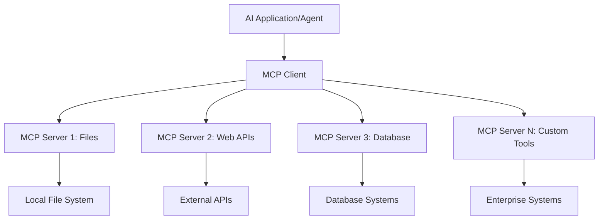

**🔧 Komponen Utama:**

| Komponen | Peran | Contoh |
| --------- | ---- | -------- |
| **MCP Hosts** | Mengonsumsi layanan MCP | VS Code, Foundry Toolkit |
| **MCP Clients** | Menangani koneksi protokol | Terintegrasi dalam host |
| **MCP Servers** | Menyediakan kapabilitas | Playwright, Files, Azure, GitHub |
| **Lapisan Transportasi** | Menghubungkan klien dan server | stdio, HTTP, WebSockets |

## 🏢 Ekosistem Server MCP Microsoft

Microsoft memimpin ekosistem MCP dengan kumpulan server kelas enterprise yang
komprehensif yang menjawab kebutuhan bisnis dunia nyata.

### 🌟 Server MCP Microsoft Unggulan

#### 1. ☁️ Azure MCP Server

**🔗 Repositori**: [azure/azure-mcp](https://github.com/azure/azure-mcp)
**🎯 Tujuan**: Manajemen sumber daya Azure komprehensif dengan integrasi AI

**✨ Fitur Utama:**

- Penyediaan infrastruktur deklaratif
- Pemantauan sumber daya waktu nyata
- Rekomendasi optimasi biaya
- Pemeriksaan kepatuhan keamanan

**🚀 Kasus Penggunaan:**

- Infrastruktur-sebagai-Kode dengan bantuan AI
- Skala sumber daya otomatis
- Optimasi biaya cloud
- Otomasi alur kerja DevOps

#### 2. 📊 Microsoft Dataverse MCP

**📚 Dokumentasi**: [Integrasi Microsoft Dataverse](https://go.microsoft.com/fwlink/?linkid=2320176)
**🎯 Tujuan**: Antarmuka bahasa alami untuk data bisnis

**✨ Fitur Utama:**

- Query database dengan bahasa alami
- Pemahaman konteks bisnis
- Template prompt kustom
- Tata kelola data enterprise

**🚀 Kasus Penggunaan:**

- Pelaporan intelijen bisnis
- Analisis data pelanggan
- Wawasan pipeline penjualan
- Query data kepatuhan

#### 3. 🌐 Playwright MCP Server

**🔗 Repositori**: [microsoft/playwright-mcp](https://github.com/microsoft/playwright-mcp)
**🎯 Tujuan**: Otomatisasi browser dan kapabilitas interaksi web

**✨ Fitur Utama:**

- Otomatisasi lintas browser (Chrome, Firefox, Safari)
- Deteksi elemen cerdas
- Pengambilan screenshot dan pembuatan PDF
- Pemantauan trafik jaringan

**🚀 Kasus Penggunaan:**

- Alur kerja pengujian otomatis
- Pengambilan data dan scraping web
- Pemantauan UI/UX
- Otomatisasi analisis kompetitif

#### 4. 📁 Files MCP Server

**🔗 Repositori**: [microsoft/files-mcp-server](https://github.com/microsoft/files-mcp-server)
**🎯 Tujuan**: Operasi sistem file cerdas

**✨ Fitur Utama:**

- Manajemen file deklaratif
- Sinkronisasi konten
- Integrasi kontrol versi
- Ekstraksi metadata

**🚀 Kasus Penggunaan:**

- Manajemen dokumentasi
- Organisasi repositori kode
- Alur kerja publikasi konten
- Penanganan file pipeline data

#### 5. 📝 MarkItDown MCP Server

**🔗 Repositori**: [microsoft/markitdown](https://github.com/microsoft/markitdown)
**🎯 Tujuan**: Pemrosesan dan manipulasi Markdown tingkat lanjut

**✨ Fitur Utama:**

- Penguraian Markdown kaya
- Konversi format (MD ↔ HTML ↔ PDF)
- Analisis struktur konten
- Pemrosesan template

**🚀 Kasus Penggunaan:**

- Alur kerja dokumentasi teknis
- Sistem manajemen konten
- Pembuatan laporan
- Otomasi basis pengetahuan

#### 6. 📈 Clarity MCP Server

**📦 Paket**: [@microsoft/clarity-mcp-server](https://www.npmjs.com/package/@microsoft/clarity-mcp-server)
**🎯 Tujuan**: Analitik web dan wawasan perilaku pengguna

**✨ Fitur Utama:**

- Analisis data heatmap
- Rekaman sesi pengguna
- Metrik performa
- Analisis corong konversi

**🚀 Kasus Penggunaan:**

- Optimasi situs web
- Riset pengalaman pengguna
- Analisis A/B testing
- Dashboard intelijen bisnis

### 🌍 Ekosistem Komunitas

Selain server Microsoft, ekosistem MCP mencakup:

- **🐙 GitHub MCP**: Manajemen repositori dan analisis kode
- **🗄️ Database MCPs**: Integrasi PostgreSQL, MySQL, MongoDB
- **☁️ Cloud Provider MCPs**: Alat AWS, GCP, Digital Ocean
- **📧 Komunikasi MCPs**: Integrasi Slack, Teams, Email

## 🛠️ Lab Praktik: Membangun Agen Otomatisasi Browser

**🎯 Tujuan Proyek**: Membuat agen otomatisasi browser cerdas menggunakan
server Playwright MCP yang dapat menavigasi situs web, mengekstrak informasi, dan
melakukan interaksi web yang kompleks.

### 🚀 Fase 1: Persiapan Dasar Agen

#### Langkah 1: Inisialisasi Agen Anda

1. **Buka Microsoft Foundry Toolkit Agent Builder**
2. **Buat Agen Baru** dengan konfigurasi berikut:
   - **Nama**: `BrowserAgent`
   - **Model**: Pilih GPT-5.1. Lihat
      [jadwal penghentian model Microsoft Foundry](https://learn.microsoft.com/azure/foundry/openai/concepts/model-retirement-schedule)
      untuk informasi siklus hidup model terkini.

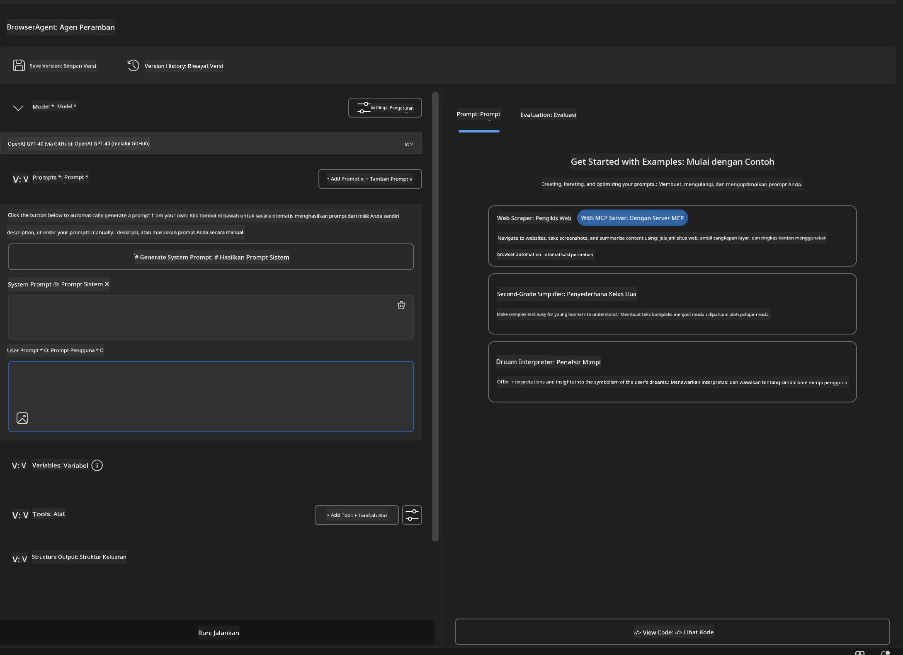

### 🔧 Fase 2: Alur Integrasi MCP

#### Langkah 3: Tambahkan Integrasi Server MCP

1. **Masuk ke Bagian Tools** di Agent Builder
2. **Klik "Add Tool"** untuk membuka menu integrasi
3. **Pilih "MCP Server"** dari opsi yang tersedia

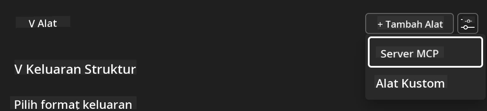

**🔍 Memahami Jenis Alat:**

- **Built-in Tools**: Fungsi pre-konfigurasi Microsoft Foundry Toolkit
- **MCP Servers**: Integrasi layanan eksternal
- **Custom APIs**: Endpoint layanan Anda sendiri
- **Function Calling**: Akses fungsi model langsung

#### Langkah 4: Pemilihan Server MCP

1. **Pilih opsi "MCP Server"** untuk melanjutkan
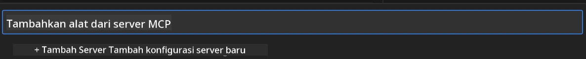

2. **Jelajahi Katalog MCP** untuk mengeksplorasi integrasi yang tersedia
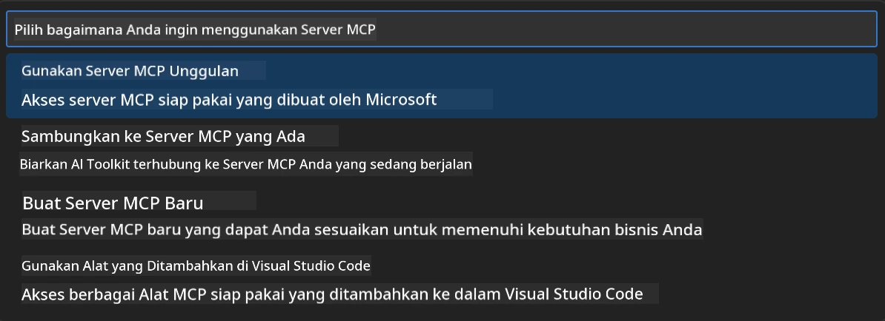

### 🎮 Fase 3: Konfigurasi Playwright MCP

#### Langkah 5: Pilih dan Konfigurasi Playwright

1. **Klik "Use Featured MCP Servers"** untuk mengakses server Microsoft yang diverifikasi
2. **Pilih "Playwright"** dari daftar unggulan
3. **Setujui MCP ID Default** atau sesuaikan untuk lingkungan Anda

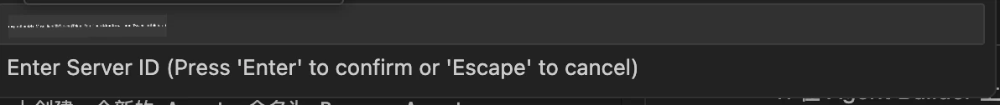

#### Langkah 6: Aktifkan Kapabilitas Playwright

**🔑 Langkah Penting**: Pilih **SEMUA** metode Playwright yang tersedia untuk fungsi maksimal

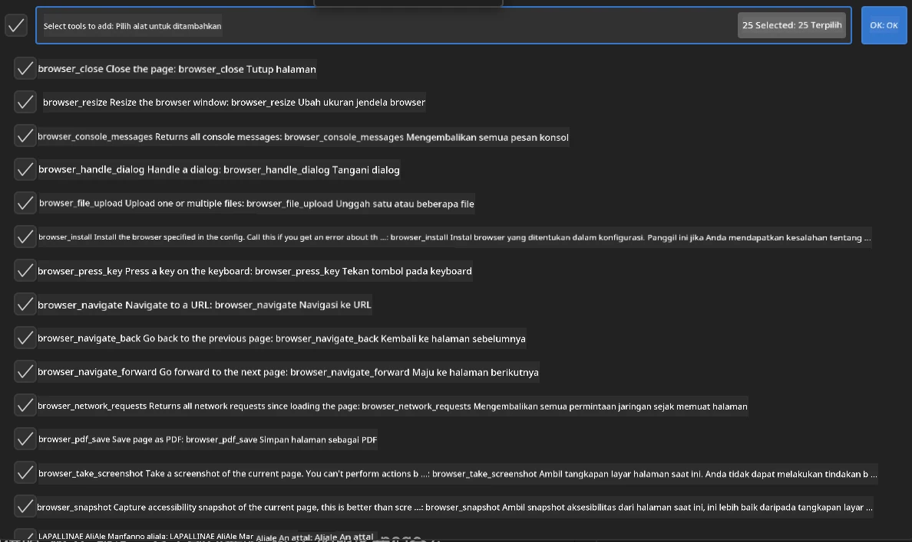

**🛠️ Alat Playwright Esensial:**

- **Navigasi**: `goto`, `goBack`, `goForward`, `reload`
- **Interaksi**: `click`, `fill`, `press`, `hover`, `drag`
- **Ekstraksi**: `textContent`, `innerHTML`, `getAttribute`
- **Validasi**: `isVisible`, `isEnabled`, `waitForSelector`
- **Pengambilan**: `screenshot`, `pdf`, `video`
- **Jaringan**: `setExtraHTTPHeaders`, `route`, `waitForResponse`

#### Langkah 7: Verifikasi Keberhasilan Integrasi

**✅ Indikator Keberhasilan:**

- Semua alat muncul di antarmuka Agent Builder
- Tidak ada pesan kesalahan di panel integrasi
- Status server Playwright menunjukkan "Connected"

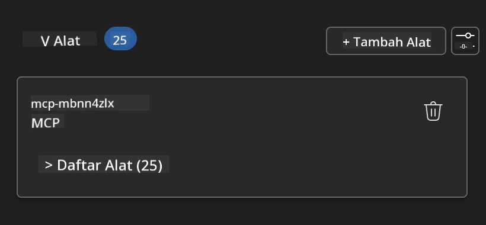

**🔧 Pemecahan Masalah Umum:**

- **Koneksi Gagal**: Periksa konektivitas internet dan pengaturan firewall
- **Alat Hilang**: Pastikan semua kapabilitas dipilih saat setup
- **Kesalahan Izin**: Verifikasi VS Code memiliki izin sistem yang diperlukan

### 🎯 Fase 4: Pengembangan Prompt Lanjutan

#### Langkah 8: Rancang Prompt Sistem Cerdas

Buat prompt canggih yang memanfaatkan kapabilitas penuh Playwright:

```markdown
# Web Automation Expert System Prompt

## Core Identity
You are an advanced web automation specialist with deep expertise in browser
automation, web scraping, and user experience analysis. You have access to
Playwright tools for comprehensive browser control.

## Capabilities & Approach
### Navigation Strategy
- Always start with screenshots to understand page layout
- Use semantic selectors (text content, labels) when possible
- Implement wait strategies for dynamic content
- Handle single-page applications (SPAs) effectively

### Error Handling
- Retry failed operations with exponential backoff
- Provide clear error descriptions and solutions
- Suggest alternative approaches when primary methods fail
- Always capture diagnostic screenshots on errors

### Data Extraction
- Extract structured data in JSON format when possible
- Provide confidence scores for extracted information
- Validate data completeness and accuracy
- Handle pagination and infinite scroll scenarios

### Reporting
- Include step-by-step execution logs
- Provide before/after screenshots for verification
- Suggest optimizations and alternative approaches
- Document any limitations or edge cases encountered

## Ethical Guidelines
- Respect robots.txt and rate limiting
- Avoid overloading target servers
- Only extract publicly available information
- Follow website terms of service
```

#### Langkah 9: Buat Prompt Pengguna Dinamis

Rancang prompt yang menunjukkan berbagai kapabilitas:

**🌐 Contoh Analisis Web:**

```markdown
Navigate to github.com/kinfey and provide a comprehensive analysis including:
1. Repository structure and organization
2. Recent activity and contribution patterns  
3. Documentation quality assessment
4. Technology stack identification
5. Community engagement metrics
6. Notable projects and their purposes

Include screenshots at key steps and provide actionable insights.
```

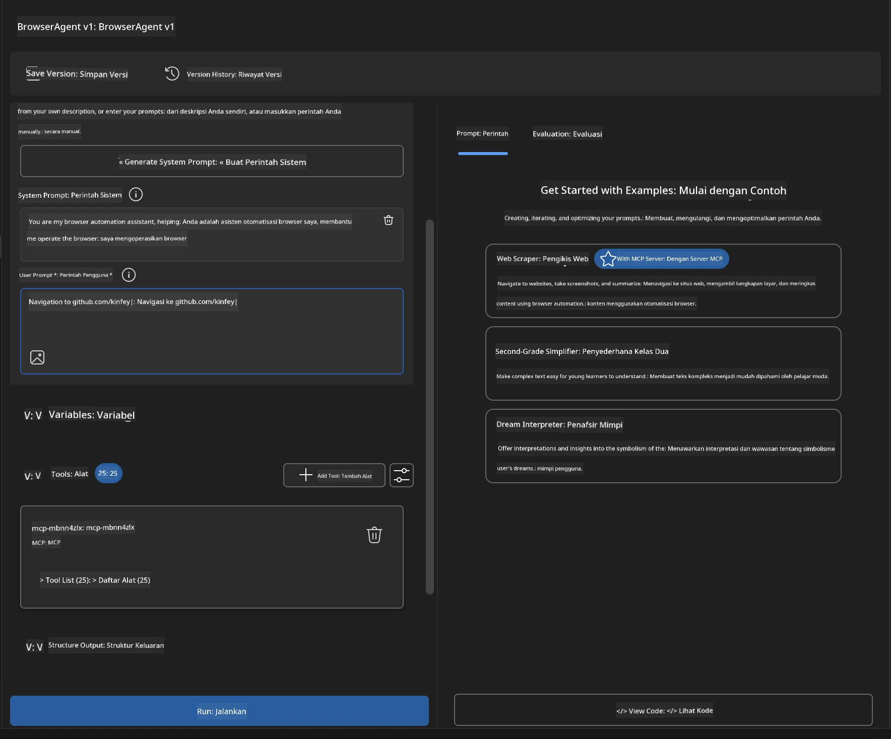

### 🚀 Fase 5: Eksekusi dan Pengujian

#### Langkah 10: Jalankan Otomatisasi Pertama Anda

1. **Klik "Run"** untuk memulai urutan otomatisasi
2. **Pantau Eksekusi Waktu Nyata**:
   - Browser Chrome meluncur otomatis
   - Agen menavigasi ke situs web target
   - Screenshot menangkap setiap langkah utama
   - Hasil analisis mengalir secara waktu nyata

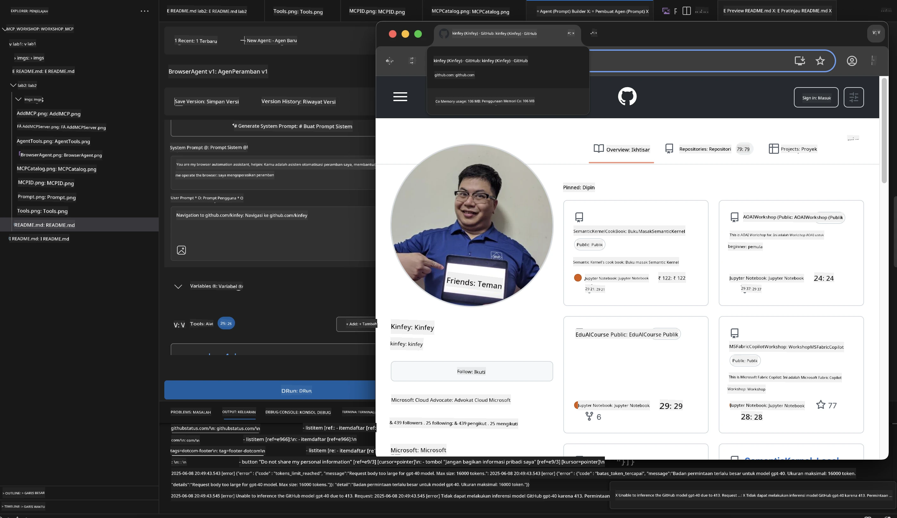

#### Langkah 11: Analisis Hasil dan Wawasan

Tinjau analisis menyeluruh di antarmuka Agent Builder:

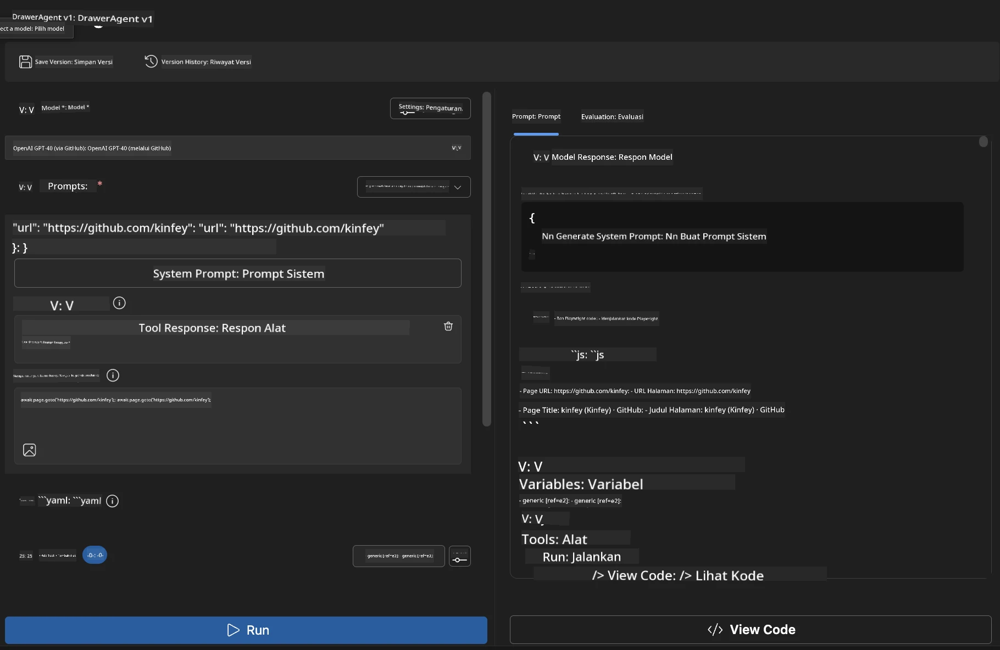

### 🌟 Fase 6: Kapabilitas Lanjutan dan Penerapan

#### Langkah 12: Ekspor dan Penerapan Produksi

Agent Builder mendukung berbagai opsi penerapan:

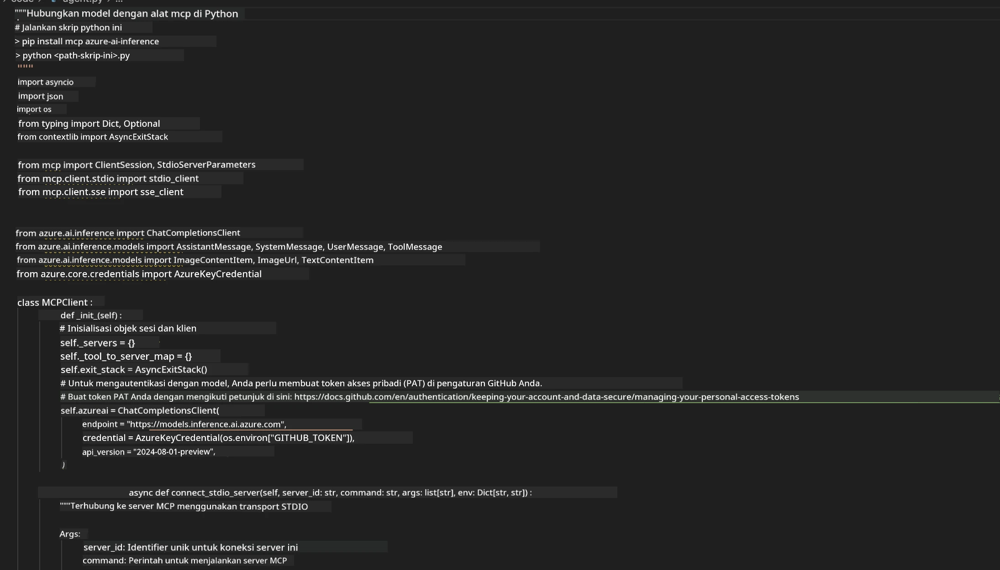

## 🎓 Ringkasan Modul 2 & Langkah Selanjutnya

### 🏆 Prestasi Tercapai: Master Integrasi MCP

**✅ Keahlian yang Dikuasai:**

- [ ] Memahami arsitektur dan manfaat MCP
- [ ] Menavigasi ekosistem server MCP Microsoft
- [ ] Mengintegrasikan Playwright MCP dengan Microsoft Foundry Toolkit
- [ ] Membangun agen otomatisasi browser yang canggih
- [ ] Pengembangan prompt lanjutan untuk otomatisasi web

### 📚 Sumber Daya Tambahan

- **🔗 Spesifikasi MCP**: [Dokumentasi Protokol Resmi](https://modelcontextprotocol.io/)
- **🛠️ API Playwright**: [Referensi Metode Lengkap](https://playwright.dev/docs/api/class-playwright)
- **🏢 Server MCP Microsoft**:
   [Panduan Integrasi Enterprise](https://github.com/microsoft/mcp-servers)
- **🌍 Contoh Komunitas**: [Galeri Server MCP](https://github.com/modelcontextprotocol/servers)

**🎉 Selamat!** Anda telah berhasil menguasai integrasi MCP dan kini dapat
membangun agen AI siap produksi dengan kapabilitas alat eksternal!

### 🔜 Lanjut ke Modul Berikutnya

Siap meningkatkan keterampilan MCP Anda lebih jauh? Lanjutkan ke
**[Modul 3: Pengembangan MCP Lanjutan dengan Microsoft Foundry Toolkit](../lab3/README.md)**
di mana Anda akan belajar bagaimana:

- Membuat server MCP kustom Anda sendiri
- Mengonfigurasi dan menggunakan SDK Python MCP terbaru
- Mengatur MCP Inspector untuk debugging
- Menguasai alur kerja pengembangan server MCP lanjutan
- Membangun Weather MCP Server dari awal

---

<!-- CO-OP TRANSLATOR DISCLAIMER START -->
**Penafian**:
Dokumen ini telah diterjemahkan menggunakan layanan terjemahan AI [Co-op Translator](https://github.com/Azure/co-op-translator). Meskipun kami berupaya untuk mencapai akurasi, harap diketahui bahwa terjemahan otomatis mungkin mengandung kesalahan atau ketidakakuratan. Dokumen asli dalam bahasa aslinya harus dianggap sebagai sumber yang sah. Untuk informasi penting, disarankan menggunakan terjemahan profesional oleh manusia. Kami tidak bertanggung jawab atas kesalahpahaman atau penafsiran yang keliru yang timbul dari penggunaan terjemahan ini.
<!-- CO-OP TRANSLATOR DISCLAIMER END -->