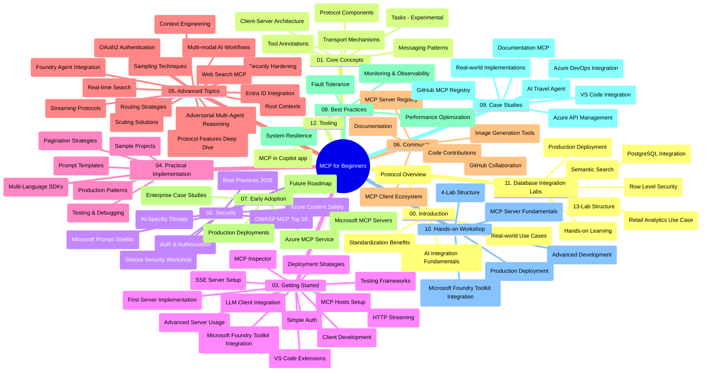

# Protokol Konteks Model (MCP) untuk Pemula - Panduan Studi

Panduan studi ini memberikan gambaran tentang struktur dan isi repositori untuk kurikulum "Protokol Konteks Model (MCP) untuk Pemula". Gunakan panduan ini untuk menavigasi repositori secara efisien dan memanfaatkan sumber daya yang tersedia dengan optimal.

## Gambaran Umum Repositori

Protokol Konteks Model (MCP) adalah kerangka kerja standar untuk interaksi antara model AI dan aplikasi klien. Awalnya dibuat oleh Anthropic, MCP kini dikelola oleh komunitas MCP yang lebih luas melalui organisasi GitHub resmi. Repositori ini menyediakan kurikulum komprehensif dengan contoh kode praktik dalam C#, Java, JavaScript, Python, dan TypeScript, yang dirancang untuk pengembang AI, arsitek sistem, dan insinyur perangkat lunak.

## Peta Kurikulum Visual

## Struktur Repositori

Repositori diorganisasikan dalam dua belas bagian utama, masing-masing berfokus pada aspek berbeda dari MCP:

1. **Pendahuluan (00-Introduction/)**
   - Gambaran Umum Protokol Konteks Model
   - Mengapa standarisasi penting dalam pipeline AI
   - Kasus penggunaan praktis dan manfaatnya

2. **Konsep Inti (01-CoreConcepts/)**
   - Arsitektur klien-server
   - Komponen kunci protokol
   - Pola pengiriman pesan dalam MCP
   - Spesifikasi saat ini: [Apa yang Berubah di MCP: Spesifikasi 2026-07-28](./01-CoreConcepts/mcp-2026-07-28.md) — inti protokol tanpa status, kerangka ekstensi, dan penghapusan Roots/Sampling/Logging

3. **Keamanan (02-Security/)**
   - Ancaman keamanan dalam sistem berbasis MCP
   - Praktik terbaik untuk mengamankan implementasi
   - Strategi autentikasi dan otorisasi
   - Praktik langsung [Contoh otorisasi CIMD dan DCR](./02-Security/samples/cimd-dcr-auth/README.md)
   - **Dokumentasi Keamanan Lengkap**:
     - Praktik Terbaik Keamanan MCP
     - Panduan Implementasi Azure Content Safety
     - Kontrol dan Teknik Keamanan MCP
     - Referensi Singkat Praktik Terbaik MCP
   - **Topik Utama Keamanan**:
     - Serangan penyisipan prompt dan peracunan alat
     - Pembajakan sesi dan masalah confused deputy
     - Kerentanan token passthrough
     - Izin berlebihan dan kontrol akses
     - Keamanan rantai pasokan untuk komponen AI
     - Integrasi Microsoft Prompt Shields

4. **Memulai (03-GettingStarted/)**
   - Pengaturan dan konfigurasi lingkungan
   - Membuat server dan klien MCP dasar
   - Integrasi dengan aplikasi yang sudah ada
   - Termasuk bagian untuk:
     - Implementasi server pertama
     - Pengembangan klien
     - Integrasi klien LLM
     - Integrasi VS Code
     - Server Server-Sent Events (SSE)
     - Penggunaan server tingkat lanjut
     - Streaming HTTP
    - Integrasi Microsoft Foundry Toolkit
     - Strategi pengujian
     - Panduan penyebaran

5. **Implementasi Praktis (04-PracticalImplementation/)**
   - Menggunakan SDK di berbagai bahasa pemrograman
   - Teknik debugging, pengujian, dan validasi
   - Membuat template dan workflow prompt yang dapat digunakan ulang
   - Proyek contoh dengan contoh implementasi

6. **Topik Lanjutan (05-AdvancedTopics/)**
   - Teknik rekayasa konteks
   - Integrasi agen Foundry
   - Workflow AI multi-modal
   - Demo autentikasi OAuth2
   - Kapabilitas pencarian real-time
   - Streaming real-time
   - Implementasi konteks akar
   - Strategi routing
   - Teknik sampling
   - Pendekatan skalabilitas
   - Pertimbangan keamanan
   - Integrasi keamanan Entra ID
   - Integrasi pencarian web
   - Penalaran multi-agen adversarial (pola debat)

7. **Kontribusi Komunitas (06-CommunityContributions/)**
   - Cara berkontribusi kode dan dokumentasi
   - Kolaborasi melalui GitHub
   - Peningkatan dan umpan balik yang digerakkan komunitas
   - Menggunakan berbagai klien MCP (Claude Desktop, Cline, VSCode)
   - Bekerja dengan server MCP populer termasuk generasi gambar

8. **Pelajaran dari Adopsi Awal (07-LessonsfromEarlyAdoption/)**
   - Implementasi dan kisah sukses dunia nyata
   - Membangun dan menyebarkan solusi berbasis MCP
   - Tren dan peta jalan masa depan
   - **Panduan Server MCP Microsoft**: Panduan komprehensif untuk 10 server Microsoft MCP yang siap produksi termasuk:
     - Server MCP Microsoft Learn Docs
     - Server MCP Azure (15+ konektor khusus)
     - Server MCP GitHub
     - Server MCP Azure DevOps
     - Server MCP MarkItDown
     - Server MCP SQL Server
     - Server MCP Playwright
     - Server MCP Dev Box
     - Server MCP Microsoft Foundry
     - Server MCP Microsoft 365 Agents Toolkit

9. **Praktik Terbaik (08-BestPractices/)**
   - Penyesuaian kinerja dan optimasi
   - Merancang sistem MCP yang tahan kesalahan
   - Strategi pengujian dan ketahanan

10. **Studi Kasus (09-CaseStudy/)**
    - **Tujuh studi kasus komprehensif** yang menunjukkan fleksibilitas MCP di berbagai skenario:
    - **Agen Perjalanan AI Azure**: Orkestras multi-agen dengan Azure OpenAI dan AI Search
    - **Integrasi Azure DevOps**: Otomatisasi proses workflow dengan pembaruan data YouTube
    - **Pengambilan Dokumen Real-Time**: Klien konsol Python dengan streaming HTTP
    - **Generator Rencana Studi Interaktif**: Aplikasi web Chainlit dengan AI percakapan
    - **Dokumentasi Dalam Editor**: Integrasi VS Code dengan workflow GitHub Copilot
    - **Manajemen API Azure**: Integrasi API perusahaan dengan pembuatan server MCP
    - **Registri MCP GitHub**: Pengembangan ekosistem dan platform integrasi agen
    - Contoh implementasi mencakup integrasi perusahaan, produktivitas pengembang, dan pengembangan ekosistem

11. **Workshop Praktis (10-StreamliningAIWorkflowsBuildingAnMCPServerWithAIToolkit/)**
    - Workshop praktis komprehensif yang menggabungkan MCP dengan Microsoft Foundry Toolkit
    - Membangun aplikasi cerdas yang menghubungkan model AI dengan alat dunia nyata
    - Modul praktis yang mencakup dasar-dasar, pengembangan server khusus, dan strategi penyebaran produksi
    - **Struktur Lab**:
      - Lab 1: Dasar Server MCP
      - Lab 2: Pengembangan Server MCP Tingkat Lanjut
      - Lab 3: Integrasi Microsoft Foundry Toolkit
      - Lab 4: Penyebaran dan Skalabilitas Produksi
    - Pendekatan pembelajaran berbasis lab dengan instruksi langkah demi langkah

12. **Lab Integrasi Database Server MCP (11-MCPServerHandsOnLabs/)**
    - **Jalur pembelajaran 13 lab komprehensif** untuk membangun server MCP siap produksi dengan integrasi PostgreSQL
    - **Implementasi analitik ritel dunia nyata** menggunakan kasus penggunaan Zava Retail
    - **Pola kelas perusahaan** termasuk Keamanan Tingkat Baris (RLS), pencarian semantik, dan akses data multi-penyewa
    - **Struktur Lab Lengkap**:
      - **Lab 00-03: Dasar-dasar** - Pendahuluan, Arsitektur, Keamanan, Pengaturan Lingkungan
      - **Lab 04-06: Membangun Server MCP** - Desain Database, Implementasi Server MCP, Pengembangan Alat
      - **Lab 07-09: Fitur Lanjutan** - Pencarian Semantik, Pengujian & Debugging, Integrasi VS Code
      - **Lab 10-12: Produksi & Praktik Terbaik** - Penyebaran, Pemantauan, Optimasi
    - **Teknologi yang Dibahas**: Kerangka FastMCP, PostgreSQL, Azure OpenAI, Azure Container Apps, Application Insights
    - **Hasil Pembelajaran**: Server MCP siap produksi, pola integrasi database, analitik berbasis AI, keamanan perusahaan

13. **Alat (12-tooling/)**
    - Pelajari cara menggunakan MCP dalam aplikasi Copilot dan alat lainnya

## Sumber Daya Tambahan

Repositori mencakup sumber daya pendukung:

- **Folder Gambar**: Berisi diagram dan ilustrasi yang digunakan sepanjang kurikulum
- **Terjemahan**: Dukungan multi-bahasa dengan terjemahan dokumentasi otomatis
- **Sumber Daya Resmi MCP**:
  - [Dokumentasi MCP](https://modelcontextprotocol.io/)
  - [Spesifikasi MCP](https://modelcontextprotocol.io/specification/2026-07-28/)
  - [Repositori MCP GitHub](https://github.com/modelcontextprotocol)

## Cara Menggunakan Repositori Ini

1. **Pembelajaran Berurutan**: Ikuti bab secara berurutan (00 sampai 11) untuk pengalaman belajar yang terstruktur.
2. **Fokus Bahasa Tertentu**: Jika Anda tertarik pada bahasa pemrograman tertentu, jelajahi direktori contoh untuk implementasi dalam bahasa pilihan Anda.
3. **Implementasi Praktis**: Mulailah dengan bagian "Memulai" untuk menyiapkan lingkungan dan membuat server serta klien MCP pertama Anda.
4. **Penjelajahan Lanjutan**: Setelah merasa nyaman dengan dasar, pelajari topik lanjutan untuk memperluas pengetahuan Anda.
5. **Keterlibatan Komunitas**: Bergabung dengan komunitas MCP melalui diskusi GitHub dan saluran Discord untuk terhubung dengan para ahli dan pengembang lain.

## Klien dan Alat MCP

Kurikulum mencakup berbagai klien dan alat MCP:

1. **Klien Resmi**:
   - Visual Studio Code
   - MCP di Visual Studio Code
   - Claude Desktop
   - Claude di VSCode
   - Claude API

2. **Klien Komunitas**:
   - Cline (berbasis terminal)
   - Cursor (editor kode)
   - ChatMCP
   - Windsurf

3. **Alat Manajemen MCP**:
   - MCP CLI
   - MCP Manager
   - MCP Linker
   - MCP Router

## Server MCP Populer

Repositori memperkenalkan berbagai server MCP, termasuk:

1. **Server MCP Resmi Microsoft**:
   - Server MCP Microsoft Learn Docs
   - Server MCP Azure (15+ konektor khusus)
   - Server MCP GitHub
   - Server MCP Azure DevOps
   - Server MCP MarkItDown
   - Server MCP SQL Server
   - Server MCP Playwright
   - Server MCP Dev Box
   - Server MCP Microsoft Foundry
   - Server MCP Microsoft 365 Agents Toolkit

2. **Server Referensi Resmi**:
   - Sistem berkas
   - Fetch
   - Memori
   - Pemikiran berurutan

3. **Generasi Gambar**:
   - Azure OpenAI DALL-E 3
   - Stable Diffusion WebUI
   - Replicate

4. **Alat Pengembangan**:
   - Git MCP
   - Kontrol Terminal
   - Asisten Kode

5. **Server Khusus**:
   - Salesforce
   - Microsoft Teams
   - Jira & Confluence

## Kontribusi

Repositori ini menyambut kontribusi dari komunitas. Lihat bagian Kontribusi Komunitas untuk panduan cara berkontribusi secara efektif ke ekosistem MCP.

----

*Panduan studi ini terakhir diperbarui pada 9 September 2026. Ini mencerminkan Spesifikasi MCP
`2026-07-28`, revisi protokol saat ini. Beberapa contoh praktik langsung tetap secara eksplisit diberi versi ke `2025-11-25` sementara SDK dan alat mereka
mengadopsi API protokol tanpa status.*
adopsi API protokol tanpa status.*

---

<!-- CO-OP TRANSLATOR DISCLAIMER START -->
**Penafian**:
Dokumen ini telah diterjemahkan menggunakan layanan terjemahan AI [Co-op Translator](https://github.com/Azure/co-op-translator). Meskipun kami berupaya untuk mencapai akurasi, harap diketahui bahwa terjemahan otomatis mungkin mengandung kesalahan atau ketidakakuratan. Dokumen asli dalam bahasa aslinya harus dianggap sebagai sumber yang sah. Untuk informasi penting, disarankan menggunakan terjemahan profesional oleh manusia. Kami tidak bertanggung jawab atas kesalahpahaman atau penafsiran yang keliru yang timbul dari penggunaan terjemahan ini.
<!-- CO-OP TRANSLATOR DISCLAIMER END -->