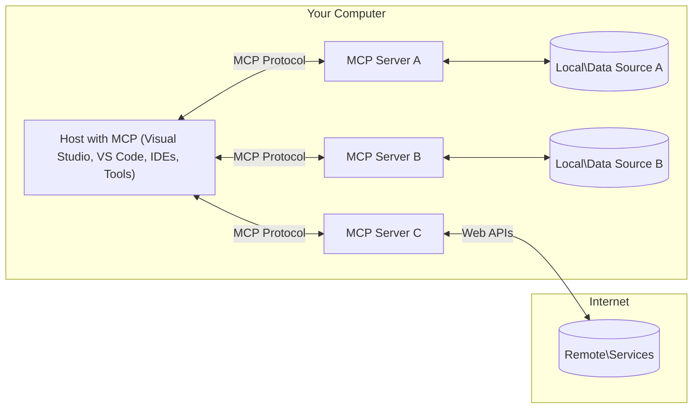

# Konsep Teras MCP: Menguasai Protokol Konteks Model untuk Integrasi AI

[](https://youtu.be/earDzWGtE84)

_(Klik imej di atas untuk melihat video pelajaran ini)_

[Protokol Konteks Model (MCP)](https://github.com/modelcontextprotocol) ialah rangka kerja berkuasa dan piawai yang mengoptimumkan komunikasi antara Model Bahasa Besar (LLM) dan alat luar, aplikasi, dan sumber data. 
Panduan ini akan membimbing anda melalui konsep teras MCP. Anda akan mempelajari tentang seni bina klien-pelayan, komponen penting, mekanik komunikasi, dan amalan terbaik pelaksanaan.

- **Kawalan dan Persetujuan Pengguna**: Hos harus menunjukkan dengan jelas data dan alat yang p
  elayan dedahkan, membenarkan pengguna menolak operasi, dan mendapatkan pengesahan
  secara eksplisit untuk tindakan sensitif atau berakibat. MCP tidak memerlukan dialog
  pengesahan sebelum setiap panggilan alat.

- **Perlindungan Privasi Data**: Data pengguna hanya didedahkan dengan persetujuan jelas dan mesti dilindungi oleh kawalan akses yang kukuh sepanjang kitaran hidup interaksi. Pelaksanaan mesti menghalang penghantaran data tanpa izin dan mengekalkan sempadan privasi yang ketat.

- **Keselamatan Pelaksanaan Alat**: Hos harus menjadikan panggilan alat kelihatan dan memastikan
  manusia boleh menolaknya. Operasi sensitif harus menunjukkan input alat
  dan impak sebelum pelaksanaan, dengan sempadan keselamatan yang menghalang
  tindakan tidak sengaja atau berniat jahat.

- **Keselamatan Pengangkutan**: Sambungan jauh harus menggunakan HTTPS dan model
  kebenaran MCP. Pelayan stdio tempatan bergantung pada pengasingan proses,
  konfigurasi yang dipercayai, dan pengendalian selamat kelayakan yang diwarisi.

#### Garis Panduan Pelaksanaan:

- **Pengurusan Kebenaran**: Laksanakan sistem kebenaran terperinci yang membenarkan pengguna mengawal pelayan, alat, dan sumber yang dapat diakses
- **Pengesahan & Kebenaran**: Gunakan kaedah pengesahan yang selamat (OAuth, kunci API) dengan pengurusan token dan luput yang betul  
- **Pengesahan Input**: Sahkan semua parameter dan input data mengikut skema yang ditakrifkan untuk mengelakkan serangan suntikan
- **Log Audit**: Kekalkan rekod terperinci semua operasi untuk pemantauan keselamatan dan pematuhan

## Gambaran Keseluruhan

Pelajaran ini meneroka seni bina asas dan komponen yang membentuk ekosistem Protokol Konteks Model (MCP). Anda akan belajar tentang seni bina klien-pelayan, komponen utama, dan mekanisme komunikasi yang menggerakkan interaksi MCP.

## Objektif Utama Pembelajaran

Menjelang akhir pelajaran ini, anda akan:

- Memahami seni bina klien-pelayan MCP.
- Mengenal pasti peranan dan tanggungjawab Hos, Klien, dan Pelayan.
- Menganalisis ciri teras yang menjadikan MCP lapisan integrasi yang fleksibel.
- Mempelajari bagaimana maklumat mengalir dalam ekosistem MCP.
- Mendapatkan pandangan praktikal melalui contoh kod dalam .NET, Java, Python, dan JavaScript.

## Seni Bina MCP: Tinjauan Mendalam

Ekosistem MCP dibina atas model klien-pelayan. Struktur modular ini membenarkan aplikasi AI berinteraksi dengan alat, pangkalan data, API, dan sumber kontekstual dengan cekap. Mari kita pecahkan seni bina ini ke dalam komponen terasnya.

Pada terasnya, MCP mengikuti seni bina klien-pelayan dimana aplikasi hos boleh menyambung ke pelbagai pelayan:



- **Hos MCP**: Program seperti VSCode, Claude Desktop, IDE, atau alat AI yang ingin mengakses data melalui MCP
- **Klien MCP**: Komponen protokol yang mengekalkan satu hubungan logik
  dengan pelayan; permintaan MCP `2026-07-28` tidak bergantung pada satu sambungan kekal
  atau sesi
- **Pelayan MCP**: Program ringan yang masing-masing mendedahkan keupayaan khusus melalui Protokol Konteks Model yang distandardkan
- **Sumber Data Tempatan**: Fail, pangkalan data, dan perkhidmatan komputer anda yang pelayan MCP boleh akses dengan selamat
- **Perkhidmatan Jauh**: Sistem luaran yang tersedia melalui internet yang pelayan MCP boleh sambungkan melalui API.

Protokol MCP adalah piawaian yang berkembang menggunakan penomboran versi berdasarkan tarikh
(format YYYY-MM-DD). Versi protokol semasa ialah **2026-07-28**. Lihat
[spesifikasi protokol 2026-07-28](https://modelcontextprotocol.io/specification/2026-07-28/).

> **Keluaran semasa:** MCP `2026-07-28` menjadikan protokol tidak bernegara di
> lapisan pengangkutan dengan membuang jabat tangan `initialize` dan
> ID sesi pada peringkat protokol. Ia juga memformalkan rangka kerja Sambungan dan
> menghentikan penggunaan Roots, Sampling, dan Logging demi corak yang lebih baru.
> Lihat [Perubahan dalam MCP: Spesifikasi 2026-07-28](./mcp-2026-07-28.md)
> untuk penjelasan penuh dan panduan migrasi. Contoh yang secara eksplisit
> mensasarkan `2025-11-25` dikekalkan sebagai pelajaran keserasian lama.

### 1. Hos

Dalam Protokol Konteks Model (MCP), **Hos** adalah aplikasi AI yang berfungsi sebagai antara muka utama melalui mana pengguna berinteraksi dengan protokol. Hos menyelaraskan dan mengurus sambungan ke pelbagai pelayan MCP dengan mencipta klien MCP khusus untuk setiap sambungan pelayan. Contoh Hos termasuk:

- **Aplikasi AI**: Claude Desktop, Visual Studio Code, Claude Code
- **Persekitaran Pembangunan**: IDE dan penyunting kod dengan integrasi MCP  
- **Aplikasi Khusus**: Ejen AI dan alat yang dibina khas

**Hos** adalah aplikasi yang menyelaraskan interaksi model AI. Mereka:

- **Mengatur Model AI**: Melaksanakan atau berinteraksi dengan LLM untuk menjana respons dan menyelaraskan aliran kerja AI
- **Mengurus Hubungan Klien**: Mencipta dan mengurus satu klien MCP untuk setiap
  pelayan MCP yang digunakan hos
- **Mengawal Antara Muka Pengguna**: Mengendalikan aliran perbualan, interaksi pengguna, dan penyampaian respons  
- **Menguatkuasakan Keselamatan**: Mengawal kebenaran, kekangan keselamatan, dan pengesahan
- **Mengendalikan Persetujuan Pengguna**: Mengurus kelulusan pengguna untuk perkongsian data dan pelaksanaan alat


### 2. Klien

**Klien** adalah komponen protokol yang dicipta oleh hos untuk pelayan MCP tertentu. Ini adalah hubungan logik satu-ke-satu, bukan keperluan untuk sambungan rangkaian kekal. Dalam MCP `2026-07-28`, setiap permintaan berdiri sendiri dan boleh dikendalikan oleh mana-mana contoh pelayan.

**Klien** adalah komponen penyambung dalam aplikasi hos. Mereka:


- **Penemuan Keupayaan**: Gunakan `server/discover` untuk mengetahui versi protokol yang disokong, keupayaan, dan sambungan pelayan

- **Kemaskini Masa-Sebenar**: Mengendalikan notifikasi dan kemas kini masa sebenar dari pelayan
- **Pemprosesan Respons**: Memproses dan memformat respons pelayan untuk dipaparkan kepada pengguna

### 3. Pelayan

**Pelayan** adalah program yang menyediakan konteks, alat, dan keupayaan kepada klien MCP. Mereka boleh dilaksanakan secara tempatan (mesin yang sama dengan Hos) atau jauh (pada platform luaran), dan bertanggungjawab untuk mengendalikan permintaan klien serta menyediakan respons berstruktur. Pelayan mendedahkan fungsi tertentu melalui Protokol Konteks Model yang distandardkan.

**Pelayan** adalah perkhidmatan yang menyediakan konteks dan keupayaan. Mereka:

- **Pendaftaran Ciri**: Mendaftar dan mendedahkan primitif tersedia (sumber, gesaan, alat) kepada klien

- **Penyediaan Konteks**: Menyediakan maklumat dan data kontekstual untuk meningkatkan respons model

- **Pendaftaran Ciri**: Daftar dan dedahkan primitif yang tersedia (sumber, arahan, alat) kepada klien
- **Pemprosesan Permintaan**: Terima dan laksanakan panggilan alat, permintaan sumber, dan permintaan arahan dari klien
- **Penyediaan Konteks**: Sediakan maklumat dan data kontekstual untuk mempertingkatkan respons model
- **Pengurusan Keadaan**: Kekalkan keadaan aplikasi dengan pemegang yang jelas disampaikan
  dalam permintaan apabila diperlukan; MCP `2026-07-28` tiada sesi peringkat protokol
- **Pemberitahuan Masa Nyata**: Hantar pemberitahuan mengenai perubahan dan kemas kini keupayaan kepada klien yang disambungkan

Pelayan boleh dibangunkan oleh sesiapa sahaja untuk memperluas keupayaan model dengan fungsi khusus, dan mereka menyokong senario penyebaran tempatan dan jauh.

### 4. Primitif Pelayan

Pelayan dalam Protokol Konteks Model (MCP) menyediakan tiga **primitif** teras yang mentakrifkan blok binaan asas untuk interaksi kaya antara klien, hos, dan model bahasa. Primitif ini menentukan jenis maklumat kontekstual dan tindakan yang tersedia melalui protokol.

Pelayan MCP boleh mendedahkan apa-apa gabungan tiga primitif teras berikut:

#### Sumber

**Sumber** adalah sumber data yang menyediakan maklumat kontekstual kepada aplikasi AI. Mereka mewakili kandungan statik atau dinamik yang boleh meningkatkan pemahaman model dan membuat keputusan:

- **Data Kontekstual**: Maklumat berstruktur dan konteks untuk penggunaan model AI
- **Pangkalan Pengetahuan**: Repositori dokumen, artikel, manual, dan kertas penyelidikan
- **Sumber Data Tempatan**: Fail, pangkalan data, dan maklumat sistem tempatan  
- **Data Luaran**: Respons API, perkhidmatan web, dan data sistem jauh
- **Kandungan Dinamik**: Data masa nyata yang dikemas kini berdasarkan keadaan luaran

Sumber dikenalpasti dengan URI dan menyokong penemuan melalui kaedah `resources/list` dan pengambilan melalui kaedah `resources/read`:

```text
file://documents/project-spec.md
database://production/users/schema
api://weather/current
```

#### Prompt

**Prompt** adalah templat boleh guna semula yang membantu menyusun interaksi dengan model bahasa. Mereka menyediakan corak interaksi yang standard dan aliran kerja bertemplak:

- **Interaksi Berasaskan Templat**: Mesej pra-tersusun dan pemula perbualan
- **Templat Aliran Kerja**: Urutan standard untuk tugas dan interaksi biasa
- **Contoh Few-shot**: Templat berasaskan contoh untuk arahan model
- **Prompt Sistem**: Prompt asas yang mentakrifkan perilaku dan konteks model
- **Templat Dinamik**: Prompt yang diparameterkan yang menyesuaikan dengan konteks tertentu

Prompt menyokong penggantian pembolehubah dan boleh ditemui melalui `prompts/list` dan diambil dengan `prompts/get`:

```markdown
Generate a {{task_type}} for {{product}} targeting {{audience}} with the following requirements: {{requirements}}
```

#### Alat

**Alat** adalah fungsi boleh laksana yang boleh dipanggil oleh model AI untuk melakukan tindakan khusus. Mereka mewakili "kata kerja" dalam ekosistem MCP, membolehkan model berinteraksi dengan sistem luaran:

- **Fungsi Boleh Laksana**: Operasi berasingan yang boleh dipanggil oleh model dengan parameter khusus
- **Integrasi Sistem Luaran**: Panggilan API, pertanyaan pangkalan data, operasi fail, pengiraan
- **Identiti Unik**: Setiap alat mempunyai nama, penerangan, dan skema parameter yang berbeza
- **I/O Berstruktur**: Alat menerima parameter yang disahkan dan memulangkan respons berstruktur, bertipe
- **Keupayaan Tindakan**: Membolehkan model melakukan tindakan dunia sebenar dan mendapatkan data langsung

Alat ditakrifkan dengan JSON Schema untuk pengesahan parameter dan ditemui melalui `tools/list` serta dilaksanakan melalui `tools/call`. Alat juga boleh menyertakan **ikon** sebagai metadata tambahan untuk persembahan UI yang lebih baik.

**Anotasi Alat**: Alat menyokong anotasi perilaku (contoh, `readOnlyHint`, `destructiveHint`) yang menerangkan sama ada alat tersebut hanya baca atau merosakkan, membantu klien membuat keputusan berinformasi mengenai pelaksanaan alat.

Contoh takrif alat:

```typescript
server.tool(
  "search_products", 
  {
    query: z.string().describe("Search query for products"),
    category: z.string().optional().describe("Product category filter"),
    max_results: z.number().default(10).describe("Maximum results to return")
  }, 
  async (params) => {
    // Execute search and return structured results
    return await productService.search(params);
  }
);
```

## Primitif Klien

Dalam Protokol Konteks Model (MCP), **klien** boleh mendedahkan primitif yang membolehkan pelayan membuat permintaan keupayaan tambahan dari aplikasi hos. Primitif sisi klien ini membolehkan pelaksanaan pelayan yang lebih kaya dan interaktif yang boleh mengakses keupayaan model AI dan interaksi pengguna.

### Pensampelan

> **Dihapuskan dalam MCP `2026-07-28`:** Pensampelan kekal tersedia untuk
> keserasian, tetapi pelaksanaan baru harus berintegrasi terus dengan API pembekal LLM.
> Ia layak dipadam dalam semakan spesifikasi pertama
> yang dikeluarkan pada atau selepas 28 Julai 2027. Lihat
> [Apa Yang Telah Berubah dalam MCP: Spesifikasi 2026-07-28](./mcp-2026-07-28.md).

**Pensampelan** membolehkan pelayan meminta penyempurnaan model bahasa dari aplikasi AI klien. Primitif ini membolehkan pelayan mengakses keupayaan LLM tanpa menyertakan kebergantungan model mereka sendiri:

- **Akses Bebas Model**: Pelayan boleh meminta penyempurnaan tanpa memasukkan SDK LLM atau mengurus akses model
- **AI Dimulakan Pelayan**: Membolehkan pelayan menghasilkan kandungan secara autonomi menggunakan model AI klien
- **Interaksi LLM Berulang**: Menyokong senario kompleks di mana pelayan memerlukan bantuan AI untuk pemprosesan
- **Penjanaan Kandungan Dinamik**: Membolehkan pelayan mencipta respons kontekstual menggunakan model hos
- **Sokongan Panggilan Alat**: Pelayan boleh menyertakan parameter `tools` dan `toolChoice` untuk membolehkan model klien memanggil alat semasa pensampelan

Pensampelan menggunakan kaedah `sampling/createMessage`, di mana pelayan meminta
penyempurnaan dari klien.

### Akar

> **Dihapuskan dalam MCP `2026-07-28`:** Akar kekal tersedia untuk
> keserasian, tetapi pelaksanaan baru harus memindahkan direktori atau fail melalui
> parameter alat, URI sumber, atau konfigurasi pelayan. Akar layak
> dipadam dalam semakan spesifikasi pertama yang dikeluarkan pada atau selepas 28
> Julai 2027. Lihat
> [Apa Yang Telah Berubah dalam MCP: Spesifikasi 2026-07-28](./mcp-2026-07-28.md).

**Akar** menyediakan cara standard untuk klien mengenal pasti lokasi sistem fail
yang relevan kepada pelayan:

- **Petunjuk Sistem Fail**: Mengenal pasti direktori dan fail yang relevan untuk permintaan
- **Pengesahan Berasingan**: Tidak memberikan akses atau menguatkuasakan sempadan keselamatan
- **Keupayaan Per Permintaan**: Klien mengiklankan sokongan Akar dalam metadata permintaan
- **Pengenalpastian Berasaskan URI**: Akar menggunakan URI `file://` untuk mengenal pasti direktori dan fail yang boleh diakses

Dalam MCP `2026-07-28`, pelayan meminta `roots/list` melalui
`InputRequiredResult` semasa memproses permintaan klien yang disokong. Klien
memulangkan akar apabila ia mencuba semula permintaan asal itu.

### Pengumpulan Maklumat  

**Pengumpulan Maklumat** membolehkan pelayan meminta maklumat tambahan atau pengesahan daripada pengguna melalui antara muka klien:

- **Permintaan Input Pengguna**: Pelayan boleh meminta maklumat tambahan apabila diperlukan untuk pelaksanaan alat
- **Dialog Pengesahan**: Meminta kelulusan pengguna untuk operasi sensitif atau berimpak
- **Aliran Kerja Interaktif**: Membolehkan pelayan mencipta interaksi pengguna langkah demi langkah
- **Pengumpulan Parameter Dinamik**: Mengumpul parameter hilang atau pilihan semasa pelaksanaan alat

Pengumpulan Maklumat menggunakan kaedah `elicitation/create` di dalam
`InputRequiredResult` untuk mengumpul input pengguna melalui antara muka klien.

**Pemanggilan Mod URL**: Pelayan juga boleh meminta interaksi pengguna berasaskan URL, membolehkan pelayan mengarahkan pengguna ke halaman web luaran untuk pengesahan, pengesahan semula, atau kemasukan data.

### Log

> **Dihentikan dalam MCP `2026-07-28`:** Logging kekal tersedia untuk
> keserasian, tetapi pelaksanaan baru harus menggunakan `stderr` dengan stdio dan
> OpenTelemetry untuk kebolehlihatan berstruktur. Logging layak untuk dihapuskan
> dalam semakan spesifikasi pertama yang dikeluarkan pada atau selepas 28 Julai 2027. Lihat
> [Apa yang Berubah dalam MCP: Spesifikasi 2026-07-28](./mcp-2026-07-28.md).

**Logging** membolehkan pelayan menghantar mesej log berstruktur kepada klien untuk penyahpepijatan, pemantauan, dan kebolehlihatan operasi:

- **Sokongan Penyahpepijatan**: Membolehkan pelayan menyediakan log pelaksanaan terperinci untuk penyelesaian masalah
- **Pemantauan Operasi**: Hantar kemas kini status dan metrik prestasi kepada klien
- **Laporan Ralat**: Sediakan konteks ralat terperinci dan maklumat diagnostik
- **Jejak Audit**: Cipta log komprehensif operasi dan keputusan pelayan

Mesej log dihantar kepada klien untuk memberi ketelusan ke dalam operasi pelayan dan memudahkan penyahpepijatan.

## Aliran Maklumat dalam MCP

Protokol Konteks Model (MCP) mentakrifkan aliran maklumat berstruktur antara hos, klien, pelayan, dan model. Memahami aliran ini membantu menjelaskan bagaimana permintaan pengguna diproses dan bagaimana alat luaran serta data diintegrasikan ke dalam respons model.

- **Hos Memulakan Sambungan**  
  Aplikasi hos (seperti IDE atau antara muka sembang) mewujudkan sambungan ke pelayan MCP, biasanya melalui STDIO, WebSocket, atau pengangkutan lain yang disokong.

- **Rundingan Keupayaan**  
  Klien (tertanam dalam hos) dan pelayan bertukar maklumat tentang ciri, alat, sumber, dan versi protokol yang disokong. Ini memastikan kedua-dua pihak memahami apa keupayaan yang tersedia untuk sesi itu.

- **Permintaan Pengguna**  
  Pengguna berinteraksi dengan hos (contohnya, memasukkan prompt atau arahan). Hos mengumpul input ini dan menyerahkannya kepada klien untuk diproses.

- **Penggunaan Sumber atau Alat**  
  - Klien boleh meminta konteks tambahan atau sumber dari pelayan (seperti fail, entri pangkalan data, atau artikel pangkalan pengetahuan) untuk memperkayakan pemahaman model.
  - Jika model menentukan bahawa alat diperlukan (contohnya, untuk mendapatkan data, melakukan pengiraan, atau memanggil API), klien menghantar permintaan panggilan alat kepada pelayan, menyatakan nama alat dan parameter.

- **Pelaksanaan Pelayan**  
  Pelayan menerima permintaan sumber atau alat, melaksanakan operasi yang diperlukan (seperti menjalankan fungsi, membuat pertanyaan pangkalan data, atau mengambil fail), dan mengembalikan keputusan kepada klien dalam format berstruktur.

- **Penjanaan Respons**  
  Klien menggabungkan respons pelayan (data sumber, output alat, dll.) ke dalam interaksi model yang sedang berjalan. Model menggunakan maklumat ini untuk menjana respons yang komprehensif dan relevan dengan konteks.

- **Pembentangan Keputusan**  
  Hos menerima output akhir dari klien dan membentangkannya kepada pengguna, sering termasuk teks yang dijana oleh model dan sebarang keputusan daripada pelaksanaan alat atau pencarian sumber.

Aliran ini membolehkan MCP menyokong aplikasi AI interaktif, maju, dan peka konteks dengan menghubungkan model secara lancar dengan alat dan sumber data luaran.

## Seni Bina & Lapisan Protokol

MCP terdiri daripada dua lapisan seni bina berbeza yang bekerjasama menyediakan rangka kerja komunikasi lengkap:

### Lapisan Data

**Lapisan Data** melaksanakan protokol MCP teras menggunakan **JSON-RPC 2.0** sebagai asasnya. Lapisan ini mentakrifkan struktur mesej, semantik, dan corak interaksi:

#### Komponen Teras:

- **Protokol JSON-RPC 2.0**: Semua komunikasi menggunakan format mesej JSON-RPC 2.0 piawai untuk panggilan metode, respons, dan pemberitahuan
- **Pengurusan Kitaran Hayat**: Mengendalikan inisialisasi sambungan, rundingan keupayaan, dan penamatan sesi antara klien dan pelayan
- **Primitif Pelayan**: Membolehkan pelayan menyediakan fungsi teras melalui alat, sumber, dan prompt
- **Primitif Klien**: Membolehkan pelayan meminta pengambilan sampel dari LLM, memanggil input pengguna, dan menghantar mesej log
- **Pemberitahuan Masa Nyata**: Menyokong pemberitahuan tak segerak untuk kemas kini dinamik tanpa pengimbasan berterusan

#### Ciri Utama:

- **Rundingan Versi Protokol**: Menggunakan penomboran versi berasaskan tarikh (YYYY-MM-DD) untuk memastikan keserasian
- **Penemuan Keupayaan**: Klien dan pelayan bertukar maklumat ciri yang disokong semasa inisialisasi
- **Sesi Berkeadaan**: Mengekalkan status sambungan merentas beberapa interaksi untuk kesinambungan konteks

### Lapisan Pengangkutan

**Lapisan Pengangkutan** mengurus saluran komunikasi, pembingkaian mesej, dan pengesahan antara peserta MCP:

#### Mekanisme Pengangkutan Disokong:

1. **Pengangkutan STDIO**:
   - Menggunakan aliran input/output standard untuk komunikasi proses langsung
   - Optimal untuk proses tempatan pada mesin yang sama tanpa beban rangkaian
   - Biasa digunakan untuk pelaksanaan pelayan MCP tempatan

2. **Pengangkutan HTTP Boleh Alir**:
   - Menggunakan HTTP POST untuk mesej klien-ke-pelayan  
   - Pilihan Server-Sent Events (SSE) untuk aliran data pelayan-ke-klien
   - Membolehkan komunikasi pelayan jauh merentas rangkaian
   - Menyokong pengesahan HTTP standard (token bearer, kunci API, header tersuai)
   - MCP mengesyorkan OAuth untuk pengesahan berasaskan token yang selamat

#### Abstraksi Pengangkutan:

Lapisan pengangkutan mengasingkan butiran komunikasi dari lapisan data, membolehkan format mesej JSON-RPC 2.0 yang sama digunakan merentas semua mekanisme pengangkutan. Abstraksi ini membolehkan aplikasi beralih lancar antara pelayan tempatan dan jauh.

### Pertimbangan Keselamatan

Pelaksanaan MCP mesti mematuhi beberapa prinsip keselamatan kritikal untuk memastikan interaksi yang selamat, boleh dipercayai, dan terjamin merentas semua operasi protokol:

- **Persetujuan dan Kawalan Pengguna**: Pengguna mesti memberikan persetujuan jelas sebelum sebarang data diakses atau operasi dilakukan. Mereka harus mempunyai kawalan yang jelas terhadap data yang dikongsi dan tindakan yang dibenarkan, disokong oleh antara muka pengguna yang intuitif untuk meninjau dan meluluskan aktiviti.

- **Privasi Data**: Data pengguna hanya harus didedahkan dengan persetujuan jelas dan mesti dilindungi oleh kawalan akses yang sesuai. Pelaksanaan MCP mesti melindungi daripada penghantaran data tanpa kebenaran dan memastikan privasi dikekalkan sepanjang semua interaksi.

- **Keselamatan Alat**: Sebelum memanggil mana-mana alat, persetujuan jelas dari pengguna diperlukan. Pengguna harus mempunyai kefahaman yang jelas tentang fungsi setiap alat, dan batas keselamatan kukuh mesti dikuatkuasakan untuk mengelakkan pelaksanaan alat yang tidak disengajakan atau tidak selamat.

Dengan mengikuti prinsip keselamatan ini, MCP memastikan kepercayaan pengguna, privasi, dan keselamatan dikekalkan merentas semua interaksi protokol sambil membolehkan integrasi AI yang berkuasa.

## Contoh Kod: Komponen Utama

Berikut adalah contoh kod dalam beberapa bahasa pengaturcaraan popular yang menunjukkan cara melaksanakan komponen pelayan MCP utama dan alat.

### Contoh .NET: Membina Pelayan MCP Mudah dengan Alat

Berikut adalah contoh kod .NET praktikal yang menunjukkan cara melaksanakan pelayan MCP mudah dengan alat tersuai. Contoh ini mempamerkan cara mendefinisi dan mendaftar alat, mengendalikan permintaan, dan menyambungkan pelayan menggunakan Protokol Konteks Model.

```csharp
using System;
using System.Threading.Tasks;
using ModelContextProtocol.Server;
using ModelContextProtocol.Server.Transport;
using ModelContextProtocol.Server.Tools;

public class WeatherServer
{
    public static async Task Main(string[] args)
    {
        // Create an MCP server
        var server = new McpServer(
            name: "Weather MCP Server",
            version: "1.0.0"
        );
        
        // Register our custom weather tool
        server.AddTool<string, WeatherData>("weatherTool", 
            description: "Gets current weather for a location",
            execute: async (location) => {
                // Call weather API (simplified)
                var weatherData = await GetWeatherDataAsync(location);
                return weatherData;
            });
        
        // Connect the server using stdio transport
        var transport = new StdioServerTransport();
        await server.ConnectAsync(transport);
        
        Console.WriteLine("Weather MCP Server started");
        
        // Keep the server running until process is terminated
        await Task.Delay(-1);
    }
    
    private static async Task<WeatherData> GetWeatherDataAsync(string location)
    {
        // This would normally call a weather API
        // Simplified for demonstration
        await Task.Delay(100); // Simulate API call
        return new WeatherData { 
            Temperature = 72.5,
            Conditions = "Sunny",
            Location = location
        };
    }
}

public class WeatherData
{
    public double Temperature { get; set; }
    public string Conditions { get; set; }
    public string Location { get; set; }
}
```

### Contoh Java: Komponen Pelayan MCP

Contoh ini menunjukkan pelayan MCP dan pendaftaran alat yang sama seperti contoh .NET di atas, tetapi dilaksanakan dalam Java.

```java
import io.modelcontextprotocol.server.McpServer;
import io.modelcontextprotocol.server.McpToolDefinition;
import io.modelcontextprotocol.server.transport.StdioServerTransport;
import io.modelcontextprotocol.server.tool.ToolExecutionContext;
import io.modelcontextprotocol.server.tool.ToolResponse;

public class WeatherMcpServer {
    public static void main(String[] args) throws Exception {
        // Create an MCP server
        McpServer server = McpServer.builder()
            .name("Weather MCP Server")
            .version("1.0.0")
            .build();
            
        // Register a weather tool
        server.registerTool(McpToolDefinition.builder("weatherTool")
            .description("Gets current weather for a location")
            .parameter("location", String.class)
            .execute((ToolExecutionContext ctx) -> {
                String location = ctx.getParameter("location", String.class);
                
                // Get weather data (simplified)
                WeatherData data = getWeatherData(location);
                
                // Return formatted response
                return ToolResponse.content(
                    String.format("Temperature: %.1f°F, Conditions: %s, Location: %s", 
                    data.getTemperature(), 
                    data.getConditions(), 
                    data.getLocation())
                );
            })
            .build());
        
        // Connect the server using stdio transport
        try (StdioServerTransport transport = new StdioServerTransport()) {
            server.connect(transport);
            System.out.println("Weather MCP Server started");
            // Keep server running until process is terminated
            Thread.currentThread().join();
        }
    }
    
    private static WeatherData getWeatherData(String location) {
        // Implementation would call a weather API
        // Simplified for example purposes
        return new WeatherData(72.5, "Sunny", location);
    }
}

class WeatherData {
    private double temperature;
    private String conditions;
    private String location;
    
    public WeatherData(double temperature, String conditions, String location) {
        this.temperature = temperature;
        this.conditions = conditions;
        this.location = location;
    }
    
    public double getTemperature() {
        return temperature;
    }
    
    public String getConditions() {
        return conditions;
    }
    
    public String getLocation() {
        return location;
    }
}
```

### Contoh Python: Membina Pelayan MCP

Contoh ini menggunakan fastmcp, jadi sila pastikan anda memasangnya terlebih dahulu:

```python
pip install fastmcp
```
Contoh Kod:

```python
#!/usr/bin/env python3
import asyncio
from fastmcp import FastMCP
from fastmcp.transports.stdio import serve_stdio

# Create a FastMCP server
mcp = FastMCP(
    name="Weather MCP Server",
    version="1.0.0"
)

@mcp.tool()
def get_weather(location: str) -> dict:
    """Gets current weather for a location."""
    return {
        "temperature": 72.5,
        "conditions": "Sunny",
        "location": location
    }

# Alternative approach using a class
class WeatherTools:
    @mcp.tool()
    def forecast(self, location: str, days: int = 1) -> dict:
        """Gets weather forecast for a location for the specified number of days."""
        return {
            "location": location,
            "forecast": [
                {"day": i+1, "temperature": 70 + i, "conditions": "Partly Cloudy"}
                for i in range(days)
            ]
        }

# Register class tools
weather_tools = WeatherTools()

# Start the server
if __name__ == "__main__":
    asyncio.run(serve_stdio(mcp))
```

### Contoh JavaScript: Membina Pelayan MCP

Contoh ini menunjukkan penciptaan pelayan MCP dalam JavaScript dan cara mendaftar dua alat berkaitan cuaca.

```javascript
// Using the official Model Context Protocol SDK
import { McpServer } from "@modelcontextprotocol/sdk/server/mcp.js";
import { StdioServerTransport } from "@modelcontextprotocol/sdk/server/stdio.js";
import { z } from "zod"; // For parameter validation

// Create an MCP server
const server = new McpServer({
  name: "Weather MCP Server",
  version: "1.0.0"
});

// Define a weather tool
server.tool(
  "weatherTool",
  {
    location: z.string().describe("The location to get weather for")
  },
  async ({ location }) => {
    // This would normally call a weather API
    // Simplified for demonstration
    const weatherData = await getWeatherData(location);
    
    return {
      content: [
        { 
          type: "text", 
          text: `Temperature: ${weatherData.temperature}°F, Conditions: ${weatherData.conditions}, Location: ${weatherData.location}` 
        }
      ]
    };
  }
);

// Define a forecast tool
server.tool(
  "forecastTool",
  {
    location: z.string(),
    days: z.number().default(3).describe("Number of days for forecast")
  },
  async ({ location, days }) => {
    // This would normally call a weather API
    // Simplified for demonstration
    const forecast = await getForecastData(location, days);
    
    return {
      content: [
        { 
          type: "text", 
          text: `${days}-day forecast for ${location}: ${JSON.stringify(forecast)}` 
        }
      ]
    };
  }
);

// Helper functions
async function getWeatherData(location) {
  // Simulate API call
  return {
    temperature: 72.5,
    conditions: "Sunny",
    location: location
  };
}

async function getForecastData(location, days) {
  // Simulate API call
  return Array.from({ length: days }, (_, i) => ({
    day: i + 1,
    temperature: 70 + Math.floor(Math.random() * 10),
    conditions: i % 2 === 0 ? "Sunny" : "Partly Cloudy"
  }));
}

// Connect the server using stdio transport
const transport = new StdioServerTransport();
server.connect(transport).catch(console.error);

console.log("Weather MCP Server started");
```

Contoh JavaScript ini menunjukkan cara mencipta pelayan MCP menggunakan SDK Protokol Konteks Model. Ia menunjukkan cara mendaftar dua alat bernama `weatherTool` dan `forecastTool` dan menjadikannya tersedia kepada klien MCP melalui `StdioServerTransport`.

## Keselamatan dan Kebenaran

MCP termasuk beberapa konsep dan mekanisme terbina dalam untuk menguruskan keselamatan dan kebenaran sepanjang protokol:

1. **Kawalan Kebenaran Alat**:  
  Klien boleh menentukan alat mana yang boleh digunakan model untuk setiap permintaan atau aliran kerja.
  Ini memastikan hanya alat yang dibenarkan secara eksplisit boleh diakses, mengurangkan
  risiko operasi yang tidak disengajakan atau tidak selamat.

2. **Pengesahan**:  
  Pelayan boleh memerlukan pengesahan sebelum memberi akses kepada alat, sumber, atau operasi sensitif. Ini mungkin melibatkan kunci API, token OAuth, atau skema pengesahan lain. Pengesahan yang betul memastikan hanya klien dan pengguna dipercayai boleh menggunakan keupayaan sisi pelayan.

3. **Pengesahan Parameter**:  
  Pengesahan parameter dikuatkuasakan untuk semua panggilan alat. Setiap alat mentakrifkan jenis, format, dan kekangan yang dijangka untuk parameternya, dan pelayan memeriksa permintaan yang masuk dengan sewajarnya. Ini mengelakkan input yang cacat atau berniat jahat daripada sampai ke pelaksanaan alat dan membantu mengekalkan integriti operasi.

4. **Had Kadar**:  
  Untuk mengelakkan penyalahgunaan dan memastikan penggunaan sumber pelayan yang adil, pelayan MCP boleh
  melaksanakan had kadar untuk panggilan alat dan akses sumber. Had kadar boleh
  diterapkan bagi setiap pengguna, kredensial, operasi, atau secara global.

Dengan menggabungkan mekanisme ini, MCP menyediakan asas yang selamat untuk mengintegrasikan model bahasa dengan alat dan sumber data luaran, sambil memberi pengguna dan pembangun kawalan terperinci ke atas akses dan penggunaan.

## Mesej Protokol & Aliran Komunikasi

Komunikasi MCP menggunakan mesej berstruktur **JSON-RPC 2.0** untuk memudahkan interaksi yang jelas dan boleh dipercayai antara hos, klien, dan pelayan. Protokol mentakrifkan corak mesej khusus untuk jenis operasi berbeza:

### Jenis Mesej Teras

#### **Metadata Permintaan dan Penemuan**

- **Metadata setiap permintaan**: Setiap permintaan `2026-07-28` adalah lengkap dan
  mengandungi versi protokol, identiti klien, dan keupayaan klien dalam `_meta`.
- **Permintaan `server/discover`**: Mendapatkan versi protokol yang disokong, identiti pelayan,
  keupayaan, dan peluasan apabila diperlukan oleh klien.
- **Header HTTP Boleh Alir**: Permintaan HTTP termasuk `MCP-Protocol-Version` dan
  `Mcp-Method`; kaedah yang merujuk alat bernama atau sumber juga termasuk
  `Mcp-Name`.

Jabat tangan `initialize`/`initialized` dan ID sesi peringkat protokol
adalah milik semakan protokol terdahulu dan bukan sebahagian daripada MCP `2026-07-28`.

#### **Mesej Penemuan**
- **Permintaan `tools/list`**: Menemui alat yang tersedia dari pelayan
- **Permintaan `resources/list`**: Menyenaraikan sumber (pangkalan data) yang tersedia
- **Permintaan `prompts/list`**: Mendapatkan templat prompt yang tersedia

#### **Mesej Pelaksanaan**  
- **Permintaan `tools/call`**: Melaksanakan alat tertentu dengan parameter yang diberikan
- **Permintaan `resources/read`**: Mendapatkan kandungan daripada sumber tertentu
- **Permintaan `prompts/get`**: Mendapatkan templat prompt dengan parameter pilihan

#### **Permintaan Input Sisi Klien**

- **`elicitation/create`**: Pelayan meminta input pengguna melalui antara muka pelanggan
  semasa memproses permintaan pelanggan.
- **`sampling/createMessage`**: Permintaan pelayan yang usang untuk penyempurnaan LLM.
- **`roots/list`**: Permintaan pelayan yang usang untuk akar sistem fail pelanggan.

Di bawah `2026-07-28`, permintaan input dari pelayan ke pelanggan menggunakan corak
pelbagai pusingan-trip `InputRequiredResult` dan bukannya bergantung pada sesi berterusan.

#### **Mesej Pemberitahuan**
- **`notifications/tools/list_changed`**: Pelayan memberitahu pelanggan tentang perubahan alat
- **`notifications/resources/list_changed`**: Pelayan memberitahu pelanggan tentang perubahan sumber  
- **`notifications/prompts/list_changed`**: Pelayan memberitahu pelanggan tentang perubahan arahan

### Struktur Mesej:

Semua mesej MCP mengikuti format JSON-RPC 2.0 dengan:
- **Mesej Permintaan**: Termasuk `id`, `method`, dan `params` pilihan
- **Mesej Respons**: Termasuk `id` dan sama ada `result` atau `error`  
- **Mesej Pemberitahuan**: Termasuk `method` dan `params` pilihan (tiada `id` atau respons dijangka)

Komunikasi yang berstruktur ini memastikan interaksi yang boleh dipercayai, boleh dijejak, dan boleh dikembangkan untuk menyokong senario canggih seperti kemas kini masa nyata, rantai alat, dan pengendalian ralat yang kukuh.

### Sambungan Tugas

Dalam MCP `2026-07-28`, Tugas adalah sambungan rasmi dan bukan ciri teras percubaan.
Ia menggunakan kitaran hayat `tasks/get`, `tasks/update`, dan
`tasks/cancel` yang direka semula; `tasks/list` telah dikeluarkan. API Tugas Percubaan
`2025-11-25` tidak serasi ke belakang dengan sambungan ini. Lihat
[Apa yang Berubah dalam MCP: Spesifikasi 2026-07-28](./mcp-2026-07-28.md).

**Tugas** menyediakan pembalut pelaksanaan tahan lama untuk pengambilan keputusan tertunda dan
penjejakan status:

- **Operasi Jangka Panjang**: Menjejak pengiraan mahal, automasi aliran kerja, dan pemprosesan kumpulan
- **Keputusan Tertunda**: Membuat tinjauan status tugas dan mengambil keputusan apabila operasi selesai
- **Penjejakan Status**: Memantau kemajuan tugas melalui keadaan kitaran hayat yang ditakrifkan
- **Operasi Berbilang Langkah**: Menyokong aliran kerja kompleks yang merangkumi pelbagai interaksi

Tugas membalut permintaan MCP standard untuk membolehkan corak pelaksanaan tak segerak bagi operasi yang tidak boleh disiapkan dengan segera.

## Perkara Penting

- **Arkitektur**: MCP menggunakan arkitektur pelanggan-pelayan di mana hos menguruskan pelbagai sambungan pelanggan ke pelayan
- **Peserta**: Ekosistem merangkumi hos (aplikasi AI), pelanggan (penyambung protokol), dan pelayan (penyedia keupayaan)
- **Mekanisme Pengangkutan**: Komunikasi menyokong stdio (tempatan) dan Streamable
  HTTP (jarak jauh); `2026-07-28` menghapuskan aliran acara GET berdiri sendiri
- **Primitif Teras**: Pelayan mendedahkan alat (fungsi boleh dijalankan), sumber (sumber data), dan arahan (templat)
- **Primitif Pelanggan**: Elicitation menyokong input pengguna, manakala Sampling dan
  Roots dikekalkan hanya sebagai ciri keserasian usang
- **Sambungan**: Sambungan Tugas rasmi menyediakan pembalut pelaksanaan yang tahan lama
  untuk operasi jangka masa panjang
- **Asas Protokol**: Dibina di atas JSON-RPC 2.0 dengan penentuan versi berasaskan tarikh
  (semasa: `2026-07-28`)
- **Keupayaan Masa Nyata**: Menyokong pemberitahuan untuk kemas kini dinamik dan penyelarasan masa nyata
- **Keselamatan Diutamakan**: Persetujuan pengguna yang jelas, perlindungan privasi data, dan pengangkutan selamat adalah keperluan teras

## Latihan

Reka alat MCP ringkas yang berguna dalam domain anda. Tetapkan:
1. Apakah nama alat tersebut
2. Parameter apa yang akan diterima
3. Output apa yang akan dikembalikan
4. Bagaimana model mungkin menggunakan alat ini untuk menyelesaikan masalah pengguna


---

## Apa seterusnya

Seterusnya: [Bab 2: Keselamatan](../02-Security/README.md)

Baca [Apa yang Berubah dalam MCP: Spesifikasi 2026-07-28](./mcp-2026-07-28.md)
untuk panduan migrasi dari `2025-11-25`.

---

<!-- CO-OP TRANSLATOR DISCLAIMER START -->
**Penafian**:
Dokumen ini telah diterjemahkan menggunakan perkhidmatan terjemahan AI [Co-op Translator](https://github.com/Azure/co-op-translator). Walaupun kami berusaha untuk ketepatan, sila ambil maklum bahawa terjemahan automatik mungkin mengandungi kesilapan atau ketidaktepatan. Dokumen asal dalam bahasa asalnya harus dianggap sebagai sumber yang sahih. Untuk maklumat penting, terjemahan oleh manusia profesional adalah disyorkan. Kami tidak bertanggungjawab terhadap sebarang salah faham atau salah tafsir yang timbul daripada penggunaan terjemahan ini.
<!-- CO-OP TRANSLATOR DISCLAIMER END -->