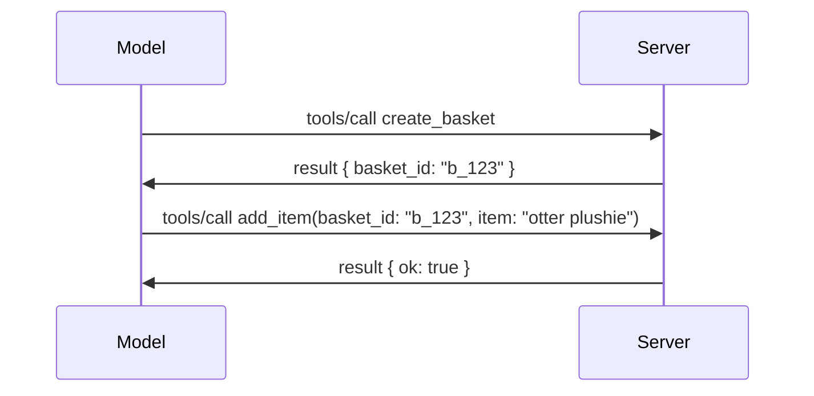

# Apa yang Berubah dalam MCP: Spesifikasi 2026-07-28

> **Status:** Muktamad. Spesifikasi MCP `2026-07-28` dihantar pada 28 Julai 2026
> dan merupakan semakan protokol terkini. Pelajaran ini menerangkan spesifikasi terakhir.
> Beberapa contoh kurikulum masih dinyatakan versi secara eksplisit
> `2025-11-25` kerana SDK mereka belum mengadaptasi API tanpa keadaan yang baru;
> anggap contoh tersebut sebagai panduan keserasian legasi.

## Gambaran Keseluruhan

`2026-07-28` adalah semakan terbesar MCP sejak ia dilancarkan. Enam
Cadangan Penambahbaikan Spesifikasi (SEP) menghapuskan sesi pada peringkat protokol dan
menjadikan MCP tanpa keadaan pada lapisan pengangkutan, lanjutan menjadi mekanisme
versi, dan beberapa ciri yang dibincangkan sebelum ini dalam kurikulum ini
(Roots, Sampling, Logging) telah dihentikan di bawah dasar kitar hayat baru. Ini
pelajaran meringkaskan apa yang berubah, mengapa ia penting, dan apa maksudnya untuk kod
yang ditulis mengikut `2025-11-25`.

Sumber: [Calon Pecahan Spesifikasi MCP 2026-07-28](https://blog.modelcontextprotocol.io/posts/2026-07-28-release-candidate/) (Blog Protokol Konteks Model, David Soria Parra dan Den Delimarsky).

## Objektif Pembelajaran

Menjelang akhir pelajaran ini, anda akan mampu:

- Jelaskan mengapa MCP beralih ke teras protokol tanpa keadaan dan masalah apa yang diselesaikan untuk pelepasan skala mendatar.
- Terangkan bagaimana jabat tangan `initialize`/`initialized` dan tajuk `Mcp-Session-Id` digantikan.
- Kenal pasti tajuk baru `Mcp-Method` dan `Mcp-Name` dan metadata cache `ttlMs`/`cacheScope`.
- Kenal pasti rangka kerja Lanjutan dan dua lanjutan yang dihantar dengan keluaran ini: MCP Apps dan Tasks.
- Ringkaskan pengukuhan kebenaran dan penghapusan Pendaftaran Klien Dinamik.

- Kenal pasti ciri teras yang kini dihentikan (Roots, Sampling, Logging), dan apa maksudnya dalam amalan.
- Terangkan perubahan Skema JSON Penuh 2020-12 untuk alat `inputSchema`/`outputSchema`.

## Protokol Tanpa Keadaan

Perubahan utama: MCP menjadi tanpa keadaan pada lapisan protokol.

### Sebelum (2025-11-25): sesi mengikat anda kepada satu contoh pelayan

Memanggil alat melalui HTTP Beraliran bermula dengan jabat tangan `initialize`. Pelayan membalas dengan tajuk `Mcp-Session-Id` yang mesti dibawa oleh setiap permintaan berikutnya:

```http
POST /mcp HTTP/1.1
Mcp-Session-Id: 1868a90c-3a3f-4f5b
Content-Type: application/json

{"jsonrpc":"2.0","id":2,"method":"tools/call",
 "params":{"name":"search","arguments":{"q":"otters"}}}
```

Kerana sesi terikat kepada contoh pelayan yang mengeluarkannya, pelaksanaan skala mendatar memerlukan **penentuan rute melekit** pada penyeimbang beban dan **penyimpanan sesi dikongsi** antara contoh.

### Selepas (2026-07-28): setiap permintaan berdiri sendiri

```http
POST /mcp HTTP/1.1
MCP-Protocol-Version: 2026-07-28
Mcp-Method: tools/call
Mcp-Name: search
Content-Type: application/json

{"jsonrpc":"2.0","id":1,"method":"tools/call",
 "params":{"name":"search","arguments":{"q":"otters"},
           "_meta":{"io.modelcontextprotocol/protocolVersion":"2026-07-28",
                    "io.modelcontextprotocol/clientInfo":{"name":"my-app","version":"1.0"},
                    "io.modelcontextprotocol/clientCapabilities":{}}}}
```

Mana-mana contoh pelayan boleh mengendalikan permintaan ini. Perubahan utama:

- **Jabat tangan `initialize`/`initialized` dibuang** ([SEP-2575](https://github.com/modelcontextprotocol/modelcontextprotocol/pull/2575)). Versi protokol, maklumat klien, dan kebolehan klien beralih ke `_meta` pada setiap permintaan. Kaedah baru `server/discover` membolehkan klien mendapatkan kebolehan pelayan terlebih dahulu bila diperlukan.
- **Tajuk `Mcp-Session-Id` dan sesi pada peringkat protokol dibuang** ([SEP-2567](https://github.com/modelcontextprotocol/modelcontextprotocol/pull/2567)). Penentuan rute melekit dan penyimpanan sesi dikongsi tidak lagi diperlukan pada lapisan protokol.

### Protokol tanpa keadaan, aplikasi berkeadaan

Menghapuskan sesi pada peringkat protokol tidak bermakna pelayan anda tidak boleh berkeadaan. Corak yang disyorkan adalah sama seperti yang sentiasa digunakan oleh API HTTP: cipta penangan eksplisit (seperti `basket_id`, `browser_id`) dari satu panggilan alat, dan model luluskan kembali penangan tersebut sebagai argumen biasa pada panggilan seterusnya.



Ini menjadikan keadaan terlihat dan masuk akal kepada model berbanding menyembunyikannya dalam metadata pengangkutan, dan membolehkan mana-mana contoh pelayan mengendalikan apa-apa panggilan.

### Permintaan pelayan-ke-klien, disusun semula

Protokol tanpa keadaan masih memerlukan cara untuk pelayan meminta sesuatu dari klien semasa panggilan (contoh, arahan elicitation):

- **Permintaan yang dimulakan oleh pelayan hanya boleh dikeluarkan semasa pelayan sedang memproses permintaan klien secara aktif** ([SEP-2260](https://github.com/modelcontextprotocol/modelcontextprotocol/pull/2260)) — sebelum ini adalah cadangan, kini wajib. Pengguna tidak akan dipromosikan secara tiba-tiba.
- **Permintaan Pelbagai Pusingan** ([SEP-2322](https://github.com/modelcontextprotocol/modelcontextprotocol/pull/2322)) menggantikan mengekalkan aliran SSE terbuka. Sebaliknya, pelayan mengembalikan `InputRequiredResult`:

  ```json
  {
    "resultType": "input_required",
    "inputRequests": {
      "confirm": {
        "type": "elicitation",
        "message": "Delete 3 files?",
        "schema": { "type": "boolean" }
      }
    },
    "requestState": "eyJzdGVwIjoxLCJmaWxlcyI6WyJhIiwiYiIsImMiXX0="
  }
  ```

  Klien mengumpul jawapan dan menghantar semula panggilan asal dengan `inputResponses` serta `requestState` yang digemakan. Mana-mana contoh pelayan boleh mengambil semula percubaan kerana semua yang diperlukan ada dalam muatan.

### Boleh dirute, boleh ditempatkan cache, boleh dijejak

Tiga perubahan kecil memudahkan trafik tanpa keadaan:

- **Tajuk `Mcp-Method` dan `Mcp-Name` dikehendaki pada HTTP Beraliran** ([SEP-2243](https://github.com/modelcontextprotocol/modelcontextprotocol/pull/2243)) supaya penyeimbang beban, pintu gerbang, dan had laju boleh merutekan pada operasi tanpa memeriksa badan JSON. Pelayan menolak permintaan di mana tajuk dan badan tidak sepadan.
- **`tools/list` dan hasil baca sumber membawa `ttlMs` dan `cacheScope`** ([SEP-2549](https://github.com/modelcontextprotocol/modelcontextprotocol/pull/2549)), dimodelkan pada HTTP `Cache-Control`. Klien tahu berapa lama senarai hasil adalah segar dan sama ada ia selamat untuk dikongsi antara pengguna, tanpa perlu aliran SSE jangka panjang untuk mengetahui perubahan.
- **Propagasi Konteks Jejak W3C dalam `_meta` didokumentasikan** ([SEP-414](https://github.com/modelcontextprotocol/modelcontextprotocol/pull/414)), membetulkan nama kunci `traceparent`, `tracestate`, dan `baggage` supaya jejak teragih boleh mengikuti panggilan merentasi SDK klien, pelayan MCP, dan sistem hiliran dalam backend yang serasi [OpenTelemetry](https://opentelemetry.io/).

## Lanjutan Menjadi Kelas Pertama

Lanjutan wujud secara tidak formal dalam `2025-11-25`. [SEP-2133](https://github.com/modelcontextprotocol/modelcontextprotocol/pull/2133) memformalkan mereka:

- Lanjutan dikenal pasti oleh ID DNS terbalik.
- Mereka dirunding melalui peta `extensions` pada kebolehan klien dan pelayan.
- Mereka hidup dalam repositori `ext-*` sendiri dengan penyelenggara yang diberi kuasa dan versi bebas daripada spesifikasi teras.
- Jejak Lanjutan baru dalam proses SEP memberi mereka laluan dari eksperimental ke rasmi.

Keluaran ini menghantar dua lanjutan rasmi.

### MCP Apps: antaramuka pengguna yang di-render pelayan

[MCP Apps](https://blog.modelcontextprotocol.io/posts/2026-01-26-mcp-apps/) ([SEP-1865](https://github.com/modelcontextprotocol/modelcontextprotocol/pull/1865)) membolehkan pelayan menghantar antaramuka HTML interaktif yang hos render dalam iframe berpasir. Alat mengisytiharkan templat UI mereka terlebih dahulu supaya hos boleh pra-muat turun, cache, dan semak keselamatan sebelum apa-apa dijalankan. Anda telah mempelajari asas ini dalam [Pelajaran 15: MCP Apps](../03-GettingStarted/15-mcp-apps/README.md) — di bawah rangka kerja Lanjutan, MCP Apps kini secara rasmi adalah lanjutan dan bukan ciri teras eksperimen.

### Tasks dinaik taraf menjadi lanjutan

Tasks dihantar sebagai ciri teras eksperimental dalam `2025-11-25`. Penggunaan dalam pengeluaran menampakkan reka bentuk semula yang cukup bahawa tempat yang betul untuknya adalah lanjutan: [lanjutan Tasks](https://github.com/modelcontextprotocol/modelcontextprotocol/pull/2663) membentuk semula kitar hayat mengikut model tanpa keadaan — pelayan boleh menjawab `tools/call` dengan pemegang tugas, dan klien menggerakkannya ke hadapan dengan `tasks/get`, `tasks/update`, dan `tasks/cancel`. Penciptaan tugas diarahkan oleh pelayan: klien mengiklankan lanjutan, dan pelayan memutuskan bila panggilan perlu dijalankan sebagai tugas. `tasks/list` dihapuskan sepenuhnya kerana ia tidak boleh di-skop dengan selamat tanpa sesi.

> **Nota migrasi:** jika anda melaksanakan API Tasks eksperimental `2025-11-25`, anda perlu bermigrasi ke kitar hayat lanjutan yang baru — ia tidak serasi ke belakang.

## Pengukuhan Kebenaran

Beberapa SEP mengukuhkan
[spesifikasi kebenaran](https://modelcontextprotocol.io/specification/2026-07-28/basic/authorization)
untuk menyelaraskan dengan pelaksanaan OAuth 2.0 / OpenID Connect dunia sebenar:

| SEP | Perubahan |
|---|---|
| [SEP-2468](https://github.com/modelcontextprotocol/modelcontextprotocol/pull/2468) | Klien mesti mengesahkan parameter `iss` pada respons kebenaran mengikut [RFC 9207](https://www.rfc-editor.org/rfc/rfc9207), mengurangkan serangan campur aduk yang biasa pada pola MCP satu klien, banyak pelayan. Versi akan datang akan memerlukan menolak respons yang tiada `iss`. |
| [SEP-837](https://github.com/modelcontextprotocol/modelcontextprotocol/pull/837) | Klien Pendaftaran Klien Dinamik keserasian sahaja mengisytiharkan `application_type` OpenID Connect mereka, mengelakkan lalai `"web"` yang salah untuk klien desktop dan CLI. |
| [SEP-2352](https://github.com/modelcontextprotocol/modelcontextprotocol/pull/2352) | Kredensial berdaftar keserasian sahaja terikat kepada `issuer` pelayan kebenaran yang mengeluarkan; klien mendaftar semula jika sumber berpindah. |
| [SEP-2207](https://github.com/modelcontextprotocol/modelcontextprotocol/pull/2207) | Mendokumentasikan cara meminta token penyegaran dari pelayan kebenaran gaya OpenID Connect. |
| [SEP-2350](https://github.com/modelcontextprotocol/modelcontextprotocol/pull/2350) | Menjelaskan pengumpulan skop semasa kebenaran peningkatan tahap. |
| [SEP-2351](https://github.com/modelcontextprotocol/modelcontextprotocol/pull/2351) | Menjelaskan akhiran penemuan `.well-known`. |

Jika anda membina pelayan kebenaran untuk MCP, sediakan `iss` pada
respons kebenaran dan ikut spesifikasi kebenaran muktamad. Lihat
[02-Security](../02-Security/README.md) untuk panduan pelaksanaan.

Pendaftaran Klien Dinamik kekal tersedia untuk keserasian tetapi juga
dihentikan dalam `2026-07-28`. Pelaksanaan baru harus menggunakan Dokumen Metadata ID Klien.


[dasar kitar hayat ciri](https://github.com/modelcontextprotocol/modelcontextprotocol/pull/2577),
Roots, Sampling, Logging, dan Pendaftaran Klien Dinamik adalah **Dihentikan**:


|---|---|
| Roots | Parameter alat, URI sumber, atau konfigurasi pelayan |
| Sampling | Integrasi langsung dengan API penyedia LLM |
| Logging | `stderr` untuk pengangkutan stdio; OpenTelemetry untuk pemerhatian berstruktur |
| Pendaftaran Klien Dinamik | Dokumen Metadata ID Klien |


Ciri-ciri ini kekal dalam `2026-07-28` untuk keserasian. Ia layak untuk
dinyahhapus dalam semakan spesifikasi pertama yang dikeluarkan pada atau selepas 28 Julai 2027;
penyahhapusan sebenar mungkin berlaku kemudian. Pelaksanaan baharu harus menggunakan pola gantian
di atas.

## Skema JSON Penuh 2020-12 untuk Alat

Alat `inputSchema` dan `outputSchema` dinaik taraf kepada [JSON Schema 2020-12](https://json-schema.org/draft/2020-12) penuh ([SEP-2106](https://github.com/modelcontextprotocol/modelcontextprotocol/pull/2106)):

- Skema input mengekalkan kekangan akar `type: "object"` tetapi kini membenarkan penggabungan (`oneOf`, `anyOf`, `allOf`), bersyarat, dan rujukan (`$ref`, `$defs`).
- Skema output tidak terhad, dan `structuredContent` kini boleh menjadi apa-apa nilai JSON dan bukan hanya objek.
- Pelaksanaan tidak harus secara automatik merujuk semula URI `$ref` luaran dan harus mengehadkan kedalaman skema dan masa pengesahan (considerasi penolakan perkhidmatan jika anda mengesahkan skema di pelayan).

Secara berasingan, kod ralat untuk sumber yang hilang berubah dari MCP-custom `-32002` ke standard JSON-RPC `-32602` (Parameter Tidak Sah) ([SEP-2164](https://github.com/modelcontextprotocol/modelcontextprotocol/pull/2164)). Jika klien anda memadankan nilai literal `-32002`, anda perlu mengemas kini ia.

## Bagaimana Protokol Berkembang Dari Sini

Pelepasan ini mengandungi perubahan yang memecahkan, yang tidak dimaksudkan oleh penyelenggara MCP sebagai norma untuk masa hadapan. Tiga SEP tadbir urus bertujuan untuk menghindari pengulangan:

- **Polisi kitar hayat ciri** memberikan setiap ciri laluan Aktif → Usang → Dihapuskan dengan sekurang-kurangnya dua belas bulan antara pengusangan dan penghapusan terawal.
- **Rangka Kerja Sambungan** membenarkan keupayaan baharu dihantar sebagai sambungan opsyen dan distabilkan sebelum (jika pernah) masuk ke dalam spesifikasi teras.
- SEP Jejak Standard tidak boleh mencapai status Akhir sehingga senario padanan terdapat dalam [set kesesuaian](https://github.com/modelcontextprotocol/conformance) ([SEP-2484](https://github.com/modelcontextprotocol/modelcontextprotocol/pull/2484)) — set yang sama yang digunakan oleh [sistem tier SDK](https://github.com/modelcontextprotocol/modelcontextprotocol/pull/1777) untuk menilai SDK rasmi.

## Garis Masa Pelepasan dan Pengesahan

- Calon pelepasan dikunci pada 21 Mei 2026.
- Spesifikasi akhir dihantar pada 28 Julai 2026.
- Sokongan SDK mungkin tertinggal daripada spesifikasi. Semak
  [dokumentasi SDK](https://modelcontextprotocol.io/docs/sdk) dan
  nota pelepasan SDK sebelum memindahkan contoh.
- Jejaki perubahan akhir dalam
  [spesifikasi 2026-07-28](https://modelcontextprotocol.io/specification/2026-07-28/)
  dan
  [log perubahan](https://modelcontextprotocol.io/specification/2026-07-28/changelog).

## Apa Maksudnya untuk Kurikulum Ini

Kurikulum sedang beralih daripada contoh `2025-11-25` kepada spesifikasi `2026-07-28` terkini.
Secara konkrit:

- **Sesi dan jabat tangan `initialize`** dalam contoh yang secara eksplisit menyasarkan
  `2025-11-25` adalah tingkah laku lama. Protokol `2026-07-28` menggantikannya
  dengan model permintaan tanpa keadaan seperti di atas.
- **Sampling dan Akar** kekal tersedia untuk keserasian tetapi sudah lapuk.
  Reka bentuk baru harus menggunakan corak pengganti yang disenaraikan di atas.
- **Ciri Tugas eksperimen**, jika anda telah menggunakannya, perlu dialihkan ke kitar hayat baharu sambungan Tugas.
- **Aplikasi MCP** ([Pelajaran 15](../03-GettingStarted/15-mcp-apps/README.md)) tidak terjejas secara praktikal; ia hanya berpindah di bawah kerangka Sambungan rasmi.

## Sumber Tambahan

- [Spesifikasi MCP 2026-07-28](https://modelcontextprotocol.io/specification/2026-07-28/)
- [Log Perubahan 2026-07-28](https://modelcontextprotocol.io/specification/2026-07-28/changelog)
- [Kandungan Blog Sejarah Calon Siaran Spesifikasi MCP 2026-07-28](https://blog.modelcontextprotocol.io/posts/2026-07-28-release-candidate/)
- [Masa Depan Pengangkutan MCP](https://blog.modelcontextprotocol.io/posts/2025-12-19-mcp-transport-future/)
- [Garis Panduan SEP](https://modelcontextprotocol.io/community/sep-guidelines)
- [Sistem Tahap SDK MCP](https://modelcontextprotocol.io/docs/sdk)

## Langkah Seterusnya

Kembali ke [Konsep Teras](./README.md) atau terus ke
[Keselamatan](../02-Security/README.md) untuk mengaplikasikan panduan `2026-07-28` terkini.

---

<!-- CO-OP TRANSLATOR DISCLAIMER START -->
**Penafian**:
Dokumen ini telah diterjemahkan menggunakan perkhidmatan terjemahan AI [Co-op Translator](https://github.com/Azure/co-op-translator). Walaupun kami berusaha untuk ketepatan, sila ambil maklum bahawa terjemahan automatik mungkin mengandungi kesilapan atau ketidaktepatan. Dokumen asal dalam bahasa asalnya harus dianggap sebagai sumber yang sahih. Untuk maklumat penting, terjemahan oleh manusia profesional adalah disyorkan. Kami tidak bertanggungjawab terhadap sebarang salah faham atau salah tafsir yang timbul daripada penggunaan terjemahan ini.
<!-- CO-OP TRANSLATOR DISCLAIMER END -->