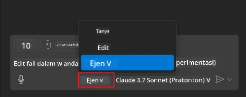
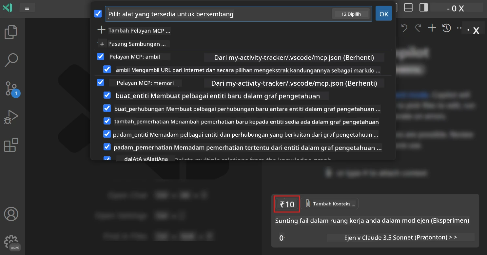
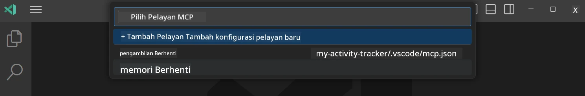
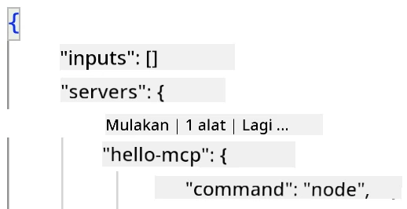
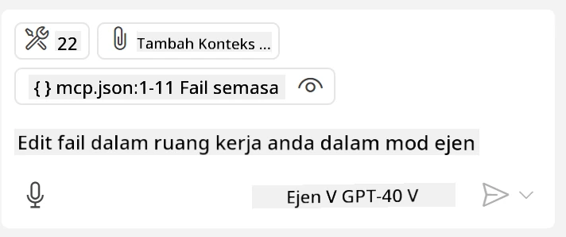
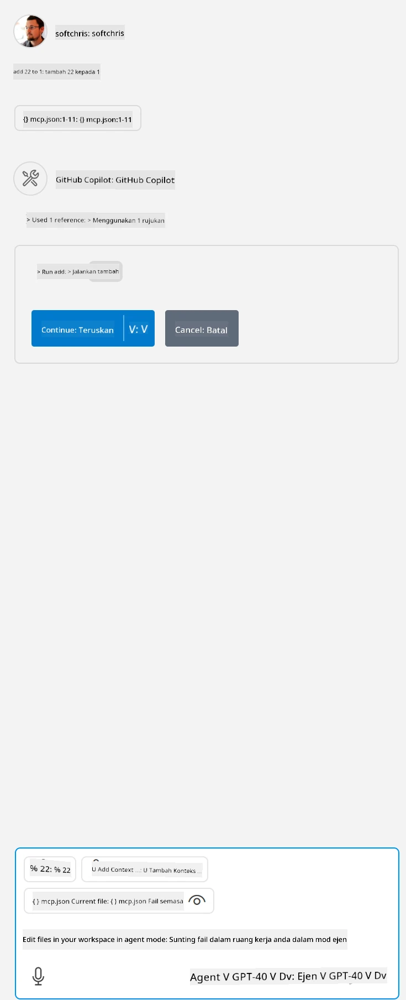

# Menggunakan pelayan dari mod Ejen GitHub Copilot

Visual Studio Code dan GitHub Copilot boleh bertindak sebagai klien dan menggunakan Pelayan MCP. Kenapa kita mahu melakukan itu anda mungkin bertanya? Baiklah, itu bermakna apa sahaja ciri yang ada pada Pelayan MCP kini boleh digunakan dari dalam IDE anda. Bayangkan anda menambah contohnya pelayan MCP GitHub, ini akan membolehkan kawalan terhadap GitHub melalui arahan bertulis berbanding menaip arahan khusus di terminal. Atau bayangkan apa-apa sahaja secara umum yang boleh memperbaiki pengalaman pembangun anda semuanya dikawal dengan bahasa semula jadi. Sekarang anda mula melihat kelebihannya, bukan?

## Gambaran Keseluruhan

Pelajaran ini merangkumi cara menggunakan Visual Studio Code dan mod Ejen GitHub Copilot sebagai klien untuk Pelayan MCP anda.

## Objektif Pembelajaran

Pada akhir pelajaran ini, anda akan dapat:

- Menggunakan Pelayan MCP melalui Visual Studio Code.
- Menjalankan kemampuan seperti alat melalui GitHub Copilot.
- Mengkonfigurasi Visual Studio Code untuk mencari dan mengurus Pelayan MCP anda.

## Cara Penggunaan

Anda boleh mengawal pelayan MCP anda dengan dua cara berbeza:

- Antara muka pengguna, anda akan lihat bagaimana ini dilakukan kemudian dalam bab ini.
- Terminal, adalah mungkin untuk mengawal perkara dari terminal menggunakan executable `code`:

  Untuk menambah pelayan MCP ke profil pengguna anda, gunakan pilihan baris arahan --add-mcp, dan berikan konfigurasi pelayan JSON dalam bentuk {\"name\":\"server-name\",\"command\":...}.

  ```
  code --add-mcp "{\"name\":\"my-server\",\"command\": \"uvx\",\"args\": [\"mcp-server-fetch\"]}"
  ```

### Tangkapan Skrin





Mari kita bincangkan lebih lanjut tentang bagaimana kita menggunakan antara muka visual dalam bahagian seterusnya.

## Pendekatan

Berikut adalah bagaimana kita perlu mendekati ini pada tahap tinggi:

- Konfigurasikan fail untuk mencari Pelayan MCP kami.
- Mulakan/Sambung ke pelayan tersebut untuk mendapatkan senarai kemampuannya.
- Gunakan kemampuan tersebut melalui antara muka GitHub Copilot Chat.

Baik, sekarang kita faham alirannya, mari kita cuba gunakan Pelayan MCP melalui Visual Studio Code melalui latihan.

## Latihan: Menggunakan pelayan

Dalam latihan ini, kita akan mengkonfigurasikan Visual Studio Code untuk mencari pelayan MCP anda supaya ia boleh digunakan dari antara muka GitHub Copilot Chat.

### -0- Langkah awal, aktifkan penemuan Pelayan MCP

Anda mungkin perlu mengaktifkan penemuan Pelayan MCP.

1. Pergi ke `File -> Preferences -> Settings` dalam Visual Studio Code.

1. Cari "MCP" dan aktifkan `chat.mcp.discovery.enabled` dalam fail settings.json.

### -1- Cipta fail konfigurasi

Mula dengan mencipta fail konfigurasi di akar projek anda, anda memerlukan fail bernama MCP.json dan tempatkan ia dalam folder bernama .vscode. Ia harus kelihatan seperti berikut:

```text
.vscode
|-- mcp.json
```

Seterusnya, mari lihat bagaimana kita boleh menambah entri pelayan.

### -2- Konfigurasikan pelayan

Tambahkan kandungan berikut ke *mcp.json*:

```json
{
    "inputs": [],
    "servers": {
       "hello-mcp": {
           "command": "node",
           "args": [
               "build/index.js"
           ]
       }
    }
}
```

Berikut adalah contoh mudah di atas cara memulakan pelayan yang ditulis dalam Node.js, untuk runtime lain tunjukkan arahan yang sesuai untuk memulakan pelayan menggunakan `command` dan `args`.

### -3- Mulakan pelayan

Sekarang anda telah menambah entri, mari mulakan pelayan:

1. Cari entri anda dalam *mcp.json* dan pastikan anda mencari ikon "main":

    

1. Klik ikon "main", anda sepatutnya melihat ikon alat dalam GitHub Copilot Chat bertambah jumlah alat tersedia. Jika anda klik ikon alat tersebut, anda akan melihat senarai alat berdaftar. Anda boleh tandakan/nyah tanda setiap alat bergantung sama ada anda mahu GitHub Copilot menggunakannya sebagai konteks:

  

1. Untuk menjalankan alat, taip arahan yang anda tahu akan padan dengan penerangan salah satu alat anda, contohnya arahan seperti "tambahkan 22 kepada 1":

  

  Anda sepatutnya melihat respons mengatakan 23.

## Tugasan

Cuba tambah entri pelayan ke dalam fail *mcp.json* anda dan pastikan anda boleh mulakan/berhenti pelayan tersebut. Pastikan anda juga boleh berkomunikasi dengan alat pada pelayan anda melalui antara muka GitHub Copilot Chat.

## Penyelesaian

[Penyelesaian](./solution/README.md)

## Perkara Penting

Perkara penting dari bab ini adalah seperti berikut:

- Visual Studio Code adalah klien hebat yang membolehkan anda menggunakan beberapa Pelayan MCP dan alatan mereka.
- Antara muka GitHub Copilot Chat adalah cara anda berinteraksi dengan pelayan.
- Anda boleh meminta pengguna memasukkan input seperti kunci API yang boleh dihantar ke Pelayan MCP semasa mengkonfigurasi entri pelayan dalam fail *mcp.json*.

## Contoh

- [Kalkulator Java](../samples/java/calculator/README.md)
- [Kalkulator .NET](../../../../03-GettingStarted/samples/csharp)
- [Kalkulator JavaScript](../samples/javascript/README.md)
- [Kalkulator TypeScript](../samples/typescript/README.md)
- [Kalkulator Python](../../../../03-GettingStarted/samples/python)

## Sumber Tambahan

- [Dokumen Visual Studio](https://code.visualstudio.com/docs/copilot/chat/mcp-servers)

## Apa Seterusnya

- Seterusnya: [Mencipta Pelayan stdio](../05-stdio-server/README.md)

---

<!-- CO-OP TRANSLATOR DISCLAIMER START -->
**Penafian**:
Dokumen ini telah diterjemahkan menggunakan perkhidmatan terjemahan AI [Co-op Translator](https://github.com/Azure/co-op-translator). Walaupun kami berusaha untuk ketepatan, sila ambil maklum bahawa terjemahan automatik mungkin mengandungi kesilapan atau ketidaktepatan. Dokumen asal dalam bahasa asalnya harus dianggap sebagai sumber yang sahih. Untuk maklumat penting, terjemahan oleh manusia profesional adalah disyorkan. Kami tidak bertanggungjawab terhadap sebarang salah faham atau salah tafsir yang timbul daripada penggunaan terjemahan ini.
<!-- CO-OP TRANSLATOR DISCLAIMER END -->