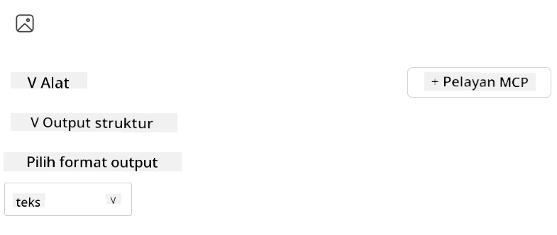
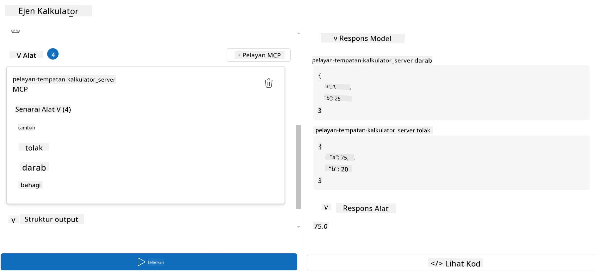

# Menggunakan pelayan dengan Microsoft Foundry Toolkit untuk Visual Studio Code

Apabila anda membina agen AI, ia bukan sahaja tentang menjana respons pintar; ia juga tentang memberi keupayaan kepada agen anda untuk mengambil tindakan. Di sinilah Protokol Konteks Model (MCP) berperanan. MCP memudahkan agen mengakses alat dan perkhidmatan luar secara konsisten. Fikirkan ia seperti menyambungkan agen anda ke sebuah kotak alat yang boleh *betul-betul* digunakan.

Katakan anda menyambungkan agen ke pelayan MCP kalkulator anda. Tiba-tiba, agen anda dapat melakukan operasi matematik hanya dengan menerima arahan seperti "Berapakah 47 darab 89?"—tiada keperluan untuk menulis logik keras atau membina API tersuai.

## Gambaran Keseluruhan

Pelajaran ini merangkumi cara untuk menyambung pelayan MCP kalkulator ke agen dengan
[Microsoft Foundry Toolkit untuk Visual Studio Code](https://aka.ms/AIToolkit),
membolehkan agen anda melakukan operasi matematik melalui bahasa semula jadi.

Microsoft Foundry Toolkit mempermudah pembangunan dan pengujian aplikasi AI generatif
dengan model yang dihoskan secara tempatan dan di awan.

*Nota*: Toolkit ini kini menyokong templat MCP Python dan TypeScript.

## Objektif Pembelajaran

Menjelang akhir pelajaran ini, anda akan dapat:

- Menggunakan pelayan MCP dengan Microsoft Foundry Toolkit.
- Mengkonfigurasi tetapan agen untuk membolehkannya mencari dan menggunakan alat yang disediakan oleh pelayan MCP.
- Menggunakan alat MCP melalui bahasa semula jadi.

## Pendekatan

Berikut adalah cara kita harus mendekatinya pada tahap tinggi:

- Cipta agen dan definisikan arahan sistemnya.
- Cipta pelayan MCP dengan alat kalkulator.
- Sambungkan Pembina Agen ke pelayan MCP.
- Uji panggilan alat agen melalui bahasa semula jadi.

Baik, sekarang kita faham aliran ini, mari kita konfigurasikan agen AI untuk memanfaatkan alat luar melalui MCP, meningkatkan keupayaannya!

## Prasyarat

- [Visual Studio Code](https://code.visualstudio.com/)
- [Microsoft Foundry Toolkit untuk Visual Studio Code](https://aka.ms/AIToolkit)

## Latihan: Menggunakan pelayan

> [!WARNING]
> Nota untuk Pengguna macOS. Kami sedang menyiasat isu yang menjejaskan pemasangan pergantungan pada macOS. Oleh itu, pengguna macOS tidak dapat menyelesaikan tutorial ini buat masa ini. Kami akan mengemas kini arahan sebaik sahaja pembaikan tersedia. Terima kasih atas kesabaran dan kefahaman anda!

Dalam latihan ini, anda akan membina, menjalankan, dan mempertingkatkan agen AI dengan alat daripada
pelayan MCP dalam Visual Studio Code menggunakan Microsoft Foundry Toolkit.

### -0- Langkah awal, tambah pelaksanaan Microsoft Foundry GPT-5.1

Cipta sumber Microsoft Foundry, lancarkan **GPT-5.1**, dan tambahkan pelaksanaan
ke dalam **Model Saya**. Semak
[jadual penamatan model](https://learn.microsoft.com/azure/foundry/openai/concepts/model-retirement-schedule)
ketika memilih pelaksanaan.

1. Buka **Microsoft Foundry Toolkit** dari **Bar Aktiviti**.
1. Dalam bahagian **Katalog**, pilih **Model** untuk membuka **Katalog Model**. Memilih **Model** membuka **Katalog Model** dalam tab penyunting baru.
1. Sambungkan projek Microsoft Foundry anda dan pilih pelaksanaan **GPT-5.1** anda.
1. Klik **+ Tambah** untuk menambahkan pelaksanaan ke senarai **Model Saya** anda.
1. Dalam **Bar Aktiviti**, sahkan pelaksanaan muncul dalam senarai.

### -1- Cipta agen

**Pembina Agen (Arahan)** membolehkan anda mencipta dan menyesuaikan agen AI anda sendiri. Dalam bahagian ini, anda akan cipta agen baru dan tetapkan model untuk menggerakkan perbualan.

1. Buka **Microsoft Foundry Toolkit** dari **Bar Aktiviti**.
1. Dalam bahagian **Alat**, pilih **Pembina Agen (Arahan)**. Memilih **Pembina Agen (Arahan)** membuka **Pembina Agen (Arahan)** dalam tab penyunting baru.
1. Klik butang **+ Agen Baru**. Sambungan akan melancarkan wizard persediaan melalui **Palet Perintah**.
1. Masukkan nama **Agen Kalkulator** dan tekan **Enter**.
1. Dalam **Pembina Agen (Arahan)**, pilih pelaksanaan **GPT-5.1** Foundry anda.

### -2- Cipta arahan sistem untuk agen

Setelah agen dibina, masa untuk menentukan personaliti dan tujuannya. Dalam bahagian ini, anda akan menggunakan ciri **Jana arahan sistem** untuk menggambarkan tingkah laku agen yang diingini—dalam kes ini, agen kalkulator—dan membiarkan model menulis arahan sistem untuk anda.

1. Untuk bahagian **Arahan**, klik butang **Jana arahan sistem**. Butang ini membuka pembina arahan yang menggunakan AI untuk menjana arahan sistem untuk agen.
1. Dalam tetingkap **Jana arahan**, masukkan teks berikut: `You are a helpful and efficient math assistant. When given a problem involving basic arithmetic, you respond with the correct result.`
1. Klik butang **Jana**. Notifikasi akan muncul di sudut kanan bawah mengesahkan arahan sistem sedang dijana. Setelah penjanaan arahan selesai, arahan akan muncul dalam medan **Arahan Sistem** di **Pembina Agen (Arahan)**.
1. Semak **Arahan Sistem** dan ubah jika perlu.

### -3- Cipta pelayan MCP

Kini anda telah mentakrifkan arahan sistem agen anda—yang membimbing tingkah laku dan responsnya—masa untuk membekalkan agen dengan keupayaan praktikal. Dalam bahagian ini, anda akan mencipta pelayan MCP kalkulator dengan alat untuk melakukan pengiraan tambah, tolak, darab, dan bahagi. Pelayan ini membolehkan agen anda melakukan operasi matematik masa nyata sebagai tindak balas kepada arahan dalam bahasa semula jadi.



Microsoft Foundry Toolkit menyertakan templat untuk mencipta pelayan MCP. Kami akan
menggunakan templat Python untuk pelayan MCP kalkulator.

*Nota*: Toolkit kini menyokong templat MCP Python dan TypeScript.

1. Dalam bahagian **Alat** **Pembina Agen (Arahan)**, klik butang **+ Pelayan MCP**. Sambungan akan melancarkan wizard persediaan melalui **Palet Perintah**.
1. Pilih **+ Tambah Pelayan**.
1. Pilih **Cipta Pelayan MCP Baru**.
1. Pilih **python-weather** sebagai templat.
1. Pilih **Folder default** untuk menyimpan templat pelayan MCP.
1. Masukkan nama berikut untuk pelayan: **Calculator**
1. Tetingkap Visual Studio Code baru akan dibuka. Pilih **Ya, saya percayakan pengarang**.
1. Menggunakan terminal (**Terminal** > **Terminal Baru**), cipta persekitaran maya: `python -m venv .venv`
1. Menggunakan terminal, aktifkan persekitaran maya:
    1. Windows - `.venv\Scripts\activate`
    1. macOS/Linux - `source .venv/bin/activate`
1. Menggunakan terminal, pasang pergantungan: `pip install -e .[dev]`
1. Dalam pandangan **Explorer** di **Bar Aktiviti**, kembangkan direktori **src** dan pilih **server.py** untuk membuka fail dalam penyunting.
1. Gantikan kod dalam fail **server.py** dengan yang berikut dan simpan:

    ```python
    """
    Sample MCP Calculator Server implementation in Python.

    
    This module demonstrates how to create a simple MCP server with calculator tools
    that can perform basic arithmetic operations (add, subtract, multiply, divide).
    """
    
    from mcp.server.fastmcp import FastMCP
    
    server = FastMCP("calculator")
    
    @server.tool()
    def add(a: float, b: float) -> float:
        """Add two numbers together and return the result."""
        return a + b
    
    @server.tool()
    def subtract(a: float, b: float) -> float:
        """Subtract b from a and return the result."""
        return a - b
    
    @server.tool()
    def multiply(a: float, b: float) -> float:
        """Multiply two numbers together and return the result."""
        return a * b
    
    @server.tool()
    def divide(a: float, b: float) -> float:
        """
        Divide a by b and return the result.
        
        Raises:
            ValueError: If b is zero
        """
        if b == 0:
            raise ValueError("Cannot divide by zero")
        return a / b
    ```

### -4- Jalankan agen dengan pelayan MCP kalkulator

Kini agen anda mempunyai alat, masa untuk menggunakannya! Dalam bahagian ini, anda akan menghantar arahan kepada agen untuk menguji dan mengesahkan sama ada agen menggunakan alat sesuai dari pelayan MCP kalkulator.



Anda akan menjalankan pelayan MCP kalkulator pada mesin pembangunan tempatan anda melalui **Pembina Agen** sebagai klien MCP.

1. Tekan `F5` untuk mula melakukan debug pelayan MCP. **Pembina Agen (Arahan)** akan dibuka dalam tab penyunting baru. Status pelayan dapat dilihat dalam terminal.
1. Dalam medan **Arahan pengguna** di **Pembina Agen (Arahan)**, masukkan arahan berikut: `I bought 3 items priced at $25 each, and then used a $20 discount. How much did I pay?`
1. Klik butang **Jalankan** untuk menjana respons agen.
1. Semak output agen. Model sepatutnya membuat kesimpulan bahawa anda membayar **$55**.
1. Berikut adalah pecahan apa yang sepatutnya berlaku:
    - Agen memilih alat **darab** dan **tolak** untuk membantu dalam pengiraan.
    - Nilai `a` dan `b` masing-masing ditetapkan untuk alat **darab**.
    - Nilai `a` dan `b` masing-masing ditetapkan untuk alat **tolak**.
    - Respons dari setiap alat disediakan dalam **Respons Alat** masing-masing.
    - Output akhir dari model disediakan dalam **Respons Model** akhir.
1. Hantar arahan tambahan untuk menguji agen dengan lebih lanjut. Anda boleh mengubah arahan sedia ada dalam medan **Arahan pengguna** dengan mengklik ke dalam medan itu dan menggantikan arahan tersebut.
1. Apabila selesai menguji agen, anda boleh menghentikan pelayan melalui **terminal** dengan memasukkan **CTRL/CMD+C** untuk keluar.

## Tugasan

Cuba tambah entri alat tambahan ke dalam fail **server.py** anda (contoh: kembalikan punca kuasa dua nombor). Hantar arahan tambahan yang memerlukan agen menggunakan alat baru anda (atau alat sedia ada). Pastikan untuk mulakan semula pelayan untuk memuatkan alat yang baru ditambah.

## Penyelesaian

[Penyelesaian](./solution/README.md)

## Pengajaran Utama

Pengajaran dari bab ini adalah:

- Microsoft Foundry Toolkit boleh menggunakan pelayan MCP dan alat-alat mereka.
- Anda boleh menambah alat baru ke pelayan MCP, memperluaskan keupayaan agen untuk memenuhi keperluan yang berkembang.
- Microsoft Foundry Toolkit menyertakan templat pelayan MCP untuk mencipta alat tersuai.

## Sumber Tambahan

- [Dokumentasi Microsoft Foundry Toolkit](https://aka.ms/AIToolkit/doc)

## Apa Yang Seterusnya
- Seterusnya: [Ujian & Debugging](../08-testing/README.md)

---

<!-- CO-OP TRANSLATOR DISCLAIMER START -->
**Penafian**:
Dokumen ini telah diterjemahkan menggunakan perkhidmatan terjemahan AI [Co-op Translator](https://github.com/Azure/co-op-translator). Walaupun kami berusaha untuk ketepatan, sila ambil maklum bahawa terjemahan automatik mungkin mengandungi kesilapan atau ketidaktepatan. Dokumen asal dalam bahasa asalnya harus dianggap sebagai sumber yang sahih. Untuk maklumat penting, terjemahan oleh manusia profesional adalah disyorkan. Kami tidak bertanggungjawab terhadap sebarang salah faham atau salah tafsir yang timbul daripada penggunaan terjemahan ini.
<!-- CO-OP TRANSLATOR DISCLAIMER END -->