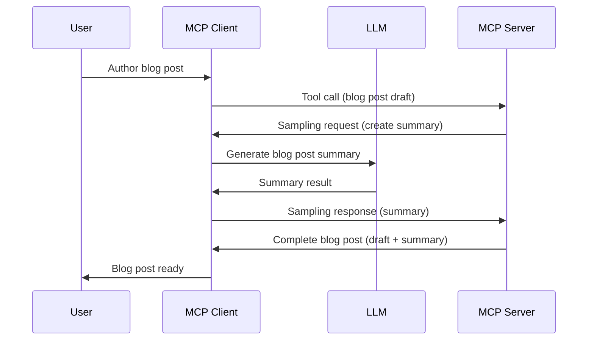

> [!WARNING]
> Pensampelan sudah tidak digunakan dalam MCP `2026-07-28`. Pelajaran ini disimpan untuk
> pelaksanaan warisan.
> Pelayan baru harus berintegrasi terus dengan API penyedia LLM.

# Pensampelan - mengalihkan ciri-ciri kepada Pelanggan

> Sampling kekal dalam spesifikasi `2026-07-28` untuk keserasian dan
> layak untuk dikeluarkan dalam semakan pertama yang dikeluarkan pada atau selepas 28 Julai,
> 2027. Contoh dalam pelajaran ini mungkin menggunakan API SDK yang melaksanakan `2025-11-25`.
> Lihat [Apa Yang Telah Berubah dalam MCP: Spesifikasi 2026-07-28](../../01-CoreConcepts/mcp-2026-07-28.md).

Dalam pelaksanaan warisan, Sampling membenarkan pelayan MCP meminta bantuan daripada LLM
yang diuruskan oleh klien. Untuk pelaksanaan baru, panggil terus pembekal LLM yang dipilih
sebaliknya.

Mari kita terokai beberapa kes penggunaan dan bagaimana membina penyelesaian yang melibatkan sampling.

## Gambaran Keseluruhan

Dalam pelajaran ini, kami memfokuskan pada penerangan bila dan di mana untuk menggunakan Sampling serta cara mengkonfigurasinya.

## Objektif Pembelajaran

Dalam bab ini, kita akan:

- Terangkan apa itu Sampling dan bila menggunakannya.
- Tunjukkan cara mengkonfigurasi Sampling dalam MCP.
- Berikan contoh tentang Sampling dalam tindakan.

## Apa itu Sampling dan mengapa menggunakannya?

Sampling adalah ciri maju yang berfungsi dengan cara berikut:



### Permintaan Sampling

Baiklah, sekarang kita mempunyai pandangan luas mengenai senario yang munasabah, mari kita bincangkan permintaan sampling yang dihantar oleh pelayan kepada klien. Berikut adalah bagaimana permintaan tersebut boleh kelihatan dalam format JSON-RPC:

```json
{
  "jsonrpc": "2.0",
  "id": 1,
  "method": "sampling/createMessage",
  "params": {
    "messages": [
      {
        "role": "user",
        "content": {
          "type": "text",
          "text": "Create a blog post summary of the following blog post: <BLOG POST>"
        }
      }
    ],
    "modelPreferences": {
      "hints": [
        {
          "name": "gpt-5.1"
        }
      ],
      "intelligencePriority": 0.8,
      "speedPriority": 0.5
    },
    "systemPrompt": "You are a helpful assistant.",
    "maxTokens": 100
  }
}
```

Terdapat beberapa perkara yang patut diketengahkan:

- Prompt, di bawah content -> text, adalah prompt kita iaitu arahan untuk LLM merumuskan kandungan pos blog.

- **modelPreferences**. Bahagian ini adalah seperti itu, satu keutamaan, satu cadangan konfigurasi untuk digunakan bersama LLM. Pengguna boleh memilih sama ada untuk menerima cadangan ini atau menukarnya. Dalam kes ini terdapat cadangan mengenai model yang digunakan serta keutamaan kelajuan dan kepintaran.
- **systemPrompt**, ini ialah prompt sistem biasa yang memberikan LLM anda personaliti dan mengandungi arahan panduan.
- **maxTokens**, ini adalah satu lagi sifat yang digunakan untuk menetapkan berapa banyak token yang disyorkan untuk tugasan ini.

### Respon Sampling

Respon ini adalah apa yang MCP Client akhirnya hantar kembali kepada MCP Server dan adalah hasil daripada klien memanggil LLM, menunggu respon tersebut dan kemudian membina mesej ini. Berikut adalah bagaimana ia boleh kelihatan dalam JSON-RPC:

```json
{
  "jsonrpc": "2.0",
  "id": 1,
  "result": {
    "role": "assistant",
    "content": {
      "type": "text",
      "text": "Here's your abstract <ABSTRACT>"
    },
    "model": "gpt-5.1",
    "stopReason": "endTurn"
  }
}
```

Respon tersebut merupakan abstrak pos blog seperti yang diminta. Klien
memilih penyebaran `gpt-5.1` yang aktif daripada keutamaan model pelayan;
keutamaan model adalah cadangan, jadi klien boleh memilih penyebaran aktif lain
apabila diperlukan.

Baiklah, sekarang kita faham aliran utama, dan tugasan berguna untuk menggunakannya ialah "pembuatan pos blog + abstrak", mari lihat apa yang perlu kita buat untuk menjadikannya berfungsi.

### Jenis mesej

Mesej Sampling tidak terhad kepada hanya teks tetapi anda juga boleh menghantar imej dan audio. Beginilah rupa JSON-RPC yang berbeza:

**Teks**

```json
{
  "type": "text",
  "text": "The message content"
}
```

**Kandungan imej**

```json
{
  "type": "image",
  "data": "base64-encoded-image-data",
  "mimeType": "image/jpeg"
}
```

**Kandungan audio**

```json
{
  "type": "audio",
  "data": "base64-encoded-audio-data",
  "mimeType": "audio/wav"
}
```

> NOTE: Untuk status terkini dan panduan migrasi, lihat
> [dokumentasi Sampling yang sudah tidak digunakan](https://modelcontextprotocol.io/specification/2026-07-28/client/sampling).

## Cara Mengkonfigurasi Sampling dalam Klien

> Nota: jika anda hanya membina pelayan, anda tidak perlu melakukan banyak di sini.

Dalam klien, anda perlu spesifikasikan ciri berikut seperti berikut:

```json
{
  "capabilities": {
    "sampling": {}
  }
}
```

Ini kemudian akan diambil apabila klien pilihan anda memulakan dengan pelayan.

## Contoh Sampling dalam Tindakan - Membuat Pos Blog

Mari kita kodkan pelayan sampling bersama, kita perlu lakukan perkara berikut:

1. Cipta alat pada Pelayan.
1. Alat tersebut harus mencipta permintaan sampling
1. Alat harus menunggu bagi permintaan sampling klien dijawab.
1. Kemudian hasil alat harus dihasilkan.

Mari lihat kod langkah demi langkah:

### -1- Cipta alat

**python**

```python
@mcp.tool()
async def create_blog(title: str, content: str, ctx: Context[ServerSession, None]) -> str:
    """Create a blog post and generate a summary"""

```

### -2- Cipta permintaan sampling

Luaskan alat anda dengan kod berikut:

**python**

```python
post = BlogPost(
        id=len(posts) + 1,
        title=title,
        content=content,
        abstract=""
    )

prompt = f"Create an abstract of the following blog post: title: {title} and draft: {content} "

result = await ctx.session.create_message(
        messages=[
            SamplingMessage(
                role="user",
                content=TextContent(type="text", text=prompt),
            )
        ],
        max_tokens=100,
)

```

### -3- Tunggu respon dan berikan respon

**python**

```python
post.abstract = result.content.text

posts.append(post)

# return the complete product
return json.dumps({
    "id": post.title,
    "abstract": post.abstract
})
```

### -4- Kod penuh

**python**

```python
from starlette.applications import Starlette
from starlette.routing import Mount, Host

from mcp.server.fastmcp import Context, FastMCP

from mcp.server.session import ServerSession
from mcp.types import SamplingMessage, TextContent

import json


from uuid import uuid4
from typing import List
from pydantic import BaseModel


mcp = FastMCP("Blog post generator")

# app = FastAPI()

posts = []

class BlogPost(BaseModel):
    id: int
    title: str
    content: str
    abstract: str

posts: List[BlogPost] = []

@mcp.tool()
async def create_blog(title: str, content: str, ctx: Context[ServerSession, None]) -> str:
    """Create a blog post and generate a summary"""

    post = BlogPost(
        id=len(posts) + 1,
        title=title,
        content=content,
        abstract=""
    )

    prompt = f"Create an abstract of the following blog post: title: {title} and draft: {content} "

    result = await ctx.session.create_message(
        messages=[
            SamplingMessage(
                role="user",
                content=TextContent(type="text", text=prompt),
            )
        ],
        max_tokens=100,
    )

    post.abstract = result.content.text

    posts.append(post)

    # return the complete blog post
    return json.dumps({
        "id": post.title,
        "abstract": post.abstract
    })

if __name__ == "__main__":
    print("Starting server...")
    # mcp.run()
    mcp.run(transport="streamable-http")

# run app with: python server.py
```

### -5- Uji dalam Visual Studio Code

Untuk menguji ini dalam Visual Studio Code, lakukan perkara berikut:

1. Mulakan pelayan dalam terminal
1. Tambahkannya ke *mcp.json* (dan pastikan ia dimulakan) contohnya seperti berikut:

   ```json
   "servers": {
      "blog-server": {
        "type": "http",
        "url": "http://localhost:8000/mcp"
      }
   }
   ```

1. Taip prompt:

   ```text
   create a blog post named "Where Python comes from", the content is "Python is actually named after Monty Python Flying Circus"
   ```

1. Benarkan sampling berlaku. Kali pertama anda menguji ini, dialog tambahan akan dipaparkan yang anda perlu terima, kemudian anda akan melihat dialog biasa yang meminta anda menjalankan alat

1. Periksa keputusan. Anda akan melihat keputusan tersebut dipamerkan dengan rapi dalam GitHub Copilot Chat tetapi anda juga boleh melihat respon JSON mentah.

**Bonus**. Alat Visual Studio Code mempunyai sokongan hebat untuk sampling. Anda boleh mengkonfigurasi akses Sampling pada pelayan yang dipasang dengan menavigasi seperti berikut:

1. Navigasi ke bahagian ekstensi.
1. Pilih ikon cog untuk pelayan yang dipasang dalam bahagian "MCP SERVERS - INSTALLED".
1 Pilih "Configure Model Access", di sini anda boleh pilih Model mana GitHub Copilot dibenarkan guna semasa melakukan sampling. Anda juga boleh melihat semua permintaan sampling yang berlaku baru-baru ini dengan memilih "Show Sampling requests".

## Tugasan

Dalam tugasan ini, anda akan membina Sampling yang sedikit berbeza iaitu integrasi sampling yang menyokong penjanaan penerangan produk. Berikut adalah senario anda:

**Senario**: Pekerja pejabat belakang di e-dagang memerlukan bantuan, ia mengambil terlalu banyak masa untuk menghasilkan penerangan produk. Oleh itu, anda perlu membina penyelesaian di mana anda boleh memanggil alat "create_product" dengan "title" dan "keywords" sebagai argumen dan ia harus menghasilkan produk lengkap termasuk medan "description" yang harus diisi oleh LLM klien.

TIP: gunakan apa yang anda pelajari sebelum ini untuk membina pelayan ini dan alatnya menggunakan permintaan sampling.

## Penyelesaian

[Penyelesaian](./solution/README.md)

## Pengajaran Utama

Sampling adalah ciri yang kuat yang membolehkan pelayan mendelegasikan tugasan kepada klien apabila ia memerlukan bantuan LLM.

## Apa Yang Seterusnya

- [Bab 4 - Pelaksanaan praktikal](../../04-PracticalImplementation/README.md)

---

<!-- CO-OP TRANSLATOR DISCLAIMER START -->
**Penafian**:
Dokumen ini telah diterjemahkan menggunakan perkhidmatan terjemahan AI [Co-op Translator](https://github.com/Azure/co-op-translator). Walaupun kami berusaha untuk ketepatan, sila ambil maklum bahawa terjemahan automatik mungkin mengandungi kesilapan atau ketidaktepatan. Dokumen asal dalam bahasa asalnya harus dianggap sebagai sumber yang sahih. Untuk maklumat penting, terjemahan oleh manusia profesional adalah disyorkan. Kami tidak bertanggungjawab terhadap sebarang salah faham atau salah tafsir yang timbul daripada penggunaan terjemahan ini.
<!-- CO-OP TRANSLATOR DISCLAIMER END -->