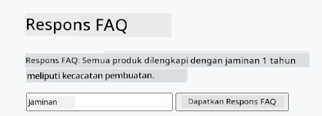
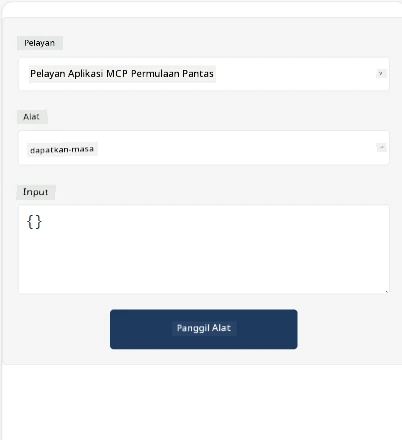
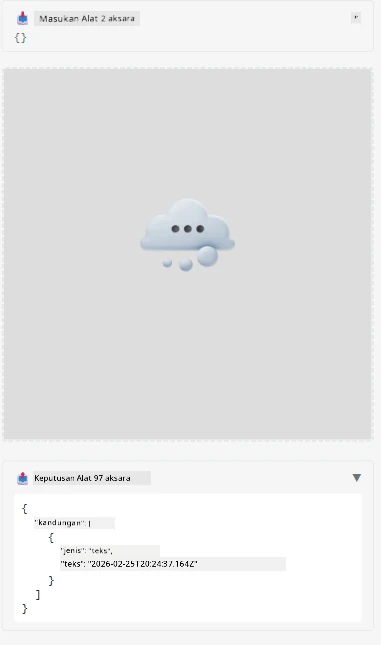

Berikut adalah contoh yang menunjukkan MCP App

## Pasang 

1. Pergi ke folder *mcp-app*
1. Jalankan `npm install`, ini akan memasang kebergantungan frontend dan backend

Sahkan backend boleh dikompilasi dengan menjalankan:

```sh
npx tsc --noEmit
```

Tidak akan ada output jika semuanya berjalan lancar.

## Jalankan backend

> Ini memerlukan sedikit kerja tambahan jika anda menggunakan mesin Windows kerana penyelesaian MCP Apps menggunakan perpustakaan `concurrently` yang anda perlu cari pengganti. Berikut adalah baris yang bermasalah dalam *package.json* di MCP App:

```json
"start": "concurrently \"cross-env NODE_ENV=development INPUT=mcp-app.html vite build --watch\" \"tsx watch main.ts\""
```

Aplikasi ini mempunyai dua bahagian, bahagian backend dan bahagian host.

Mulakan backend dengan memanggil:

```sh
npm start
```

Ini akan memulakan backend pada `http://localhost:3001/mcp`. 

> Nota, jika anda berada dalam Codespace, anda mungkin perlu menetapkan keterlihatan port kepada awam. Semak anda boleh mencapai titik akhir dalam pelayar melalui https://<name of Codespace>.app.github.dev/mcp

## Pilihan -1 Uji aplikasi dalam Visual Studio Code

Untuk menguji penyelesaian dalam Visual Studio Code, lakukan perkara berikut:

- Tambah entri pelayan ke `mcp.json` seperti berikut:

    ```json
    {
        "servers": {
            "my-mcp-server-7178eca7": {
                "url": "http://localhost:3001/mcp",
                "type": "http"
            }
        },
        "inputs": []
    }
    ```

1. Klik butang "start" dalam *mcp.json*
1. Pastikan tetingkap sembang terbuka dan taip `get-faq`, anda sepatutnya melihat hasil seperti berikut:

    

## Pilihan -2- Uji aplikasi dengan host

Repo <https://github.com/modelcontextprotocol/ext-apps> mengandungi beberapa host berbeza yang boleh anda gunakan untuk menguji MVP Apps anda. 

Kami akan memberikan dua pilihan kepada anda di sini:

### Mesin tempatan

- Pergi ke *ext-apps* selepas anda clone repo itu.

- Pasang kebergantungan

   ```sh
   npm install
   ```

- Dalam tetingkap terminal berasingan, pergi ke *ext-apps/examples/basic-host*

    > jika anda menggunakan Codespace, anda perlu pergi ke serve.ts dan baris 27 dan gantikan http://localhost:3001/mcp dengan URL Codespace anda untuk backend, contohnya https://psychic-xylophone-657rpjgvxpc5g64-3001.app.github.dev/mcp

- Jalankan host:

    ```sh
    npm start
    ```

    Ini akan menyambungkan host dengan backend dan anda sepatutnya melihat aplikasi berjalan seperti berikut:

    

### Codespace

Ia memerlukan sedikit kerja tambahan untuk mendapatkan persekitaran Codespace berfungsi. Untuk menggunakan host melalui Codespace: 

- Lihat direktori *ext-apps* dan pergi ke *examples/basic-host*. 
- Jalankan `npm install` untuk memasang kebergantungan
- Jalankan `npm start` untuk memulakan host.

## Uji aplikasi

Cuba aplikasi dengan cara berikut:

- Pilih butang "Call Tool" dan anda sepatutnya melihat hasil seperti berikut:

    

Hebat, semuanya berfungsi.

---

<!-- CO-OP TRANSLATOR DISCLAIMER START -->
**Penafian**:
Dokumen ini telah diterjemahkan menggunakan perkhidmatan terjemahan AI [Co-op Translator](https://github.com/Azure/co-op-translator). Walaupun kami berusaha untuk ketepatan, sila ambil maklum bahawa terjemahan automatik mungkin mengandungi kesilapan atau ketidaktepatan. Dokumen asal dalam bahasa asalnya harus dianggap sebagai sumber yang sahih. Untuk maklumat penting, terjemahan oleh manusia profesional adalah disyorkan. Kami tidak bertanggungjawab terhadap sebarang salah faham atau salah tafsir yang timbul daripada penggunaan terjemahan ini.
<!-- CO-OP TRANSLATOR DISCLAIMER END -->