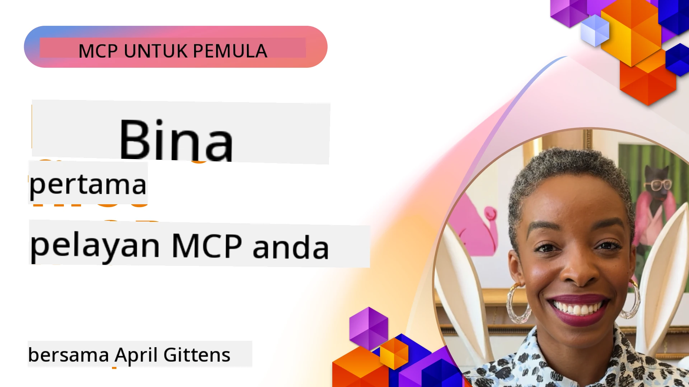

## Memulakan  

_(Klik imej di atas untuk menonton video pelajaran ini)_

Bahagian ini terdiri daripada beberapa pelajaran:

- **1 Server pertama anda**, dalam pelajaran pertama ini, anda akan belajar cara membuat server pertama anda dan menginspeksinya dengan alat pemeriksa, cara yang bernilai untuk menguji dan menyahpepijat server anda, [ke pelajaran](01-first-server/README.md)

- **2 Klien**, dalam pelajaran ini, anda akan belajar cara menulis klien yang boleh menyambung ke server anda, [ke pelajaran](02-client/README.md)

- **3 Klien dengan LLM**, cara yang lebih baik menulis klien adalah dengan menambahkan LLM supaya ia boleh "berunding" dengan server anda tentang apa yang perlu dilakukan, [ke pelajaran](03-llm-client/README.md)

- **4 Menggunakan Mod Ejen GitHub Copilot Server dalam Visual Studio Code**. Di sini, kita melihat menjalankan Server MCP kita dari dalam Visual Studio Code, [ke pelajaran](04-vscode/README.md)

- **5 Server Pengangkutan stdio** pengangkutan stdio adalah standard yang disyorkan untuk komunikasi server-ke-klien MCP tempatan, menyediakan komunikasi berasaskan subproses yang selamat dengan pengasingan proses terbina dalam [ke pelajaran](05-stdio-server/README.md)

- **6 Penstriman HTTP dengan MCP (HTTP Boleh Penstriman)**. Belajar tentang standard
	pengangkutan jauh dalam [Spesifikasi MCP 2026-07-28](https://modelcontextprotocol.io/specification/2026-07-28/basic/transports/streamable-http),
	serta pelaksanaan berasaskan sesi lama yang dikekalkan dalam pelajaran.
	[ke pelajaran](06-http-streaming/README.md)

- **7 Menggunakan Microsoft Foundry Toolkit untuk Visual Studio Code** untuk menggunakan dan menguji klien dan server MCP anda [dalam pelajaran ini](07-aitk/README.md)

- **8 Ujian**. Di sini kita akan fokus khusus bagaimana kita boleh menguji server dan klien kita dengan cara yang berbeza, [ke pelajaran](08-testing/README.md)

- **9 Penempatan**. Bab ini akan melihat pelbagai cara untuk menempatkan penyelesaian MCP anda, [ke pelajaran](09-deployment/README.md)

- **10 Penggunaan server lanjutan**. Bab ini meliputi penggunaan server yang lebih maju, [ke pelajaran](./10-advanced/README.md)

- **11 Pengesahan**. Bab ini meliputi cara menambah pengesahan mudah, dari Pengesahan Asas ke menggunakan JWT dan RBAC. Anda digalakkan untuk bermula di sini dan kemudian lihat Topik Lanjutan dalam Bab 5 dan lakukan pengukuhan keselamatan tambahan melalui saranan dalam Bab 2, [ke pelajaran](./11-simple-auth/README.md)

- **12 Hos MCP**. Konfigurasi dan gunakan klien hos MCP popular termasuk Claude Desktop, Cursor, Cline, dan Windsurf. Pelajari jenis pengangkutan dan penyelesaian masalah, [ke pelajaran](./12-mcp-hosts/README.md)

- **13 Pemeriksa MCP**. Nyahpepijat dan uji server MCP anda secara interaktif menggunakan alat Pemeriksa MCP. Pelajari cara menyelesaikan masalah alat, sumber, dan mesej protokol, [ke pelajaran](./13-mcp-inspector/README.md)

- **14 Pensampelan**. Pelajari primitif Pensampelan lama untuk `2025-11-25` dan
	cara migrasi reka bentuk baru ke integrasi pembekal LLM secara langsung. Pensampelan
	dihentikan dalam MCP `2026-07-28`. [ke pelajaran](./14-sampling/README.md)

- **15 Aplikasi MCP**. Bina Server MCP yang juga membalas dengan arahan UI, [ke pelajaran](./15-mcp-apps/README.md)

Protokol Konteks Model (MCP) adalah protokol terbuka yang menstandardkan bagaimana aplikasi menyediakan konteks kepada LLM. Fikirkan MCP seperti port USB-C untuk aplikasi AI - ia menyediakan cara standard untuk menyambungkan model AI kepada pelbagai sumber data dan alat.

## Objektif Pembelajaran

Menjelang akhir pelajaran ini, anda akan dapat:

- Menyiapkan persekitaran pembangunan untuk MCP dalam C#, Java, Python, TypeScript, dan JavaScript
- Membangun dan menempatkan server MCP asas dengan ciri khusus (sumber, prompt, dan alat)
- Mewujudkan aplikasi hos yang menyambung ke server MCP
- Menguji dan menyahpepijat pelaksanaan MCP
- Memahami cabaran penyediaan biasa dan penyelesaiannya
- Menyambungkan pelaksanaan MCP anda ke perkhidmatan LLM popular

## Menyediakan Persekitaran MCP Anda

Sebelum anda mula bekerja dengan MCP, penting untuk menyediakan persekitaran pembangunan anda dan memahami aliran kerja asas. Bahagian ini akan membimbing anda melalui langkah penyediaan awal untuk memastikan permulaan lancar dengan MCP.

### Prasyarat

Sebelum memulakan pembangunan MCP, pastikan anda mempunyai:

- **Persekitaran Pembangunan**: Untuk bahasa pilihan anda (C#, Java, Python, TypeScript, atau JavaScript)
- **IDE/Penyunting**: Visual Studio, Visual Studio Code, IntelliJ, Eclipse, PyCharm, atau mana-mana penyunting kod moden
- **Pengurus Pakej**: NuGet, Maven/Gradle, pip, atau npm/yarn
- **Kunci API**: Untuk mana-mana perkhidmatan AI yang anda rancang untuk digunakan dalam aplikasi hos anda

### SDK Rasmi

Dalam bab akan datang anda akan melihat penyelesaian dibina menggunakan Python, TypeScript,
Java dan .NET. Berikut adalah SDK rasmi.

Sokongan SDK untuk MCP `2026-07-28` sedang dikeluarkan secara berasingan mengikut bahasa.
Sebelum menjalankan contoh, semak versi pakejnya dan nota keluaran
SDK untuk semakan protokol yang disokong. Lihat
[senarai SDK rasmi](https://modelcontextprotocol.io/docs/sdk):
- [SDK C#](https://github.com/modelcontextprotocol/csharp-sdk) - Diselenggara bersama Microsoft
- [SDK Java](https://github.com/modelcontextprotocol/java-sdk) - Diselenggara bersama Spring AI
- [SDK TypeScript](https://github.com/modelcontextprotocol/typescript-sdk) - Pelaksanaan rasmi TypeScript
- [SDK Python](https://github.com/modelcontextprotocol/python-sdk) - Pelaksanaan rasmi Python (FastMCP)
- [SDK Kotlin](https://github.com/modelcontextprotocol/kotlin-sdk) - Pelaksanaan rasmi Kotlin
- [SDK Swift](https://github.com/modelcontextprotocol/swift-sdk) - Diselenggara bersama Loopwork AI
- [SDK Rust](https://github.com/modelcontextprotocol/rust-sdk) - Pelaksanaan rasmi Rust
- [SDK Go](https://github.com/modelcontextprotocol/go-sdk) - Pelaksanaan rasmi Go

## Perkara Penting

- Menyediakan persekitaran pembangunan MCP adalah mudah dengan SDK khusus bahasa
- Membangun server MCP melibatkan membuat dan mendaftar alat dengan skema yang jelas
- Klien MCP menyambung ke server dan model untuk menggunakan keupayaan diperkembangkan
- Ujian dan penyahpepijatan adalah penting untuk pelaksanaan MCP yang boleh dipercayai
- Pilihan penempatan sebaris dari pembangunan tempatan ke penyelesaian berasaskan awan

## Latihan

Kami mempunyai satu set sampel yang melengkapi latihan yang anda akan lihat dalam semua bab di bahagian ini. Selain itu setiap bab juga mempunyai latihan dan tugasan sendiri

- [Kalkulator Java](./samples/java/calculator/README.md)
- [Kalkulator .NET](../../../03-GettingStarted/samples/csharp)
- [Kalkulator JavaScript](./samples/javascript/README.md)
- [Kalkulator TypeScript](./samples/typescript/README.md)
- [Kalkulator Python](../../../03-GettingStarted/samples/python)

## Sumber Tambahan

- [Bina Ejen menggunakan Protokol Konteks Model di Azure](https://learn.microsoft.com/azure/developer/ai/intro-agents-mcp)
- [MCP Jauh dengan Azure Container Apps (Node.js/TypeScript/JavaScript)](https://learn.microsoft.com/samples/azure-samples/mcp-container-ts/mcp-container-ts/)
- [Ejen MCP OpenAI .NET](https://learn.microsoft.com/samples/azure-samples/openai-mcp-agent-dotnet/openai-mcp-agent-dotnet/)

## Apa seterusnya

Mulakan dengan pelajaran pertama: [Membina Server MCP pertama anda](01-first-server/README.md)

Setelah anda menyelesaikan modul ini, teruskan ke: [Modul 4: Pelaksanaan Praktikal](../04-PracticalImplementation/README.md)

---

<!-- CO-OP TRANSLATOR DISCLAIMER START -->
**Penafian**:
Dokumen ini telah diterjemahkan menggunakan perkhidmatan terjemahan AI [Co-op Translator](https://github.com/Azure/co-op-translator). Walaupun kami berusaha untuk ketepatan, sila ambil maklum bahawa terjemahan automatik mungkin mengandungi kesilapan atau ketidaktepatan. Dokumen asal dalam bahasa asalnya harus dianggap sebagai sumber yang sahih. Untuk maklumat penting, terjemahan oleh manusia profesional adalah disyorkan. Kami tidak bertanggungjawab terhadap sebarang salah faham atau salah tafsir yang timbul daripada penggunaan terjemahan ini.
<!-- CO-OP TRANSLATOR DISCLAIMER END -->