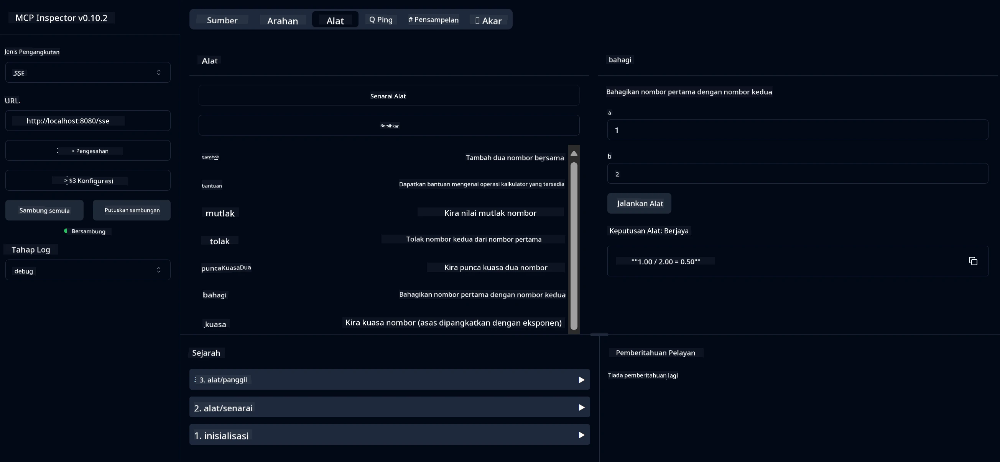

# Perkhidmatan Kalkulator Asas MCP

> [!NOTE]
> Contoh ini menggunakan pengangkutan HTTP+SSE lama dan menyasarkan SDK yang serasi
> dengan MCP `2025-11-25`. Pelayan jauh baru harus menggunakan sokongan
> HTTP Streamable `2026-07-28`.

Perkhidmatan ini menyediakan operasi kalkulator asas melalui Protokol Konteks Model (MCP) menggunakan Spring Boot dengan pengangkutan WebFlux. Ia direka sebagai contoh ringkas untuk pemula yang belajar tentang pelaksanaan MCP.

Untuk maklumat lanjut, lihat dokumentasi rujukan [MCP Server Boot Starter](https://docs.spring.io/spring-ai/reference/api/mcp/mcp-server-boot-starter-docs.html).

## Gambaran Keseluruhan

Perkhidmatan ini mempamerkan:
- Sokongan untuk SSE (Server-Sent Events)
- Pendaftaran alat automatik menggunakan anotasi `@Tool` Spring AI
- Fungsi kalkulator asas:
  - Penambahan, penolakan, pendaraban, pembahagian
  - Pengiraan kuasa dan punca kuasa dua
  - Modulus (baki) dan nilai mutlak
  - Fungsi bantuan untuk penerangan operasi

## Ciri-ciri

Perkhidmatan kalkulator ini menawarkan keupayaan berikut:

1. **Operasi Aritmetik Asas**:
   - Penambahan dua nombor
   - Penolakan satu nombor daripada nombor lain
   - Pendaraban dua nombor
   - Pembahagian satu nombor dengan nombor lain (dengan semakan pembahagian sifar)

2. **Operasi Lanjutan**:
   - Pengiraan kuasa (menaikkan asas kepada punca)
   - Pengiraan punca kuasa dua (dengan semakan nombor negatif)
   - Pengiraan modulus (baki)
   - Pengiraan nilai mutlak

3. **Sistem Bantuan**:
   - Fungsi bantuan terbina dalam yang menerangkan semua operasi yang tersedia

## Menggunakan Perkhidmatan

Perkhidmatan ini mendedahkan titik akhir API berikut melalui protokol MCP:

- `add(a, b)`: Tambah dua nombor bersama
- `subtract(a, b)`: Tolak nombor kedua daripada nombor pertama
- `multiply(a, b)`: Darab dua nombor
- `divide(a, b)`: Bahagikan nombor pertama dengan nombor kedua (dengan semakan sifar)
- `power(base, exponent)`: Kira kuasa nombor
- `squareRoot(number)`: Kira punca kuasa dua (dengan semakan nombor negatif)
- `modulus(a, b)`: Kira baki pembahagian
- `absolute(number)`: Kira nilai mutlak
- `help()`: Dapatkan maklumat tentang operasi yang tersedia

## Pelanggan Ujian

Pelanggan ujian ringkas disertakan dalam pakej `com.microsoft.mcp.sample.client`. Kelas `SampleCalculatorClient` menunjukkan operasi kalkulator yang tersedia.

## Menggunakan Pelanggan LangChain4j

Projek ini termasuk pelanggan contoh LangChain4j di
`com.microsoft.mcp.sample.client.LangChain4jClient` yang menunjukkan cara untuk
menyepadukan perkhidmatan kalkulator dengan model Microsoft Foundry.

### Prasyarat

1. Cipta sumber Microsoft Foundry dan gunakan model aktif seperti
   `gpt-5.1`.
2. Tetapkan titik akhir model, kekunci API, dan nama penggubalan:

   ```bash
   export AZURE_OPENAI_ENDPOINT="https://<resource-name>.openai.azure.com"
   export AZURE_OPENAI_API_KEY="<api-key>"
   export AZURE_OPENAI_DEPLOYMENT="gpt-5.1"
   ```

3. Semak
   [jadual persaraan model Microsoft Foundry](https://learn.microsoft.com/azure/foundry/openai/concepts/model-retirement-schedule)
   sebelum memilih penggubalan.
4. Pastikan pelayan kalkulator berjalan pada `localhost:8080`.

### Menjalankan Pelanggan LangChain4j

Contoh ini menunjukkan:
- Sambungan ke pelayan MCP kalkulator melalui pengangkutan SSE
- Menggunakan LangChain4j untuk membuat bot sembang yang menggunakan operasi kalkulator
- Penyepaduan dengan model Microsoft Foundry yang digubal

Pelanggan menghantar pertanyaan contoh berikut untuk menunjukkan fungsi:
1. Mengira jumlah dua nombor
2. Mencari punca kuasa dua nombor
3. Mendapatkan maklumat bantuan mengenai operasi kalkulator yang tersedia

Jalankan contoh dan periksa output konsol untuk melihat bagaimana model AI menggunakan alat kalkulator untuk menjawab pertanyaan.

### Konfigurasi Model Microsoft Foundry

Pelanggan LangChain4j menggunakan titik akhir yang serasi Azure OpenAI v1 yang didedahkan oleh
Microsoft Foundry:

```java
String endpoint = System.getenv("AZURE_OPENAI_ENDPOINT");
ChatLanguageModel model = OpenAiOfficialChatModel.builder()
   .baseUrl(endpoint.replaceAll("/+$", "") + "/openai/v1/")
   .apiKey(System.getenv("AZURE_OPENAI_API_KEY"))
   .isAzure(true)
   .modelName(System.getenv().getOrDefault("AZURE_OPENAI_DEPLOYMENT", "gpt-5.1"))
    .timeout(Duration.ofSeconds(60))
    .build();
```

`AZURE_OPENAI_DEPLOYMENT` mesti sepadan dengan nama yang diberikan apabila model itu
digunakan, yang mungkin berbeza daripada nama model asas.

## Kebergantungan

Projek ini memerlukan kebergantungan utama berikut:

```xml
<!-- For MCP Server -->
<dependency>
    <groupId>org.springframework.ai</groupId>
    <artifactId>spring-ai-starter-mcp-server-webflux</artifactId>
</dependency>

<!-- For LangChain4j integration -->
<dependency>
    <groupId>dev.langchain4j</groupId>
    <artifactId>langchain4j-mcp</artifactId>
    <version>${langchain4j.version}</version>
</dependency>

<!-- For Microsoft Foundry's OpenAI-compatible endpoint -->
<dependency>
    <groupId>dev.langchain4j</groupId>
   <artifactId>langchain4j-open-ai-official</artifactId>
    <version>${langchain4j.version}</version>
</dependency>
```

## Membina Projek

Bina projek menggunakan Maven:
```bash
./mvnw clean install -DskipTests
```

## Menjalankan Pelayan

### Menggunakan Java

```bash
java -jar target/calculator-server-0.0.1-SNAPSHOT.jar
```

### Menggunakan MCP Inspector

MCP Inspector adalah alat berguna untuk berinteraksi dengan perkhidmatan MCP. Untuk menggunakannya dengan perkhidmatan kalkulator ini:

1. **Pasang dan jalankan MCP Inspector** di tetingkap terminal baru:
   ```bash
   npx @modelcontextprotocol/inspector
   ```

2. **Akses UI web** dengan mengklik URL yang dipaparkan oleh app (biasanya http://localhost:6274)

3. **Konfigurasikan sambungan**:
   - Tetapkan jenis pengangkutan kepada "SSE"
   - Tetapkan URL kepada titik akhir SSE pelayan anda yang sedang berjalan: `http://localhost:8080/sse`
   - Klik "Sambung"

4. **Gunakan alat**:
   - Klik "Senarai Alat" untuk melihat operasi kalkulator yang tersedia
   - Pilih alat dan klik "Jalankan Alat" untuk melaksanakan operasi



### Menggunakan Docker

Projek ini termasuk Dockerfile untuk penghantaran berkontena:

1. **Bina imej Docker**:
   ```bash
   docker build -t calculator-mcp-service .
   ```

2. **Jalankan kontena Docker**:
   ```bash
   docker run -p 8080:8080 calculator-mcp-service
   ```

Ini akan:
- Bina imej Docker multi-peringkat dengan Maven 3.9.9 dan Eclipse Temurin 24 JDK
- Membuat imej kontena yang dioptimumkan
- Dedahkan perkhidmatan pada port 8080
- Mulakan perkhidmatan kalkulator MCP di dalam kontena

Anda boleh mengakses perkhidmatan di `http://localhost:8080` setelah kontena berjalan.

## Penyelesaian Masalah

### Isu Sambungan Model Biasa

1. **Ralat pengesahan**: Sahkan `AZURE_OPENAI_API_KEY` milik
   sumber yang dikenal pasti oleh `AZURE_OPENAI_ENDPOINT`.
2. **Penggubalan tidak ditemui**: Sahkan `AZURE_OPENAI_DEPLOYMENT` tepat sama
   dengan nama penggubalan dalam Microsoft Foundry.
3. **Had kadar**: Semak kuota penggubalan dan cuba semula selepas selang
   yang dipulangkan oleh perkhidmatan.

Untuk bantuan lanjut, lihat
dokumentasi [LangChain4j](https://github.com/langchain4j/langchain4j) dan
dokumentasi [Microsoft Foundry](https://learn.microsoft.com/azure/ai-foundry/).

---

<!-- CO-OP TRANSLATOR DISCLAIMER START -->
**Penafian**:
Dokumen ini telah diterjemahkan menggunakan perkhidmatan terjemahan AI [Co-op Translator](https://github.com/Azure/co-op-translator). Walaupun kami berusaha untuk ketepatan, sila ambil maklum bahawa terjemahan automatik mungkin mengandungi kesilapan atau ketidaktepatan. Dokumen asal dalam bahasa asalnya harus dianggap sebagai sumber yang sahih. Untuk maklumat penting, terjemahan oleh manusia profesional adalah disyorkan. Kami tidak bertanggungjawab terhadap sebarang salah faham atau salah tafsir yang timbul daripada penggunaan terjemahan ini.
<!-- CO-OP TRANSLATOR DISCLAIMER END -->