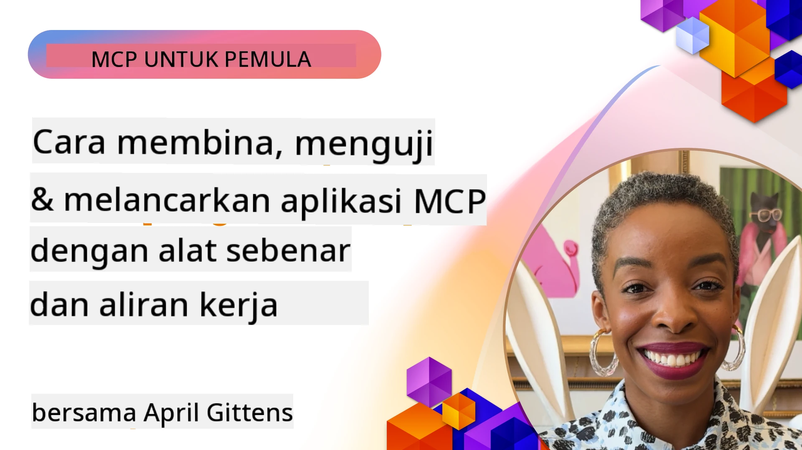
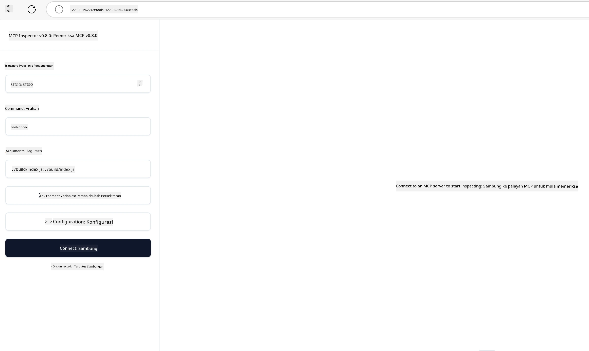

# Pelaksanaan Praktikal

[](https://youtu.be/vCN9-mKBDfQ)

_(Klik imej di atas untuk menonton video pelajaran ini)_

Pelaksanaan praktikal ialah di mana kuasa Protokol Konteks Model (MCP) menjadi ketara. Walaupun memahami teori dan seni bina di sebalik MCP adalah penting, nilai sebenar muncul apabila anda menerapkan konsep ini untuk membina, menguji, dan menerapkan penyelesaian yang menyelesaikan masalah dunia sebenar. Bab ini menjembatani jurang antara pengetahuan konseptual dan pembangunan praktikal, membimbing anda melalui proses membawa aplikasi berasaskan MCP ke kehidupan.

Sama ada anda membangunkan pembantu pintar, mengintegrasikan AI ke dalam aliran kerja perniagaan, atau membina alat khusus untuk pemprosesan data, MCP menyediakan asas yang fleksibel. Reka bentuk bebas bahasa dan SDK rasmi untuk bahasa pengaturcaraan popular menjadikannya boleh diakses oleh pelbagai jenis pembangun. Dengan memanfaatkan SDK ini, anda boleh dengan cepat prototaip, ulang kaji, dan skala penyelesaian anda merentasi pelbagai platform dan persekitaran.

Dalam bahagian berikut, anda akan menemui contoh praktikal, kod contoh, dan strategi penerapan yang menunjukkan cara melaksanakan MCP dalam C#, Java dengan Spring, TypeScript, JavaScript, dan Python. Anda juga akan belajar cara debug dan uji pelayan MCP anda, mengurus API, dan menerapkan penyelesaian ke awan menggunakan Azure. Sumber praktikal ini direka untuk mempercepat pembelajaran anda dan membantu anda membina aplikasi MCP yang kukuh dan bersedia untuk pengeluaran dengan yakin.

## Gambaran Keseluruhan

Pelajaran ini menumpukan pada aspek praktikal pelaksanaan MCP merentasi pelbagai bahasa pengaturcaraan. Kita akan meneroka bagaimana menggunakan SDK MCP dalam C#, Java dengan Spring, TypeScript, JavaScript, dan Python untuk membina aplikasi yang kukuh, debug dan uji pelayan MCP, serta mencipta sumber, arahan, dan alat yang boleh digunakan semula.

## Objektif Pembelajaran

Pada akhir pelajaran ini, anda akan dapat:

- Melaksanakan penyelesaian MCP menggunakan SDK rasmi dalam pelbagai bahasa pengaturcaraan
- Menyahpepijat dan menguji pelayan MCP secara sistematik
- Mencipta dan menggunakan ciri pelayan (Sumber, Arahan, dan Alat)
- Mereka bentuk aliran kerja MCP yang berkesan untuk tugasan kompleks
- Mengoptimumkan pelaksanaan MCP untuk prestasi dan kebolehpercayaan

## Sumber SDK Rasmi

Model Context Protocol menawarkan SDK rasmi untuk pelbagai bahasa. Sokongan SDK
untuk MCP `2026-07-28` dikeluarkan secara berasingan, jadi periksa nota keluaran setiap SDK
dan versi pakej contoh sebelum menganggap keserasian protokol.
Lihat [senarai SDK rasmi](https://modelcontextprotocol.io/docs/sdk):

- [SDK C#](https://github.com/modelcontextprotocol/csharp-sdk)
- [SDK Java dengan Spring](https://github.com/modelcontextprotocol/java-sdk) **Nota:** memerlukan pergantungan pada [Project Reactor](https://projectreactor.io). (Lihat [isu perbincangan 246](https://github.com/orgs/modelcontextprotocol/discussions/246).)
- [TypeScript SDK](https://github.com/modelcontextprotocol/typescript-sdk)
- [Python SDK](https://github.com/modelcontextprotocol/python-sdk)
- [Kotlin SDK](https://github.com/modelcontextprotocol/kotlin-sdk)
- [Go SDK](https://github.com/modelcontextprotocol/go-sdk)

## Bekerja dengan MCP SDKs

Bahagian ini menyediakan contoh praktikal pelaksanaan MCP merentasi pelbagai bahasa pengaturcaraan. Anda boleh mencari kod contoh dalam direktori `samples` yang disusun mengikut bahasa.

### Contoh Tersedia

Repositori ini termasuk [pelaksanaan contoh](../../../04-PracticalImplementation/samples) dalam bahasa berikut:

- [C#](./samples/csharp/README.md)
- [Java dengan Spring](./samples/java/containerapp/README.md)
- [TypeScript](./samples/typescript/README.md)
- [JavaScript](./samples/javascript/README.md)
- [Python](./samples/python/README.md)

Setiap contoh menunjukkan konsep-konsep utama MCP dan corak pelaksanaan untuk bahasa dan ekosistem tersebut.

### Panduan Praktikal

Panduan tambahan untuk pelaksanaan MCP yang praktikal:

- [Penomboran dan Set Keputusan Besar](./pagination/README.md) - Mengendalikan penomboran berasaskan kursor untuk alat, sumber, dan set data besar

## Ciri Teras Pelayan

Pelayan MCP boleh melaksanakan mana-mana gabungan ciri berikut:

### Sumber

Sumber menyediakan konteks dan data untuk digunakan oleh pengguna atau model AI:

- Repositori dokumen
- Pangkalan pengetahuan
- Sumber data berstruktur
- Sistem fail

### Arahan

Arahan adalah mesej dan alur kerja berasaskan templat untuk pengguna:

- Templat perbualan yang telah ditetapkan
- Corak interaksi berpandu
- Struktur dialog khusus

### Alat

Alat adalah fungsi untuk model AI laksanakan:

- Utiliti pemprosesan data
- Integrasi API luar
- Keupayaan pengkomputeran
- Fungsi carian

## Contoh Pelaksanaan: Pelaksanaan C#

Repositori SDK rasmi C# mengandungi beberapa contoh pelaksanaan yang menunjukkan aspek berbeza MCP:

- **Klien MCP Asas**: Contoh ringkas menunjukkan cara mencipta klien MCP dan memanggil alat
- **Pelayan MCP Asas**: Pelaksanaan pelayan minimum dengan pendaftaran alat asas
- **Pelayan MCP Lanjutan**: Pelayan penuh ciri dengan pendaftaran alat, pengesahan, dan pengendalian ralat
- **Integrasi ASP.NET**: Contoh menunjukkan integrasi dengan ASP.NET Core
- **Corak Pelaksanaan Alat**: Pelbagai corak untuk melaksanakan alat dengan tahap kerumitan berbeza

SDK MCP C# dalam pratonton dan API mungkin berubah. Kami akan sentiasa mengemas kini blog ini apabila SDK berkembang.

### Ciri Utama

- [C# MCP Nuget ModelContextProtocol](https://www.nuget.org/packages/ModelContextProtocol)
- Membangun [Pelayan MCP pertama anda](https://devblogs.microsoft.com/dotnet/build-a-model-context-protocol-mcp-server-in-csharp/).

Untuk contoh pelaksanaan C# lengkap, lawati [repositori contoh SDK C# rasmi](https://github.com/modelcontextprotocol/csharp-sdk)

## Contoh pelaksanaan: Pelaksanaan Java dengan Spring

SDK Java dengan Spring menawarkan pilihan pelaksanaan MCP yang kukuh dengan ciri tahap perusahaan.

### Ciri Utama

- Integrasi Spring Framework
- Keselamatan jenis yang kukuh
- Sokongan pengaturcaraan reaktif
- Pengendalian ralat menyeluruh

Untuk contoh pelaksanaan Java dengan Spring lengkap, lihat [contoh Java dengan Spring](samples/java/containerapp/README.md) di direktori contoh.

## Contoh pelaksanaan: Pelaksanaan JavaScript

SDK JavaScript menyediakan pendekatan ringan dan fleksibel untuk pelaksanaan MCP.

### Ciri Utama

- Sokongan Node.js dan pelayar
- API berasaskan Janji
- Integrasi mudah dengan Express dan rangka kerja lain
- Sokongan WebSocket untuk penstriman

Untuk contoh pelaksanaan JavaScript lengkap, lihat [contoh JavaScript](samples/javascript/README.md) di direktori contoh.

## Contoh pelaksanaan: Pelaksanaan Python

SDK Python menawarkan pendekatan Pythonic untuk pelaksanaan MCP dengan integrasi rangka kerja ML yang cemerlang.

### Ciri Utama

- Sokongan async/await dengan asyncio
- Integrasi FastAPI
- Pendaftaran alat yang mudah
- Integrasi asli dengan perpustakaan ML popular

Untuk contoh pelaksanaan Python lengkap, lihat [contoh Python](samples/python/README.md) di direktori contoh.

## Pengurusan API

Pengurusan API Azure adalah jawapan terbaik bagaimana kita boleh mengamankan Pelayan MCP. Idea adalah untuk meletakkan satu instans Pengurusan API Azure di hadapan Pelayan MCP anda dan membiarkannya mengendalikan ciri-ciri yang mungkin anda inginkan seperti:

- had kadar
- pengurusan token
- pemantauan
- pengimbangan beban
- keselamatan

### Contoh Azure

Berikut adalah Contoh Azure yang melakukan perkara tersebut, iaitu [mencipta Pelayan MCP dan mengamankannya dengan Pengurusan API Azure](https://github.com/Azure-Samples/remote-mcp-apim-functions-python).

Lihat bagaimana aliran kebenaran berlaku dalam imej di bawah:


Dalam imej sebelumnya, perkara berikut berlaku:

- Pengesahan/Kebenaran berlaku menggunakan Microsoft Entra.
- Pengurusan API Azure bertindak sebagai pintu masuk dan menggunakan polisi untuk mengarahkan dan mengurus trafik.
- Azure Monitor merekod semua permintaan untuk analisis lanjut.

#### Aliran kebenaran

Mari kita lihat aliran kebenaran dengan lebih terperinci:


#### Spesifikasi kebenaran MCP

Ketahui lebih lanjut tentang
[spesifikasi Kebenaran MCP](https://modelcontextprotocol.io/specification/2026-07-28/basic/authorization/).

## Menyebarkan Pelayan MCP Jauh ke Azure

Mari lihat jika kita boleh menyebarkan contoh yang disebut tadi:

1. Klon repo

    ```bash
    git clone https://github.com/Azure-Samples/remote-mcp-apim-functions-python.git
    cd remote-mcp-apim-functions-python
    ```

1. Daftar pembekal sumber `Microsoft.App`.

   - Jika anda menggunakan Azure CLI, jalankan `az provider register --namespace Microsoft.App --wait`.
   - Jika anda menggunakan Azure PowerShell, jalankan `Register-AzResourceProvider -ProviderNamespace Microsoft.App`. Kemudian jalankan `(Get-AzResourceProvider -ProviderNamespace Microsoft.App).RegistrationState` selepas beberapa ketika untuk memeriksa jika pendaftaran selesai.

1. Jalankan perintah [azd](https://aka.ms/azd) ini untuk menyediakan perkhidmatan pengurusan API, aplikasi fungsi (dengan kod) dan semua sumber Azure lain yang diperlukan

    ```shell
    azd up
    ```

    Perintah ini harus menyebarkan semua sumber awan di Azure

### Menguji pelayan anda dengan MCP Inspector

1. Dalam **tetingkap terminal baru**, pasang dan jalankan MCP Inspector

    ```shell
    npx @modelcontextprotocol/inspector
    ```

    Anda harus melihat antara muka yang serupa dengan:

    

1. CTRL klik untuk memuatkan aplikasi web MCP Inspector dari URL yang dipaparkan oleh aplikasi (contohnya [http://127.0.0.1:6274/#resources](http://127.0.0.1:6274/#resources))
1. Tetapkan jenis pengangkutan kepada `SSE`
1. Tetapkan URL kepada titik akhir Pengurusan API SSE anda yang sedang berjalan yang dipaparkan selepas `azd up` dan **Sambungkan**:

    ```shell
    https://<apim-servicename-from-azd-output>.azure-api.net/mcp/sse
    ```

1. **Senarai Alat**. Klik pada alat dan **Jalankan Alat**.  

Jika semua langkah telah berjaya, anda kini harus bersambung ke pelayan MCP dan anda berjaya memanggil satu alat.

## Pelayan MCP untuk Azure

[Remote-mcp-functions](https://github.com/Azure-Samples/remote-mcp-functions-dotnet): Kumpulan repositori ini adalah templat permulaan pantas untuk membina dan menyebarkan pelayan MCP jauh khusus menggunakan Azure Functions dengan Python, C# .NET atau Node/TypeScript.

Contoh menyediakan penyelesaian lengkap yang membolehkan pembangun untuk:

- Membina dan menjalankan secara setempat: Membangun dan menyahpepijat pelayan MCP pada mesin setempat
- Menyebarkan ke Azure: Mudah menyebarkan ke awan dengan perintah azd up yang ringkas
- Bersambung dari klien: Bersambung ke pelayan MCP dari pelbagai klien termasuk mod ejen Copilot VS Code dan alat MCP Inspector

### Ciri Utama

- Keselamatan secara reka bentuk: Pelayan MCP diamankan menggunakan kunci dan HTTPS
- Pilihan pengesahan: Menyokong OAuth menggunakan pengesahan terbina dalam dan/atau Pengurusan API
- Pengasingan rangkaian: Membenarkan pengasingan rangkaian menggunakan Rangkaian Maya Azure (VNET)
- Seni bina tanpa pelayan: Menggunakan Azure Functions untuk pelaksanaan yang boleh diskala dan berasaskan acara
- Pembangunan setempat: Sokongan pembangunan dan penyahpepijatan setempat yang lengkap
- Penyebaran mudah: Proses penyebaran ke Azure yang mudah

Repositori termasuk semua fail konfigurasi, kod sumber, dan definisi infrastruktur yang diperlukan untuk memulakan implementasi pelayan MCP siap produksi dengan cepat.

- [Azure Remote MCP Functions Python](https://github.com/Azure-Samples/remote-mcp-functions-python) - Implementasi contoh MCP menggunakan Azure Functions dengan Python

- [Azure Remote MCP Functions .NET](https://github.com/Azure-Samples/remote-mcp-functions-dotnet) - Implementasi contoh MCP menggunakan Azure Functions dengan C# .NET

- [Azure Remote MCP Functions Node/Typescript](https://github.com/Azure-Samples/remote-mcp-functions-typescript) - Implementasi contoh MCP menggunakan Azure Functions dengan Node/TypeScript.

## Intipati Utama

- SDK MCP menyediakan alat khusus bahasa untuk melaksanakan penyelesaian MCP yang mantap
- Proses penyahpepijatan dan ujian sangat penting untuk aplikasi MCP yang boleh dipercayai
- Templat prompt yang boleh digunakan semula membolehkan interaksi AI yang konsisten
- Alur kerja yang direka dengan baik boleh mengorkestrasi tugas kompleks menggunakan pelbagai alat
- Melaksanakan penyelesaian MCP memerlukan pertimbangan keselamatan, prestasi, dan pengendalian ralat

## Latihan

Reka alur kerja MCP yang praktikal yang menangani masalah dunia nyata dalam domain anda:

1. Kenal pasti 3-4 alat yang berguna untuk menyelesaikan masalah ini
2. Cipta rajah alur kerja yang menunjukkan bagaimana alat-alat ini berinteraksi
3. Laksanakan versi asas salah satu alat menggunakan bahasa pilihan anda
4. Cipta templat prompt yang akan membantu model menggunakan alat anda dengan berkesan

## Sumber Tambahan

---

## Apa Seterusnya

Seterusnya: [Topik Lanjutan](../05-AdvancedTopics/README.md)

---

<!-- CO-OP TRANSLATOR DISCLAIMER START -->
**Penafian**:
Dokumen ini telah diterjemahkan menggunakan perkhidmatan terjemahan AI [Co-op Translator](https://github.com/Azure/co-op-translator). Walaupun kami berusaha untuk ketepatan, sila ambil maklum bahawa terjemahan automatik mungkin mengandungi kesilapan atau ketidaktepatan. Dokumen asal dalam bahasa asalnya harus dianggap sebagai sumber yang sahih. Untuk maklumat penting, terjemahan oleh manusia profesional adalah disyorkan. Kami tidak bertanggungjawab terhadap sebarang salah faham atau salah tafsir yang timbul daripada penggunaan terjemahan ini.
<!-- CO-OP TRANSLATOR DISCLAIMER END -->