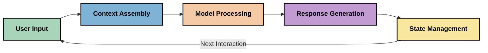
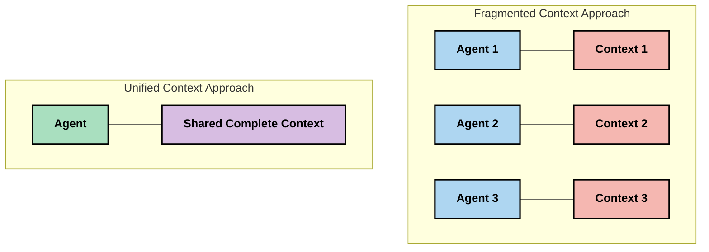
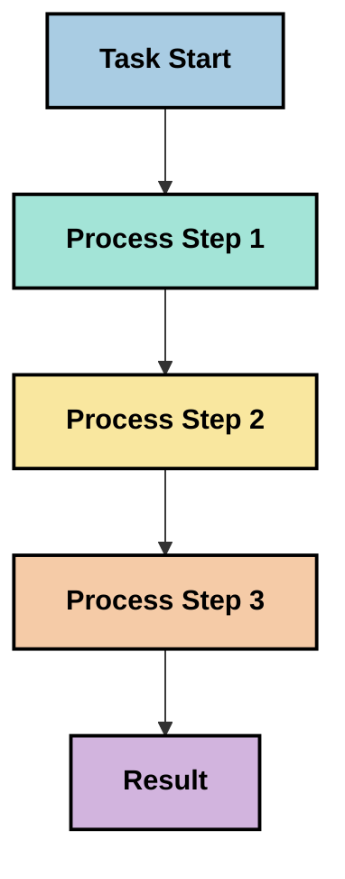
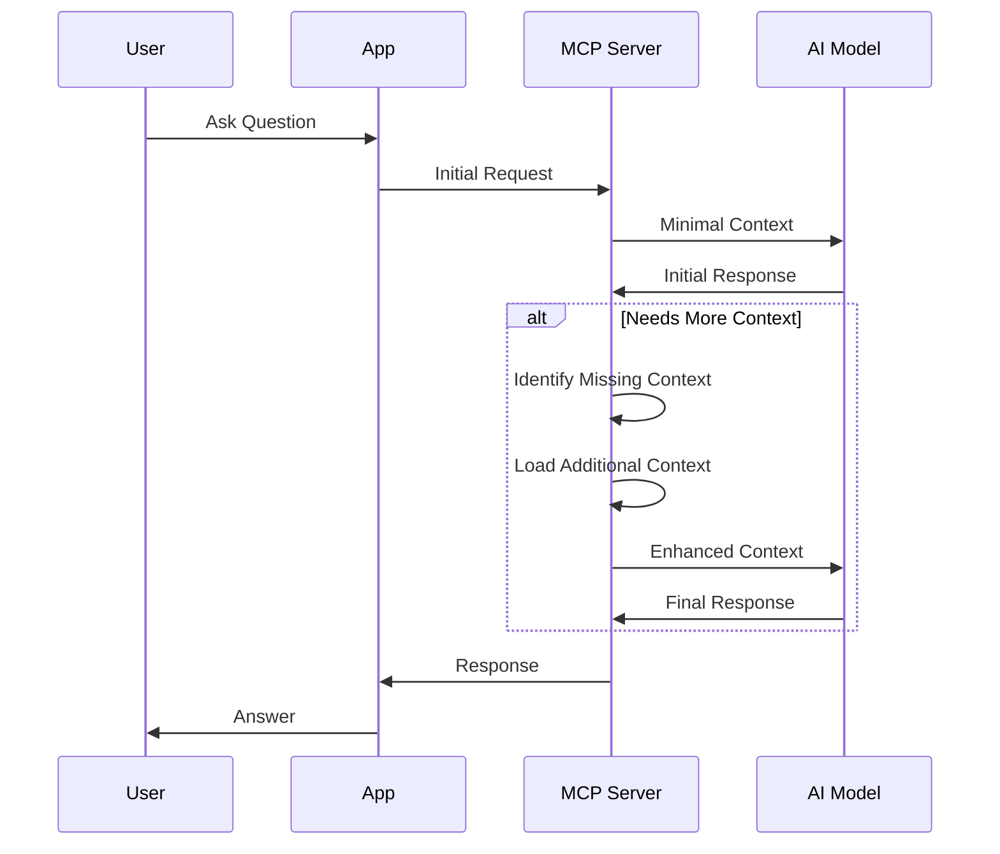
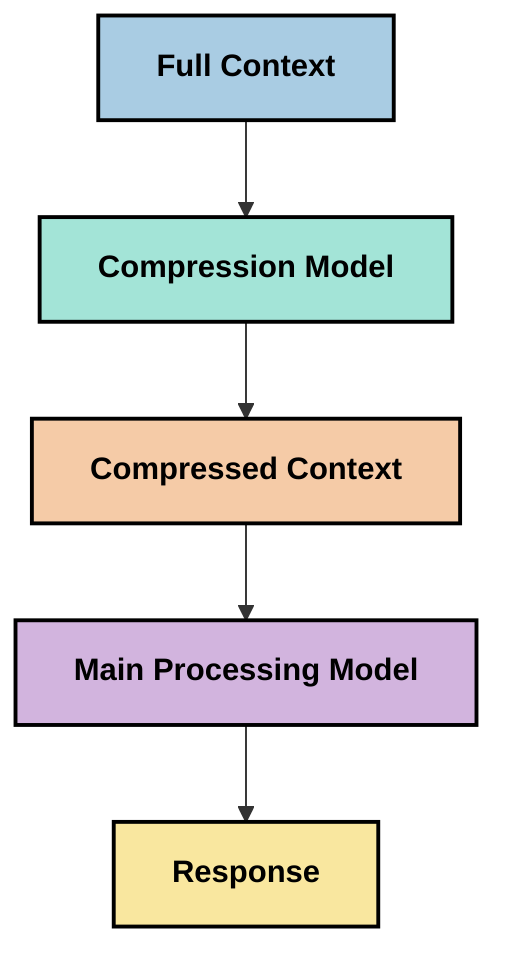
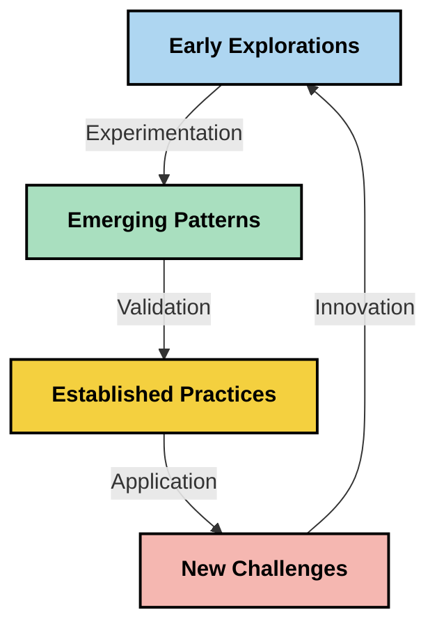

# Kejuruteraan Konteks: Konsep Baru dalam Ekosistem MCP

## Gambaran Keseluruhan

Kejuruteraan konteks adalah konsep baru dalam ruang AI yang meneroka bagaimana maklumat distrukturkan, disampaikan, dan dikekalkan sepanjang interaksi antara pelanggan dan perkhidmatan AI. Ketika ekosistem Protokol Konteks Model (MCP) berkembang, memahami cara mengurus konteks dengan berkesan menjadi semakin penting. Modul ini memperkenalkan konsep kejuruteraan konteks dan meneroka potensi penggunaannya dalam pelaksanaan MCP.

## Objektif Pembelajaran

Menjelang akhir modul ini, anda akan dapat:

- Memahami konsep baru kejuruteraan konteks dan peranannya yang berpotensi dalam aplikasi MCP
- Mengenal pasti cabaran utama dalam pengurusan konteks yang ditangani oleh reka bentuk protokol MCP
- Meneroka teknik untuk meningkatkan prestasi model melalui pengendalian konteks yang lebih baik
- Mempertimbangkan pendekatan untuk mengukur dan menilai keberkesanan konteks
- Menerapkan konsep baru ini untuk memperbaiki pengalaman AI melalui rangka kerja MCP

## Pengenalan kepada Kejuruteraan Konteks

Kejuruteraan konteks adalah konsep baru yang memfokuskan pada reka bentuk dan pengurusan aliran maklumat secara sengaja antara pengguna, aplikasi, dan model AI. Berbeza dengan bidang yang telah ditetapkan seperti kejuruteraan arahan, kejuruteraan konteks masih didefinisikan oleh pengamal ketika mereka berusaha menyelesaikan cabaran unik dalam menyediakan model AI dengan maklumat yang tepat pada masa yang tepat.

Ketika model bahasa besar (LLM) telah berkembang, kepentingan konteks menjadi semakin jelas. Kualiti, kaitan, dan struktur konteks yang kami sediakan secara langsung mempengaruhi keluaran model. Kejuruteraan konteks meneroka hubungan ini dan berusaha membangunkan prinsip untuk pengurusan konteks yang berkesan.

> "Pada tahun 2025, model di luar sana sangat pintar. Tetapi walaupun manusia paling pintar tidak akan dapat menjalankan tugas mereka dengan berkesan tanpa konteks apa yang mereka diminta lakukan... 'Kejuruteraan konteks' adalah tahap seterusnya dalam kejuruteraan arahan. Ia mengenai melakukan ini secara automatik dalam sistem dinamik." — Walden Yan, Cognition AI

Kejuruteraan konteks mungkin meliputi:

1. **Pemilihan Konteks**: Menentukan maklumat yang relevan untuk tugasan tertentu
2. **Penyusunan Konteks**: Menyusun maklumat untuk memaksimumkan pemahaman model
3. **Penghantaran Konteks**: Mengoptimumkan cara dan masa maklumat dihantar ke model
4. **Penyelenggaraan Konteks**: Menguruskan keadaan dan evolusi konteks dari masa ke masa
5. **Penilaian Konteks**: Mengukur dan memperbaiki keberkesanan konteks

Bidang fokus ini sangat relevan dalam ekosistem MCP, yang menyediakan cara standard bagi aplikasi untuk menyediakan konteks kepada LLM.


## Perspektif Perjalanan Konteks

Salah satu cara untuk memvisualisasikan kejuruteraan konteks adalah menjejaki perjalanan maklumat melalui sistem MCP:



### Tahap Utama dalam Perjalanan Konteks:

1. **Input Pengguna**: Maklumat mentah dari pengguna (teks, imej, dokumen)
2. **Perhimpunan Konteks**: Menggabungkan input pengguna dengan konteks sistem, sejarah perbualan, dan maklumat lain yang diperoleh
3. **Pemprosesan Model**: Model AI memproses konteks yang dihimpun
4. **Penjanaan Respons**: Model menghasilkan keluaran berdasarkan konteks yang diberikan
5. **Pengurusan Keadaan**: Sistem mengemas kini keadaannya berdasarkan interaksi

Perspektif ini menyoroti sifat dinamik konteks dalam sistem AI dan membangkitkan persoalan penting mengenai cara terbaik untuk mengurus maklumat pada setiap tahap.

## Prinsip Baru dalam Kejuruteraan Konteks

Ketika bidang kejuruteraan konteks terbentuk, beberapa prinsip awal mula muncul daripada pengamal. Prinsip ini boleh membantu memaklumkan pilihan pelaksanaan MCP:

### Prinsip 1: Kongsi Konteks Sepenuhnya

Konteks harus dikongsi sepenuhnya antara semua komponen dalam sistem dan bukannya dipecahkan kepada beberapa ejen atau proses. Apabila konteks diedarkan, keputusan yang dibuat di satu bahagian sistem mungkin bertentangan dengan keputusan di bahagian lain.



Dalam aplikasi MCP, ini mencadangkan mereka bentuk sistem di mana konteks mengalir lancar melalui seluruh rangkaian dan tidak dikompartmenkan.

### Prinsip 2: Kenali Bahawa Tindakan Membawa Keputusan Tersirat

Setiap tindakan yang diambil oleh model mengandungi keputusan tersirat tentang cara mentafsir konteks. Apabila beberapa komponen bertindak atas konteks yang berbeza, keputusan tersirat ini boleh bertentangan, menyebabkan hasil yang tidak konsisten.

Prinsip ini mempunyai implikasi penting bagi aplikasi MCP:
- Utamakan pemprosesan linear tugas yang kompleks daripada pelaksanaan selari dengan konteks yang terpecah
- Pastikan semua titik keputusan mempunyai akses kepada maklumat kontekstual yang sama
- Reka bentuk sistem di mana langkah-langkah kemudian dapat melihat keseluruhan konteks keputusan terdahulu

### Prinsip 3: Seimbangkan Kedalaman Konteks dengan Had Tetingkap

Apabila perbualan dan proses menjadi lebih panjang, tetingkap konteks akhirnya melimpah. Kejuruteraan konteks yang berkesan meneroka pendekatan untuk mengurus ketegangan antara konteks yang menyeluruh dan batasan teknikal.

Pendekatan yang mungkin sedang diterokai termasuk:
- Pemampatan konteks yang mengekalkan maklumat penting sambil mengurangkan penggunaan token
- Memuat konteks secara progresif berdasarkan kaitan dengan keperluan semasa
- Merumuskan interaksi sebelumnya sambil mengekalkan keputusan dan fakta utama

## Cabaran Konteks dan Reka Bentuk Protokol MCP

Protokol Konteks Model (MCP) direka dengan kesedaran akan cabaran unik pengurusan konteks. Memahami cabaran ini membantu menjelaskan aspek utama reka bentuk protokol MCP:


### Cabaran 1: Had Tetingkap Konteks
Kebanyakan model AI mempunyai saiz tetingkap konteks yang tetap, membatasi berapa banyak maklumat yang boleh mereka proses sekaligus.

**Respons Reka Bentuk MCP:** 
- Protokol menyokong konteks berstruktur berasaskan sumber yang boleh dirujuk dengan cekap
- Sumber boleh dipaginakan dan dimuatkan secara progresif

### Cabaran 2: Penentuan Kaitannya
Menentukan maklumat mana yang paling relevan untuk disertakan dalam konteks adalah sukar.

**Respons Reka Bentuk MCP:**
- Alat fleksibel membolehkan pengambilan maklumat dinamik berdasarkan keperluan
- Arahan berstruktur membolehkan organisasi konteks yang konsisten

### Cabaran 3: Kekal Konteks
Mengurus status sepanjang interaksi memerlukan penjejakan konteks yang teliti.

**Respons Reka Bentuk MCP:**
- Pengurusan sesi yang distandardkan
- Corak interaksi yang jelas untuk evolusi konteks

### Cabaran 4: Konteks Multi-Modal
Pelbagai jenis data (teks, imej, data berstruktur) memerlukan pengendalian yang berbeza.

**Respons Reka Bentuk MCP:**
- Reka bentuk protokol mengakomodasi pelbagai jenis kandungan
- Representasi standard maklumat multi-modal

### Cabaran 5: Keselamatan dan Privasi
Konteks sering mengandungi maklumat sensitif yang mesti dilindungi.

**Respons Reka Bentuk MCP:**
- Sempadan jelas antara tanggungjawab klien dan pelayan
- Pilihan pemprosesan lokal untuk meminimumkan pendedahan data

Memahami cabaran ini dan bagaimana MCP mengatasinya menyediakan asas untuk meneroka teknik kejuruteraan konteks yang lebih maju.

## Pendekatan Baru dalam Kejuruteraan Konteks

Ketika bidang kejuruteraan konteks berkembang, beberapa pendekatan yang menjanjikan muncul. Ini mewakili pemikiran semasa dan bukan amalan terbaik yang sudah mantap, dan kemungkinan akan berubah apabila kita memperoleh lebih banyak pengalaman dengan pelaksanaan MCP.

### 1. Pemprosesan Linear Berterusan Tunggal

Berbeza dengan seni bina berbilang ejen yang mengedarkan konteks, beberapa pengamal mendapati bahawa pemprosesan linear berterusan tunggal menghasilkan hasil yang lebih konsisten. Ini sejajar dengan prinsip mengekalkan konteks yang bersatu.



Walaupun pendekatan ini mungkin kelihatan kurang cekap berbanding pemprosesan selari, ia sering menghasilkan hasil yang lebih koheren dan boleh dipercayai kerana setiap langkah dibina berdasarkan pemahaman penuh keputusan terdahulu.

### 2. Pemecahan dan Prioritisasi Konteks

Memecah konteks besar menjadi bahagian yang mudah diurus dan mengutamakan apa yang paling penting.

```python
# Conceptual Example: Context Chunking and Prioritization
def process_with_chunked_context(documents, query):
    # 1. Break documents into smaller chunks
    chunks = chunk_documents(documents)
    
    # 2. Calculate relevance scores for each chunk
    scored_chunks = [(chunk, calculate_relevance(chunk, query)) for chunk in chunks]
    
    # 3. Sort chunks by relevance score
    sorted_chunks = sorted(scored_chunks, key=lambda x: x[1], reverse=True)
    
    # 4. Use the most relevant chunks as context
    context = create_context_from_chunks([chunk for chunk, score in sorted_chunks[:5]])
    
    # 5. Process with the prioritized context
    return generate_response(context, query)
```

Konsep di atas menggambarkan bagaimana kita boleh memecah dokumen besar menjadi bahagian yang mudah diurus dan memilih hanya bahagian yang paling relevan untuk konteks. Pendekatan ini boleh membantu bekerja dalam had tetingkap konteks sambil masih menggunakan pangkalan pengetahuan yang besar.

### 3. Pemuatkan Konteks Secara Progresif

Memuat konteks secara progresif mengikut keperluan dan bukannya sekaligus.



Pemuatkan konteks progresif bermula dengan konteks minimum dan berkembang hanya apabila perlu. Ini boleh mengurangkan penggunaan token dengan ketara untuk pertanyaan mudah sambil mengekalkan kemampuan untuk mengendalikan soalan kompleks.

### 4. Pemampatan dan Perumusan Konteks

Mengurangkan saiz konteks sambil mengekalkan maklumat penting.



Pemampatan konteks memberi tumpuan kepada:
- Menghapuskan maklumat berulang
- Merumuskan kandungan yang panjang
- Mengekstrak fakta dan butiran utama
- Mengekalkan elemen konteks kritikal
- Mengoptimumkan kecekapan token

Pendekatan ini boleh sangat berharga untuk mengekalkan perbualan panjang dalam tetingkap konteks atau untuk memproses dokumen besar dengan cekap. Beberapa pengamal menggunakan model khusus secara khusus untuk pemampatan konteks dan perumusan sejarah perbualan.


## Pertimbangan Eksplorasi Kejuruteraan Konteks

Semasa meneroka bidang baru kejuruteraan konteks, beberapa pertimbangan patut diambil kira apabila bekerja dengan pelaksanaan MCP. Ini bukan amalan terbaik yang preskriptif tetapi kawasan eksplorasi yang mungkin memberikan peningkatan dalam kes penggunaan spesifik anda.

### Pertimbangkan Matlamat Konteks Anda

Sebelum melaksanakan penyelesaian pengurusan konteks yang kompleks, nyatakan dengan jelas apa yang anda cuba capai:
- Apakah maklumat khusus yang model perlukan untuk berjaya?
- Maklumat mana yang penting dan mana yang tambahan?
- Apakah had prestasi anda (latensi, had token, kos)?

### Terokai Pendekatan Konteks Berlapis

Beberapa pengamal mendapati kejayaan dengan konteks yang disusun dalam lapisan konseptual:
- **Lapisan Teras**: Maklumat penting yang sentiasa diperlukan oleh model
- **Lapisan Situasional**: Konteks khusus untuk interaksi semasa
- **Lapisan Sokongan**: Maklumat tambahan yang mungkin berguna
- **Lapisan Cadangan**: Maklumat yang diakses hanya apabila diperlukan

### Siasat Strategi Pengambilan

Keberkesanan konteks anda sering bergantung pada bagaimana anda mengambil maklumat:
- Carian semantik dan embedding untuk mencari maklumat yang relevan secara konseptual
- Carian berdasarkan kata kunci untuk butiran fakta spesifik
- Pendekatan hibrid yang menggabungkan beberapa kaedah pengambilan
- Penapisan metadata untuk menyempitkan skop berdasarkan kategori, tarikh, atau sumber

### Cuba Koherensi Konteks

Struktur dan aliran konteks anda mungkin mempengaruhi pemahaman model:
- Mengelompokkan maklumat yang berkaitan bersama
- Menggunakan format dan organisasi yang konsisten
- Menjaga urutan logik atau kronologi apabila sesuai
- Mengelakkan maklumat bertentangan

### Timbang Kelebihan dan Kekurangan Seni Bina Berbilang Ejen

Walaupun seni bina berbilang ejen popular dalam banyak rangka kerja AI, ia disertai cabaran besar dalam pengurusan konteks:
- Pemecahan konteks boleh menyebabkan keputusan tidak konsisten antara ejen
- Pemprosesan selari mungkin memperkenalkan konflik yang sukar diselesaikan
- Beban komunikasi antara ejen boleh mengimbangi peningkatan prestasi
- Pengurusan keadaan yang kompleks diperlukan untuk mengekalkan koherensi

Dalam banyak kes, pendekatan ejen tunggal dengan pengurusan konteks yang menyeluruh mungkin menghasilkan keputusan yang lebih boleh dipercayai berbanding beberapa ejen khusus dengan konteks yang terpecah.

### Bangunkan Kaedah Penilaian

Untuk memperbaiki kejuruteraan konteks dari masa ke masa, pertimbangkan bagaimana anda akan mengukur kejayaan:
- Ujian A/B dengan struktur konteks berbeza
- Memantau penggunaan token dan masa tindak balas
- Mengesan kepuasan pengguna dan kadar penyelesaian tugasan
- Menganalisis bila dan mengapa strategi konteks gagal

Pertimbangan ini mewakili kawasan eksplorasi aktif dalam ruang kejuruteraan konteks. Ketika bidang ini matang, corak dan amalan yang lebih pasti mungkin muncul.

## Mengukur Keberkesanan Konteks: Rangka Kerja yang Berkembang

Ketika kejuruteraan konteks muncul sebagai konsep, pengamal mula meneroka bagaimana kita boleh mengukurnya. Tiada rangka kerja yang mantap lagi, tetapi pelbagai metrik sedang dipertimbangkan yang dapat membantu panduan kerja masa depan.

### Dimensi Pengukuran Potensi


#### 1. Pertimbangan Kecekapan Input

- **Nisbah Konteks ke Respons**: Berapa banyak konteks diperlukan berbanding saiz respons?
- **Penggunaan Token**: Berapakah peratusan token konteks yang diberi yang nampaknya mempengaruhi respons?
- **Pengurangan Konteks**: Sejauh mana kita boleh memampatkan maklumat mentah dengan berkesan?

#### 2. Pertimbangan Prestasi

- **Kesan Latensi**: Bagaimana pengurusan konteks mempengaruhi masa tindak balas?
- **Ekonomi Token**: Adakah kita mengoptimumkan penggunaan token dengan berkesan?
- **Ketepatan Pengambilan**: Sejauh manakah maklumat yang diambil adalah relevan?
- **Penggunaan Sumber**: Apakah sumber pengkomputeran yang diperlukan?

#### 3. Pertimbangan Kualiti

- **Kaitan Respons**: Sejauh manakah respons itu menjawab pertanyaan?
- **Ketepatan Faktual**: Adakah pengurusan konteks memperbaiki ketepatan fakta?
- **Konsistensi**: Adakah respons konsisten merentasi pertanyaan serupa?
- **Kadar Halusinasi**: Adakah konteks yang lebih baik mengurangkan halusinasi model?

#### 4. Pertimbangan Pengalaman Pengguna

- **Kadar Susulan**: Berapa kerap pengguna memerlukan penjelasan lanjut?
- **Penyelesaian Tugasan**: Adakah pengguna berjaya mencapai matlamat mereka?
- **Penunjuk Kepuasan**: Bagaimana pengguna menilai pengalaman mereka?

### Pendekatan Eksplorasi untuk Pengukuran

Apabila bereksperimen dengan kejuruteraan konteks dalam pelaksanaan MCP, pertimbangkan pendekatan eksplorasi ini:

1. **Perbandingan Asas**: Tetapkan asas dengan pendekatan konteks mudah sebelum menguji kaedah yang lebih canggih

2. **Perubahan Inkremental**: Ubah satu aspek pengurusan konteks pada satu masa untuk memisahkan kesannya

3. **Penilaian Berpusatkan Pengguna**: Gabungkan metrik kuantitatif dengan maklum balas kualitatif pengguna

4. **Analisis Kegagalan**: Selidiki kes di mana strategi konteks gagal untuk memahami penambahbaikan yang mungkin

5. **Penilaian Berbilang Dimensi**: Pertimbangkan pertukaran antara kecekapan, kualiti, dan pengalaman pengguna

Pendekatan eksperimen berbilang aspek ini sejajar dengan sifat baru kejuruteraan konteks.

## Pemikiran Penutup

Kejuruteraan konteks adalah bidang penerokaan baru yang mungkin menjadi pusat kepada aplikasi MCP yang berkesan. Dengan mempertimbangkan dengan teliti bagaimana maklumat mengalir melalui sistem anda, anda mungkin dapat mencipta pengalaman AI yang lebih cekap, tepat, dan bernilai kepada pengguna.

Teknik dan pendekatan yang dibentangkan dalam modul ini mewakili pemikiran awal dalam bidang ini, bukan amalan yang sudah mantap. Kejuruteraan konteks mungkin berkembang menjadi disiplin yang lebih jelas apabila keupayaan AI berkembang dan pemahaman kita mendalam. Untuk sekarang, eksperimen bersama pengukuran teliti kelihatan sebagai pendekatan yang paling produktif.

## Arah Potensi Masa Depan

Bidang kejuruteraan konteks masih dalam peringkat awal, tetapi beberapa arah yang menjanjikan sedang muncul:

- Prinsip kejuruteraan konteks mungkin memberi kesan besar terhadap prestasi model, kecekapan, pengalaman pengguna, dan kebolehpercayaan
- Pendekatan berterusan tunggal dengan pengurusan konteks menyeluruh mungkin mengatasi seni bina berbilang ejen untuk banyak kes penggunaan
- Model pemampatan konteks khusus mungkin menjadi komponen standard dalam aliran AI
- Ketegangan antara kesempurnaan konteks dan had token mungkin mendorong inovasi dalam pengendalian konteks
- Apabila model menjadi lebih cekap dalam komunikasi seperti manusia, kolaborasi berbilang ejen yang sebenar mungkin menjadi lebih boleh dilaksanakan
- Pelaksanaan MCP mungkin berkembang untuk menstandardkan corak pengurusan konteks yang muncul daripada eksperimen semasa



## Sumber

### Sumber Rasmi MCP
- [Laman Web Protokol Konteks Model](https://modelcontextprotocol.io/)
- [Spesifikasi Protokol Konteks Model](https://github.com/modelcontextprotocol/modelcontextprotocol)
- [Dokumentasi MCP](https://modelcontextprotocol.io/docs)
- [MCP C# SDK](https://github.com/modelcontextprotocol/csharp-sdk)
- [MCP Python SDK](https://github.com/modelcontextprotocol/python-sdk)
- [MCP TypeScript SDK](https://github.com/modelcontextprotocol/typescript-sdk)
- [MCP Inspector](https://github.com/modelcontextprotocol/inspector) - Alat ujian visual untuk pelayan MCP

### Artikel Kejuruteraan Konteks
- [Jangan Membina Multi-Ejen: Prinsip Kejuruteraan Konteks](https://cognition.ai/blog/dont-build-multi-agents) - Pandangan Walden Yan tentang prinsip kejuruteraan konteks
- [Panduan Praktikal untuk Membina Ejen](https://cdn.openai.com/business-guides-and-resources/a-practical-guide-to-building-agents.pdf) - Panduan OpenAI mengenai reka bentuk ejen yang berkesan
- [Membina Ejen Berkesan](https://www.anthropic.com/engineering/building-effective-agents) - Pendekatan Anthropic terhadap pembangunan ejen

### Penyelidikan Berkaitan
- [Pengayaan Pengambilan Dinamik untuk Model Bahasa Besar](https://arxiv.org/abs/2310.01487) - Penyelidikan mengenai pendekatan pengambilan dinamik
- [Hilang di Tengah: Bagaimana Model Bahasa Menggunakan Konteks Panjang](https://arxiv.org/abs/2307.03172) - Penyelidikan penting mengenai corak pemprosesan konteks
- [Penjanaan Imej Bersyarat Teks Berhierarki dengan Latent CLIP](https://arxiv.org/abs/2204.06125) - Kertas DALL-E 2 dengan pandangan tentang penyusunan konteks
- [Meneroka Peranan Konteks dalam Seni Bina Model Bahasa Besar](https://aclanthology.org/2023.findings-emnlp.124/) - Penyelidikan terkini mengenai pengendalian konteks
- [Kerjasama Multi-Ejen: Satu Tinjauan](https://arxiv.org/abs/2304.03442) - Penyelidikan mengenai sistem multi-ejen dan cabaran mereka

### Sumber Tambahan
- [Teknik Pengoptimuman Tetingkap Konteks](https://learn.microsoft.com/en-us/azure/ai-services/openai/concepts/context-window)
- [Teknik RAG Lanjutan](https://www.microsoft.com/en-us/research/blog/retrieval-augmented-generation-rag-and-frontier-models/)
- [Dokumentasi Teras Semantik](https://github.com/microsoft/semantic-kernel)
- [Kit Alat Microsoft Foundry untuk Visual Studio Code](https://github.com/microsoft/vscode-ai-toolkit)

## Apa yang seterusnya 

- [5.15 MCP Pengangkutan Tersuai](../mcp-transport/README.md)

---

<!-- CO-OP TRANSLATOR DISCLAIMER START -->
**Penafian**:
Dokumen ini telah diterjemahkan menggunakan perkhidmatan terjemahan AI [Co-op Translator](https://github.com/Azure/co-op-translator). Walaupun kami berusaha untuk ketepatan, sila ambil maklum bahawa terjemahan automatik mungkin mengandungi kesilapan atau ketidaktepatan. Dokumen asal dalam bahasa asalnya harus dianggap sebagai sumber yang sahih. Untuk maklumat penting, terjemahan oleh manusia profesional adalah disyorkan. Kami tidak bertanggungjawab terhadap sebarang salah faham atau salah tafsir yang timbul daripada penggunaan terjemahan ini.
<!-- CO-OP TRANSLATOR DISCLAIMER END -->