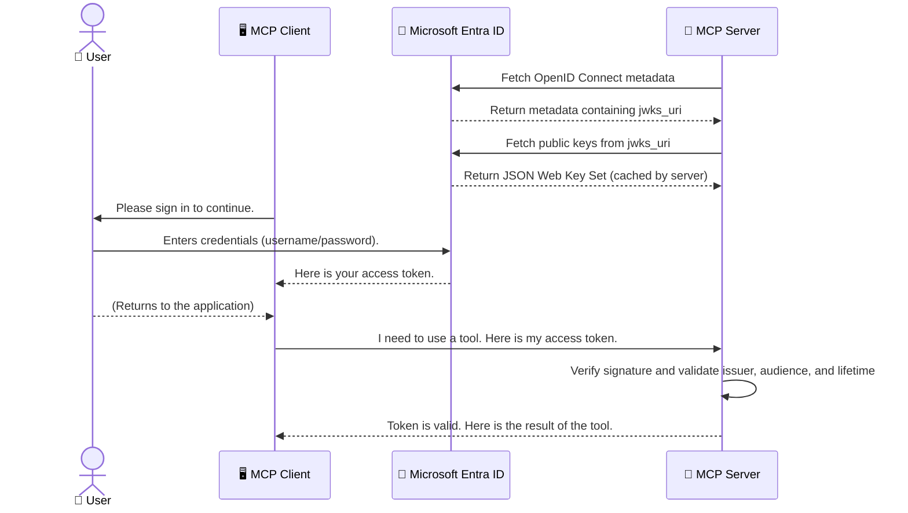

# Mengamankan Aliran Kerja AI: Pengesahan Entra ID untuk Pelayan Protokol Konteks Model

> [!NOTE]
> Kod pelayan jauh dalam pelajaran ini melindungi titik hujung `/sse` dan `/message` lama
> serta menyasarkan MCP `2025-11-25`. Kekalkan identiti dan amalan pengesahan tokennya,
> tetapi gunakan pengangkutan HTTP Streamable yang serasi dengan `2026-07-28` untuk
> pelaksanaan baru.

## Pengenalan
Mengamankan pelayan Protokol Konteks Model (MCP) anda adalah sama penting seperti mengunci pintu depan rumah anda. Membiarkan pelayan MCP anda terbuka mendedahkan alat dan data anda kepada akses tanpa izin, yang boleh membawa kepada pelanggaran keselamatan. Microsoft Entra ID menyediakan penyelesaian pengurusan identiti dan akses berasaskan awan yang kukuh, membantu memastikan hanya pengguna dan aplikasi yang dibenarkan boleh berinteraksi dengan pelayan MCP anda. Dalam bahagian ini, anda akan belajar bagaimana untuk melindungi aliran kerja AI anda menggunakan pengesahan Entra ID.

## Objektif Pembelajaran
Menjelang akhir bahagian ini, anda akan dapat:

- Memahami kepentingan mengamankan pelayan MCP.
- Menjelaskan asas pengesahan Microsoft Entra ID dan OAuth 2.0.
- Mengenali perbezaan antara klien awam dan sulit.
- Melaksanakan pengesahan Entra ID dalam senario pelayan MCP tempatan (klien awam) dan jauh (klien sulit).
- Mengaplikasikan amalan terbaik keselamatan ketika membangunkan aliran kerja AI.

## Keselamatan dan MCP

Sama seperti anda tidak akan membiarkan pintu depan rumah anda terbuka, anda juga tidak harus membiarkan pelayan MCP anda terbuka untuk diakses oleh sesiapa sahaja. Mengamankan aliran kerja AI anda adalah penting untuk membina aplikasi yang kukuh, boleh dipercayai, dan selamat. Bab ini akan memperkenalkan anda kepada penggunaan Microsoft Entra ID untuk mengamankan pelayan MCP anda, memastikan hanya pengguna dan aplikasi yang dibenarkan boleh berinteraksi dengan alat dan data anda.

## Mengapa Keselamatan Penting untuk Pelayan MCP

Bayangkan pelayan MCP anda mempunyai alat yang boleh menghantar e-mel atau mengakses pangkalan data pelanggan. Pelayan yang tidak selamat bermakna sesiapa sahaja berpotensi boleh menggunakan alat tersebut, yang boleh menyebabkan akses data tanpa izin, spam, atau aktiviti berniat jahat lain.

Dengan melaksanakan pengesahan, anda memastikan setiap permintaan ke pelayan anda disahkan, mengesahkan identiti pengguna atau aplikasi yang membuat permintaan tersebut. Ini adalah langkah pertama dan paling kritikal untuk mengamankan aliran kerja AI anda.

## Pengenalan kepada Microsoft Entra ID

[**Microsoft Entra ID**](https://adoption.microsoft.com/microsoft-security/entra/) ialah perkhidmatan pengurusan identiti dan akses berasaskan awan. Anggaplah ia sebagai pengawal keselamatan sejagat untuk aplikasi anda. Ia mengendalikan proses kompleks untuk mengesahkan identiti pengguna (pengesahan) dan menentukan apa yang mereka dibenarkan lakukan (pemberian kebenaran).

Dengan menggunakan Entra ID, anda boleh:

- Membolehkan log masuk yang selamat untuk pengguna.
- Melindungi API dan perkhidmatan.
- Mengurus polisi akses dari lokasi pusat.

Untuk pelayan MCP, Entra ID menyediakan penyelesaian yang kukuh dan dipercayai secara meluas untuk mengurus siapa yang boleh mengakses keupayaan pelayan anda.

---

## Memahami Keajaiban: Bagaimana Pengesahan Entra ID Berfungsi

Entra ID menggunakan piawaian terbuka seperti **OAuth 2.0** untuk mengendalikan pengesahan. Walaupun butiran boleh menjadi rumit, konsep inti adalah mudah dan boleh difahami menggunakan analogi.

### Pengenalan Ringkas kepada OAuth 2.0: Kunci Valet

Anggaplah OAuth 2.0 seperti perkhidmatan valet untuk kereta anda. Apabila anda tiba di restoran, anda tidak memberikan kunci utama anda kepada valet. Sebaliknya, anda menyediakan **kunci valet** yang mempunyai kebenaran terhad—kunci ini boleh menghidupkan kereta dan mengunci pintu, tetapi tidak boleh membuka but kereta atau kompartmen sarung tangan.

Dalam analogi ini:

- **Anda** adalah **Pengguna**.
- **Kereta anda** adalah **Pelayan MCP** dengan alat dan data berharga.
- **Valet** adalah **Microsoft Entra ID**.
- **Pengawal Parkir** adalah **Klien MCP** (aplikasi yang cuba mengakses pelayan).
- **Kunci Valet** adalah **Token Akses**.

Token akses adalah rentetan teks yang selamat yang diterima klien MCP dari Entra ID selepas anda log masuk. Klien kemudian membentangkan token ini kepada pelayan MCP dengan setiap permintaan. Pelayan boleh mengesahkan token untuk memastikan permintaan itu sah dan klien mempunyai kebenaran yang diperlukan, semua ini tanpa perlu mengendalikan kelayakan sebenar anda (seperti kata laluan anda).

### Aliran Pengesahan

Berikut adalah cara proses ini berfungsi dalam praktik:



Pelayan MCP tidak memanggil Entra ID untuk mengesahkan setiap token akses. Ia
mengesahkan tandatangan JWT secara kriptografi dengan kunci awam cache Entra ID
dan mengesahkan tuntutan token, termasuk penerbit, penonton, dan hayatnya.
Pelayan membaca `jwks_uri` dari metadata OpenID Connect, mengambil kunci awam dari URI tersebut,
dan mengemas kini secara berkala untuk menangani pusingan kunci. Gunakan
perpustakaan pengesahan token yang disokong dan bukannya melaksanakan logik ini
sendiri. Untuk maklumat lanjut, lihat
[Pengesahan token dalam platform identiti Microsoft](https://learn.microsoft.com/entra/identity-platform/access-tokens#validate-tokens).

### Memperkenalkan Perpustakaan Pengesahan Microsoft (MSAL)

Sebelum kita menyelami kod, penting untuk memperkenalkan komponen utama yang anda akan lihat dalam contoh: **Perpustakaan Pengesahan Microsoft (MSAL)**.

MSAL adalah perpustakaan yang dibangunkan oleh Microsoft yang memudahkan para pembangun mengendalikan pengesahan. Daripada anda perlu menulis semua kod kompleks untuk mengendalikan token keselamatan, mengurus log masuk, dan menyegar semula sesi, MSAL menguruskan kerja berat itu.

Menggunakan perpustakaan seperti MSAL sangat disyorkan kerana:

- **Ia Selamat:** Ia melaksanakan protokol piawai industri dan amalan keselamatan terbaik, mengurangkan risiko kerentanan dalam kod anda.
- **Ia Memudahkan Pembangunan:** Ia mengabstrakkan kerumitan protokol OAuth 2.0 dan OpenID Connect, membolehkan anda menambah pengesahan kukuh dalam aplikasi dengan hanya beberapa baris kod.
- **Ia Dikekalkan:** Microsoft secara aktif mengurus dan mengemas kini MSAL untuk menangani ancaman keselamatan baru dan perubahan platform.

MSAL menyokong pelbagai bahasa dan rangka kerja aplikasi, termasuk .NET, JavaScript/TypeScript, Python, Java, Go, dan platform mudah alih seperti iOS dan Android. Ini bermakna anda boleh menggunakan corak pengesahan yang konsisten di seluruh tumpukan teknologi anda.

Untuk mengetahui lebih lanjut tentang MSAL, anda boleh menyemak [dokumentasi ulasan MSAL rasmi](https://learn.microsoft.com/entra/identity-platform/msal-overview).

---

## Mengamankan Pelayan MCP Anda dengan Entra ID: Panduan Langkah demi Langkah

Sekarang, mari kita lalui cara mengamankan pelayan MCP tempatan (yang berkomunikasi melalui `stdio`) menggunakan Entra ID. Contoh ini menggunakan **klien awam**, yang sesuai untuk aplikasi yang berjalan di mesin pengguna, seperti aplikasi desktop atau pelayan pembangunan tempatan.

### Senario 1: Mengamankan Pelayan MCP Tempatan (dengan Klien Awam)

Dalam senario ini, kita akan melihat pelayan MCP yang berjalan secara tempatan, berkomunikasi melalui `stdio`, dan menggunakan Entra ID untuk mengesahkan pengguna sebelum membenarkan akses ke alatnya. Pelayan akan mempunyai alat tunggal yang mengambil maklumat profil pengguna dari Microsoft Graph API.

#### 1. Mendaftarkan Aplikasi dalam Entra ID

Sebelum menulis sebarang kod, anda perlu mendaftarkan aplikasi anda dalam Microsoft Entra ID. Ini memberitahu Entra ID tentang aplikasi anda dan memberikannya kebenaran untuk menggunakan perkhidmatan pengesahan.

1. Pergi ke **[portal Microsoft Entra](https://entra.microsoft.com/)**.
2. Pergi ke **Pendaftaran Aplikasi** dan klik **Pendaftaran Baru**.
3. Berikan nama untuk aplikasi anda (contoh: "Pelayan MCP Tempatan Saya").
4. Untuk **Jenis akaun yang disokong**, pilih **Akaun di direktori organisasi ini sahaja**.
5. Anda boleh biarkan **URI Pengalihan** kosong untuk contoh ini.
6. Klik **Daftar**.

Setelah didaftarkan, ambil perhatian **ID Aplikasi (klien)** dan **ID Direktori (penyewa)**. Anda akan memerlukannya dalam kod anda.

#### 2. Kod: Pecahan

Mari kita lihat bahagian utama kod yang mengendalikan pengesahan. Kod penuh untuk contoh ini tersedia dalam folder [Entra ID - Tempatan - WAM](https://github.com/Azure-Samples/mcp-auth-servers/tree/main/src/entra-id-local-wam) dalam repositori GitHub [mcp-auth-servers](https://github.com/Azure-Samples/mcp-auth-servers).

**`AuthenticationService.cs`**

Kelas ini bertanggungjawab untuk mengendalikan interaksi dengan Entra ID.

- **`CreateAsync`**: Kaedah ini menginisialisasi `PublicClientApplication` dari MSAL (Perpustakaan Pengesahan Microsoft). Ia dikonfigurasikan dengan `clientId` dan `tenantId` aplikasi anda.
- **`WithBroker`**: Ini membolehkan penggunaan broker (seperti Pengurus Akaun Web Windows), yang menyediakan pengalaman log masuk tunggal yang lebih selamat dan lancar.
- **`AcquireTokenAsync`**: Ini adalah kaedah inti. Ia pertama kali cuba mendapatkan token secara senyap (bermaksud pengguna tidak perlu log masuk semula jika sudah ada sesi yang sah). Jika token senyap tidak boleh diperolehi, ia akan meminta pengguna untuk log masuk secara interaktif.

```csharp
// Simplified for clarity
public static async Task<AuthenticationService> CreateAsync(ILogger<AuthenticationService> logger)
{
    var msalClient = PublicClientApplicationBuilder
        .Create(_clientId) // Your Application (client) ID
        .WithAuthority(AadAuthorityAudience.AzureAdMyOrg)
        .WithTenantId(_tenantId) // Your Directory (tenant) ID
        .WithBroker(new BrokerOptions(BrokerOptions.OperatingSystems.Windows))
        .Build();

    // ... cache registration ...

    return new AuthenticationService(logger, msalClient);
}

public async Task<string> AcquireTokenAsync()
{
    try
    {
        // Try silent authentication first
        var accounts = await _msalClient.GetAccountsAsync();
        var account = accounts.FirstOrDefault();

        AuthenticationResult? result = null;

        if (account != null)
        {
            result = await _msalClient.AcquireTokenSilent(_scopes, account).ExecuteAsync();
        }
        else
        {
            // If no account, or silent fails, go interactive
            result = await _msalClient.AcquireTokenInteractive(_scopes).ExecuteAsync();
        }

        return result.AccessToken;
    }
    catch (Exception ex)
    {
        _logger.LogError(ex, "An error occurred while acquiring the token.");
        throw; // Optionally rethrow the exception for higher-level handling
    }
}
```

**`Program.cs`**

Di sinilah pelayan MCP disediakan dan perkhidmatan pengesahan diintegrasikan.

- **`AddSingleton<AuthenticationService>`**: Ini mendaftar `AuthenticationService` dengan bekas suntikan kebergantungan, supaya boleh digunakan oleh bahagian lain aplikasi (seperti alat kami).
- **`GetUserDetailsFromGraph` alat**: Alat ini memerlukan instance `AuthenticationService`. Sebelum melakukan apa-apa, ia memanggil `authService.AcquireTokenAsync()` untuk mendapatkan token akses yang sah. Jika pengesahan berjaya, ia menggunakan token tersebut untuk memanggil Microsoft Graph API dan mendapatkan maklumat pengguna.

```csharp
// Simplified for clarity
[McpServerTool(Name = "GetUserDetailsFromGraph")]
public static async Task<string> GetUserDetailsFromGraph(
    AuthenticationService authService)
{
    try
    {
        // This will trigger the authentication flow
        var accessToken = await authService.AcquireTokenAsync();

        // Use the token to create a GraphServiceClient
        var graphClient = new GraphServiceClient(
            new BaseBearerTokenAuthenticationProvider(new TokenProvider(authService)));

        var user = await graphClient.Me.GetAsync();

        return System.Text.Json.JsonSerializer.Serialize(user);
    }
    catch (Exception ex)
    {
        return $"Error: {ex.Message}";
    }
}
```

#### 3. Bagaimana Ia Berfungsi Bersama

1. Apabila klien MCP cuba menggunakan alat `GetUserDetailsFromGraph`, alat tersebut pertama memanggil `AcquireTokenAsync`.
2. `AcquireTokenAsync` mencetuskan perpustakaan MSAL untuk memeriksa token yang sah.
3. Jika tiada token dijumpai, MSAL melalui broker akan meminta pengguna untuk log masuk dengan akaun Entra ID mereka.
4. Setelah pengguna log masuk, Entra ID mengeluarkan token akses.
5. Alat menerima token dan menggunakannya untuk membuat panggilan selamat ke Microsoft Graph API.
6. Maklumat pengguna dikembalikan kepada klien MCP.

Proses ini memastikan hanya pengguna yang disahkan boleh menggunakan alat tersebut, secara berkesan mengamankan pelayan MCP tempatan anda.

### Senario 2: Mengamankan Pelayan MCP Jauh (dengan Klien Sulit)

Apabila pelayan MCP anda berjalan pada mesin jauh (seperti pelayan awan) dan berkomunikasi melalui protokol seperti Streaming HTTP, keperluan keselamatannya adalah berbeza. Dalam kes ini, anda harus menggunakan **klien sulit** dan **Aliran Kod Otorisasi**. Ini adalah kaedah yang lebih selamat kerana rahsia aplikasi tidak pernah didedahkan kepada pelayar.

Contoh ini menggunakan pelayan MCP berasaskan TypeScript yang menggunakan Express.js untuk mengendalikan permintaan HTTP.

#### 1. Mendaftarkan Aplikasi dalam Entra ID

Persediaan dalam Entra ID adalah serupa dengan klien awam, tetapi dengan satu perbezaan utama: anda perlu membuat **rahsia klien**.

1. Pergi ke **[portal Microsoft Entra](https://entra.microsoft.com/)**.
2. Dalam pendaftaran aplikasi anda, pergi ke tab **Sijil & rahsia**.
3. Klik **Rahsia klien baru**, berikan deskripsi, dan klik **Tambah**.
4. **Penting:** Salin nilai rahsia itu dengan segera. Anda tidak akan dapat melihatnya lagi.
5. Anda juga perlu mengkonfigurasi **URI Pengalihan**. Pergi ke tab **Pengesahan**, klik **Tambah platform**, pilih **Web**, dan masukkan URI pengalihan untuk aplikasi anda (contoh, `http://localhost:3001/auth/callback`).

> **⚠️ Nota Keselamatan Penting:** Untuk aplikasi produksi, Microsoft sangat mengesyorkan menggunakan kaedah pengesahan **tanpa rahsia** seperti **Identiti Terkelola (Managed Identity)** atau **Federasi Identiti Beban Kerja (Workload Identity Federation)** sebagai ganti rahsia klien. Rahsia klien berisiko keselamatan kerana boleh didedahkan atau dikompromi. Identiti terkelola menyediakan pendekatan lebih selamat dengan menghapuskan keperluan menyimpan kelayakan dalam kod atau konfigurasi anda.
>
> Untuk maklumat lebih lanjut tentang identiti terkelola dan cara melaksanakannya, lihat [Gambaran keseluruhan identiti terkelola untuk sumber Azure](https://learn.microsoft.com/entra/identity/managed-identities-azure-resources/overview).

#### 2. Kod: Pecahan

Contoh ini menggunakan pendekatan berasaskan sesi. Apabila pengguna mengesah, pelayan menyimpan token akses dan token segar dalam sesi dan memberikan pengguna token sesi. Token sesi ini kemudian digunakan untuk permintaan seterusnya. Kod penuh untuk contoh ini ada dalam folder [Entra ID - Klien Sulit](https://github.com/Azure-Samples/mcp-auth-servers/tree/main/src/entra-id-cca-session) dalam repositori GitHub [mcp-auth-servers](https://github.com/Azure-Samples/mcp-auth-servers).

**`Server.ts`**

Fail ini menyediakan pelayan Express dan lapisan pengangkutan MCP.

- **`requireBearerAuth`**: Ini adalah perantaraan yang melindungi titik hujung `/sse` dan `/message`. Ia memeriksa token pembawa yang sah dalam header `Authorization` permintaan.
- **`EntraIdServerAuthProvider`**: Ini adalah kelas tersuai yang melaksanakan antara muka `McpServerAuthorizationProvider`. Ia bertanggungjawab untuk mengendalikan aliran OAuth 2.0.
- **`/auth/callback`**: Titik hujung ini mengendalikan pengalihan dari Entra ID selepas pengguna mengesah. Ia menukar kod otorisasi kepada token akses dan token segar.

```typescript
// Simplified for clarity
const app = express();
const { server } = createServer();
const provider = new EntraIdServerAuthProvider();

// Protect the SSE endpoint
app.get("/sse", requireBearerAuth({
  provider,
  requiredScopes: ["User.Read"]
}), async (req, res) => {
  // ... connect to the transport ...
});

// Protect the message endpoint
app.post("/message", requireBearerAuth({
  provider,
  requiredScopes: ["User.Read"]
}), async (req, res) => {
  // ... handle the message ...
});

// Handle the OAuth 2.0 callback
app.get("/auth/callback", (req, res) => {
  provider.handleCallback(req.query.code, req.query.state)
    .then(result => {
      // ... handle success or failure ...
    });
});
```

**`Tools.ts`**

Fail ini mendefinisikan alat yang disediakan oleh pelayan MCP. Alat `getUserDetails` adalah serupa dengan yang dalam contoh sebelumnya, tetapi ia mendapatkan token akses dari sesi.

```typescript
// Simplified for clarity
server.setRequestHandler(CallToolRequestSchema, async (request) => {
  const { name } = request.params;
  const context = request.params?.context as { token?: string } | undefined;
  const sessionToken = context?.token;

  if (name === ToolName.GET_USER_DETAILS) {
    if (!sessionToken) {
      throw new AuthenticationError("Authentication token is missing or invalid. Ensure the token is provided in the request context.");
    }

    // Get the Entra ID token from the session store
    const tokenData = tokenStore.getToken(sessionToken);
    const entraIdToken = tokenData.accessToken;

    const graphClient = Client.init({
      authProvider: (done) => {
        done(null, entraIdToken);
      }
    });

    const user = await graphClient.api('/me').get();

    // ... return user details ...
  }
});
```

**`auth/EntraIdServerAuthProvider.ts`**

Kelas ini mengendalikan logik untuk:

- Mengarahkan pengguna ke halaman masuk Entra ID.
- Menukar kod kebenaran dengan token akses.
- Menyimpan token dalam `tokenStore`.
- Menyegarkan token akses apabila ia luput.

#### 3. Bagaimana Ia Berfungsi Bersama

1. Apabila pengguna mula-mula cuba menyambung ke pelayan MCP, middleware `requireBearerAuth` akan melihat bahawa mereka tidak mempunyai sesi yang sah dan akan mengarahkan mereka ke halaman masuk Entra ID.
2. Pengguna masuk dengan akaun Entra ID mereka.
3. Entra ID mengarahkan pengguna kembali ke titik akhir `/auth/callback` dengan kod kebenaran.
4. Pelayan menukar kod tersebut kepada token akses dan token segar semula, menyimpannya, dan mencipta token sesi yang dihantar ke klien.
5. Klien kini boleh menggunakan token sesi ini dalam pengepala `Authorization` untuk semua permintaan masa depan ke pelayan MCP.
6. Apabila alat `getUserDetails` dipanggil, ia menggunakan token sesi untuk mencari token akses Entra ID dan kemudian menggunakan itu untuk memanggil API Microsoft Graph.

Aliran ini lebih kompleks daripada aliran klien awam, tetapi diperlukan untuk titik akhir yang berhadapan dengan internet. Oleh kerana pelayan MCP jauh boleh diakses melalui internet awam, mereka memerlukan langkah keselamatan yang lebih kuat untuk melindungi daripada akses tanpa izin dan serangan berpotensi.


## Amalan Terbaik Keselamatan

- **Sentiasa gunakan HTTPS**: Encrypt komunikasi antara klien dan pelayan untuk melindungi token daripada diserang.
- **Laksanakan Kawalan Akses Berasaskan Peranan (RBAC)**: Jangan hanya periksa *jika* pengguna disahkan; periksa *apa* yang mereka dibenarkan lakukan. Anda boleh mendefinisikan peranan dalam Entra ID dan memeriksanya dalam pelayan MCP anda.
- **Pantau dan audit**: Log semua acara pengesahan supaya anda boleh mengesan dan bertindak balas terhadap aktiviti yang mencurigakan.
- **Urus had kadar dan throttling**: Microsoft Graph dan API lain melaksanakan had kadar untuk mengelakkan penyalahgunaan. Laksanakan logik tolak balik eksponen dan cubaan semula dalam pelayan MCP anda untuk mengendalikan secara lancar tindak balas HTTP 429 (Terlalu Banyak Permintaan). Pertimbangkan untuk menyimpan data yang kerap diakses dalam cache untuk mengurangkan panggilan API.
- **Penyimpanan token yang selamat**: Simpan token akses dan token segar semula dengan selamat. Untuk aplikasi tempatan, gunakan mekanisme penyimpanan selamat sistem. Untuk aplikasi pelayan, pertimbangkan menggunakan penyimpanan tersulit atau perkhidmatan pengurusan kekunci yang selamat seperti Azure Key Vault.
- **Pengendalian tamat tempoh token**: Token akses mempunyai jangka hayat terhad. Laksanakan penyegaran token automatik menggunakan token segar semula untuk mengekalkan pengalaman pengguna yang lancar tanpa perlu pengesahan semula.
- **Pertimbangkan menggunakan Azure API Management**: Walaupun melaksanakan keselamatan secara langsung dalam pelayan MCP anda memberi anda kawalan granularity, Pintu Gerbang API seperti Azure API Management boleh menangani banyak kebimbangan keselamatan ini secara automatik, termasuk pengesahan, kebenaran, had kadar, dan pemantauan. Ia menyediakan lapisan keselamatan berpusat yang terletak di antara klien anda dan pelayan MCP anda. Untuk maklumat lanjut tentang menggunakan Pintu Gerbang API dengan MCP, lihat [Azure API Management Your Auth Gateway For MCP Servers](https://techcommunity.microsoft.com/blog/integrationsonazureblog/azure-api-management-your-auth-gateway-for-mcp-servers/4402690).


##  Poin Utama

- Melindungi pelayan MCP anda amat penting untuk melindungi data dan alat anda.
- Microsoft Entra ID menyediakan penyelesaian yang kukuh dan skalabel untuk pengesahan dan kebenaran.
- Gunakan **klien awam** untuk aplikasi tempatan dan **klien sulit** untuk pelayan jauh.
- **Aliran Kod Kebenaran** adalah pilihan paling selamat untuk aplikasi web.


## Latihan

1. Fikirkan tentang pelayan MCP yang mungkin anda bina. Adakah ia pelayan tempatan atau pelayan jauh?
2. Berdasarkan jawapan anda, adakah anda akan menggunakan klien awam atau klien sulit?
3. Apakah kebenaran yang pelayan MCP anda akan minta untuk melaksanakan tindakan terhadap Microsoft Graph?


## Latihan Praktikal

### Latihan 1: Daftar Aplikasi dalam Entra ID
Navigasi ke portal Microsoft Entra.
Daftar aplikasi baharu untuk pelayan MCP anda.
Catatkan ID Aplikasi (klien) dan ID Direktori (penyewa).

### Latihan 2: Lindungi Pelayan MCP Tempatan (Klien Awam)
- Ikuti contoh kod untuk mengintegrasikan MSAL (Microsoft Authentication Library) untuk pengesahan pengguna.
- Uji aliran pengesahan dengan memanggil alat MCP yang mengambil maklumat pengguna dari Microsoft Graph.

### Latihan 3: Lindungi Pelayan MCP Jauh (Klien Sulit)
- Daftar klien sulit dalam Entra ID dan cipta rahsia klien.
- Konfigurasi pelayan MCP Express.js anda untuk menggunakan Aliran Kod Kebenaran.
- Uji titik akhir yang dilindungi dan sahkan akses berdasarkan token.

### Latihan 4: Terapkan Amalan Terbaik Keselamatan
- Aktifkan HTTPS untuk pelayan tempatan atau jauh anda.
- Laksanakan kawalan akses berasaskan peranan (RBAC) dalam logik pelayan anda.
- Tambah pengendalian tamat tempoh token dan penyimpanan token yang selamat.

## Sumber

1. **Dokumentasi Gambaran Keseluruhan MSAL**  
   Pelajari bagaimana Microsoft Authentication Library (MSAL) membolehkan pemerolehan token yang selamat merentas platform:  
   [Gambaran Keseluruhan MSAL di Microsoft Learn](https://learn.microsoft.com/en-gb/entra/msal/overview)

2. **Repositori GitHub Azure-Samples/mcp-auth-servers**  
   Implementasi rujukan pelayan MCP yang menunjukkan aliran pengesahan:  
   [Azure-Samples/mcp-auth-servers di GitHub](https://github.com/Azure-Samples/mcp-auth-servers)

3. **Gambaran Keseluruhan Identiti Terurus untuk Sumber Azure**  
   Fahami cara menghapuskan rahsia dengan menggunakan identiti terurus yang ditetapkan oleh sistem atau pengguna:  
   [Gambaran Keseluruhan Identiti Terurus di Microsoft Learn](https://learn.microsoft.com/en-us/entra/identity/managed-identities-azure-resources/)

4. **Azure API Management: Gerbang Auth Anda untuk Pelayan MCP**  
   Kajian mendalam menggunakan APIM sebagai gerbang OAuth2 yang selamat untuk pelayan MCP:  
   [Azure API Management Your Auth Gateway For MCP Servers](https://techcommunity.microsoft.com/blog/integrationsonazureblog/azure-api-management-your-auth-gateway-for-mcp-servers/4402690)

5. **Rujukan Kebenaran Microsoft Graph**  
   Senarai lengkap kebenaran yang diwakilkan dan aplikasi untuk Microsoft Graph:  
   [Rujukan Kebenaran Microsoft Graph](https://learn.microsoft.com/zh-tw/graph/permissions-reference)


## Hasil Pembelajaran
Selepas melengkapkan bahagian ini, anda akan dapat:

- Menjelaskan mengapa pengesahan penting untuk pelayan MCP dan aliran kerja AI.
- Menyediakan dan mengkonfigurasi pengesahan Entra ID untuk senario pelayan MCP tempatan dan jauh.
- Memilih jenis klien yang sesuai (awam atau sulit) berdasarkan penyebaran pelayan anda.
- Melaksanakan amalan pengkodan selamat, termasuk penyimpanan token dan kebenaran berasaskan peranan.
- Melindungi pelayan MCP dan alatnya daripada akses tanpa izin dengan yakin.

## Apa seterusnya

- [5.13 Integrasi Protokol Konteks Model (MCP) dengan Microsoft Foundry](../mcp-foundry-agent-integration/README.md)

---

<!-- CO-OP TRANSLATOR DISCLAIMER START -->
**Penafian**:
Dokumen ini telah diterjemahkan menggunakan perkhidmatan terjemahan AI [Co-op Translator](https://github.com/Azure/co-op-translator). Walaupun kami berusaha untuk ketepatan, sila ambil maklum bahawa terjemahan automatik mungkin mengandungi kesilapan atau ketidaktepatan. Dokumen asal dalam bahasa asalnya harus dianggap sebagai sumber yang sahih. Untuk maklumat penting, terjemahan oleh manusia profesional adalah disyorkan. Kami tidak bertanggungjawab terhadap sebarang salah faham atau salah tafsir yang timbul daripada penggunaan terjemahan ini.
<!-- CO-OP TRANSLATOR DISCLAIMER END -->