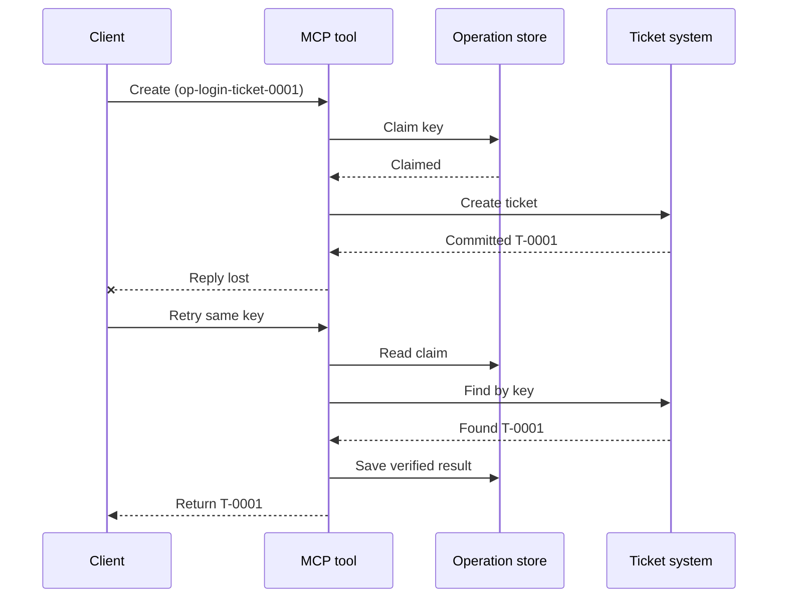
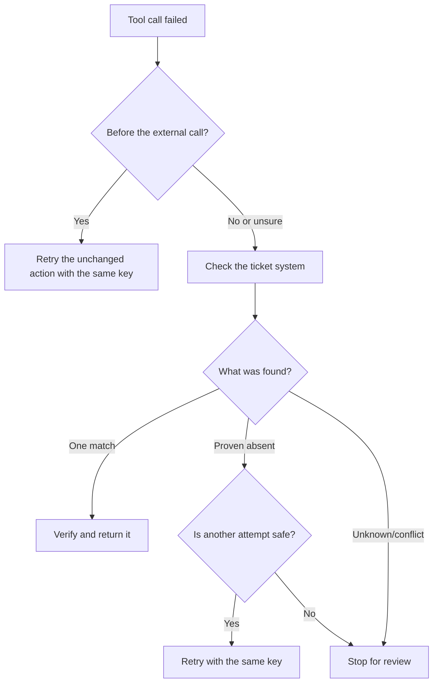

# Cubaan Semula Selamat untuk Alat MCP: Corak Sidecar Kebolehpercayaan

Respon yang hilang tidak bermaksud tindakan itu hilang. Alat tiket sokongan
mungkin mencipta tiket `T-0001` kemudian kehilangan sambungan sebelum klien melihat
keputusan itu. Jika klien mencuba semula tanpa memastikan, ia mungkin mencipta `T-0002`.

Pelajaran ini menunjukkan cara mengenal pasti hasil yang tidak pasti itu, mengekalkan satu identiti stabil
untuk tindakan yang dimaksudkan, dan memeriksa sistem tiket sebelum mencuba
lagi. Latihan Python yang disertakan dijalankan secara tempatan dengan perpustakaan standard
dan SQLite.

## Kenapa Timeout Bermakna "Hasil Tidak Diketahui"

Anggap klien memanggil `create_support_ticket` dengan kunci operasi
`op-login-ticket-0001`:



Sambungan gagal selepas tiket disahkan tetapi sebelum keputusan tiba.
Klien hanya tahu bahawa balasan hilang. Ia tidak tahu sama ada
tiket hilang. Menggunakan semula kunci operasi membolehkan alat mencari dan memulangkan
`T-0001` sebagai ganti mencipta `T-0002`.

## Apa Yang Dilakukan Sidecar Kebolehpercayaan

Sidecar kebolehpercayaan ialah kod aplikasi yang menyimpan keadaan pemulihan di sekitar
alat. Ia mungkin perpustakaan, middleware, perkhidmatan yang disokong pangkalan data, atau hanya
sebahagian daripada pelaksanaan alat. Ia tidak perlu menjadi proses berasingan,
dan ia bukan ciri protokol MCP.

Sidecar mempunyai empat tugas:

1. menyimpan tindakan yang dimaksudkan sebelum memanggil sistem luaran;
2. membolehkan hanya satu pekerja menuntut tindakan itu;
3. mengingati cukup keadaan untuk pulih selepas kemalangan; dan
4. memeriksa sistem luaran apabila hasil tidak pasti.

Pelajaran ini menyasarkan spesifikasi MCP terakhir `2026-07-28`. MCP tiada
sesi peringkat protokol, jadi kunci operasi ialah argumen biasa alat
yang disokong oleh keadaan aplikasi yang tahan lama. Corak yang sama juga berfungsi dengan versi
MCP terdahulu.

## Empat ID Yang Menyelesaikan Masalah Yang Berbeza

Pengenal ini berkait, tetapi tidak boleh ditukar ganti:

| Pengenal | Apa yang dikenalinya | Bertahan cubaan semula? |
| --- | --- | --- |
| ID JSON-RPC | Satu permintaan dan balasan | Tidak; guna ID permintaan baru |
| ID Tugas MCP | Satu tugas jangka panjang | Ya; simpan untuk polling |
| Kunci operasi | Satu tindakan yang dimaksudkan | Ya; guna semula untuk tindakan itu |
| ID Tiket | Keputusan yang disimpan | Ya; kembalikan selepas pengesahan |

Pemberitahuan kemajuan dan konteks jejak membantu anda memerhati permintaan.
Pembatalan meminta kerja berhenti. Tiada satu pun menghalang tiket pendua.

## Bina Pengawal

Cipta kunci operasi sebelum panggilan alat pertama dan simpan dengan
aliran kerja. Setiap cubaan untuk mencipta tiket yang sama menggunakan kunci yang sama:

```json
{
  "operation_key": "op-login-ticket-0001",
  "title": "Cannot sign in"
}
```

Tiket yang dimaksudkan berbeza mendapat kunci baru. Dalam pengeluaran, jana nilai kabur,
yang tidak boleh teka, sebagai ganti meletakkan data pelanggan ke dalam kunci.

Berikut skema alat MCP lengkap yang digunakan dalam pelajaran ini:

```json
{
  "name": "create_support_ticket",
  "title": "Create support ticket",
  "description": "Creates or recovers one support ticket for an operation key.",
  "inputSchema": {
    "$schema": "https://json-schema.org/draft/2020-12/schema",
    "type": "object",
    "properties": {
      "operation_key": {
        "type": "string",
        "minLength": 16,
        "maxLength": 128,
        "description": "Stable key reused for the same intended action."
      },
      "title": {
        "type": "string",
        "minLength": 1,
        "maxLength": 200
      }
    },
    "required": ["operation_key", "title"],
    "additionalProperties": false
  },
  "outputSchema": {
    "$schema": "https://json-schema.org/draft/2020-12/schema",
    "type": "object",
    "properties": {
      "ticket_id": {
        "type": "string"
      },
      "operation_key": {
        "type": "string"
      },
      "status": {
        "type": "string",
        "const": "verified"
      }
    },
    "required": ["ticket_id", "operation_key", "status"],
    "additionalProperties": false
  }
}
```

Identiti pemanggil yang disahkan datang dari konteks pelayan, bukan dari
input alat yang disediakan model. Lingkupi setiap operasi yang disimpan kepada:

- pemanggil itu, penyewa, atau akaun perkhidmatan;
- nama dan versi alat; dan
- hash input yang dinormalisasi yang menentukan tindakan luaran.

Hash input menjawab soalan mudah: "Adakah cubaan semula ini meminta tiket yang sama?"
Jika kunci itu sudah milik tajuk berbeza, tolak panggilan itu.
Memulangkan keputusan terdahulu untuk input yang berubah akan menyembunyikan ralat kontrak.

Simpan tuntutan dengan operasi pangkalan data atomik. "Atomik" bermakna dua pekerja
tidak boleh sama-sama melihat rekod kosong dan menjadi pemilik. Kunci proses tempatan
tidak mencukupi apabila contoh pelayan lain boleh menerima cubaan semula.

Aliran kerja mencipta kunci semasa tindakan `planned`. Contoh kemudian
menyimpan keadaan ini:

- `claimed`: satu pekerja telah menempah operasi;
- `completed`: sistem tiket telah memulangkan keputusan; dan
- `verified`: bacaan dari sistem tiket mengesahkan keputusan.

Kemalangan boleh meninggalkan keadaan yang disimpan pada `claimed` walaupun selepas tiket
dicipta. Anggap setiap tuntutan bukan terminal sebagai tidak pasti sehingga bukti luaran
menetapkannya. Jangan anggap `claimed` bermakna "tiada apa yang berlaku."

## Pulih Sebelum Anda Mencuba Semula

Apabila panggilan alat gagal, tentukan apa yang diketahui sebelum menghantar satu lagi penulisan
luaran:



Pengesahan yang gagal sebelum API tiket dipanggil adalah kegagalan yang diketahui.
Cuba semula tindakan yang tidak berubah dengan kunci operasi yang sama. Jika membetulkan input
mengubah tiket yang dimaksudkan, buat kunci baru untuk tindakan baru itu.

Jika permintaan mungkin telah sampai ke sistem tiket, selesaikan dahulu.
Penyelesaian bermaksud membandingkan tuntutan yang disimpan dengan rekod tiket autoritatif.
Pulangkan tiket sedia ada apabila tepat satu rekod yang sepadan dijumpai.
Cuba semula hanya apabila tiket benar-benar tiada dan kontrak hiliran
menjadikan cubaan lain selamat.

"Tidak ditemui" tidak selalu pasti. Penyedia dengan carian yang akhirnya konsisten
mungkin memerlukan menunggu terhad dan pemeriksaan lain. Jika sistem tidak boleh
dicari, memberi keputusan bertentangan, atau tidak dapat menyahduplikasi cubaan lain
dengan selamat, berhenti dan laporkan `outcome unknown`. Berhenti di sini kadangkala disebut
"gagal tertutup": aliran kerja menolak untuk meneka.

## Bukti, Tugasan, dan Pembatalan

Respons alat mengatakan apa yang dilaporkan oleh alat. Titik semakan yang disimpan mengatakan apa yang
direkodkan oleh aliran kerja. Bukti terkuat datang daripada sistem yang memiliki
keputusan: untuk contoh ini, bacaan dari sistem tiket yang menemui tepat satu
tiket yang sepadan.

Padankan bukti dengan risiko. ID mesej penyedia mungkin cukup untuk
pemberitahuan risiko rendah. Pembayaran, pelaksanaan, dan tindakan memusnahkan mungkin
memerlukan bukti status penyedia, lejar, atau semakan manual.

Sambungan Tugasan MCP melengkapkan corak ini untuk kerja jangka panjang. ID Tugasan
membolehkan klien menyambung semula peninjauan selepas terputus sambungan, tetapi ia tidak mengenal pasti
atau menyahduplikasi tiket itu sendiri. Apabila Tugasan digunakan, identiti disambungkan
seperti ini:

```text
operation key -> Task ID -> ticket ID -> verification evidence
```

Pembatalan adalah kerjasama, bukan pembatalan transaksi. Tiket mungkin masih dibuat
selepas pengesahan pembatalan, oleh itu keputusan yang tidak pasti masih memerlukan
penyelesaian.

## Jalankan Latihan Suntikan Kegagalan

Contoh menggunakan dua fail SQLite: satu mewakili stor operasi dan
satu lagi mewakili sistem tiket luaran. Tiada transaksi yang merangkumi
kedua-dua fail. Kegagalan disuntik selepas tiket disahkan tetapi sebelum
rekod sisi mencatatkan tamat.

Kaedah Python langsung menerima `caller_id` sebagai ganti konteks pelayan yang disahkan.
Jangan tambah `caller_id` pada skema input MCP yang dikawal model.


Ramalkan keputusan sebelum menjalankan ujian:

| Laluan | Keputusan selepas cuba semula | Kiraan tiket |
| --- | --- | --- |
| Cubaan buta | Mencipta `T-0002` selepas kehilangan respons untuk `T-0001` | 2 |
| Cubaan dijaga | Menemui dan memulangkan `T-0001` | 1 |

Jalankan:

```bash
cd 08-BestPractices/reliability-sidecars/python
python -m unittest discover -p "test_*.py" -v
```

Enam ujian menunjukkan bahawa:

1. percubaan semula tanpa pandang menghasilkan pendua;
2. kehilangan respons serta mulakan semula memulihkan satu tiket daripada tuntutan tahan lama;
3. percubaan semula yang disahkan menggunakan semula hasil yang disimpan;
4. input yang diubah atau bukti luaran yang bertentangan ditolak;
5. tuntutan sedia ada tanpa bukti luaran berhenti dengan selamat; dan
6. tuntutan serentak mengaku satu pemilik tanpa menurunkan hasil yang disahkan.

Buka sampel:

- [Pelaksanaan Python](../../../../08-BestPractices/reliability-sidecars/python/reliability_sidecar.py)
- [Ujian Deterministik](../../../../08-BestPractices/reliability-sidecars/python/test_reliability_sidecar.py)

Sampel sengaja mengabaikan pajakan tuntutan usang. Polisi pengambilalihan
produksi memerlukan pajakan terhad, pemindahan pemilikan atomik, dan satu lagi
pemeriksaan luaran sebelum melaksanakan.

## Pelaksanaan Komuniti Pilihan

Agent Enhancer Utilities adalah salah satu pelaksanaan komuniti corak peringkat
aplikasi ini. Perancangnya memilih pendekatan pemulihan, manakala
checkpoint merekod keadaan tuntutan dan hasil tidak pasti. Alat domain atau server MCP
masih melaksanakan dan mengesahkan tindakan sebenar. Perkhidmatan ini bukan sebahagian
daripada spesifikasi MCP dan tidak wajib untuk pelajaran ini.

| Konsep pelajaran | Bahagian Agent Enhancer | Had penting |
| --- | --- | --- |
| Rancangan pemulihan | `workflow-guard-planner` | Tidak memanggil alat domain |
| Tuntutan dan pemulihan | `workflow-checkpoint` | `external_proof` kekal `false` |
| Main balik sidecar tepat | `lab.invoke_tool` | Menggunakan kunci idempotensi berasingan |
| Sahkan tindakan sebenar | Carian/dibaca balik destinasi | Dimiliki MCP domain |

Untuk percubaan semula tepat satu panggilan sidecar, `lab.invoke_tool` menerima
`idempotency_key` luar. Kunci itu mengenal pasti panggilan sidecar; ia bukan
`operation_key` perniagaan yang digunakan untuk tiket.

Kontrak awam berpenanda dan contoh berkaitan rangkaian pilihan boleh didapati
di sini:

- [Kontrak Sidecar Kebolehpercayaan v1](https://github.com/artiehinz/Agent-Enhancer-Utilities/blob/v1.6.0/docs/RELIABILITY_SIDECAR_CONTRACT_V1.md)
- [Perancang dan contoh mock-domain](https://github.com/artiehinz/Agent-Enhancer-Utilities/tree/v1.6.0/examples/reliability-sidecar)

Pautan ini menjelaskan corak aplikasi. Ia tidak mendakwa bahawa
perkhidmatan dihos mematuhi MCP `2026-07-28`, dan keadaan checkpoint tidak pernah
dikira sebagai bukti luaran tiket.

## Senarai Semak Produksi

- [ ] Cipta dan simpan kunci operasi sebelum percubaan luaran pertama.
- [ ] Ikat kunci kepada pemanggil, versi alat, dan hash input dinormalisasi.
- [ ] Tolak input berubah di bawah kunci sedia ada.
- [ ] Terima satu pemilik dengan operasi stor bersama atomik.
- [ ] Hantar kunci ke penyedia hiliran apabila ia menyokong idempotensi.
- [ ] Selesaikan hasil tidak pasti sebelum menulis sekali lagi.
- [ ] Simpan hasil dan bukti yang disahkan untuk seluruh tetingkap percubaan semula.
- [ ] Berhenti untuk semakan jika hasil luaran tidak dapat dipastikan dengan selamat.

## Rujukan

- [Spesifikasi MCP `2026-07-28`](https://modelcontextprotocol.io/specification/2026-07-28)
- [Panduan alat MCP `2026-07-28`](https://modelcontextprotocol.io/specification/2026-07-28/server/tools)
- [Sambungan Tugas MCP](https://modelcontextprotocol.io/extensions/tasks/overview)
- [Spesifikasi JSON-RPC 2.0](https://www.jsonrpc.org/specification)

---

<!-- CO-OP TRANSLATOR DISCLAIMER START -->
**Penafian**:
Dokumen ini telah diterjemahkan menggunakan perkhidmatan terjemahan AI [Co-op Translator](https://github.com/Azure/co-op-translator). Walaupun kami berusaha untuk ketepatan, sila ambil maklum bahawa terjemahan automatik mungkin mengandungi kesilapan atau ketidaktepatan. Dokumen asal dalam bahasa asalnya harus dianggap sebagai sumber yang sahih. Untuk maklumat penting, terjemahan oleh manusia profesional adalah disyorkan. Kami tidak bertanggungjawab terhadap sebarang salah faham atau salah tafsir yang timbul daripada penggunaan terjemahan ini.
<!-- CO-OP TRANSLATOR DISCLAIMER END -->