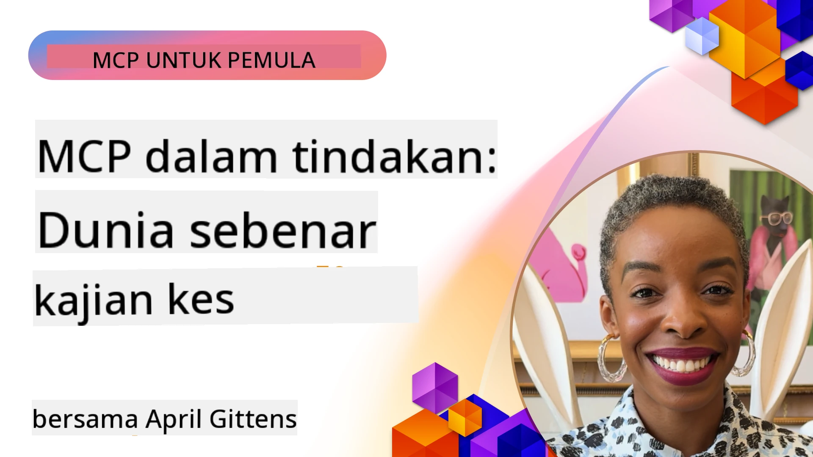

# MCP dalam Tindakan: Kajian Kes Dunia Sebenar

_(Klik gambar di atas untuk menonton video pelajaran ini)_

Model Context Protocol (MCP) sedang mengubah cara aplikasi AI berinteraksi dengan data, alat, dan perkhidmatan. Bahagian ini membentangkan kajian kes dunia sebenar yang menunjukkan aplikasi praktikal MCP dalam pelbagai senario perusahaan.

## Gambaran Keseluruhan

Bahagian ini mempamerkan contoh konkrit pelaksanaan MCP, menonjolkan bagaimana organisasi menggunakan protokol ini untuk menyelesaikan cabaran perniagaan yang kompleks. Dengan meneliti kajian kes ini, anda akan memperoleh pandangan mengenai kepelbagaian, kebolehsesuaian, dan manfaat praktikal MCP dalam senario dunia sebenar.

## Objektif Pembelajaran Utama

Dengan meneroka kajian kes ini, anda akan:

- Memahami bagaimana MCP boleh digunakan untuk menyelesaikan masalah perniagaan tertentu
- Mempelajari corak integrasi dan pendekatan seni bina yang berbeza
- Mengenali amalan terbaik untuk melaksanakan MCP dalam persekitaran perusahaan
- Mendapatkan pandangan mengenai cabaran dan penyelesaian yang ditemui dalam pelaksanaan dunia sebenar
- Mengenal pasti peluang untuk menggunakan corak serupa dalam projek anda sendiri

## Kajian Kes Pilihan

### 1. [Ejen Perjalanan AI Azure – Pelaksanaan Rujukan](./travelagentsample.md)

Kajian kes ini mengkaji penyelesaian rujukan menyeluruh Microsoft yang menunjukkan bagaimana membina aplikasi perancangan perjalanan berkuasa AI pelbagai ejen menggunakan MCP, Azure OpenAI, dan Azure AI Search. Projek ini menampilkan:

- Orkestrasi pelbagai ejen melalui MCP
- Integrasi data perusahaan dengan Azure AI Search
- Seni bina yang selamat dan boleh diskalakan menggunakan perkhidmatan Azure
- Alat boleh dikembangkan dengan komponen MCP boleh guna semula
- Pengalaman pengguna perbualan yang didayakan oleh Azure OpenAI

Seni bina dan butiran pelaksanaan menyediakan pandangan berharga dalam membina sistem pelbagai ejen yang kompleks dengan MCP sebagai lapisan koordinasi.

### 2. [Mengemas Kini Item Azure DevOps dari Data YouTube](./UpdateADOItemsFromYT.md)

Kajian kes ini menunjukkan aplikasi praktikal MCP untuk mengautomasikan proses aliran kerja. Ia menunjukkan bagaimana alat MCP boleh digunakan untuk:

- Mengekstrak data dari platform dalam talian (YouTube)
- Mengemas kini item kerja dalam sistem Azure DevOps
- Mewujudkan aliran kerja automasi yang berulang
- Mengintegrasi data merentasi sistem yang berbeza

Contoh ini menggambarkan bagaimana pelaksanaan MCP yang agak mudah boleh memberikan peningkatan kecekapan yang ketara dengan mengautomasikan tugas rutin dan meningkatkan konsistensi data merentasi sistem.

### 3. [Pemulihan Dokumentasi Masa Nyata dengan MCP](./docs-mcp/README.md)

Kajian kes ini membimbing anda melalui penyambungan klien konsol Python ke pelayan Model Context Protocol (MCP) untuk mendapatkan dan merekod dokumentasi Microsoft kontekstual masa nyata. Anda akan belajar bagaimana untuk:

- Menyambung ke pelayan MCP menggunakan klien Python dan SDK MCP rasmi
- Menggunakan klien HTTP penstriman untuk mendapatkan data masa nyata secara cekap
- Memanggil alat dokumentasi pada pelayan dan merekod respons terus ke konsol
- Mengintegrasi dokumentasi Microsoft terkini ke dalam aliran kerja tanpa meninggalkan terminal

Bab ini merangkumi tugasan praktikal, contoh kod kerja minimum, dan pautan ke sumber tambahan untuk pembelajaran lebih mendalam. Lihat panduan penuh dan kod dalam bab yang dipautkan untuk memahami bagaimana MCP boleh mengubah akses dokumentasi dan produktiviti pembangun dalam persekitaran berasaskan konsol.

### 4. [Aplikasi Web Penjana Rancangan Kajian Interaktif dengan MCP](./docs-mcp/README.md)

Kajian kes ini menunjukkan cara membina aplikasi web interaktif menggunakan Chainlit dan Model Context Protocol (MCP) untuk menjana rancangan kajian peribadi bagi mana-mana topik. Pengguna boleh menentukan subjek (seperti "Sijil AI-900") dan tempoh kajian (contohnya, 8 minggu), dan aplikasi akan menyediakan pecahan kandungan mingguan yang disyorkan. Chainlit membolehkan antara muka perbualan, menjadikan pengalaman ini menarik dan adaptif.

- Aplikasi web perbualan yang didayakan oleh Chainlit
- Arahan yang dipacu pengguna untuk topik dan tempoh
- Cadangan kandungan mingguan menggunakan MCP
- Respons adaptif masa nyata dalam antara muka perbualan

Projek ini menggambarkan bagaimana AI perbualan dan MCP boleh digabungkan untuk mencipta alat pendidikan dinamik yang dipacu pengguna dalam persekitaran web moden.

### 5. [Dokumen Dalam Penyunting dengan Pelayan MCP di VS Code](./docs-mcp/README.md)

Kajian kes ini menunjukkan bagaimana anda boleh membawa Microsoft Learn Docs terus ke dalam persekitaran VS Code anda menggunakan pelayan MCP—tidak perlu lagi bertukar tab pelayar! Anda akan melihat bagaimana untuk:

- Mencari dan membaca dokumen dalam VS Code menggunakan panel MCP atau palet arahan
- Merujuk dokumentasi dan menyisip pautan terus ke fail README atau markdown kursus anda
- Menggunakan GitHub Copilot dan MCP bersama-sama untuk aliran kerja dokumentasi dan kod bertenaga AI tanpa gangguan
- Mengesahkan dan meningkatkan dokumentasi anda dengan maklum balas masa nyata dan ketepatan sumber Microsoft
- Mengintegrasi MCP dengan aliran kerja GitHub untuk pengesahan dokumentasi secara berterusan

Pelaksanaan termasuk:

- Contoh konfigurasi `.vscode/mcp.json` untuk penyiapan mudah
- Panduan berdasarkan tangkapan skrin pengalaman dalam penyunting
- Petua untuk menggabungkan Copilot dan MCP untuk produktiviti maksimum

Senario ini sesuai untuk penulis kursus, penulis dokumentasi, dan pembangun yang ingin kekal fokus dalam penyunting mereka sambil bekerja dengan dokumen, Copilot, dan alat pengesahan—semuanya didayakan oleh MCP.

### 6. [Penciptaan Pelayan MCP APIM](./apimsample.md)

Kajian kes ini menyediakan panduan langkah demi langkah mengenai cara mencipta pelayan MCP menggunakan Azure API Management (APIM). Ia merangkumi:

- Menyediakan pelayan MCP dalam Azure API Management
- Mendedahkan operasi API sebagai alat MCP
- Mengkonfigurasi polisi untuk pengehadatan kadar dan keselamatan
- Menguji pelayan MCP menggunakan Visual Studio Code dan GitHub Copilot

Contoh ini menggambarkan cara menggunakan keupayaan Azure untuk mencipta pelayan MCP yang kukuh yang boleh digunakan dalam pelbagai aplikasi, meningkatkan integrasi sistem AI dengan API perusahaan.

### 7. [Pendaftar MCP GitHub — Mempercepat Integrasi Agens](https://github.com/mcp)

Kajian kes ini mengkaji bagaimana Pendaftar MCP GitHub, yang dilancarkan pada September 2025, menangani cabaran kritikal dalam ekosistem AI: penemuan dan penyebaran pelayan Model Context Protocol (MCP) yang terpecah-pecah.

#### Gambaran Keseluruhan
**Pendaftar MCP** menyelesaikan kesukaran yang semakin meningkat akibat pelayan MCP yang tersebar di pelbagai repositori dan pendaftar, yang sebelum ini menjadikan integrasi perlahan dan mudah terjadi kesilapan. Pelayan ini membolehkan ejen AI berinteraksi dengan sistem luaran seperti API, pangkalan data, dan sumber dokumentasi.

#### Kenyataan Masalah
Pembangun yang membina aliran kerja agens menghadapi beberapa cabaran:
- **Penemuan yang lemah** pelayan MCP merentasi pelbagai platform
- **Soalan penyediaan berulang** yang tersebar di forum dan dokumentasi
- **Risiko keselamatan** dari sumber yang tidak disahkan dan tidak dipercayai
- **Kekurangan standardisasi** dalam kualiti pelayan dan keserasian

#### Seni Bina Penyelesaian
Pendaftar MCP GitHub memusatkan pelayan MCP yang dipercayai dengan ciri utama:
- **Pemasangan satu klik** integrasi melalui VS Code untuk penyediaan lancar
- **Pengisihan isyarat daripada bunyi** berdasarkan bintang, aktiviti, dan pengesahan komuniti
- **Integrasi langsung** dengan GitHub Copilot dan alat lain yang serasi MCP
- **Model sumbangan terbuka** membolehkan komuniti dan rakan kongsi perusahaan menyumbang

#### Impak Perniagaan
Pendaftar telah menghasilkan penambahbaikan yang dapat diukur:
- **Pematuhan lebih cepat** untuk pembangun menggunakan alat seperti Microsoft Learn MCP Server, yang menstrim dokumentasi rasmi terus ke dalam agen
- **Produktiviti yang dipertingkat** melalui pelayan khusus seperti `github-mcp-server`, yang membolehkan automasi GitHub berbahasa semula jadi (penciptaan PR, jalankan semula CI, imbasan kod)
- **Kepercayaan ekosistem yang kukuh** melalui senarai terpilih dan piawaian konfigurasi yang telus

#### Nilai Strategik
Bagi pengamal yang mengkhusus dalam pengurusan kitaran hayat ejen dan aliran kerja boleh ulang, Pendaftar MCP menyediakan:
- Keupayaan **penyebaran ejen modular** dengan komponen piawai
- **Saluran penilaian yang disokong oleh pendaftar** untuk ujian dan pengesahan konsisten
- **Interoperabiliti merentasi alat** membolehkan integrasi lancar antara platform AI yang berbeza

Kajian kes ini menunjukkan bahawa Pendaftar MCP lebih daripada sekadar direktori—ia adalah platform asas untuk integrasi model yang boleh diskala dan penyebaran sistem agens dunia sebenar.

### 8. [Penerbitan ke Rangkaian Sosial dari Ejen](./publora-social-publishing.md)

Kajian kes ini menerangkan **pelayan MCP jauh dengan keupayaan tulis** — yang alatnya melakukan tindakan tidak boleh diterbalikkan bagi pihak pengguna — menggunakan penerbitan sosial sebagai contoh kerja. Seorang ejen merangka pos, manusia meluluskannya, dan pelayan menjadualkannya ke rangkaian.

Bahagian menarik ialah kekangan reka bentuk yang dikenakan oleh penerbitan, yang terpakai kepada mana-mana pelayan yang menulis dan bukan membaca:

- **Penemuan terbuka, pelaksanaan diautentikasi** — `tools/list` dijawab tanpa kelayakan supaya pendaftar dan klien dapat menganalisis, sementara setiap `tools/call` memerlukan token dan sebaliknya mengembalikan `401` dengan pengepala `WWW-Authenticate`
- **Pendaftaran OAuth tanpa langkah luar jalur** — pendaftaran klien dinamik hari ini, dengan Dokumen Metadata ID Klien sebagai arah yang diarahkan oleh spesifikasi `2026-07-28`
- **Anotasi alat** (`readOnlyHint`, `destructiveHint`, `idempotentHint`) yang digunakan klien untuk memutuskan apa yang perlu disahkan — petunjuk dan bukan pemaksaan, dan sesuatu yang kini dijangka oleh direktori penyambung semasa semakan
- **Pengecam yang tidak boleh dicipta** supaya nilai yang halusinasi gagal dengan kuat dan tidak bertindak berdasarkan yang kelihatan munasabah
- **Kunci idempotensi pada alat pencipta pos**, supaya cuba semula masa jalan ejen tidak menjadi penerbitan berganda
- **Objektif tiada tindakan yang diterangkan dalam skema alat** yang menguji laluan tulis penuh dan tidak menerbitkan apa-apa, untuk penilai dan CI

Bab ini ditutup dengan senarai semak pendek yang boleh anda gunakan untuk pelayan yang sedang anda bina.

## Kesimpulan

Lapan kajian kes yang menyeluruh ini menunjukkan kepelbagaian luar biasa dan aplikasi praktikal Model Context Protocol merentasi pelbagai senario dunia sebenar. Dari sistem perancangan perjalanan pelbagai ejen yang kompleks dan pengurusan API perusahaan kepada aliran kerja dokumentasi yang dipermudahkan dan Pendaftar MCP GitHub yang revolusioner, contoh-contoh ini menunjukkan bagaimana MCP menyediakan cara piawai dan boleh diskalakan untuk menghubungkan sistem AI dengan alat, data, dan perkhidmatan yang mereka perlukan untuk menyampaikan nilai yang luar biasa.

Kajian kes meliputi pelbagai dimensi pelaksanaan MCP:
- **Integrasi Perusahaan**: Pengurusan Azure API dan automasi Azure DevOps
- **Orkestrasi Multi-Ejen**: Perancangan perjalanan dengan ejen AI yang terkoordinasi
- **Produktiviti Pembangun**: Integrasi VS Code dan akses dokumentasi masa nyata
- **Pembangunan Ekosistem**: Pendaftar MCP GitHub sebagai platform asas
- **Aplikasi Pendidikan**: Penjana rancangan kajian interaktif dan antara muka perbualan

Dengan mengkaji pelaksanaan ini, anda memperoleh pandangan penting mengenai:
- **Corak seni bina** untuk skala dan kes penggunaan yang berbeza
- **Strategi pelaksanaan** yang mengimbangi fungsi dengan kemudahan penyelenggaraan
- **Pertimbangan keselamatan dan kebolehsesuaian** untuk pengeluaran
- **Amalan terbaik** untuk pembangunan pelayan MCP dan integrasi klien
- **Pemikiran ekosistem** untuk membina penyelesaian AI berkuasa dan saling berhubung

Contoh-contoh ini secara kolektif menunjukkan bahawa MCP bukan hanya rangka kerja teoretikal tetapi protokol matang dan sedia produksi yang membolehkan penyelesaian praktikal kepada cabaran perniagaan yang kompleks. Sama ada anda membina alat automasi mudah atau sistem pelbagai ejen yang canggih, corak dan pendekatan yang diterangkan di sini menyediakan asas yang kukuh untuk projek MCP anda sendiri.

## Sumber Tambahan

- [Repositori GitHub Ejen Perjalanan AI Azure](https://github.com/Azure-Samples/azure-ai-travel-agents)
- [Alat MCP Azure DevOps](https://github.com/microsoft/azure-devops-mcp)
- [Alat MCP Playwright](https://github.com/microsoft/playwright-mcp)
- [Pelayan MCP Microsoft Docs](https://github.com/MicrosoftDocs/mcp)
- [Pendaftar MCP GitHub — Mempercepat Integrasi Agens](https://github.com/mcp)
- [Contoh Komuniti MCP](https://github.com/microsoft/mcp)

## Apa Seterusnya

- Sebelumnya: [Modul 8: Amalan Terbaik](../08-BestPractices/README.md)
- Seterusnya: [Modul 10: Melancarkan Aliran Kerja AI: Membangun Pelayan MCP dengan Alat Microsoft Foundry](../10-StreamliningAIWorkflowsBuildingAnMCPServerWithAIToolkit/README.md)

---

<!-- CO-OP TRANSLATOR DISCLAIMER START -->
**Penafian**:
Dokumen ini telah diterjemahkan menggunakan perkhidmatan terjemahan AI [Co-op Translator](https://github.com/Azure/co-op-translator). Walaupun kami berusaha untuk ketepatan, sila ambil maklum bahawa terjemahan automatik mungkin mengandungi kesilapan atau ketidaktepatan. Dokumen asal dalam bahasa asalnya harus dianggap sebagai sumber yang sahih. Untuk maklumat penting, terjemahan oleh manusia profesional adalah disyorkan. Kami tidak bertanggungjawab terhadap sebarang salah faham atau salah tafsir yang timbul daripada penggunaan terjemahan ini.
<!-- CO-OP TRANSLATOR DISCLAIMER END -->