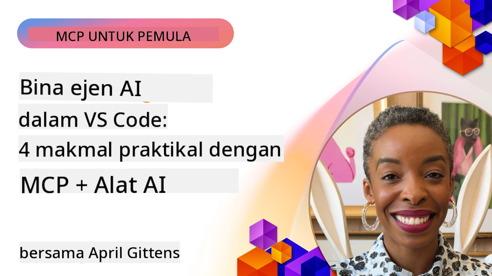

# Memperkemas Aliran Kerja AI: Membina Pelayan MCP dengan Microsoft Foundry Toolkit

## 🎯  Gambaran Keseluruhan

_(Klik imej di atas untuk menonton video pelajaran ini)_

Selamat datang ke **Bengkel Protokol Konteks Model (MCP)**! Bengkel amali menyeluruh ini menggabungkan dua teknologi canggih untuk merevolusikan pembangunan aplikasi AI:

> **Nota keserasian:** kod bengkel dibina dan diuji dengan MCP
> `2025-11-25`, seperti yang ditunjukkan oleh lencana di atas. Gunakan
> [spesifikasi `2026-07-28` terkini](https://modelcontextprotocol.io/specification/2026-07-28/)
> untuk pelaksanaan protokol baru dan semak nota pelepasan SDK sebelum
> memindahkan makmal.

- **🔗 Protokol Konteks Model (MCP)**: Piawaian terbuka untuk integrasi alat AI tanpa halangan
- **🛠️ Sambungan Microsoft Foundry Toolkit untuk VS Code**: Sambungan pembangunan AI yang berkuasa daripada Microsoft

### 🎓 Apa Yang Akan Anda Pelajari

Menjelang akhir bengkel ini, anda akan menguasai seni membina aplikasi pintar yang menghubungkan model AI dengan alat dan perkhidmatan dunia sebenar. Daripada ujian automatik kepada integrasi API khusus, anda akan memperoleh kemahiran praktikal untuk menyelesaikan cabaran perniagaan yang kompleks.

## 🏗️ Teknologi Digunakan

### 🔌 Protokol Konteks Model (MCP)

MCP adalah **"USB-C untuk AI"** - satu piawaian universal yang menghubungkan model AI kepada alat dan sumber data luaran.

**✨ Ciri-ciri Utama:**

- 🔄 **Integrasi Piawai**: Antara muka universal untuk sambungan alat AI
- 🏛️ **Seni Bina Fleksibel**: Pelayan tempatan & jauh melalui pengangkutan stdio/SSE
- 🧰 **Ekosistem Kaya**: Alat, arahan, dan sumber dalam satu protokol
- 🔒 **Sedia untuk Perusahaan**: Keselamatan dan kebolehpercayaan terbina dalam

**🎯 Kenapa MCP Penting:**
Seperti USB-C menghapuskan kekacauan kabel, MCP menghapuskan kerumitan integrasi AI. Satu protokol, kemungkinan tanpa had.

### 🤖 Sambungan Microsoft Foundry Toolkit untuk VS Code

Sambungan pembangunan AI utama Microsoft yang mengubah VS Code menjadi kuasa AI.

**🚀 Keupayaan Teras:**

- 📦 **Katalog Model**: Akses model daripada Azure AI, GitHub, Hugging Face, Ollama
- ⚡ **Inferens Tempatan**: Pelaksanaan CPU/GPU/NPU dioptimumkan ONNX
- 🏗️ **Pembina Ejen**: Pembangunan ejen AI visual dengan integrasi MCP
- 🎭 **Mod Berbilang**: Sokongan teks, visi, dan output berstruktur

**💡 Manfaat Pembangunan:**

- Penyebaran model tanpa konfigurasi
- Kejuruteraan arahan visual
- Kawasan ujian masa nyata
- Integrasi pelayan MCP lancar

## 📚 Perjalanan Pembelajaran

### [🚀 Modul 1: Asas Microsoft Foundry Toolkit](./lab1/README.md)

**Tempoh**: 15 minit

- 🛠️ Pasang dan konfigurasikan Microsoft Foundry Toolkit untuk VS Code
- 🗂️ Terokai Katalog Model (100+ model daripada GitHub, ONNX, OpenAI, Anthropic, Google)
- 🎮 Kuasai Kawasan Interaktif untuk ujian model masa nyata
- 🤖 Bangunkan ejen AI pertama anda dengan Pembina Ejen
- 📊 Nilai prestasi model dengan metrik terbina dalam (F1, kaitan, kesamaan, koheren)
- ⚡ Pelajari pengendalian pek dan sokongan mod berbilang

**🎯 Hasil Pembelajaran**: Cipta ejen AI berfungsi dengan kefahaman menyeluruh mengenai keupayaan Microsoft Foundry Toolkit

### [🌐 Modul 2: MCP dengan Asas Microsoft Foundry Toolkit](./lab2/README.md)

**Tempoh**: 20 minit

- 🧠 Kuasai seni bina dan konsep Protokol Konteks Model (MCP)
- 🌐 Terokai ekosistem pelayan MCP Microsoft
- 🤖 Bangunkan ejen automasi pelayar menggunakan pelayan Playwright MCP
- 🔧 Integrasikan pelayan MCP dengan Microsoft Foundry Toolkit Pembina Ejen
- 📊 Konfigurasikan dan uji alat MCP dalam ejen anda
- 🚀 Eksport dan sebarkan ejen dikuasakan MCP untuk penggunaan produksi

**🎯 Hasil Pembelajaran**: Sebarkan ejen AI yang dipertingkatkan dengan alat luaran melalui MCP

### [🔧 Modul 3: Pembangunan MCP Lanjutan dengan Microsoft Foundry Toolkit](./lab3/README.md)

**Tempoh**: 20 minit

- 💻 Cipta pelayan MCP khusus menggunakan Microsoft Foundry Toolkit
- 🐍 Konfigurasikan dan gunakan SDK Python MCP terkini (v1.9.3)
- 🔍 Sediakan dan gunakan MCP Inspector untuk penyahpepijatan
- 🛠️ Bina Pelayan Cuaca MCP dengan aliran kerja penyahpepijatan profesional
- 🧪 Nyahpepijat pelayan MCP di persekitaran Pembina Ejen dan Inspector

**🎯 Hasil Pembelajaran**: Bangunkan dan nyahpepijat pelayan MCP khusus dengan alat moden

### [🐙 Modul 4: Pembangunan MCP Praktikal - Pelayan Klon GitHub Khusus](./lab4/README.md)

**Tempoh**: 30 minit

- 🏗️ Bina Pelayan Klon GitHub MCP dunia nyata untuk aliran kerja pembangunan
- 🔄 Laksanakan pengklonan repositori pintar dengan pengesahan dan pengendalian ralat
- 📁 Cipta pengurusan direktori pintar dan integrasi VS Code
- 🤖 Gunakan Mod Ejen GitHub Copilot dengan alat MCP khusus
- 🛡️ Terapkan kebolehpercayaan sedia produksi dan keserasian lintas platform

**🎯 Hasil Pembelajaran**: Sebarkan pelayan MCP yang sedia produksi yang memudahkan aliran kerja pembangunan sebenar

## 💡 Aplikasi Dunia Sebenar & Impak

### 🏢 Kes Penggunaan Perusahaan

#### 🔄 Automasi DevOps

Ubah aliran kerja pembangunan anda dengan automasi pintar:

- **Pengurusan Repositori Pintar**: Kajian kod dan keputusan penggabungan dikendalikan AI
- **CI/CD Pintar**: Pengoptimuman pipeline automatik berdasarkan perubahan kod
- **Triage Isu**: Klasifikasi dan penugasan pepijat automatik

#### 🧪 Revolusi Jaminan Kualiti

Tingkatkan ujian dengan automasi dikuasakan AI:

- **Penjanaan Ujian Pintar**: Cipta suite ujian menyeluruh secara automatik
- **Ujian Regressi Visual**: Pengesanan perubahan UI dikuasakan AI
- **Pemantauan Prestasi**: Pengenalpastian dan penyelesaian isu secara proaktif

#### 📊 Kecerdasan Saluran Data

Bina aliran pemprosesan data yang lebih pintar:

- **Proses ETL Adaptif**: Transformasi data yang mengoptimumkan diri
- **Pengesanan Anomali**: Pemantauan kualiti data masa nyata
- **Penghalaan Pintar**: Pengurusan aliran data yang bijak

#### 🎧 Peningkatan Pengalaman Pelanggan

Cipta interaksi pelanggan yang luar biasa:

- **Sokongan Berinformasi Konteks**: Ejen AI dengan akses kepada sejarah pelanggan
- **Penyelesaian Isu Proaktif**: Perkhidmatan pelanggan prediktif
- **Integrasi Pelbagai Saluran**: Pengalaman AI yang unify merentas platform

## 🛠️ Prasyarat & Persediaan

### 💻 Keperluan Sistem

| Komponen | Keperluan | Nota |
|-----------|-------------|-------|
| **Sistem Operasi** | Windows 10+, macOS 10.15+, Linux | Mana-mana OS moden |
| **Visual Studio Code** | Versi stabil terkini | Diperlukan untuk Microsoft Foundry Toolkit |
| **Node.js** | v18.0+ dan npm | Untuk pembangunan pelayan MCP |
| **Python** | 3.10+ | Pilihan untuk pelayan MCP Python |
| **Memori** | Minimum 8GB RAM | 16GB disyorkan untuk model tempatan |

### 🔧 Persekitaran Pembangunan

#### Sambungan VS Code Disyorkan

- **Microsoft Foundry Toolkit** (ms-windows-ai-studio.windows-ai-studio)
- **Python** (ms-python.python)
- **Python Debugger** (ms-python.debugpy)
- **GitHub Copilot** (GitHub.copilot) - Pilihan tetapi berguna

#### Alat Pilihan

- **uv**: Pengurus pakej Python moden
- **MCP Inspector**: Alat penyahpepijatan visual untuk pelayan MCP
- **Playwright**: Untuk contoh automasi web

## 🎖️ Hasil Pembelajaran & Laluan Pensijilan

### 🏆 Senarai Semak Penguasaan Kemahiran

Dengan menamatkan bengkel ini, anda akan mencapai penguasaan dalam:

#### 🎯 Kecekapan Teras

- [ ] **Penguasaan Protokol MCP**: Kefahaman mendalam tentang seni bina dan corak pelaksanaan
- [ ] **Kemahiran Microsoft Foundry Toolkit**: Penggunaan pakar Microsoft Foundry Toolkit untuk pembangunan pantas
- [ ] **Pembangunan Pelayan Khusus**: Bina, sebarkan, dan penyelenggaraan pelayan MCP produksi
- [ ] **Kecemerlangan Integrasi Alat**: Sambungkan AI secara lancar dengan aliran kerja pembangunan sedia ada
- [ ] **Aplikasi Penyelesaian Masalah**: Gunakan kemahiran dipelajari untuk cabaran perniagaan sebenar

#### 🔧 Kemahiran Teknikal

- [ ] Sediakan dan konfigurasikan Microsoft Foundry Toolkit dalam VS Code
- [ ] Reka bentuk dan laksanakan pelayan MCP khusus
- [ ] Integrasikan model Microsoft Foundry dengan seni bina MCP
- [ ] Bina aliran kerja ujian automatik dengan Playwright
- [ ] Sebarkan ejen AI untuk penggunaan produksi
- [ ] Nyahpepijat dan optimakan prestasi pelayan MCP

#### 🚀 Keupayaan Lanjutan

- [ ] Seni bina integrasi AI skala perusahaan
- [ ] Laksanakan amalan keselamatan terbaik untuk aplikasi AI
- [ ] Reka bentuk seni bina pelayan MCP berskala
- [ ] Cipta rangkaian alat khusus untuk domain tertentu
- [ ] Mentorkan orang lain dalam pembangunan berasaskan AI

## 📖 Sumber Tambahan

- [Spesifikasi MCP (2026-07-28)](https://modelcontextprotocol.io/specification/2026-07-28/)
- [Repositori GitHub Microsoft Foundry Toolkit](https://github.com/microsoft/vscode-ai-toolkit)
- [Koleksi Pelayan MCP Contoh](https://github.com/modelcontextprotocol/servers)
- [Panduan Amalan Terbaik](https://modelcontextprotocol.io/docs/best-practices)
- [OWASP MCP 10 Teratas](https://microsoft.github.io/mcp-azure-security-guide/mcp/) - Amalan keselamatan terbaik

---

**🚀 Sedia untuk merevolusikan aliran kerja pembangunan AI anda?**

Mari bina masa depan aplikasi pintar bersama-sama dengan MCP dan Microsoft Foundry Toolkit!

## Apa Seterusnya

Teruskan ke: [Modul 11: Makmal Amali Pelayan MCP](../11-MCPServerHandsOnLabs/README.md)

---

<!-- CO-OP TRANSLATOR DISCLAIMER START -->
**Penafian**:
Dokumen ini telah diterjemahkan menggunakan perkhidmatan terjemahan AI [Co-op Translator](https://github.com/Azure/co-op-translator). Walaupun kami berusaha untuk ketepatan, sila ambil maklum bahawa terjemahan automatik mungkin mengandungi kesilapan atau ketidaktepatan. Dokumen asal dalam bahasa asalnya harus dianggap sebagai sumber yang sahih. Untuk maklumat penting, terjemahan oleh manusia profesional adalah disyorkan. Kami tidak bertanggungjawab terhadap sebarang salah faham atau salah tafsir yang timbul daripada penggunaan terjemahan ini.
<!-- CO-OP TRANSLATOR DISCLAIMER END -->