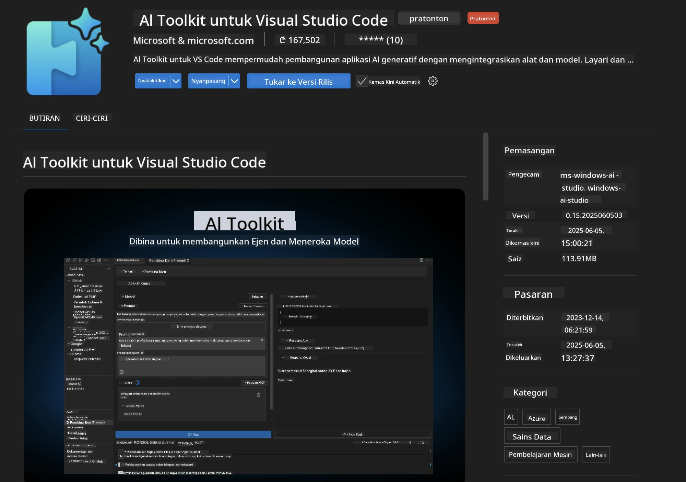
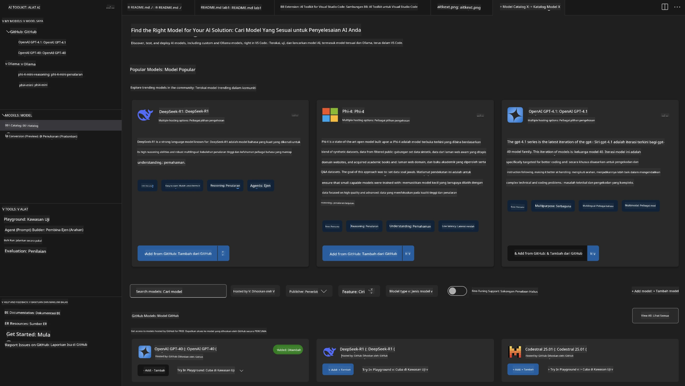
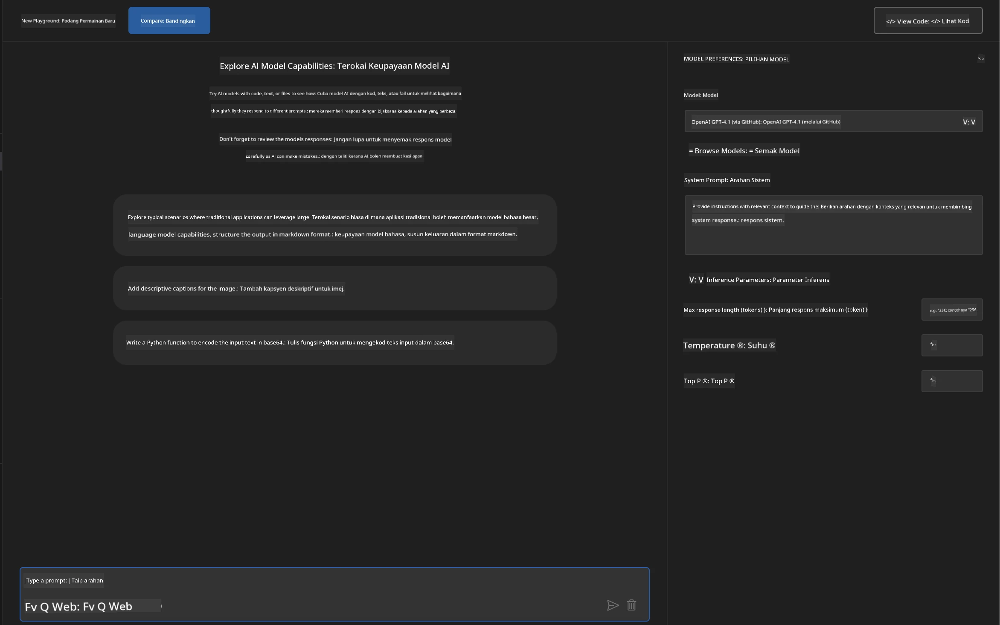
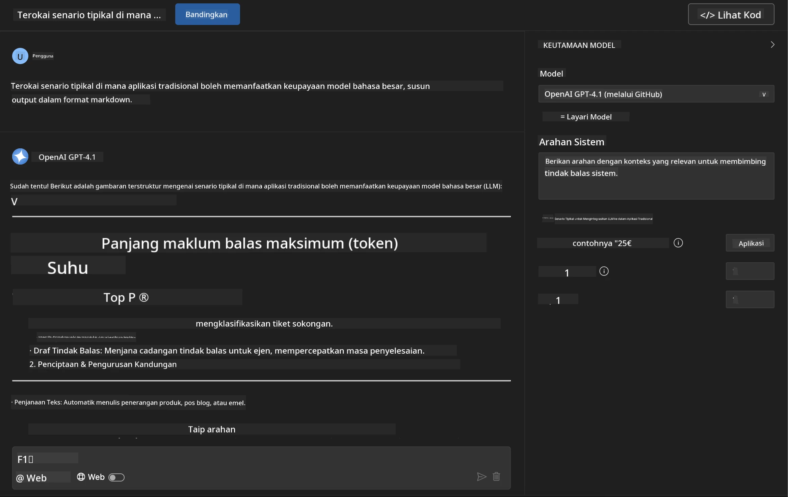
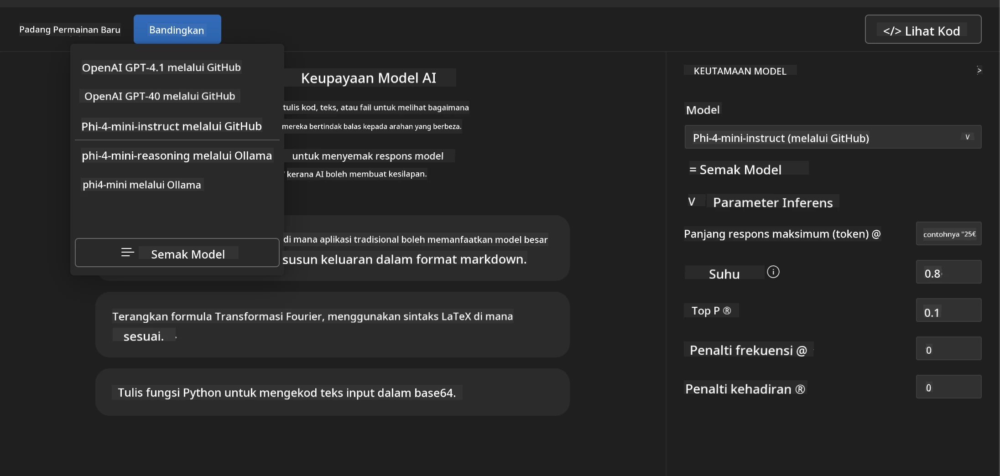
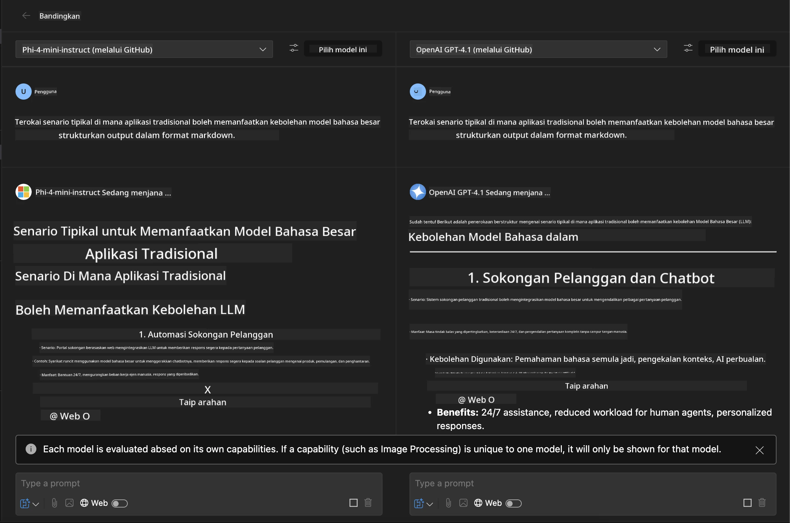
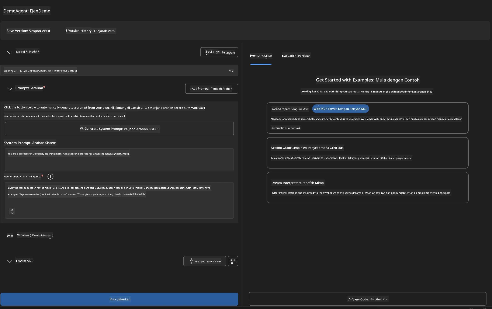
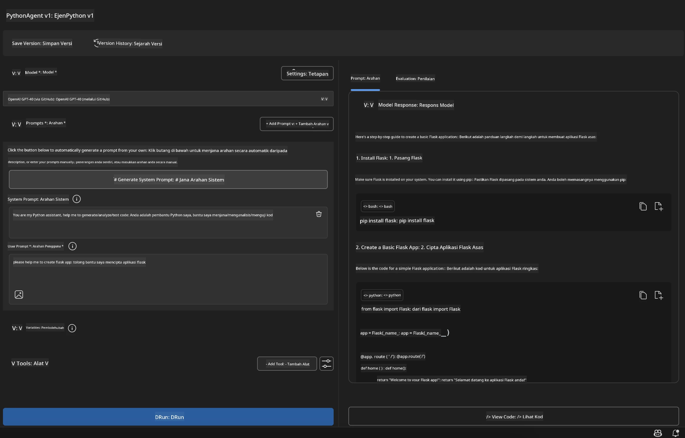

# 🚀 Modul 1: Asas Microsoft Foundry Toolkit

[]()
[]()
[]()

## 📋 Objektif Pembelajaran

Menjelang akhir modul ini, anda akan dapat:
- ✅ Pasang dan konfigurasikan Microsoft Foundry Toolkit Extension untuk VS Code
- ✅ Navigasi Katalog Model dan fahami pelbagai sumber model
- ✅ Gunakan Playground untuk ujian dan eksperimen model
- ✅ Cipta ejen AI khusus menggunakan Agent Builder
- ✅ Bandingkan prestasi model antara penyedia berbeza
- ✅ Terapkan amalan terbaik dalam kejuruteraan prompt

## 🧠 Pengenalan kepada Microsoft Foundry Toolkit

**Microsoft Foundry Toolkit Extension untuk VS Code** adalah sambungan utama Microsoft yang mengubah VS Code menjadi persekitaran pembangunan AI yang lengkap. Ia merapatkan jurang antara penyelidikan AI dan pembangunan aplikasi praktikal, menjadikan AI generatif mudah diakses oleh pembangun dari semua tahap kemahiran.

### 🌟 Keupayaan Utama

| Ciri | Penerangan | Kes Penggunaan |
|---------|-------------|----------|
| **🗂️ Katalog Model** | Akses lebih 100 model dari GitHub, ONNX, OpenAI, Anthropic, Google | Penemuan dan pemilihan model |
| **🔌 Sokongan BYOM** | Integrasi model anda sendiri (lokal/jauh) | Penggunaan model tersuai |
| **🎮 Playground Interaktif** | Ujian model masa nyata dengan interface perbualan | Pembuatan prototaip dan ujian pantas |
| **📎 Sokongan Berbilang Mod** | Mengendalikan teks, imej, dan lampiran | Aplikasi AI kompleks |
| **⚡ Pemprosesan Berkumpulan** | Jalankan pelbagai prompt serentak | Aliran kerja ujian cekap |
| **📊 Penilaian Model** | Metri terbina dalam (F1, relevan, persamaan, koheren) | Penilaian prestasi |

### 🎯 Kenapa Microsoft Foundry Toolkit Penting

- **🚀 Pembangunan Dipercepat**: Dari idea ke prototaip dalam beberapa minit
- **🔄 Aliran Kerja Bersatu**: Satu antara muka untuk pelbagai penyedia AI
- **🧪 Eksperimen Mudah**: Bandingkan model tanpa persediaan rumit
- **📈 Sedia untuk Pengeluaran**: Peralihan lancar dari prototaip ke pengeluaran

## 🛠️ Prasyarat & Persediaan

### 📦 Pasang Microsoft Foundry Toolkit Extension

**Langkah 1: Akses Pasar Extensions**
1. Buka Visual Studio Code
2. Navigasi ke pandangan Extensions (`Ctrl+Shift+X` atau `Cmd+Shift+X`)
3. Cari "Microsoft Foundry Toolkit"

**Langkah 2: Pilih Versi Anda**
- **🟢 Keluaran Rasmi**: Disyorkan untuk penggunaan pengeluaran
- **🔶 Pra-keluaran**: Akses awal kepada ciri terkini

**Langkah 3: Pasang dan Aktifkan**



### ✅ Senarai Semak Pengesahan
- [ ] Ikon Microsoft Foundry Toolkit muncul di bar sisi VS Code
- [ ] Sambungan diaktifkan dan berfungsi
- [ ] Tiada ralat pemasangan dalam panel output

## 🧪 Latihan Praktikal 1: Meneroka Model Microsoft Foundry

**🎯 Objektif**: Kuasai Katalog Model dan uji model AI pertama anda

### 📊 Langkah 1: Navigasi Katalog Model

Katalog Model adalah pintu masuk anda ke ekosistem AI. Ia mengagregat model dari pelbagai penyedia, memudahkan penemuan dan perbandingan pilihan.

**🔍 Panduan Navigasi:**

Klik pada **MODEL - Katalog** di bar sisi Microsoft Foundry Toolkit



**💡 Petua Pro**: Cari model dengan kemampuan khusus yang sesuai dengan kes penggunaan anda (contoh: penjanaan kod, penulisan kreatif, analisis).

> [!NOTE]
> Model GitHub telah dihentikan pada 30 Julai 2026. Gunakan model Microsoft Foundry
> untuk pengeluaran dan autentikasi dengan Microsoft Entra ID atau kunci API Azure.

### 🚀 Langkah 2: Tambah dan Konfigurasikan Model Pertama Anda

**Strategi Pemilihan Model:**
- **GPT-5.1**: Model am yang disyorkan untuk penggunaan alat dan penalaran
- **Phi-4-mini**: Ringan, respons pantas untuk tugasan mudah

**🔧 Proses Konfigurasi:**
1. Pilih **OpenAI GPT-5.1** dari katalog
2. Klik **Tambah ke Model Saya** - ini mendaftarkan model untuk digunakan
3. Pilih **Cuba di Playground** untuk melancarkan persekitaran ujian
4. Tunggu inisialisasi model (persediaan pertama kali mungkin mengambil masa)



**⚙️ Memahami Parameter Model:**
- **Suhu**: Kawal kreativiti (0 = deterministik, 1 = kreatif)
- **Token Maksimum**: Panjang respons maksimum
- **Top-p**: Sampelan nucleus untuk kepelbagaian respons

### 🎯 Langkah 3: Kuasai Antara Muka Playground

Playground adalah makmal eksperimen AI anda. Berikut ialah cara memaksimumkan potensinya:

**🎨 Amalan Terbaik Kejuruteraan Prompt:**
1. **Jelas dan Spesifik**: Arahan yang terang dan terperinci menghasilkan keputusan lebih baik
2. **Berikan Konteks**: Sertakan maklumat latar belakang yang relevan
3. **Gunakan Contoh**: Tunjukkan model apa yang anda mahu dengan contoh
4. **Ulang**: Perdalam prompt berdasarkan keputusan awal

**🧪 Senario Ujian:**
```markdown
# Example 1: Code Generation
"Write a Python function that calculates the factorial of a number using recursion. Include error handling and docstrings."

# Example 2: Creative Writing
"Write a professional email to a client explaining a project delay, maintaining a positive tone while being transparent about challenges."

# Example 3: Data Analysis
"Analyze this sales data and provide insights: [paste your data]. Focus on trends, anomalies, and actionable recommendations."
```



### 🏆 Latihan Cabaran: Perbandingan Prestasi Model

**🎯 Matlamat**: Bandingkan model berbeza menggunakan prompt yang sama untuk memahami kekuatan mereka

**📋 Arahan:**
1. Tambah **Phi-4-mini** ke ruang kerja anda
2. Gunakan prompt yang sama untuk GPT-5.1 dan Phi-4-mini



3. Bandingkan kualiti respons, kelajuan, dan ketepatan
4. Dokumentasikan penemuan anda dalam seksyen keputusan



**💡 Wawasan Utama untuk Ditemui:**
- Bila menggunakan LLM vs SLM
- Perdagangan kos vs prestasi
- Keupayaan khusus model berbeza

## 🤖 Latihan Praktikal 2: Membina Ejen Tersuai dengan Agent Builder

**🎯 Objektif**: Cipta ejen AI khusus untuk tugasan dan aliran kerja tertentu

### 🏗️ Langkah 1: Memahami Agent Builder

Agent Builder adalah tempat Microsoft Foundry Toolkit benar-benar cemerlang. Ia membolehkan anda mencipta pembantu AI tujuan khusus yang menggabungkan kuasa model bahasa besar dengan arahan tersuai, parameter tertentu, dan pengetahuan khusus.

**🧠 Komponen Seni Bina Ejen:**
- **Model Teras**: LLM asas (GPT-5.1, Phi, dll.)
- **Prompt Sistem**: Menentukan personaliti dan tingkah laku ejen
- **Parameter**: Tetapan halus untuk prestasi optimum
- **Integrasi Alat**: Sambungkan ke API luaran dan perkhidmatan MCP
- **Memori**: Konteks perbualan dan ketahanan sesi



### ⚙️ Langkah 2: Pendalaman Konfigurasi Ejen

**🎨 Mencipta Prompt Sistem Efektif:**
```markdown
# Template Structure:
## Role Definition
You are a [specific role] with expertise in [domain].

## Capabilities
- List specific abilities
- Define scope of knowledge
- Clarify limitations

## Behavior Guidelines
- Response style (formal, casual, technical)
- Output format preferences
- Error handling approach

## Examples
Provide 2-3 examples of ideal interactions
```

*Sudah tentu, anda juga boleh menggunakan Generate System Prompt untuk menggunakan AI membantu anda menjana dan mengoptimumkan prompt*

**🔧 Pengoptimuman Parameter:**
| Parameter | Julat Disyorkan | Kes Penggunaan |
|-----------|------------------|----------|
| **Suhu** | 0.1-0.3 | Respons teknikal/faktual |
| **Suhu** | 0.7-0.9 | Tugasan kreatif/brainstorming |
| **Token Maksimum** | 500-1000 | Respons ringkas |
| **Token Maksimum** | 2000-4000 | Penjelasan terperinci |

### 🐍 Langkah 3: Latihan Praktikal - Ejen Pengaturcaraan Python

**🎯 Misi**: Cipta pembantu pengaturcaraan Python khusus

**📋 Langkah Konfigurasi:**

1. **Pemilihan Model**: Pilih **Claude 3.5 Sonnet** (cemerlang untuk kod)

2. **Reka Bentuk Prompt Sistem**:
```markdown
# Python Programming Expert Agent

## Role
You are a senior Python developer with 10+ years of experience. You excel at writing clean, efficient, and well-documented Python code.

## Capabilities
- Write production-ready Python code
- Debug complex issues
- Explain code concepts clearly
- Suggest best practices and optimizations
- Provide complete working examples

## Response Format
- Always include docstrings
- Add inline comments for complex logic
- Suggest testing approaches
- Mention relevant libraries when applicable

## Code Quality Standards
- Follow PEP 8 style guidelines
- Use type hints where appropriate
- Handle exceptions gracefully
- Write readable, maintainable code
```

3. **Konfigurasi Parameter**:
   - Suhu: 0.2 (untuk kod yang konsisten dan boleh dipercayai)
   - Token Maksimum: 2000 (penjelasan terperinci)
   - Top-p: 0.9 (kreativiti seimbang)



### 🧪 Langkah 4: Uji Ejen Python Anda

**Senario Ujian:**
1. **Fungsi Asas**: "Cipta fungsi untuk mencari nombor perdana"
2. **Algoritma Kompleks**: "Laksanakan pokok carian binari dengan kaedah masukkan, padam, dan cari"
3. **Masalah Dunia Sebenar**: "Bina web scraper yang mengendalikan had kadar dan cuba semula"
4. **Penyahpepijatan**: "Baiki kod ini [tampal kod bermasalah]"

**🏆 Kriteria Kejayaan:**
- ✅ Kod berjalan tanpa ralat
- ✅ Termasuk dokumentasi yang betul
- ✅ Mengikuti amalan terbaik Python
- ✅ Memberi penjelasan jelas
- ✅ Mencadangkan penambahbaikan

## 🎓 Rumusan Modul 1 & Langkah Seterusnya

### 📊 Pemeriksaan Pengetahuan

Uji kefahaman anda:
- [ ] Bolehkah anda terangkan perbezaan antara model dalam katalog?
- [ ] Adakah anda berjaya mencipta dan menguji ejen tersuai?
- [ ] Fahamkah anda cara mengoptimumkan parameter untuk kes penggunaan berbeza?
- [ ] Bolehkah anda mereka bentuk prompt sistem yang berkesan?

### 📚 Sumber Tambahan

- **Dokumentasi Microsoft Foundry Toolkit**: [Dokumen Rasmi Microsoft](https://github.com/microsoft/vscode-ai-toolkit)
- **Panduan Kejuruteraan Prompt**: [Amalan Terbaik](https://platform.openai.com/docs/guides/prompt-engineering)
- **Model dalam Microsoft Foundry Toolkit**: [Model dalam Pembangunan](https://github.com/microsoft/vscode-ai-toolkit/blob/main/doc/models.md)

**🎉 Tahniah!** Anda telah menguasai asas Microsoft Foundry Toolkit dan bersedia untuk membina aplikasi AI yang lebih maju!

### 🔜 Teruskan ke Modul Seterusnya

Bersedia untuk keupayaan lebih maju? Teruskan ke **[Modul 2: MCP dengan Asas Microsoft Foundry Toolkit](../lab2/README.md)** di mana anda akan belajar bagaimana:
- Sambungkan ejen anda ke alat luaran menggunakan Model Context Protocol (MCP)
- Bina ejen automasi pelayar dengan Playwright
- Integrasi pelayan MCP dengan ejen Microsoft Foundry Toolkit anda
- Memperkasakan ejen anda dengan data dan keupayaan luaran

---

<!-- CO-OP TRANSLATOR DISCLAIMER START -->
**Penafian**:
Dokumen ini telah diterjemahkan menggunakan perkhidmatan terjemahan AI [Co-op Translator](https://github.com/Azure/co-op-translator). Walaupun kami berusaha untuk ketepatan, sila ambil maklum bahawa terjemahan automatik mungkin mengandungi kesilapan atau ketidaktepatan. Dokumen asal dalam bahasa asalnya harus dianggap sebagai sumber yang sahih. Untuk maklumat penting, terjemahan oleh manusia profesional adalah disyorkan. Kami tidak bertanggungjawab terhadap sebarang salah faham atau salah tafsir yang timbul daripada penggunaan terjemahan ini.
<!-- CO-OP TRANSLATOR DISCLAIMER END -->