# 🌐 Modul 2: MCP dengan Asas Microsoft Foundry Toolkit


## 📋 Objektif Pembelajaran

Pada akhir modul ini, anda akan dapat:

- ✅ Memahami seni bina dan faedah Model Context Protocol (MCP)
- ✅ Meneroka ekosistem pelayan MCP Microsoft
- ✅ Mengintegrasikan pelayan MCP dengan Microsoft Foundry Toolkit Agent Builder
- ✅ Membina ejen automasi pelayar yang berfungsi menggunakan Playwright MCP
- ✅ Mengkonfigurasi dan menguji alat MCP dalam ejen anda
- ✅ Mengeksport dan menyebarkan ejen berkuasa MCP untuk kegunaan produksi

## 🎯 Membangun daripada Modul 1

Dalam Modul 1, kita menguasai asas Microsoft Foundry Toolkit dan mencipta
Ejen Python pertama kita. Sekarang kita akan **meningkatkan kuasa** ejen anda dengan
menghubungkannya dengan alat dan perkhidmatan luar melalui revolusi
**Model Context Protocol (MCP)**.

Anggap ini sebagai peningkatan daripada kalkulator asas kepada komputer penuh. Ejen AI
anda akan memperoleh kebolehan untuk:

- 🌐 Melayari dan berinteraksi dengan laman web
- 📁 Mengakses dan memanipulasi fail
- 🔧 Mengintegrasi dengan sistem perusahaan
- 📊 Memproses data masa nyata dari API

## 🧠 Memahami Model Context Protocol (MCP)

### 🔍 Apa itu MCP?

Model Context Protocol (MCP) adalah **"USB-C untuk aplikasi AI"**: satu piawaian terbuka
yang menghubungkan Model Bahasa Besar (LLMs) kepada alat luaran, sumber data,
dan perkhidmatan. Sama seperti USB-C menyediakan satu penyambung universal, MCP
mengurangkan kerumitan integrasi AI melalui satu protokol standard.

### 🎯 Masalah yang Diselesaikan oleh MCP

**Sebelum MCP:**

- 🔧 Integrasi tersuai untuk setiap alat
- 🔄 Terperangkap dengan penyelesaian vendor proprietari
- 🔒 Kelemahan keselamatan dari sambungan ad-hoc
- ⏱️ Berbulan-bulan pembangunan untuk integrasi asas

**Dengan MCP:**

- ⚡ Integrasi alat plug-and-play
- 🔄 Seni bina bebas vendor
- 🛡️ Amalan keselamatan terbina dalam
- 🚀 Tambah keupayaan baru dalam beberapa minit

### 🏗️ Mendalami Seni Bina MCP

MCP mengikuti **arsitektur klien-pelayan** yang mencipta ekosistem yang selamat dan boleh

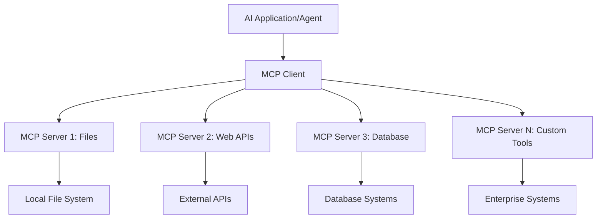

**🔧 Komponen Teras:**

| Komponen | Peranan | Contoh |
| --------- | ---- | -------- |
| **Hos MCP** | Menggunakan perkhidmatan MCP | VS Code, Foundry Toolkit |
| **Klien MCP** | Mengendalikan sambungan protokol | Terbenam dalam hos |
| **Pelayan MCP** | Menyediakan kebolehan | Playwright, Files, Azure, GitHub |
| **Lapisan Pengangkutan** | Menghubungkan klien dan pelayan | stdio, HTTP, WebSockets |

## 🏢 Ekosistem Pelayan MCP Microsoft

Microsoft mengetuai ekosistem MCP dengan suite pelayan
tahap perusahaan yang menyelesaikan keperluan perniagaan sebenar.

### 🌟 Pelayan Microsoft MCP Pilihan

#### 1. ☁️ Pelayan Azure MCP

**🔗 Repositori**: [azure/azure-mcp](https://github.com/azure/azure-mcp)
**🎯 Tujuan**: Pengurusan sumber Azure menyeluruh dengan integrasi AI

**✨ Ciri Utama:**

- Penyediaan infrastruktur deklaratif
- Pemantauan sumber masa nyata
- Cadangan pengoptimuman kos
- Semakan pematuhan keselamatan

**🚀 Kes Penggunaan:**

- Infrastruktur-sebagai-Kod dengan bantuan AI
- Penskalaan sumber automatik
- Pengoptimuman kos awan
- Automasi alur kerja DevOps

#### 2. 📊 Microsoft Dataverse MCP

**📚 Dokumentasi**: [Integrasi Microsoft Dataverse](https://go.microsoft.com/fwlink/?linkid=2320176)
**🎯 Tujuan**: Antara muka bahasa semula jadi untuk data perniagaan

**✨ Ciri Utama:**

- Pertanyaan pangkalan data menggunakan bahasa semula jadi
- Pemahaman konteks perniagaan
- Templat prompt tersuai
- Tadbir urus data perusahaan

**🚀 Kes Penggunaan:**

- Laporan kecerdasan perniagaan
- Analisis data pelanggan
- Wawasan saluran jualan
- Pertanyaan data pematuhan

#### 3. 🌐 Pelayan Playwright MCP

**🔗 Repositori**: [microsoft/playwright-mcp](https://github.com/microsoft/playwright-mcp)
**🎯 Tujuan**: Kebolehan automasi pelayar dan interaksi web

**✨ Ciri Utama:**

- Automasi pelbagai pelayar (Chrome, Firefox, Safari)
- Pengecaman elemen pintar
- Penjanaan tangkapan skrin dan PDF
- Pemantauan trafik rangkaian

**🚀 Kes Penggunaan:**

- Alur kerja ujian automatik
- Pengikisan web dan pengekstrakan data
- Pemantauan UI/UX
- Automasi analisis persaingan

#### 4. 📁 Pelayan Files MCP

**🔗 Repositori**: [microsoft/files-mcp-server](https://github.com/microsoft/files-mcp-server)
**🎯 Tujuan**: Operasi sistem fail pintar

**✨ Ciri Utama:**

- Pengurusan fail deklaratif
- Penyelarasan kandungan
- Integrasi kawalan versi
- Pengekstrakan metadata

**🚀 Kes Penggunaan:**

- Pengurusan dokumentasi
- Penyusunan repositori kod
- Alur kerja penerbitan kandungan
- Pengendalian fail saluran data

#### 5. 📝 Pelayan MarkItDown MCP

**🔗 Repositori**: [microsoft/markitdown](https://github.com/microsoft/markitdown)
**🎯 Tujuan**: Pemprosesan dan manipulasi Markdown lanjutan

**✨ Ciri Utama:**

- Parsing Markdown kaya
- Penukaran format (MD ↔ HTML ↔ PDF)
- Analisis struktur kandungan
- Pemprosesan templat

**🚀 Kes Penggunaan:**

- Alur kerja dokumentasi teknikal
- Sistem pengurusan kandungan
- Penjanaan laporan
- Automasi pangkalan pengetahuan

#### 6. 📈 Pelayan Clarity MCP

**📦 Pakej**: [@microsoft/clarity-mcp-server](https://www.npmjs.com/package/@microsoft/clarity-mcp-server)
**🎯 Tujuan**: Analitik web dan wawasan tingkah laku pengguna

**✨ Ciri Utama:**

- Analisis data heatmap
- Rakaman sesi pengguna
- Metrik prestasi
- Analisis corong penukaran

**🚀 Kes Penggunaan:**

- Pengoptimuman laman web
- Penyelidikan pengalaman pengguna
- Analisis ujian A/B
- Papan pemuka kecerdasan perniagaan

### 🌍 Ekosistem Komuniti

Selain pelayan Microsoft, ekosistem MCP termasuk:

- **🐙 GitHub MCP**: Pengurusan repositori dan analisis kod
- **🗄️ MCP Pangkalan Data**: Integrasi PostgreSQL, MySQL, MongoDB
- **☁️ MCP Penyedia Awan**: Alat AWS, GCP, Digital Ocean
- **📧 MCP Komunikasi**: Integrasi Slack, Teams, Email

## 🛠️ Makmal Praktikal: Membangun Ejen Automasi Pelayar

**🎯 Matlamat Projek**: Cipta ejen automasi pelayar pintar menggunakan
pelayan Playwright MCP yang mampu melayari laman web, mengekstrak maklumat, dan
melaksanakan interaksi web yang kompleks.

### 🚀 Fasa 1: Persediaan Asas Ejen

#### Langkah 1: Mulakan Ejen Anda

1. **Buka Microsoft Foundry Toolkit Agent Builder**
2. **Cipta Ejen Baru** dengan konfigurasi berikut:
   - **Nama**: `BrowserAgent`
   - **Model**: Pilih GPT-5.1. Lihat
      [jadual persaraan model Microsoft Foundry](https://learn.microsoft.com/azure/foundry/openai/concepts/model-retirement-schedule)
      untuk maklumat kitaran hayat model terkini.

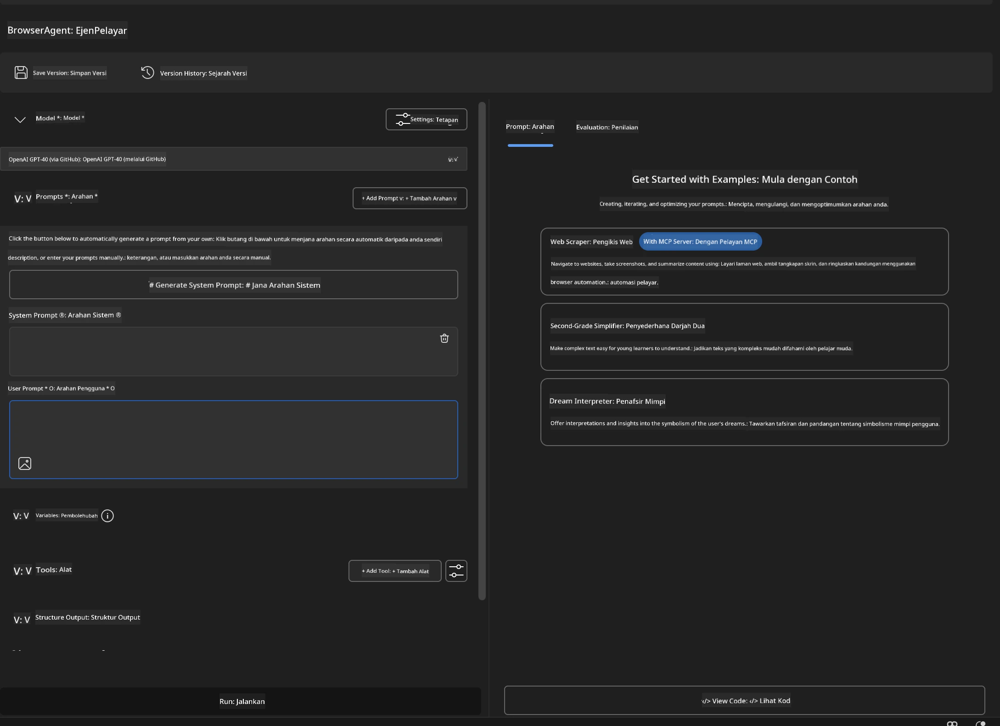

### 🔧 Fasa 2: Alur Kerja Integrasi MCP

#### Langkah 3: Tambah Integrasi Pelayan MCP

1. **Navigasi ke Bahagian Alat** dalam Agent Builder
2. **Klik "Tambah Alat"** untuk buka menu integrasi
3. **Pilih "Pelayan MCP"** dari pilihan yang tersedia

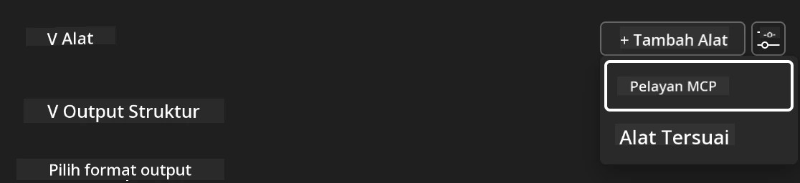

**🔍 Memahami Jenis Alat:**

- **Alat Terbenam**: Fungsi Microsoft Foundry Toolkit yang telah dikonfigurasi
- **Pelayan MCP**: Integrasi perkhidmatan luaran
- **API Tersuai**: Titik akhir perkhidmatan anda sendiri
- **Panggilan Fungsi**: Akses fungsi model secara langsung

#### Langkah 4: Pemilihan Pelayan MCP

1. **Pilih pilihan "Pelayan MCP"** untuk meneruskan
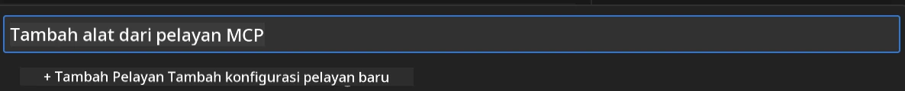

2. **Layari Katalog MCP** untuk meneroka integrasi yang tersedia
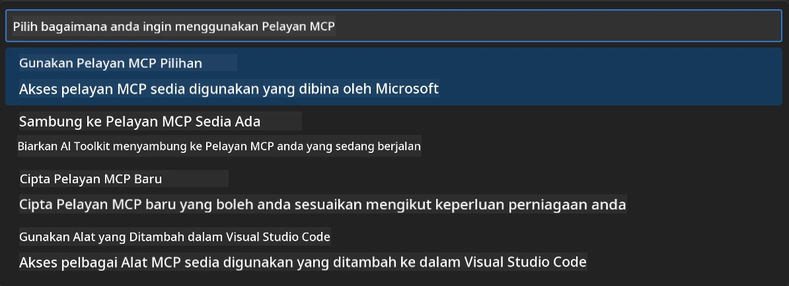

### 🎮 Fasa 3: Konfigurasi Playwright MCP

#### Langkah 5: Pilih dan Konfigurasikan Playwright

1. **Klik "Gunakan Pelayan MCP Pilihan"** untuk akses pelayan yang disahkan Microsoft
2. **Pilih "Playwright"** dari senarai pilihan
3. **Terima ID MCP Lalai** atau sesuaikan untuk persekitaran anda

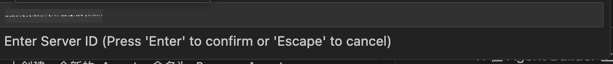

#### Langkah 6: Aktifkan Kebolehan Playwright

**🔑 Langkah Kritikal**: Pilih **SEMUA** kaedah Playwright yang tersedia untuk fungsi maksimum

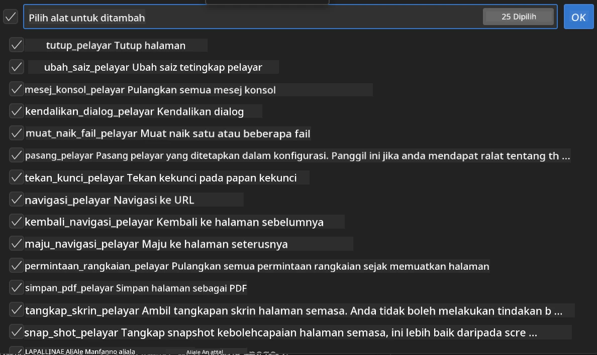

**🛠️ Alat Penting Playwright:**

- **Navigasi**: `goto`, `goBack`, `goForward`, `reload`
- **Interaksi**: `click`, `fill`, `press`, `hover`, `drag`
- **Pengekstrakan**: `textContent`, `innerHTML`, `getAttribute`
- **Pengesahan**: `isVisible`, `isEnabled`, `waitForSelector`
- **Tangkap**: `screenshot`, `pdf`, `video`
- **Rangkaian**: `setExtraHTTPHeaders`, `route`, `waitForResponse`

#### Langkah 7: Sahkan Kejayaan Integrasi

**✅ Penunjuk Kejayaan:**

- Semua alat muncul dalam antara muka Agent Builder
- Tiada mesej ralat di panel integrasi
- Status pelayan Playwright menunjukkan "Bersambung"

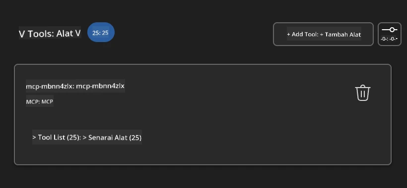

**🔧 Penyelesaian Masalah Biasa:**

- **Sambungan Gagal**: Semak sambungan internet dan tetapan firewall
- **Alat Hilang**: Pastikan semua kebolehan dipilih semasa persediaan
- **Ralat Kebenaran**: Sahkan VS Code mempunyai kebenaran sistem yang diperlukan

### 🎯 Fasa 4: Kejuruteraan Prompt Lanjutan

#### Langkah 8: Reka Bentuk Prompt Sistem Pintar

Cipta prompt canggih yang memanfaatkan sepenuhnya kebolehan Playwright:

```markdown
# Web Automation Expert System Prompt

## Core Identity
You are an advanced web automation specialist with deep expertise in browser
automation, web scraping, and user experience analysis. You have access to
Playwright tools for comprehensive browser control.

## Capabilities & Approach
### Navigation Strategy
- Always start with screenshots to understand page layout
- Use semantic selectors (text content, labels) when possible
- Implement wait strategies for dynamic content
- Handle single-page applications (SPAs) effectively

### Error Handling
- Retry failed operations with exponential backoff
- Provide clear error descriptions and solutions
- Suggest alternative approaches when primary methods fail
- Always capture diagnostic screenshots on errors

### Data Extraction
- Extract structured data in JSON format when possible
- Provide confidence scores for extracted information
- Validate data completeness and accuracy
- Handle pagination and infinite scroll scenarios

### Reporting
- Include step-by-step execution logs
- Provide before/after screenshots for verification
- Suggest optimizations and alternative approaches
- Document any limitations or edge cases encountered

## Ethical Guidelines
- Respect robots.txt and rate limiting
- Avoid overloading target servers
- Only extract publicly available information
- Follow website terms of service
```

#### Langkah 9: Cipta Prompt Pengguna Dinamik

Reka prompt yang menunjukkan pelbagai kebolehan:

**🌐 Contoh Analisis Web:**

```markdown
Navigate to github.com/kinfey and provide a comprehensive analysis including:
1. Repository structure and organization
2. Recent activity and contribution patterns  
3. Documentation quality assessment
4. Technology stack identification
5. Community engagement metrics
6. Notable projects and their purposes

Include screenshots at key steps and provide actionable insights.
```

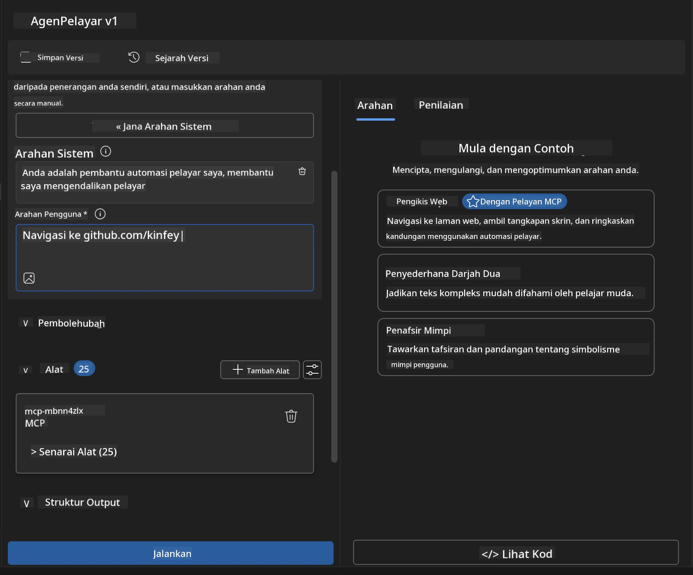

### 🚀 Fasa 5: Pelaksanaan dan Pengujian

#### Langkah 10: Jalankan Automasi Pertama Anda

1. **Klik "Jalankan"** untuk memulakan urutan automasi
2. **Pantau Pelaksanaan Masa Nyata**:
   - Pelayar Chrome dibuka secara automatik
   - Ejen melayari laman web sasaran
   - Tangkapan skrin diambil bagi setiap langkah utama
   - Keputusan analisis dihantar secara langsung

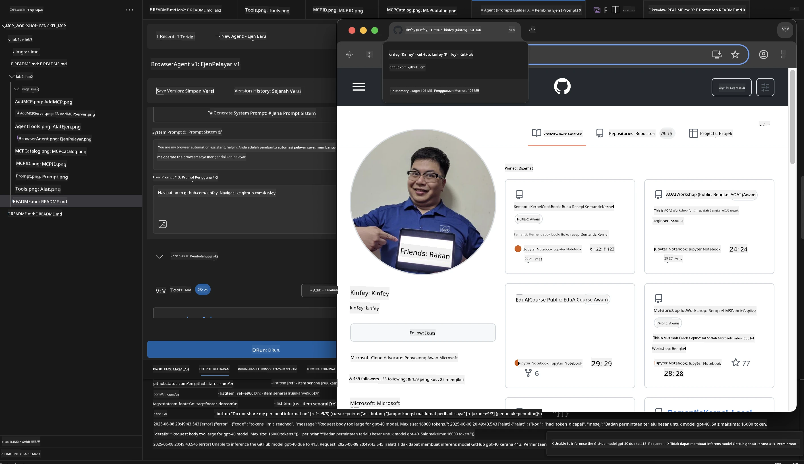

#### Langkah 11: Analisis Keputusan dan Wawasan

Tinjau analisis menyeluruh dalam antara muka Agent Builder:

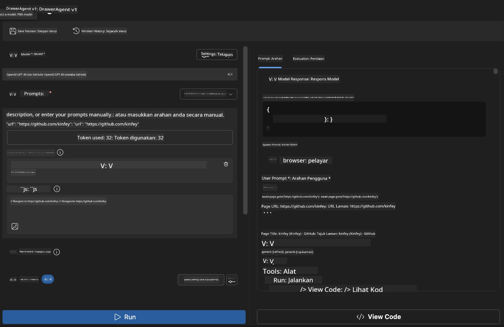

### 🌟 Fasa 6: Kebolehan Lanjutan dan Penyebaran

#### Langkah 12: Eksport dan Penyebaran Produksi

Agent Builder menyokong pelbagai pilihan penyebaran:

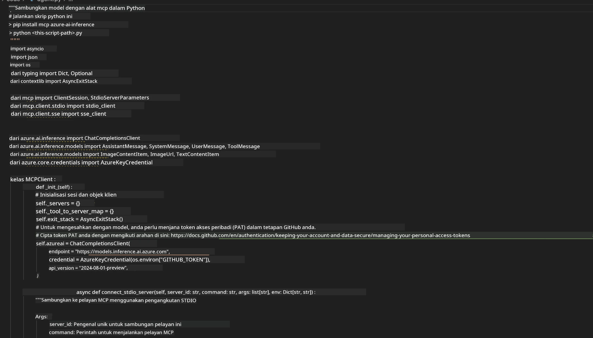

## 🎓 Ringkasan Modul 2 & Langkah Seterusnya

### 🏆 Pencapaian Dicapai: Pakar Integrasi MCP

**✅ Kemahiran Dikuasai:**

- [ ] Memahami seni bina dan faedah MCP
- [ ] Menavigasi ekosistem pelayan MCP Microsoft
- [ ] Mengintegrasi Playwright MCP dengan Microsoft Foundry Toolkit
- [ ] Membangun ejen automasi pelayar yang canggih
- [ ] Kejuruteraan prompt lanjutan untuk automasi web

### 📚 Sumber Tambahan

- **🔗 Spesifikasi MCP**: [Dokumentasi Protokol Rasmi](https://modelcontextprotocol.io/)
- **🛠️ API Playwright**: [Rujukan Kaedah Lengkap](https://playwright.dev/docs/api/class-playwright)
- **🏢 Pelayan MCP Microsoft**:
   [Panduan Integrasi Perusahaan](https://github.com/microsoft/mcp-servers)
- **🌍 Contoh Komuniti**: [Galeri Pelayan MCP](https://github.com/modelcontextprotocol/servers)

**🎉 Tahniah!** Anda telah berjaya menguasai integrasi MCP dan kini boleh
membina ejen AI bersedia produksi dengan kebolehan alat luaran!

### 🔜 Teruskan ke Modul Seterusnya

Bersedia untuk meningkatkan kemahiran MCP anda? Teruskan ke
**[Modul 3: Pembangunan MCP Lanjutan dengan Microsoft Foundry Toolkit](../lab3/README.md)**
di mana anda akan belajar cara untuk:

- Mencipta pelayan MCP tersuai anda sendiri
- Mengkonfigurasi dan menggunakan SDK Python MCP terkini
- Menyediakan MCP Inspector untuk penyahpepijatan
- Menguasai alur kerja pembangunan pelayan MCP lanjutan
- Membina Pelayan MCP Cuaca dari awal

---

<!-- CO-OP TRANSLATOR DISCLAIMER START -->
**Penafian**:
Dokumen ini telah diterjemahkan menggunakan perkhidmatan terjemahan AI [Co-op Translator](https://github.com/Azure/co-op-translator). Walaupun kami berusaha untuk ketepatan, sila ambil maklum bahawa terjemahan automatik mungkin mengandungi kesilapan atau ketidaktepatan. Dokumen asal dalam bahasa asalnya harus dianggap sebagai sumber yang sahih. Untuk maklumat penting, terjemahan oleh manusia profesional adalah disyorkan. Kami tidak bertanggungjawab terhadap sebarang salah faham atau salah tafsir yang timbul daripada penggunaan terjemahan ini.
<!-- CO-OP TRANSLATOR DISCLAIMER END -->