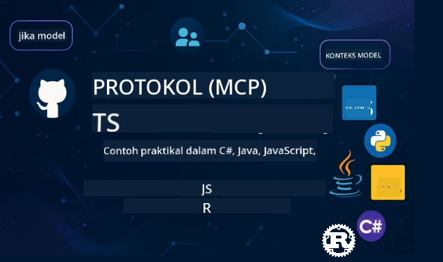

 

[](https://GitHub.com/microsoft/mcp-for-beginners/graphs/contributors)
[](https://GitHub.com/microsoft/mcp-for-beginners/issues)
[](https://GitHub.com/microsoft/mcp-for-beginners/pulls)
[](http://makeapullrequest.com)
[](https://mcptoplist.com/server/mcp.so%2Fmcp-for-beginners%2Fmicrosoft)

[](https://GitHub.com/microsoft/mcp-for-beginners/watchers)
[](https://GitHub.com/microsoft/mcp-for-beginners/fork)
[](https://GitHub.com/microsoft/mcp-for-beginners/stargazers)


[](https://discord.gg/nTYy5BXMWG)

Ikuti langkah-langkah ini untuk memulakan penggunaan sumber ini:
1. **Fork Repositori**: Klik [](https://GitHub.com/microsoft/mcp-for-beginners/fork)
2. **Klon Repositori**:   `git clone https://github.com/microsoft/mcp-for-beginners.git`
3. **Sertai** [](https://discord.gg/nTYy5BXMWG)


### 🌐 Sokongan Pelbagai Bahasa

#### Terjemahan diselenggara dengan [Co-op Translator](https://github.com/Azure/co-op-translator)

<!-- CO-OP TRANSLATOR LANGUAGES TABLE START -->
[Arab](../ar/README.md) | [Bengali](../bn/README.md) | [Bulgaria](../bg/README.md) | [Burmese (Myanmar)](../my/README.md) | [Cina (Dipermudahkan)](../zh-CN/README.md) | [Cina (Tradisional, Hong Kong)](../zh-HK/README.md) | [Cina (Tradisional, Macau)](../zh-MO/README.md) | [Cina (Tradisional, Taiwan)](../zh-TW/README.md) | [Croatia](../hr/README.md) | [Czech](../cs/README.md) | [Denmark](../da/README.md) | [Belanda](../nl/README.md) | [Estonia](../et/README.md) | [Finland](../fi/README.md) | [Perancis](../fr/README.md) | [Jerman](../de/README.md) | [Greek](../el/README.md) | [Ibrani](../he/README.md) | [Hindi](../hi/README.md) | [Hungaria](../hu/README.md) | [Indonesia](../id/README.md) | [Itali](../it/README.md) | [Jepun](../ja/README.md) | [Kannada](../kn/README.md) | [Khmer](../km/README.md) | [Korea](../ko/README.md) | [Lithuania](../lt/README.md) | [Melayu](./README.md) | [Malayalam](../ml/README.md) | [Manipuri (Meitei Mayek)](../mni/README.md) | [Marathi](../mr/README.md) | [Nepali](../ne/README.md) | [Pidgin Nigeria](../pcm/README.md) | [Norwegian](../no/README.md) | [Parsi (Farsi)](../fa/README.md) | [Poland](../pl/README.md) | [Portugal (Brasil)](../pt-BR/README.md) | [Portugal](../pt-PT/README.md) | [Punjabi (Gurmukhi)](../pa/README.md) | [Romania](../ro/README.md) | [Rusia](../ru/README.md) | [Serbian (Cyrillic)](../sr/README.md) | [Slovak](../sk/README.md) | [Slovenia](../sl/README.md) | [Sepanyol](../es/README.md) | [Swahili](../sw/README.md) | [Sweden](../sv/README.md) | [Tagalog (Filipina)](../tl/README.md) | [Tamil](../ta/README.md) | [Telugu](../te/README.md) | [Thai](../th/README.md) | [Turki](../tr/README.md) | [Ukraine](../uk/README.md) | [Urdu](../ur/README.md) | [Vietnam](../vi/README.md)

> **Lebih Suka Klon Secara Tempatan?**
>
> Repositori ini mengandungi terjemahan lebih 50+ bahasa yang secara signifikan meningkatkan saiz muat turun. Untuk klon tanpa terjemahan, gunakan sparse checkout:
>
> **Bash / macOS / Linux:**
> ```bash
> git clone --filter=blob:none --sparse https://github.com/microsoft/mcp-for-beginners.git
> cd mcp-for-beginners
> git sparse-checkout set --no-cone '/*' '!translations' '!translated_images'
> ```
>
> **CMD (Windows):**
> ```cmd
> git clone --filter=blob:none --sparse https://github.com/microsoft/mcp-for-beginners.git
> cd mcp-for-beginners
> git sparse-checkout set --no-cone "/*" "!translations" "!translated_images"
> ```
>
> Ini memberi anda semua yang anda perlukan untuk menyelesaikan kursus dengan muat turun yang jauh lebih pantas.
<!-- CO-OP TRANSLATOR LANGUAGES TABLE END -->

# 🚀 Kurikulum Model Context Protocol (MCP) untuk Pemula

## **Belajar MCP dengan Contoh Kod Amali dalam C#, Java, JavaScript, Rust, Python, dan TypeScript**

## 🧠 Gambaran Keseluruhan Kurikulum Model Context Protocol
Selamat datang ke perjalanan anda dalam Model Context Protocol! Jika anda pernah tertanya-tanya bagaimana aplikasi AI berkomunikasi dengan pelbagai alat dan perkhidmatan, anda akan menemui penyelesaian elegan yang sedang mengubah cara pembangun membina sistem pintar.

Fikirkan MCP sebagai penterjemah universal untuk aplikasi AI - sama seperti port USB membenarkan anda menyambungkan mana-mana peranti ke komputer, MCP membenarkan model AI menyambung ke mana-mana alat atau perkhidmatan secara piawai. Sama ada anda membina chatbot pertama anda atau sedang mengendalikan aliran kerja AI yang kompleks, memahami MCP akan memberi anda kuasa untuk mencipta aplikasi yang lebih berupaya dan fleksibel.

Kurikulum ini direka dengan kesabaran dan perhatian untuk perjalanan pembelajaran anda. Kami akan mulakan dengan konsep mudah yang sudah anda fahami dan secara beransur-ansur membina kepakaran anda melalui latihan praktikal dalam bahasa pengaturcaraan kegemaran anda. Setiap langkah disertakan dengan penerangan yang jelas, contoh praktikal, dan banyak galakan sepanjang perjalanan.

Apabila anda melengkapkan perjalanan ini, anda akan mempunyai keyakinan untuk membina pelayan MCP anda sendiri, mengintegrasikannya dengan platform AI popular, dan memahami bagaimana teknologi ini membentuk semula masa depan pembangunan AI. Mari kita mulakan pengembaraan menarik ini bersama-sama!

### Dokumentasi Rasmi dan Spesifikasi

Semakan protokol semasa ialah **Spesifikasi MCP 2026-07-28**. Spesifikasi MCP
menggunakan penomboran versi berasaskan tarikh (format YYYY-MM-DD) untuk menjadikan keserasian protokol
jelas.

> **Nota versi:** kurikulum ini mengajar konsep `2026-07-28`
> semasa, termasuk permintaan tanpa keadaan, rangka kerja Extensions, dan
> penghentian Roots, Sampling, dan Logging. Beberapa contoh praktikal masih
> secara eksplisit diberi versi `2025-11-25` sementara sokongan SDK menyusul. Lihat
> [Perubahan dalam MCP: Spesifikasi 2026-07-28](./01-CoreConcepts/mcp-2026-07-28.md)
> untuk perubahan dan panduan migrasi.

Sumber-sumber ini menjadi lebih bernilai apabila pemahaman anda bertambah, tetapi jangan rasa tertekan untuk membaca semuanya serta-merta. Mulakan dengan bidang yang paling menarik minat anda!
- 📘 [Dokumentasi MCP](https://modelcontextprotocol.io/) – Ini adalah sumber utama anda untuk tutorial langkah demi langkah dan panduan pengguna. Dokumentasi ditulis dengan mempertimbangkan pemula, menyediakan contoh jelas yang boleh anda ikuti pada kadar anda sendiri.
- 📜 [Spesifikasi MCP](https://modelcontextprotocol.io/specification/2026-07-28) – Anggap ini sebagai manual rujukan komprehensif anda. Semasa anda bekerja melalui kurikulum, anda akan kembali ke sini untuk mencari butiran tertentu dan meneroka ciri lanjutan.
- 📜 [Penomboran Versi Spesifikasi MCP](https://modelcontextprotocol.io/specification/versioning) – Ini mengandungi maklumat tentang sejarah versi protokol dan bagaimana MCP menggunakan penomboran versi berasaskan tarikh (format YYYY-MM-DD).
- 🧑‍💻 [Repositori MCP GitHub](https://github.com/modelcontextprotocol) –  Di sini anda akan temui SDK, alat, dan contoh kod dalam pelbagai bahasa pengaturcaraan. Ia seperti khazanah contoh praktikal dan komponen sedia digunakan.
- 🌐 [Komuniti MCP](https://github.com/orgs/modelcontextprotocol/discussions) – Sertai para pelajar dan pembangun berpengalaman dalam perbincangan tentang MCP. Ia adalah komuniti sokongan di mana soalan dialu-alukan dan pengetahuan dikongsi secara bebas.
  
## Objektif Pembelajaran

Menjelang akhir kurikulum ini, anda akan merasa yakin dan teruja dengan kebolehan baru anda. Berikut adalah apa yang akan anda capai:

• **Memahami asas MCP**: Anda akan faham apa itu Model Context Protocol dan mengapa ia merevolusikan cara aplikasi AI berkerjasama, menggunakan analogi dan contoh yang mudah difahami.

• **Bina pelayan MCP pertama anda**: Anda akan mencipta pelayan MCP yang berfungsi dalam bahasa pengaturcaraan pilihan anda, bermula dengan contoh mudah dan meningkatkan kemahiran langkah demi langkah.

• **Sambungkan model AI kepada alat sebenar**: Anda akan belajar bagaimana menjembatani jurang antara model AI dan perkhidmatan sebenar, memberikan aplikasi anda keupayaan baru yang berkuasa.

• **Laksanakan amalan keselamatan terbaik**: Anda akan memahami cara memastikan pelaksanaan MCP anda selamat dan terjamin, melindungi kedua-dua aplikasi dan pengguna anda.

• **Laksanakan dengan yakin**: Anda akan tahu bagaimana membawa projek MCP anda dari pembangunan ke pengeluaran, dengan strategi pelaksanaan praktikal yang berkesan di dunia sebenar.

• **Sertai komuniti MCP**: Anda akan menjadi sebahagian daripada komuniti pembangun yang berkembang yang sedang membentuk masa depan pembangunan aplikasi AI.

## Latar Belakang Penting

Sebelum kita menyelami butiran MCP, mari pastikan anda selesa dengan beberapa konsep asas. Jangan risau jika anda bukan pakar dalam bidang ini - kami akan terangkan semua yang anda perlu tahu semasa kita pergi!

### Memahami Protokol (Asas)

Fikirkan protokol sebagai peraturan untuk perbualan. Apabila anda menghubungi seorang kawan, anda berdua tahu untuk berkata "hello" apabila menjawab, bergilir bercakap, dan berkata "selamat tinggal" apabila selesai. Program komputer memerlukan peraturan serupa untuk berkomunikasi dengan berkesan.

MCP adalah protokol - satu set peraturan yang dipersetujui yang membantu model AI dan aplikasi membuat "perbualan" yang produktif dengan alat dan perkhidmatan. Sama seperti peraturan perbualan menjadikan komunikasi manusia lebih lancar, mempunyai MCP menjadikan komunikasi aplikasi AI jauh lebih boleh dipercayai dan berkuasa.

### Hubungan Klien-Pelayan (Bagaimana Program Berkerjasama)

Anda sudah menggunakan hubungan klien-pelayan setiap hari! Apabila anda menggunakan penyemak imbas web (klien) untuk melawat laman web, anda menyambung ke pelayan web yang menghantar kandungan halaman kepada anda. Penyemak imbas tahu cara meminta maklumat, dan pelayan tahu cara memberi respon.

Dalam MCP, kita mempunyai hubungan serupa: model AI bertindak sebagai klien yang meminta maklumat atau tindakan, manakala pelayan MCP menyediakan keupayaan tersebut. Ia seperti mempunyai pembantu yang membantu (pelayan) yang boleh AI minta untuk melakukan tugas tertentu.

### Mengapa Standardisasi Penting (Membuat Perkara Berfungsi Bersama)

Bayangkan jika setiap pengeluar kereta menggunakan pam minyak berbentuk berbeza - anda memerlukan penyesuai berbeza untuk setiap kereta! Standardisasi bermaksud bersetuju pada pendekatan umum supaya perkara berfungsi bersama dengan lancar.

MCP menyediakan standardisasi ini untuk aplikasi AI. Daripada setiap model AI memerlukan kod khas untuk bekerjasama dengan setiap alat, MCP mencipta cara universal untuk mereka berkomunikasi. Ini bermakna pembangun boleh membina alat sekali dan menjadikannya berfungsi dengan banyak sistem AI berbeza.

## 🧭 Gambaran Keseluruhan Laluan Pembelajaran Anda

Perjalanan MCP anda disusun dengan teliti untuk membina keyakinan dan kemahiran anda secara berperingkat. Setiap fasa memperkenalkan konsep baru sambil mengukuhkan apa yang sudah anda pelajari.

### 🌱 Fasa Asas: Memahami Asas (Modul 0-2)

Di sinilah pengembaraan anda bermula! Kami akan memperkenalkan anda kepada konsep MCP menggunakan analogi yang biasa dan contoh mudah. Anda akan faham apa itu MCP, mengapa ia wujud, dan bagaimana ia sesuai dalam dunia pembangunan AI yang lebih luas.

• **Modul 0 - Pengenalan kepada MCP**: Kami akan mulakan dengan meneroka apa itu MCP dan mengapa ia sangat penting untuk aplikasi AI moden. Anda akan melihat contoh sebenar MCP berfungsi dan faham bagaimana ia menyelesaikan masalah biasa yang dihadapi pembangun.

• **Modul 1 - Konsep Teras Dijelaskan**: Di sini anda akan belajar blok binaan penting MCP. Kami akan gunakan banyak analogi dan contoh visual untuk memastikan konsep ini terasa semula jadi dan mudah difahami.

• **Modul 2 - Keselamatan dalam MCP**: Keselamatan mungkin kedengaran menakutkan, tetapi kami akan tunjukkan bagaimana MCP memasukkan ciri keselamatan terbina dalam dan mengajar amalan terbaik yang melindungi aplikasi anda sejak awal.

### 🔨 Fasa Pembinaan: Mencipta Pelaksanaan Pertama Anda (Modul 3)

Sekarang keseronokan sebenar bermula! Anda akan mendapat pengalaman praktikal membina pelayan dan klien MCP sebenar. Jangan risau - kami akan mula dengan mudah dan membimbing anda melalui setiap langkah.

Modul ini merangkumi pelbagai panduan praktikal yang membolehkan anda berlatih dalam bahasa pengaturcaraan pilihan anda. Anda akan mencipta pelayan pertama anda, membina klien untuk menyambung kepadanya, dan bahkan mengintegrasikan dengan alat pembangunan popular seperti VS Code.

Setiap panduan merangkumi contoh kod lengkap, petua menyelesaikan masalah, dan penjelasan mengapa kami membuat pilihan reka bentuk tertentu. Menjelang akhir fasa ini, anda akan mempunyai pelaksanaan MCP yang berfungsi yang boleh anda banggakan!

### 🚀 Fasa Berkembang: Konsep Lanjutan dan Aplikasi Dunia Sebenar (Modul 4-5)

Dengan asas-asas telah dikuasai, anda sudah bersedia untuk meneroka ciri MCP yang lebih canggih. Kami akan membincangkan strategi pelaksanaan praktikal, teknik penyahpepijatan, dan topik lanjutan seperti integrasi AI multi-modal.

Anda juga akan belajar bagaimana untuk meningkatkan pelaksanaan MCP anda untuk kegunaan pengeluaran dan mengintegrasikannya dengan platform awan seperti Azure. Modul-modul ini menyediakan anda untuk membina penyelesaian MCP yang mampu menangani permintaan dunia sebenar.

### 🌟 Fasa Penguasaan: Komuniti dan Pengkhususan (Modul 6-11)

Fasa akhir memfokuskan pada menyertai komuniti MCP dan mengkhusus dalam bidang yang paling menarik minat anda. Anda akan belajar cara menyumbang kepada projek MCP sumber terbuka, melaksanakan corak pengesahan lanjutan, dan membina penyelesaian bersepadu pangkalan data yang komprehensif.

Modul 11 layak disebut secara istimewa - ia adalah laluan pembelajaran praktikal lengkap dengan 13 makmal yang mengajar anda cara membina pelayan MCP sedia pengeluaran dengan integrasi PostgreSQL. Ia seperti projek penutup yang menggabungkan semua yang anda telah pelajari!

### 📚 Struktur Kurikulum Lengkap

| Modul | Topik | Penerangan | Pautan |
|--------|-------|-------------|------|
| **Modul 0-3: Asas** | | | |
| 00 | Pengenalan kepada MCP | Gambaran keseluruhan Protokol Konteks Model dan kepentingannya dalam saluran AI | [Baca lagi](./00-Introduction/README.md) |
| 01 | Konsep Teras Dijelaskan | Penerokaan mendalam konsep MCP teras | [Baca lagi](./01-CoreConcepts/README.md) |
| 1.1 | Apa yang Telah Berubah dalam MCP (2026-07-28) | Protokol tanpa status, rangka kerja Sambungan, dan penarikan ciri dalam spesifikasi terkini | [Panduan](./01-CoreConcepts/mcp-2026-07-28.md) |
| 02 | Keselamatan dalam MCP | Ancaman keselamatan dan amalan terbaik | [Baca lagi](./02-Security/README.md) |
| 2.1 | Kebenaran CIMD dan DCR | Bandingkan pendaftaran CIMD pilihan dengan kebenaran DCR yang telah ditinggalkan menggunakan pelayan MCP yang dilindungi | [Contoh](./02-Security/samples/cimd-dcr-auth/README.md) |
| 03 | Memulakan MCP | Penyediaan persekitaran, pelayan/klien asas, integrasi | [Baca lagi](./03-GettingStarted/README.md) |
| **Modul 3: Membina Pelayan & Klien Pertama Anda** | | | |
| 3.1 | Pelayan Pertama | Cipta pelayan MCP pertama anda | [Panduan](./03-GettingStarted/01-first-server/README.md) |
| 3.2 | Klien Pertama | Bangunkan klien MCP asas | [Panduan](./03-GettingStarted/02-client/README.md) |
| 3.3 | Klien dengan LLM | Integrasikan model bahasa besar | [Panduan](./03-GettingStarted/03-llm-client/README.md) |
| 3.4 | Integrasi VS Code | Gunakan pelayan MCP dalam VS Code | [Panduan](./03-GettingStarted/04-vscode/README.md) |
| 3.5 | Pelayan stdio | Cipta pelayan menggunakan pengangkutan stdio | [Panduan](./03-GettingStarted/05-stdio-server/README.md) |
| 3.6 | Penstriman HTTP | Laksanakan penstriman HTTP dalam MCP | [Panduan](./03-GettingStarted/06-http-streaming/README.md) |
| 3.7 | Perkakas Microsoft Foundry | Gunakan Perkakas Microsoft Foundry dengan MCP | [Panduan](./03-GettingStarted/07-aitk/README.md) |
| 3.8 | Ujian | Uji pelaksanaan pelayan MCP anda | [Panduan](./03-GettingStarted/08-testing/README.md) |
| 3.9 | Penggunaan | Lancarkan pelayan MCP ke produksi | [Panduan](./03-GettingStarted/09-deployment/README.md) |
| 3.10 | Penggunaan pelayan lanjutan | Gunakan pelayan lanjutan untuk penggunaan ciri lanjutan dan seni bina yang dipertingkatkan | [Panduan](./03-GettingStarted/10-advanced/README.md) |
| 3.11 | Pengesahan mudah | Bab yang menunjukkan anda pengesahan dari awal dan RBAC | [Panduan](./03-GettingStarted/11-simple-auth/README.md) |
| 3.12 | Hos MCP | Konfigurasikan Claude Desktop, Cursor, Cline, dan hos MCP lain | [Panduan](./03-GettingStarted/12-mcp-hosts/README.md) |
| 3.13 | Pemeriksa MCP | Sahkan dan uji pelayan MCP dengan alat Pemeriksa | [Panduan](./03-GettingStarted/13-mcp-inspector/README.md) |
| 3.14 | Pensampelan | Gunakan pensampelan untuk berkolaborasi dengan klien | [Panduan](./03-GettingStarted/14-sampling/README.md) |
| 3.15 | Aplikasi MCP | Bangunkan Aplikasi MCP | [Panduan](./03-GettingStarted/15-mcp-apps/README.md) |
| **Modul 4-5: Praktikal & Lanjutan** | | | |
| 04 | Pelaksanaan Praktikal | SDK, penyahpepijatan, ujian, templat prompt boleh guna semula | [Baca lagi](./04-PracticalImplementation/README.md) |
| 4.1 | Paginasi | Urus set hasil besar dengan paginasi berasaskan penunjuk | [Panduan](./04-PracticalImplementation/pagination/README.md) |
| 05 | Topik Lanjutan dalam MCP | AI multi-modal, penskalaan, kegunaan perusahaan | [Baca lagi](./05-AdvancedTopics/README.md) |
| 5.1 | Integrasi Azure | Integrasi MCP dengan Azure | [Panduan](./05-AdvancedTopics/mcp-integration/README.md) |
| 5.2 | Multi-modaliti | Bekerja dengan pelbagai modaliti | [Panduan](./05-AdvancedTopics/mcp-multi-modality/README.md) |
| 5.3 | Demo OAuth2 | Laksanakan pengesahan OAuth2 | [Panduan](./05-AdvancedTopics/mcp-oauth2-demo/README.md) |
| 5.4 | Konteks Akar | Fahami dan laksanakan konteks akar | [Panduan](./05-AdvancedTopics/mcp-root-contexts/README.md) |
| 5.5 | Penghalaan | Strategi penghalaan MCP | [Panduan](./05-AdvancedTopics/mcp-routing/README.md) |
| 5.6 | Pensampelan | Teknik pensampelan dalam MCP | [Panduan](./05-AdvancedTopics/mcp-sampling/README.md) |
| 5.7 | Penskalaan | Skala pelaksanaan MCP | [Panduan](./05-AdvancedTopics/mcp-scaling/README.md) |
| 5.8 | Keselamatan | Pertimbangan keselamatan lanjutan | [Panduan](./05-AdvancedTopics/mcp-security/README.md) |
| 5.9 | Carian Web | Laksanakan kemampuan carian web | [Panduan](./05-AdvancedTopics/web-search-mcp/README.md) |
| 5.10 | Penstriman Masa Nyata | Bangunkan fungsi penstriman masa nyata | [Panduan](./05-AdvancedTopics/mcp-realtimestreaming/README.md) |
| 5.11 | Carian Masa Nyata | Laksanakan carian masa nyata | [Panduan](./05-AdvancedTopics/mcp-realtimesearch/README.md) |
| 5.12 | Pengesahan Entra ID | Pengesahan dengan Microsoft Entra ID | [Panduan](./05-AdvancedTopics/mcp-security-entra/README.md) |
| 5.13 | Integrasi Foundry | Integrasi dengan Microsoft Foundry | [Panduan](./05-AdvancedTopics/mcp-foundry-agent-integration/README.md) |
| 5.14 | Kejuruteraan Konteks | Teknik untuk kejuruteraan konteks yang berkesan | [Panduan](./05-AdvancedTopics/mcp-contextengineering/README.md) |
| 5.15 | Pengangkutan Tersuai MCP | Pelaksanaan Pengangkutan Tersuai | [Panduan](./05-AdvancedTopics/mcp-transport/README.md) |
| 5.16 | Ciri Protokol | Pemberitahuan kemajuan, pembatalan, templat sumber | [Panduan](./05-AdvancedTopics/mcp-protocol-features/README.md) |
| 5.17 | Penalaran Multi-Ejen Adversarial | Dua ejen berhujah dari sisi bertentangan menggunakan alat MCP bersama, dinilai oleh ejen hakim | [Panduan](./05-AdvancedTopics/mcp-adversarial-agents/README.md) |
| **Modul 6-10: Komuniti & Amalan Terbaik** | | | |
| 06 | Sumbangan Komuniti | Cara menyumbang kepada ekosistem MCP | [Panduan](./06-CommunityContributions/README.md) |
| 07 | Wawasan dari Penggunaan Awal | Cerita pelaksanaan dunia sebenar | [Panduan](./07-LessonsfromEarlyAdoption/README.md) |
| 08 | Amalan Terbaik untuk MCP | Prestasi, ketahanan kesalahan, ketahanan | [Panduan](./08-BestPractices/README.md) |
| 09 | Kajian Kes MCP | Contoh pelaksanaan praktikal | [Panduan](./09-CaseStudy/README.md) |
| 10 | Bengkel Praktikal | Membina Pelayan MCP dengan Microsoft Foundry Toolkit | [Makmal](./10-StreamliningAIWorkflowsBuildingAnMCPServerWithAIToolkit/README.md) |
| **Modul 11: Makmal Praktikal Pelayan MCP** | | | |
| 11 | Integrasi Pangkalan Data Pelayan MCP | Laluan pembelajaran praktikal lengkap 13 makmal untuk integrasi PostgreSQL | [Makmal](./11-MCPServerHandsOnLabs/README.md) |
| 11.1 | Pengenalan | Gambaran keseluruhan MCP dengan integrasi pangkalan data dan kes penggunaan analitik runcit | [Makmal 00](./11-MCPServerHandsOnLabs/00-Introduction/README.md) |
| 11.2 | Seni Bina Teras | Memahami seni bina pelayan MCP, lapisan pangkalan data, dan corak keselamatan | [Makmal 01](./11-MCPServerHandsOnLabs/01-Architecture/README.md) |
| 11.3 | Keselamatan & Multi-Penyewa | Keselamatan Baris, pengesahan, dan akses data berbilang penyewa | [Makmal 02](./11-MCPServerHandsOnLabs/02-Security/README.md) |
| 11.4 | Penyediaan Persekitaran | Menyediakan persekitaran pembangunan, Docker, sumber Azure | [Makmal 03](./11-MCPServerHandsOnLabs/03-Setup/README.md) |
| 11.5 | Reka Bentuk Pangkalan Data | Penyediaan PostgreSQL, reka bentuk skim runcit, dan data contoh | [Makmal 04](./11-MCPServerHandsOnLabs/04-Database/README.md) |
| 11.6 | Pelaksanaan Pelayan MCP | Membina pelayan FastMCP dengan integrasi pangkalan data | [Makmal 05](./11-MCPServerHandsOnLabs/05-MCP-Server/README.md) |
| 11.7 | Pembangunan Alat | Mencipta alat pertanyaan pangkalan data dan introspeksi skim | [Makmal 06](./11-MCPServerHandsOnLabs/06-Tools/README.md) |
| 11.8 | Carian Semantik | Melaksanakan embedding vektor dengan Azure OpenAI dan pgvector | [Makmal 07](./11-MCPServerHandsOnLabs/07-Semantic-Search/README.md) |
| 11.9 | Ujian & Penyahpepijatan | Strategi ujian, alat penyahpepijatan, dan pendekatan pengesahan | [Makmal 08](./11-MCPServerHandsOnLabs/08-Testing/README.md) |
| 11.10 | Integrasi VS Code | Menyediakan integrasi VS Code MCP dan penggunaan Sembang AI | [Makmal 09](./11-MCPServerHandsOnLabs/09-VS-Code/README.md) |
| 11.11 | Strategi Penggunaan | Penggunaan Docker, Azure Container Apps, dan pertimbangan penskalaan | [Makmal 10](./11-MCPServerHandsOnLabs/10-Deployment/README.md) |
| 11.12 | Pemantauan | Application Insights, log, pemantauan prestasi | [Makmal 11](./11-MCPServerHandsOnLabs/11-Monitoring/README.md) |
| 11.13 | Amalan Terbaik | Pengoptimuman prestasi, pengerasan keselamatan, dan petua produksi | [Makmal 12](./11-MCPServerHandsOnLabs/12-Best-Practices/README.md) |
| **Modul 12: Perkakas MCP** | | | |
| 12.1 | Perkakas | Penggunaan MCP dalam Aplikasi Copilot | [ Panduan ](./12-tooling/README.md) |

### 💻 Projek Kod Contoh

Salah satu bahagian paling menarik dalam belajar MCP adalah melihat kemahiran kod anda berkembang secara progresif. Kami telah mereka contoh kod kami untuk bermula dengan mudah dan menjadi lebih canggih apabila kefahaman anda mendalam. Beginilah kami memperkenalkan konsep - dengan kod mudah difahami tetapi menunjukkan prinsip MCP sebenar, anda akan memahami bukan sahaja apa yang kod ini lakukan, tetapi mengapa ia disusun sedemikian dan bagaimana ia sesuai dalam aplikasi MCP yang lebih besar.

#### Contoh Kalkulator MCP Asas

| Bahasa | Penerangan | Pautan |
|----------|-------------|------|
| C# | Contoh Pelayan MCP | [Lihat Kod](./03-GettingStarted/samples/csharp/README.md) |
| Java | Kalkulator MCP | [Lihat Kod](./03-GettingStarted/samples/java/calculator/README.md) |
| JavaScript | Demo MCP | [Lihat Kod](./03-GettingStarted/samples/javascript/README.md) |
| Python | Pelayan MCP | [Lihat Kod](../../03-GettingStarted/samples/python/mcp_calculator_server.py) |
| TypeScript | Contoh MCP | [Lihat Kod](./03-GettingStarted/samples/typescript/README.md) |
| Rust | Contoh MCP | [Lihat Kod](./03-GettingStarted/samples/rust/README.md) |

#### Pelaksanaan MCP Lanjutan

| Bahasa | Penerangan | Pautan |
|----------|-------------|------|
| C# | Contoh Lanjutan | [Lihat Kod](./04-PracticalImplementation/samples/csharp/README.md) |
| Java dengan Spring | Contoh Aplikasi Kontena | [Lihat Kod](./04-PracticalImplementation/samples/java/containerapp/README.md) |
| JavaScript | Contoh Lanjutan | [Lihat Kod](./04-PracticalImplementation/samples/javascript/README.md) |
| Python | Pelaksanaan Kompleks | [Lihat Kod](./04-PracticalImplementation/samples/python/README.md) |
| TypeScript | Contoh Kontena | [Lihat Kod](./04-PracticalImplementation/samples/typescript/README.md) |


## 🎯 Prasyarat untuk Belajar MCP

Untuk mendapat manfaat maksimum dari kurikulum ini, anda harus mempunyai:

- Pengetahuan asas pengaturcaraan dalam sekurang-kurangnya satu daripada bahasa berikut: C#, Java, JavaScript, Python, atau TypeScript
- Pemahaman model klien-pelayan dan API
- Kefahaman konsep REST dan HTTP
- (Pilihan) Latar belakang dalam konsep AI/ML

- Sertai perbincangan komuniti kami untuk sokongan

## 📚 Panduan Belajar & Sumber

Repositori ini merangkumi beberapa sumber untuk membantu anda menavigasi dan belajar dengan berkesan:

### Panduan Belajar

Sebuah [Panduan Belajar](./study_guide.md) yang komprehensif disediakan untuk membantu anda menavigasi repositori ini dengan berkesan. Peta kurikulum visual ini menunjukkan bagaimana semua topik bersambung dan memberikan panduan tentang cara menggunakan projek contoh dengan berkesan. Ia amat membantu jika anda seorang pelajar visual yang suka melihat gambaran besar.

Panduan ini merangkumi:
- Peta kurikulum visual yang menunjukkan semua topik yang diliputi
- Pecahan terperinci setiap bahagian repositori
- Panduan tentang cara menggunakan projek contoh
- Laluan pembelajaran yang disyorkan untuk tahap kemahiran yang berbeza
- Sumber tambahan untuk melengkapkan perjalanan pembelajaran anda

### Perubahan Terkini

Kami mengekalkan [Perubahan Terkini](./changelog.md) yang terperinci yang mengesan semua kemas kini penting pada bahan kurikulum, supaya anda dapat sentiasa mengikuti penambahbaikan dan penambahan terkini.
- Penambahan kandungan baru
- Perubahan struktur
- Penambahbaikan ciri
- Kemas kini dokumentasi

## 🛠️ Cara Menggunakan Kurikulum Ini Dengan Berkesan

Setiap pelajaran dalam panduan ini merangkumi:

1. Penjelasan jelas tentang konsep MCP  
2. Contoh kod langsung dalam pelbagai bahasa  
3. Latihan untuk membina aplikasi MCP sebenar  
4. Sumber tambahan untuk pelajar lanjutan

## 🎓 Perjalanan MCP Anda Bermula

Tahniah! Anda baru sahaja mengambil langkah pertama dalam perjalanan yang menarik yang akan mengembangkan keupayaan pengaturcaraan anda dan menghubungkan anda dengan teknologi AI terkini.

### Apa yang Sudah Anda Capai

Dengan membaca pengenalan ini, anda sudah mula membina asas pengetahuan MCP anda. Anda memahami apa itu MCP, mengapa ia penting, dan bagaimana kurikulum ini akan menyokong perjalanan pembelajaran anda. Itu adalah pencapaian penting dan permulaan kepakaran anda dalam teknologi penting ini.

### Pengembaraan Di Hadapan

Semasa anda maju melalui modul, ingat bahawa setiap pakar pernah menjadi pemula. Konsep yang mungkin kelihatan rumit sekarang akan menjadi biasa apabila anda berlatih dan mengaplikasikannya. Setiap langkah kecil membina keupayaan hebat yang akan membantu anda sepanjang kerjaya pembangunan anda.

### Rangkaian Sokongan Anda

Anda menyertai komuniti pelajar dan pakar yang bersemangat tentang MCP dan bersemangat untuk membantu orang lain berjaya. Sama ada anda tersekat dalam cabaran pengkodan atau teruja untuk berkongsi penemuan, komuniti ini ada untuk menyokong perjalanan anda.

Jika anda menghadapi kesukaran atau mempunyai sebarang soalan tentang membina aplikasi AI. Sertailah pelajar lain dan pembangun berpengalaman dalam perbincangan tentang MCP. Ia adalah komuniti penyokong di mana soalan dialu-alukan dan pengetahuan dikongsi dengan bebas.

[](https://discord.gg/nTYy5BXMWG)

Jika anda mempunyai maklum balas produk atau kesilapan semasa membina, lawati:

[](https://aka.ms/foundry/forum)

### Sedia untuk Bermula?

Pengembaraan MCP anda bermula sekarang! Mulakan dengan Modul 0 untuk menyelami pengalaman MCP hands-on pertama anda, atau terokai projek contoh untuk melihat apa yang akan anda bina. Ingat - setiap pakar bermula tepat di tempat anda sekarang, dan dengan kesabaran dan latihan, anda akan terkejut dengan apa yang anda boleh capai.

Selamat datang ke dunia pembangunan Model Context Protocol. Mari bina sesuatu yang hebat bersama-sama!

## 🤝 Menyumbang kepada Komuniti Pembelajaran

Kurikulum ini menjadi lebih kuat dengan sumbangan daripada pelajar seperti anda! Sama ada anda membetulkan kesilapan ejaan, mencadangkan penjelasan yang lebih jelas, atau menambah contoh baru, sumbangan anda membantu pemula lain berjaya.

Terima kasih kepada Microsoft Valued Professional [Shivam Goyal](https://www.linkedin.com/in/shivam2003/) kerana menyumbang contoh kod.

Proses sumbangan direka untuk menjadi mesra dan menyokong. Kebanyakan sumbangan memerlukan Perjanjian Lesen Penyumbang (CLA), tetapi alat automatik akan membimbing anda melalui proses dengan lancar.

## 📜 Pembelajaran Sumber Terbuka

Keseluruhan kurikulum ini tersedia di bawah lesen MIT [LICENSE](../../LICENSE), bermakna anda boleh menggunakan, mengubah suai, dan berkongsi secara bebas. Ini menyokong misi kami untuk menjadikan pengetahuan MCP dapat diakses oleh pembangun di mana-mana.
## 🤝 Garis Panduan Sumbangan

Projek ini mengalu-alukan sumbangan dan cadangan. Kebanyakan sumbangan memerlukan anda bersetuju dengan
Perjanjian Lesen Penyumbang (CLA) yang menyatakan bahawa anda mempunyai hak, dan benar-benar memberi,
hak kepada kami untuk menggunakan sumbangan anda. Untuk maklumat lanjut, lawati <https://cla.opensource.microsoft.com>.

Apabila anda menghantar permintaan tarik, bot CLA akan secara automatik menentukan sama ada anda perlu
menyediakan CLA dan menghias PR dengan sewajarnya (contoh, semakan status, komen). Ikuti sahaja arahan
yang diberikan oleh bot. Anda hanya perlu melakukan ini sekali sahaja di semua repos yang menggunakan CLA kami.

Projek ini telah menerima [Kod Etika Sumber Terbuka Microsoft](https://opensource.microsoft.com/codeofconduct/).
Untuk maklumat lanjut lihat [Soalan Lazim Kod Etika](https://opensource.microsoft.com/codeofconduct/faq/) atau
hubungi [opencode@microsoft.com](mailto:opencode@microsoft.com) dengan sebarang soalan atau komen tambahan.

---

*Sedia untuk memulakan perjalanan MCP anda? Mulakan dengan [Modul 00 - Pengenalan kepada MCP](./00-Introduction/README.md) dan ambil langkah pertama anda ke dunia pembangunan Model Context Protocol!*


## 🎒 Kursus Lain
Pasukan kami juga menghasilkan kursus lain! Lihat:

<!-- CO-OP TRANSLATOR OTHER COURSES START -->
### LangChain
[](https://aka.ms/langchain4j-for-beginners)
[](https://aka.ms/langchainjs-for-beginners?WT.mc_id=m365-94501-dwahlin)
[](https://github.com/microsoft/langchain-for-beginners?WT.mc_id=m365-94501-dwahlin)
---

### Azure / Edge / MCP / Ejen
[](https://github.com/microsoft/AZD-for-beginners?WT.mc_id=academic-105485-koreyst)
[](https://github.com/microsoft/edgeai-for-beginners?WT.mc_id=academic-105485-koreyst)
[](https://github.com/microsoft/mcp-for-beginners?WT.mc_id=academic-105485-koreyst)
[](https://github.com/microsoft/ai-agents-for-beginners?WT.mc_id=academic-105485-koreyst)

---
 
### Siri AI Generatif
[](https://github.com/microsoft/generative-ai-for-beginners?WT.mc_id=academic-105485-koreyst)
[-9333EA?style=for-the-badge&labelColor=E5E7EB&color=9333EA)](https://github.com/microsoft/Generative-AI-for-beginners-dotnet?WT.mc_id=academic-105485-koreyst)
[-C084FC?style=for-the-badge&labelColor=E5E7EB&color=C084FC)](https://github.com/microsoft/generative-ai-for-beginners-java?WT.mc_id=academic-105485-koreyst)
[-E879F9?style=for-the-badge&labelColor=E5E7EB&color=E879F9)](https://github.com/microsoft/generative-ai-with-javascript?WT.mc_id=academic-105485-koreyst)

---
 
### Pembelajaran Teras
[](https://aka.ms/ml-beginners?WT.mc_id=academic-105485-koreyst)
[](https://aka.ms/datascience-beginners?WT.mc_id=academic-105485-koreyst)
[](https://aka.ms/ai-beginners?WT.mc_id=academic-105485-koreyst)
[](https://github.com/microsoft/Security-101?WT.mc_id=academic-96948-sayoung)
[](https://aka.ms/webdev-beginners?WT.mc_id=academic-105485-koreyst)
[](https://aka.ms/iot-beginners?WT.mc_id=academic-105485-koreyst)
[](https://github.com/microsoft/xr-development-for-beginners?WT.mc_id=academic-105485-koreyst)

---
 
### Siri Copilot
[](https://aka.ms/GitHubCopilotAI?WT.mc_id=academic-105485-koreyst)
[](https://github.com/microsoft/mastering-github-copilot-for-dotnet-csharp-developers?WT.mc_id=academic-105485-koreyst)
[](https://github.com/microsoft/CopilotAdventures?WT.mc_id=academic-105485-koreyst)
<!-- CO-OP TRANSLATOR OTHER COURSES END -->

---

<!-- CO-OP TRANSLATOR DISCLAIMER START -->
**Penafian**:
Dokumen ini telah diterjemahkan menggunakan perkhidmatan terjemahan AI [Co-op Translator](https://github.com/Azure/co-op-translator). Walaupun kami berusaha untuk ketepatan, sila ambil maklum bahawa terjemahan automatik mungkin mengandungi kesilapan atau ketidaktepatan. Dokumen asal dalam bahasa asalnya harus dianggap sebagai sumber yang sahih. Untuk maklumat penting, terjemahan oleh manusia profesional adalah disyorkan. Kami tidak bertanggungjawab terhadap sebarang salah faham atau salah tafsir yang timbul daripada penggunaan terjemahan ini.
<!-- CO-OP TRANSLATOR DISCLAIMER END -->