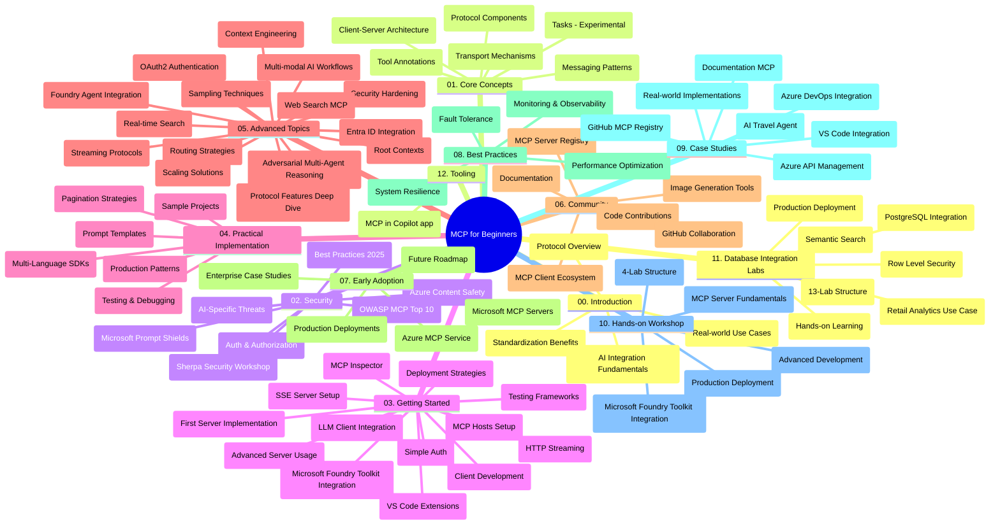

# Protokol Konteks Model (MCP) untuk Pemula - Panduan Kajian

Panduan kajian ini memberikan gambaran struktur dan kandungan repositori untuk kurikulum "Protokol Konteks Model (MCP) untuk Pemula". Gunakan panduan ini untuk menavigasi repositori dengan cekap dan memanfaatkan sumber yang tersedia.

## Gambaran Keseluruhan Repositori

Protokol Konteks Model (MCP) adalah kerangka kerja piawai untuk interaksi antara model AI dan aplikasi klien. Pada mulanya dicipta oleh Anthropic, MCP kini diselenggara oleh komuniti MCP yang lebih luas melalui organisasi rasmi GitHub. Repositori ini menyediakan kurikulum komprehensif dengan contoh kod praktikal dalam C#, Java, JavaScript, Python, dan TypeScript, direka untuk pembangun AI, arkitek sistem, dan jurutera perisian.

## Peta Kurikulum Visual

## Struktur Repositori

Repositori ini diatur ke dalam dua belas bahagian utama, setiap satu memberi tumpuan kepada aspek berbeza MCP:

1. **Pengenalan (00-Introduction/)**
   - Gambaran keseluruhan Protokol Konteks Model
   - Mengapa pensandardan penting dalam saluran AI
   - Kes penggunaan praktikal dan manfaat

2. **Konsep Teras (01-CoreConcepts/)**
   - Seni bina klien-pelayan
   - Komponen utama protokol
   - Corak pemesejan dalam MCP
   - Spesifikasi semasa: [Apa Yang Berubah dalam MCP: Spesifikasi 2026-07-28](./01-CoreConcepts/mcp-2026-07-28.md) — teras protokol tanpa status, kerangka Sambungan, dan pemansuhan Roots/Sampling/Logging

3. **Keselamatan (02-Security/)**
   - Ancaman keselamatan dalam sistem berasaskan MCP
   - Amalan terbaik untuk memastikan pelaksanaan selamat
   - Strategi pengesahan dan kebenaran
   - Latihan praktikal [contoh kebenaran CIMD dan DCR](./02-Security/samples/cimd-dcr-auth/README.md)
   - **Dokumentasi Keselamatan Komprehensif**:
     - Amalan Terbaik Keselamatan MCP
     - Panduan Pelaksanaan Keselamatan Kandungan Azure
     - Kawalan dan Teknik Keselamatan MCP
     - Rujukan Pantas Amalan Terbaik MCP
   - **Topik Utama Keselamatan**:
     - Suntikan arahan dan serangan alat beracun
     - Penculikan sesi dan masalah deputi keliru
     - Kerentanan laluan token
     - Kebenaran berlebihan dan kawalan akses
     - Keselamatan rantaian bekalan untuk komponen AI
     - Integrasi Microsoft Prompt Shields

4. **Memulakan (03-GettingStarted/)**
   - Persediaan dan konfigurasi persekitaran
   - Mencipta pelayan dan klien MCP asas
   - Integrasi dengan aplikasi sedia ada
   - Termasuk bahagian untuk:
     - Pelaksanaan pelayan pertama
     - Pembangunan klien
     - Integrasi klien LLM
     - Integrasi VS Code
     - Pelayan Acara Dihantar Server (SSE)
     - Penggunaan pelayan lanjutan
     - Penstriman HTTP
    - Integrasi Microsoft Foundry Toolkit
     - Strategi pengujian
     - Garis panduan penyebaran

5. **Pelaksanaan Praktikal (04-PracticalImplementation/)**
   - Menggunakan SDK dalam pelbagai bahasa pengaturcaraan
   - Teknik penyahpepijatan, pengujian, dan pengesahan
   - Mereka templat arahan guna semula dan aliran kerja
   - Projek contoh dengan contoh pelaksanaan

6. **Topik Lanjutan (05-AdvancedTopics/)**
   - Teknik kejuruteraan konteks
   - Integrasi agen Foundry
   - Aliran kerja AI pelbagai modal
   - Demonstrasi pengesahan OAuth2
   - Keupayaan carian masa nyata
   - Penstriman masa nyata
   - Pelaksanaan konteks akar
   - Strategi penghalaan
   - Teknik pensampelan
   - Pendekatan penskalaan
   - Pertimbangan keselamatan
   - Integrasi keselamatan Entra ID
   - Integrasi carian web
   - Pemikiran multi-agen bersaing (pola debat)

7. **Sumbangan Komuniti (06-CommunityContributions/)**
   - Cara menyumbang kod dan dokumentasi
   - Bekerjasama melalui GitHub
   - Penambahbaikan dan maklum balas yang dipacu komuniti
   - Menggunakan pelbagai klien MCP (Claude Desktop, Cline, VSCode)
   - Bekerja dengan pelayan MCP popular termasuk penjanaan imej

8. **Pengajaran dari Penggunaan Awal (07-LessonsfromEarlyAdoption/)**
   - Pelaksanaan dunia sebenar dan kisah kejayaan
   - Membina dan menyebarkan penyelesaian berasaskan MCP
   - Trend dan peta jalan masa depan
   - **Panduan Pelayan MCP Microsoft**: Panduan komprehensif untuk 10 pelayan MCP Microsoft sedia produksi termasuk:
     - Pelayan MCP Microsoft Learn Docs
     - Pelayan MCP Azure (15+ penyambung khusus)
     - Pelayan MCP GitHub
     - Pelayan MCP Azure DevOps
     - Pelayan MCP MarkItDown
     - Pelayan MCP SQL Server
     - Pelayan MCP Playwright
     - Pelayan MCP Dev Box
     - Pelayan MCP Microsoft Foundry
     - Pelayan MCP Alat Ejen Microsoft 365

9. **Amalan Terbaik (08-BestPractices/)**
   - Pengawalan prestasi dan pengoptimuman
   - Mereka sistem MCP tahan ralat
   - Strategi pengujian dan ketahanan

10. **Kajian Kes (09-CaseStudy/)**
    - **Tujuh kajian kes komprehensif** yang menunjukkan kepelbagaian MCP dalam pelbagai senario:
    - **Ejen Pelancongan AI Azure**: Orkestrasi multi-agen dengan Azure OpenAI dan Carian AI
    - **Integrasi Azure DevOps**: Automasi proses aliran kerja dengan kemas kini data YouTube
    - **Pengambilan Dokumentasi Masa Nyata**: Klien konsol Python dengan penstriman HTTP
    - **Penjana Pelan Kajian Interaktif**: Aplikasi web Chainlit dengan AI perbualan
    - **Dokumentasi Dalam Penyunting**: Integrasi VS Code dengan aliran kerja GitHub Copilot
    - **Pengurusan API Azure**: Integrasi API perusahaan dengan penciptaan pelayan MCP
    - **Daftar MCP GitHub**: Pembangunan ekosistem dan platform integrasi agenik
    - Contoh pelaksanaan meliputi integrasi perusahaan, produktiviti pembangun, dan pembangunan ekosistem

11. **Bengkel Praktikal (10-StreamliningAIWorkflowsBuildingAnMCPServerWithAIToolkit/)**
    - Bengkel praktikal komprehensif menggabungkan MCP dengan Microsoft Foundry Toolkit
    - Membangun aplikasi pintar yang menghubungkan model AI dengan alat dunia nyata
    - Modul praktikal merangkumi asas, pembangunan pelayan khusus, dan strategi penyebaran produksi
    - **Struktur Makmal**:
      - Makmal 1: Asas Pelayan MCP
      - Makmal 2: Pembangunan Pelayan MCP Lanjutan
      - Makmal 3: Integrasi Microsoft Foundry Toolkit
      - Makmal 4: Penyebaran dan Penskalahan Produksi
    - Pendekatan pembelajaran berdasarkan makmal dengan arahan langkah demi langkah

12. **Makmal Integrasi Pangkalan Data Pelayan MCP (11-MCPServerHandsOnLabs/)**
    - **Laluan pembelajaran 13-makmal komprehensif** untuk membina pelayan MCP sedia produksi dengan integrasi PostgreSQL
    - **Pelaksanaan analitik peruncitan dunia sebenar** menggunakan kes penggunaan Zava Retail
    - **Corak kelas perusahaan** termasuk Keselamatan Tahap Baris (RLS), carian semantik, dan akses data berbilang penyewa
    - **Struktur Makmal Lengkap**:
      - **Makmal 00-03: Asas** - Pengenalan, Seni Bina, Keselamatan, Persediaan Persekitaran
      - **Makmal 04-06: Membangun Pelayan MCP** - Reka Bentuk Pangkalan Data, Pelaksanaan Pelayan MCP, Pembangunan Alat
      - **Makmal 07-09: Ciri Lanjutan** - Carian Semantik, Pengujian & Penyahpepijatan, Integrasi VS Code
      - **Makmal 10-12: Produksi & Amalan Terbaik** - Penyebaran, Penyeliaan, Pengoptimuman
    - **Teknologi Terlibat**: Rangka kerja FastMCP, PostgreSQL, Azure OpenAI, Azure Container Apps, Application Insights
    - **Hasil Pembelajaran**: Pelayan MCP siap produksi, corak integrasi pangkalan data, analitik berkuasa AI, keselamatan perusahaan

13. **Alat (12-tooling/)**
    - Pelajari cara menggunakan MCP dalam aplikasi Copilot dan alat lain

## Sumber Tambahan

Repositori ini merangkumi sumber sokongan:

- **Folder Imej**: Mengandungi diagram dan ilustrasi yang digunakan sepanjang kurikulum
- **Terjemahan**: Sokongan berbilang bahasa dengan terjemahan automatik dokumentasi
- **Sumber MCP Rasmi**:
  - [Dokumentasi MCP](https://modelcontextprotocol.io/)
  - [Spesifikasi MCP](https://modelcontextprotocol.io/specification/2026-07-28/)
  - [Repositori MCP GitHub](https://github.com/modelcontextprotocol)

## Cara Menggunakan Repositori Ini

1. **Pembelajaran Berurutan**: Ikut bab mengikut susunan (00 hingga 11) untuk pengalaman pembelajaran berstruktur.
2. **Tumpuan Bahasa Khusus**: Jika anda berminat dengan bahasa pengaturcaraan tertentu, teroka direktori contoh untuk pelaksanaan dalam bahasa pilihan anda.
3. **Pelaksanaan Praktikal**: Mulakan dengan bahagian "Memulakan" untuk menyediakan persekitaran anda dan mencipta pelayan serta klien MCP pertama anda.
4. **Penjelajahan Lanjutan**: Setelah selesa dengan asas, selami topik lanjutan untuk memperluaskan pengetahuan anda.
5. **Penglibatan Komuniti**: Sertai komuniti MCP melalui perbincangan GitHub dan saluran Discord untuk berhubung dengan pakar dan pembangun lain.

## Klien dan Alat MCP

Kurikulum merangkumi pelbagai klien dan alat MCP:

1. **Klien Rasmi**:
   - Visual Studio Code
   - MCP dalam Visual Studio Code
   - Claude Desktop
   - Claude dalam VSCode
   - API Claude

2. **Klien Komuniti**:
   - Cline (berasaskan terminal)
   - Cursor (penyunting kod)
   - ChatMCP
   - Windsurf

3. **Alat Pengurusan MCP**:
   - MCP CLI
   - MCP Manager
   - MCP Linker
   - MCP Router

## Pelayan MCP Popular

Repositori ini memperkenalkan pelbagai pelayan MCP, termasuk:

1. **Pelayan MCP Microsoft Rasmi**:
   - Pelayan MCP Microsoft Learn Docs
   - Pelayan MCP Azure (15+ penyambung khusus)
   - Pelayan MCP GitHub
   - Pelayan MCP Azure DevOps
   - Pelayan MCP MarkItDown
   - Pelayan MCP SQL Server
   - Pelayan MCP Playwright
   - Pelayan MCP Dev Box
   - Pelayan MCP Microsoft Foundry
   - Pelayan MCP Alat Ejen Microsoft 365

2. **Pelayan Rujukan Rasmi**:
   - Sistem Fail
   - Ambil
   - Memori
   - Pemikiran Berurutan

3. **Penjanaan Imej**:
   - Azure OpenAI DALL-E 3
   - Stable Diffusion WebUI
   - Replicate

4. **Alat Pembangunan**:
   - Git MCP
   - Kawalan Terminal
   - Pembantu Kod

5. **Pelayan Khusus**:
   - Salesforce
   - Microsoft Teams
   - Jira & Confluence

## Penyumbangan

Repositori ini mengalu-alukan sumbangan dari komuniti. Lihat bahagian Sumbangan Komuniti untuk panduan bagaimana menyumbang secara berkesan kepada ekosistem MCP.

----

*Panduan kajian ini terakhir dikemas kini pada 9 September 2026. Ia mencerminkan Spesifikasi MCP
`2026-07-28`, semakan protokol terkini. Beberapa contoh praktikal masih secara eksplisit berversi kepada `2025-11-25` sementara SDK dan alat mereka
mengadaptasi API protokol tanpa status.*
gunakan API protokol tanpa keadaan.*

---

<!-- CO-OP TRANSLATOR DISCLAIMER START -->
**Penafian**:
Dokumen ini telah diterjemahkan menggunakan perkhidmatan terjemahan AI [Co-op Translator](https://github.com/Azure/co-op-translator). Walaupun kami berusaha untuk ketepatan, sila ambil maklum bahawa terjemahan automatik mungkin mengandungi kesilapan atau ketidaktepatan. Dokumen asal dalam bahasa asalnya harus dianggap sebagai sumber yang sahih. Untuk maklumat penting, terjemahan oleh manusia profesional adalah disyorkan. Kami tidak bertanggungjawab terhadap sebarang salah faham atau salah tafsir yang timbul daripada penggunaan terjemahan ini.
<!-- CO-OP TRANSLATOR DISCLAIMER END -->