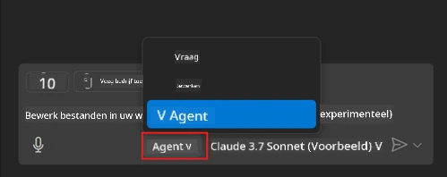
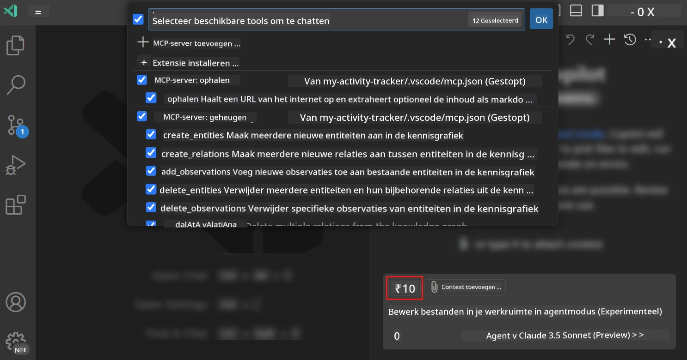
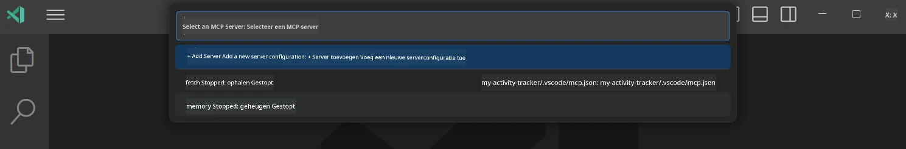
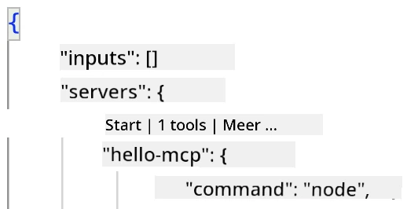
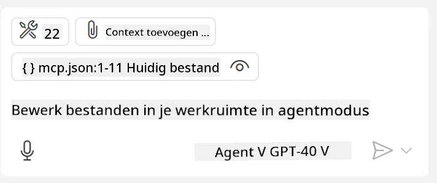
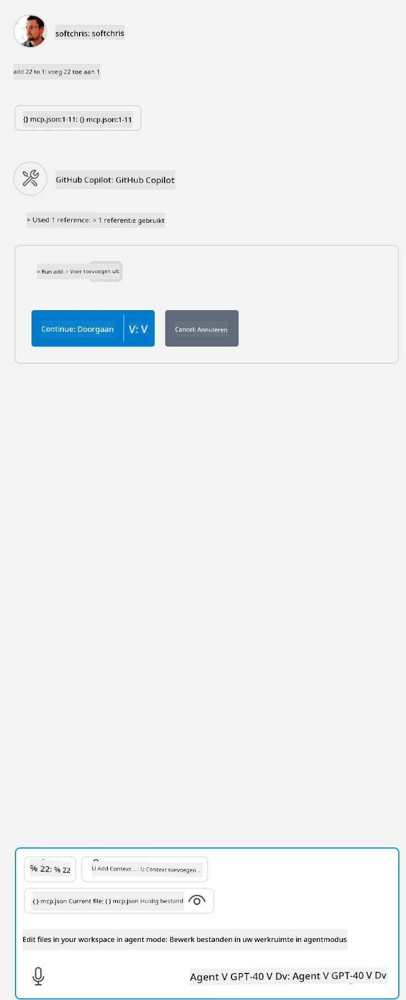

# Het gebruiken van een server vanuit GitHub Copilot Agent-modus

Visual Studio Code en GitHub Copilot kunnen fungeren als een client en een MCP-server gebruiken. Je vraagt je misschien af waarom we dat zouden willen? Wel, dat betekent dat welke functies de MCP-server ook heeft, deze nu vanuit je IDE kunnen worden gebruikt. Stel je voor dat je bijvoorbeeld de MCP-server van GitHub toevoegt, dit zou het mogelijk maken om GitHub te beheren via prompts in plaats van specifieke opdrachten in de terminal te typen. Of stel je iets voor in het algemeen dat je ontwikkelaarservaring kan verbeteren, allemaal bestuurd door natuurlijke taal. Nu zie je het voordeel toch?

## Overzicht

Deze les behandelt hoe je Visual Studio Code en GitHub Copilot's Agent-modus kunt gebruiken als client voor je MCP-server.

## Leerdoelen

Aan het einde van deze les kun je:

- Een MCP-server gebruiken via Visual Studio Code.
- Mogelijkheden zoals tools uitvoeren via GitHub Copilot.
- Visual Studio Code configureren om je MCP-server te vinden en beheren.

## Gebruik

Je kunt je MCP-server op twee verschillende manieren bedienen:

- Gebruikersinterface, je zal later in dit hoofdstuk zien hoe dit gedaan wordt.
- Terminal, het is mogelijk om dingen te bedienen vanuit de terminal met de `code` uitvoerbare file:

  Om een MCP-server toe te voegen aan je gebruikersprofiel, gebruik je de --add-mcp commandoregeloptie en geef je de JSON-serverconfiguratie op in de vorm {\"name\":\"server-naam\",\"command\":...}.

  ```
  code --add-mcp "{\"name\":\"my-server\",\"command\": \"uvx\",\"args\": [\"mcp-server-fetch\"]}"
  ```

### Screenshots





Laten we in de volgende secties meer praten over hoe we de visuele interface gebruiken.

## Aanpak

Zo moeten we dit op hoofdlijnen aanpakken:

- Configureer een bestand om onze MCP-server te vinden.
- Start op/Verbind met genoemde server om zijn mogelijkheden te laten zien.
- Gebruik genoemde mogelijkheden via de GitHub Copilot Chat-interface.

Geweldig, nu we het proces begrijpen, laten we proberen een MCP-server via Visual Studio Code te gebruiken met een oefening.

## Oefening: Een server gebruiken

In deze oefening configureren we Visual Studio Code om jouw MCP-server te vinden zodat deze vanuit de GitHub Copilot Chat-interface gebruikt kan worden.

### -0- Voorstap, MCP-serverdiscovery inschakelen

Mogelijk moet je de ontdekking van MCP-servers inschakelen.

1. Ga naar `File -> Preferences -> Settings` in Visual Studio Code.

1. Zoek "MCP" en schakel `chat.mcp.discovery.enabled` in het settings.json-bestand in.

### -1- Configuratiebestand aanmaken

Begin met het aanmaken van een configuratiebestand in de hoofdmap van je project. Je hebt een bestand nodig genaamd MCP.json en plaats dit in een map genaamd .vscode. Het zou er als volgt uit moeten zien:

```text
.vscode
|-- mcp.json
```

Vervolgens bekijken we hoe we een serververmelding kunnen toevoegen.

### -2- Een server configureren

Voeg de volgende inhoud toe aan *mcp.json*:

```json
{
    "inputs": [],
    "servers": {
       "hello-mcp": {
           "command": "node",
           "args": [
               "build/index.js"
           ]
       }
    }
}
```

Bovenstaand een eenvoudig voorbeeld hoe je een server start die in Node.js is geschreven. Voor andere runtimes geef je het juiste commando aan om de server te starten met behulp van `command` en `args`.

### -3- De server starten

Nu je een invoer hebt toegevoegd, laten we de server starten:

1. Zoek je invoer in *mcp.json* en zorg dat je het "play"-icoon ziet:

    

1. Klik op het "play"-icoon, je zou moeten zien dat het tools-icoon in de GitHub Copilot Chat het aantal beschikbare tools verhoogt. Klik je op dat tools-icoon, dan zie je een lijst met geregistreerde tools. Je kunt elke tool aan- of uitvinken afhankelijk of je wilt dat GitHub Copilot ze als context gebruikt:

  

1. Om een tool te gebruiken, typ een prompt waarvan je weet dat die overeenkomt met de beschrijving van een van je tools, bijvoorbeeld een prompt als "add 22 to 1":

  

  Je zou een antwoord moeten zien waarin staat 23.

## Opdracht

Probeer een serververmelding toe te voegen aan je *mcp.json*-bestand en zorg dat je de server kunt starten/stoppen. Zorg er ook voor dat je via de GitHub Copilot Chat-interface met de tools op je server kunt communiceren.

## Oplossing

[Oplossing](./solution/README.md)

## Belangrijke punten

De belangrijkste punten uit dit hoofdstuk zijn:

- Visual Studio Code is een geweldige client waarmee je verschillende MCP-servers en hun tools kunt gebruiken.
- De GitHub Copilot Chat-interface is hoe je met de servers interacteert.
- Je kunt de gebruiker vragen om invoer zoals API-sleutels die aan de MCP-server worden doorgegeven bij het configureren van de serververmelding in het *mcp.json*-bestand.

## Voorbeelden

- [Java Calculator](../samples/java/calculator/README.md)
- [.NET Calculator](../../../../03-GettingStarted/samples/csharp)
- [JavaScript Calculator](../samples/javascript/README.md)
- [TypeScript Calculator](../samples/typescript/README.md)
- [Python Calculator](../../../../03-GettingStarted/samples/python)

## Extra bronnen

- [Visual Studio docs](https://code.visualstudio.com/docs/copilot/chat/mcp-servers)

## Wat nu?

- Volgende: [Een stdio-server maken](../05-stdio-server/README.md)

---

<!-- CO-OP TRANSLATOR DISCLAIMER START -->
**Disclaimer**:
Dit document is vertaald met behulp van de AI vertaaldienst [Co-op Translator](https://github.com/Azure/co-op-translator). Hoewel we streven naar nauwkeurigheid, dient u er rekening mee te houden dat geautomatiseerde vertalingen fouten of onnauwkeurigheden kunnen bevatten. Het originele document in de oorspronkelijke taal moet worden beschouwd als de gezaghebbende bron. Voor kritieke informatie wordt professionele menselijke vertaling aanbevolen. Wij zijn niet aansprakelijk voor eventuele misverstanden of verkeerde interpretaties die voortvloeien uit het gebruik van deze vertaling.
<!-- CO-OP TRANSLATOR DISCLAIMER END -->