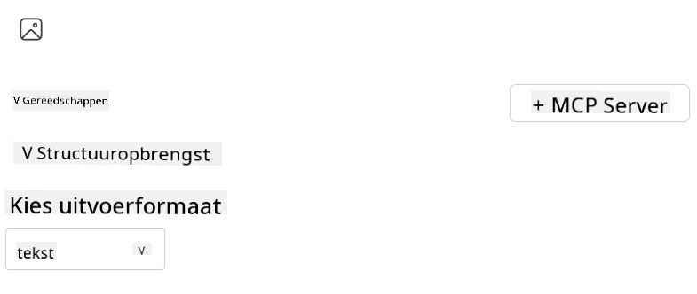
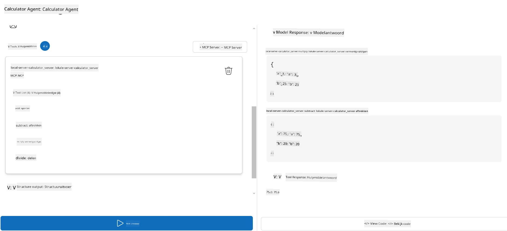

# Een server gebruiken met Microsoft Foundry Toolkit voor Visual Studio Code

Wanneer je een AI-agent bouwt, gaat het niet alleen om het genereren van slimme antwoorden; het gaat er ook om je agent in staat te stellen actie te ondernemen. Dat is waar het Model Context Protocol (MCP) om de hoek komt kijken. MCP maakt het gemakkelijk voor agenten om op een consistente manier toegang te krijgen tot externe tools en diensten. Zie het als het aansluiten van je agent op een gereedschapskist die hij *echt* kan gebruiken.

Stel dat je een agent koppelt aan je calculator MCP-server. Plotseling kan je agent wiskundige bewerkingen uitvoeren door simpelweg een prompt te ontvangen zoals “Wat is 47 keer 89?”—er is geen noodzaak meer om logica hard te coderen of aangepaste API’s te bouwen.

## Overzicht

Deze les behandelt hoe je een calculator MCP-server verbindt met een agent met behulp van
[Microsoft Foundry Toolkit voor Visual Studio Code](https://aka.ms/AIToolkit),
zodat je agent wiskundige berekeningen via natuurlijke taal kan uitvoeren.

Microsoft Foundry Toolkit stroomlijnt de ontwikkeling en het testen van generatieve
AI-applicaties met lokale modellen en modellen die in de cloud gehost worden.

*Opmerking*: De Toolkit ondersteunt momenteel Python- en TypeScript-MCP-sjablonen.

## Leerdoelen

Aan het einde van deze les kun je:

- Een MCP-server gebruiken met Microsoft Foundry Toolkit.
- Een agentconfiguratie instellen om tools te ontdekken en te gebruiken die door de MCP-server worden geleverd.
- MCP-tools gebruiken via natuurlijke taal.

## Aanpak

Zo moeten we het op hoofdlijnen aanpakken:

- Maak een agent aan en definieer zijn systeem-prompt.
- Maak een MCP-server met calculator-tools.
- Verbind de Agent Builder met de MCP-server.
- Test de aanroep van tools door de agent via natuurlijke taal.

Geweldig, nu we de flow begrijpen, laten we een AI-agent configureren om externe tools via MCP te gebruiken en zo zijn mogelijkheden uitbreiden!

## Vereisten

- [Visual Studio Code](https://code.visualstudio.com/)
- [Microsoft Foundry Toolkit voor Visual Studio Code](https://aka.ms/AIToolkit)

## Oefening: Een server gebruiken

> [!WARNING]
> Opmerking voor macOS-gebruikers. We onderzoeken momenteel een probleem dat de installatie van afhankelijkheden op macOS beïnvloedt. Daardoor kunnen macOS-gebruikers deze tutorial momenteel niet voltooien. We zullen de instructies bijwerken zodra er een oplossing beschikbaar is. Dank voor je geduld en begrip!

In deze oefening bouw je, start je en verbeter je een AI-agent met tools van
een MCP-server binnen Visual Studio Code met Microsoft Foundry Toolkit.

### -0- Vooraf: voeg een Microsoft Foundry GPT-5.1-implementatie toe

Maak een Microsoft Foundry-resource, implementeer **GPT-5.1**, en voeg de implementatie
toe aan **Mijn Modellen**. Bekijk het
[model buiten gebruik schema](https://learn.microsoft.com/azure/foundry/openai/concepts/model-retirement-schedule)
bij het kiezen van een implementatie.

1. Open **Microsoft Foundry Toolkit** via de **Activiteitenbalk**.
1. Selecteer in het gedeelte **Catalogus** **Modellen** om de **Modelcatalogus** te openen. Het selecteren van **Modellen** opent de **Modelcatalogus** in een nieuw tabblad van de editor.
1. Verbind je Microsoft Foundry-project en selecteer je **GPT-5.1**-implementatie.
1. Klik op **+ Toevoegen** om de implementatie aan je lijst **Mijn Modellen** toe te voegen.
1. Bevestig in de **Activiteitenbalk** dat de implementatie in de lijst verschijnt.

### -1- Maak een agent aan

De **Agent (Prompt) Builder** stelt je in staat om je eigen door AI aangedreven agenten te maken en aan te passen. In deze sectie maak je een nieuwe agent en wijs je een model toe om het gesprek aan te sturen.

1. Open **Microsoft Foundry Toolkit** via de **Activiteitenbalk**.
1. Selecteer in het gedeelte **Tools** **Agent (Prompt) Builder**. Het selecteren hiervan opent de **Agent (Prompt) Builder** in een nieuw tabblad van de editor.
1. Klik op de knop **+ Nieuwe Agent**. De extensie start een installatiewizard via de **Command Palette**.
1. Voer de naam **Calculator Agent** in en druk op **Enter**.
1. Selecteer in de **Agent (Prompt) Builder** je **GPT-5.1** Foundry-implementatie.

### -2- Maak een systeem-prompt voor de agent

Nu de agent klaarstaat, is het tijd om zijn persoonlijkheid en doel te definiëren. In deze sectie gebruik je de functie **Genereer systeem-prompt** om het beoogde gedrag van de agent te beschrijven—een calculator-agent in dit geval—en laat je het model de systeem-prompt voor je schrijven.

1. Klik op de knop **Genereer systeem-prompt** in de sectie **Prompts**. Deze knop opent de prompt-builder die AI gebruikt om een systeem-prompt voor de agent te genereren.
1. Voer in het venster **Genereer een prompt** het volgende in: `You are a helpful and efficient math assistant. When given a problem involving basic arithmetic, you respond with the correct result.`
1. Klik op de knop **Genereer**. Er verschijnt een melding rechtsonder die bevestigt dat de systeem-prompt wordt gegenereerd. Zodra de promptgeneratie voltooid is, verschijnt de prompt in het veld **Systeem-prompt** van de **Agent (Prompt) Builder**.
1. Bekijk de **Systeem-prompt** en pas deze indien nodig aan.

### -3- Maak een MCP-server

Nu je de systeem-prompt van je agent hebt gedefinieerd—die zijn gedrag en reacties stuurt—is het tijd om de agent praktische vaardigheden te geven. In deze sectie maak je een calculator MCP-server met tools om optellen, aftrekken, vermenigvuldigen en delen uit te voeren. Deze server stelt je agent in staat om realtime wiskundige bewerkingen uit te voeren op basis van natuurlijke taalprompts.



Microsoft Foundry Toolkit bevat sjablonen voor het maken van MCP-servers. We gebruiken
het Python-sjabloon voor de calculator MCP-server.

*Opmerking*: De Toolkit ondersteunt momenteel Python- en TypeScript-MCP-sjablonen.

1. Klik in het gedeelte **Tools** van de **Agent (Prompt) Builder** op de knop **+ MCP Server**. De extensie start een installatiewizard via de **Command Palette**.
1. Selecteer **+ Server toevoegen**.
1. Selecteer **Maak een nieuwe MCP-server aan**.
1. Selecteer **python-weather** als sjabloon.
1. Selecteer **Standaardmap** om de MCP-server-sjabloon op te slaan.
1. Voer de volgende naam voor de server in: **Calculator**
1. Er opent een nieuw Visual Studio Code-venster. Selecteer **Ja, ik vertrouw de auteurs**.
1. Maak met de terminal (**Terminal** > **Nieuwe terminal**) een virtuele omgeving aan: `python -m venv .venv`
1. Activeer in de terminal de virtuele omgeving:
    1. Windows - `.venv\Scripts\activate`
    1. macOS/Linux - `source .venv/bin/activate`
1. Installeer met de terminal de afhankelijkheden: `pip install -e .[dev]`
1. Vouw in het **Verkenner**-overzicht van de **Activiteitenbalk** de map **src** uit en selecteer **server.py** om het bestand in de editor te openen.
1. Vervang de code in het bestand **server.py** door het volgende en sla op:

    ```python
    """
    Sample MCP Calculator Server implementation in Python.

    
    This module demonstrates how to create a simple MCP server with calculator tools
    that can perform basic arithmetic operations (add, subtract, multiply, divide).
    """
    
    from mcp.server.fastmcp import FastMCP
    
    server = FastMCP("calculator")
    
    @server.tool()
    def add(a: float, b: float) -> float:
        """Add two numbers together and return the result."""
        return a + b
    
    @server.tool()
    def subtract(a: float, b: float) -> float:
        """Subtract b from a and return the result."""
        return a - b
    
    @server.tool()
    def multiply(a: float, b: float) -> float:
        """Multiply two numbers together and return the result."""
        return a * b
    
    @server.tool()
    def divide(a: float, b: float) -> float:
        """
        Divide a by b and return the result.
        
        Raises:
            ValueError: If b is zero
        """
        if b == 0:
            raise ValueError("Cannot divide by zero")
        return a / b
    ```

### -4- Start de agent met de calculator MCP-server

Nu je agent tools heeft, is het tijd ze te gebruiken! In deze sectie dien je prompts in bij de agent om te testen en valideren of de agent de juiste tool van de calculator MCP-server gebruikt.



Je runt de calculator MCP-server op je lokale ontwikkelmachine via de **Agent Builder** als MCP-client.

1. Druk op `F5` om het debuggen van de MCP-server te starten. De **Agent (Prompt) Builder** opent in een nieuw tabblad van de editor. De status van de server is zichtbaar in de terminal.
1. Voer in het veld **Gebruikersprompt** van de **Agent (Prompt) Builder** volgende prompt in: `I bought 3 items priced at $25 each, and then used a $20 discount. How much did I pay?`
1. Klik op de knop **Uitvoeren** om de reactie van de agent te genereren.
1. Bekijk de uitvoer van de agent. Het model moet concluderen dat je **$55** hebt betaald.
1. Hier is een overzicht van wat er zou moeten gebeuren:
    - De agent selecteert de tools **vermenigvuldigen** en **aftrekken** om te helpen bij de berekening.
    - De respectievelijke waarden `a` en `b` worden toegewezen voor de tool **vermenigvuldigen**.
    - De respectievelijke waarden `a` en `b` worden toegewezen voor de tool **aftrekken**.
    - De reactie van elke tool wordt weergegeven onder **Reactie tool**.
    - De uiteindelijke output van het model verschijnt in de definitieve **Reactie model**.
1. Dien extra prompts in om de agent verder te testen. Je kunt de bestaande prompt in het veld **Gebruikersprompt** aanpassen door te klikken en de prompt te vervangen.
1. Als je klaar bent met testen, kun je de server stoppen via de **terminal** door **CTRL/CMD+C** in te voeren.

## Opdracht

Probeer een extra tool toe te voegen aan je bestand **server.py** (bijvoorbeeld: bereken de wortel van een getal). Dien extra prompts in die van de agent vereisen je nieuwe tool (of bestaande tools) te gebruiken. Zorg dat je de server herstart om nieuwe tools te laden.

## Oplossing

[Oplossing](./solution/README.md)

## Belangrijke conclusies

De conclusies van dit hoofdstuk zijn als volgt:

- Microsoft Foundry Toolkit kan MCP-servers en hun tools gebruiken.
- Je kunt nieuwe tools toevoegen aan MCP-servers, waardoor de capaciteiten van de agent worden uitgebreid om aan veranderende eisen te voldoen.
- Microsoft Foundry Toolkit bevat MCP-server-sjablonen voor het maken van aangepaste tools.

## Aanvullende bronnen

- [Documentatie Microsoft Foundry Toolkit](https://aka.ms/AIToolkit/doc)

## Wat is de volgende stap
- Volgende: [Testen & Debuggen](../08-testing/README.md)

---

<!-- CO-OP TRANSLATOR DISCLAIMER START -->
**Disclaimer**:
Dit document is vertaald met behulp van de AI vertaaldienst [Co-op Translator](https://github.com/Azure/co-op-translator). Hoewel we streven naar nauwkeurigheid, dient u er rekening mee te houden dat geautomatiseerde vertalingen fouten of onnauwkeurigheden kunnen bevatten. Het originele document in de oorspronkelijke taal moet worden beschouwd als de gezaghebbende bron. Voor kritieke informatie wordt professionele menselijke vertaling aanbevolen. Wij zijn niet aansprakelijk voor eventuele misverstanden of verkeerde interpretaties die voortvloeien uit het gebruik van deze vertaling.
<!-- CO-OP TRANSLATOR DISCLAIMER END -->