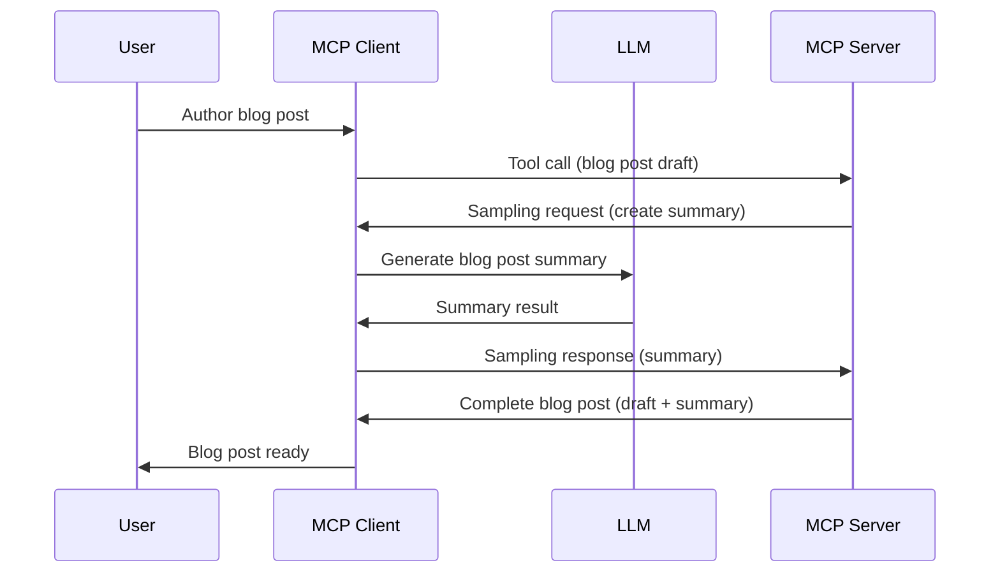

> [!WARNING]
> Sampling is afgeschaft in MCP `2026-07-28`. Deze les is behouden voor
> legacy-implementaties. Nieuwe servers zouden direct met een LLM
> provider-API moeten integreren.

# Sampling - delegeer functies aan de Client

> Sampling blijft in de `2026-07-28` specificatie voor compatibiliteit en komt
> in aanmerking voor verwijdering in de eerste revisie die wordt uitgebracht op of na 28 juli,
> 2027. Voorbeelden in deze les kunnen SDK-API's gebruiken die `2025-11-25` implementeren.
> Zie [Wat is gewijzigd in MCP: De specificatie van 2026-07-28](../../01-CoreConcepts/mcp-2026-07-28.md).

In legacy-implementaties stelt Sampling een MCP-server in staat om hulp te vragen aan een LLM
die door de client wordt beheerd. Voor nieuwe implementaties, roep in plaats daarvan direct de gekozen LLM-provider
aan.

Laten we enkele gebruikssituaties onderzoeken en hoe we een oplossing kunnen bouwen waarin sampling wordt gebruikt.

## Overzicht

In deze les richten we ons op het uitleggen wanneer en waar Sampling te gebruiken en hoe dit te configureren.

## Leerdoelen

In dit hoofdstuk zullen we:

- Uitleggen wat Sampling is en wanneer het te gebruiken.
- Tonen hoe Sampling in MCP te configureren.
- Voorbeelden geven van Sampling in actie.

## Wat is Sampling en waarom gebruiken?

Sampling is een geavanceerde functie die als volgt werkt:



### Sampling-verzoek

Oké, nu we een globaal overzicht hebben van een geloofwaardig scenario, laten we het hebben over het sampling-verzoek dat de server terugstuurt naar de client. Dit is hoe zo'n verzoek eruit kan zien in JSON-RPC formaat:

```json
{
  "jsonrpc": "2.0",
  "id": 1,
  "method": "sampling/createMessage",
  "params": {
    "messages": [
      {
        "role": "user",
        "content": {
          "type": "text",
          "text": "Create a blog post summary of the following blog post: <BLOG POST>"
        }
      }
    ],
    "modelPreferences": {
      "hints": [
        {
          "name": "gpt-5.1"
        }
      ],
      "intelligencePriority": 0.8,
      "speedPriority": 0.5
    },
    "systemPrompt": "You are a helpful assistant.",
    "maxTokens": 100
  }
}
```

Er zijn hier een paar punten die het vermelden waard zijn:

- Prompt, onder content -> text, is onze prompt die een instructie is voor de LLM om blogpost-inhoud samen te vatten.

- **modelPreferences**. Dit gedeelte is precies dat, een voorkeur, een aanbeveling welke configuratie te gebruiken met de LLM. De gebruiker kan kiezen of hij deze aanbevelingen volgt of aanpast. In dit geval zijn er aanbevelingen over welk model te gebruiken en prioriteit op snelheid en intelligentie.
- **systemPrompt**, dit is je normale systeem-prompt die je LLM een persoonlijkheid geeft en begeleidende instructies bevat.
- **maxTokens**, dit is een andere eigenschap die aangeeft hoeveel tokens aanbevolen wordt te gebruiken voor deze taak.

### Sampling-antwoord

Dit antwoord is wat de MCP Client uiteindelijk terugstuurt naar de MCP Server en is het resultaat van het aanroepen van de LLM door de client, wachten op dat antwoord en vervolgens dit bericht construeren. Zo kan het eruit zien in JSON-RPC:

```json
{
  "jsonrpc": "2.0",
  "id": 1,
  "result": {
    "role": "assistant",
    "content": {
      "type": "text",
      "text": "Here's your abstract <ABSTRACT>"
    },
    "model": "gpt-5.1",
    "stopReason": "endTurn"
  }
}
```

Het antwoord is een samenvatting van de blogpost zoals gevraagd. De client
selecteerde de actieve `gpt-5.1` deployment van de server's modelvoorkeur;
modelvoorkeuren zijn aanbevelingen, dus de client kan een andere actieve
deployment kiezen indien nodig.

Oké, nu we de hoofdflow begrijpen, en een nuttige taak om het voor te gebruiken: "blogpostcreatie + samenvatting", laten we zien wat we moeten doen om het te laten werken.

### Berichttypen

Sampling-berichten zijn niet beperkt tot alleen tekst maar je kunt ook afbeeldingen en audio verzenden. Zo ziet de JSON-RPC er anders uit:

**Tekst**

```json
{
  "type": "text",
  "text": "The message content"
}
```

**Afbeeldingsinhoud**

```json
{
  "type": "image",
  "data": "base64-encoded-image-data",
  "mimeType": "image/jpeg"
}
```

**Audio-inhoud**

```json
{
  "type": "audio",
  "data": "base64-encoded-audio-data",
  "mimeType": "audio/wav"
}
```

> NOTE: Voor de huidige status en migratieadviezen, zie de
> [verouderde Sampling-documentatie](https://modelcontextprotocol.io/specification/2026-07-28/client/sampling).

## Hoe Sampling in de Client te configureren

> Opmerking: als je alleen een server bouwt, hoef je hier niet veel te doen.

In een client moet je de volgende feature zo specificeren:

```json
{
  "capabilities": {
    "sampling": {}
  }
}
```

Dit wordt dan opgepikt wanneer je gekozen client initialiseert met de server.

## Voorbeeld van Sampling in actie - Maak een Blogpost

Laten we samen een sampling-server coderen, we moeten het volgende doen:

1. Maak een tool op de Server.
1. Deze tool moet een sampling-verzoek maken.
1. De tool wacht totdat het sampling-verzoek van de client beantwoord is.
1. Vervolgens wordt het toolresultaat geproduceerd.

Laten we de code stap voor stap bekijken:

### -1- Maak de tool

**python**

```python
@mcp.tool()
async def create_blog(title: str, content: str, ctx: Context[ServerSession, None]) -> str:
    """Create a blog post and generate a summary"""

```

### -2- Maak een sampling-verzoek

Breid je tool uit met de volgende code:

**python**

```python
post = BlogPost(
        id=len(posts) + 1,
        title=title,
        content=content,
        abstract=""
    )

prompt = f"Create an abstract of the following blog post: title: {title} and draft: {content} "

result = await ctx.session.create_message(
        messages=[
            SamplingMessage(
                role="user",
                content=TextContent(type="text", text=prompt),
            )
        ],
        max_tokens=100,
)

```

### -3- Wacht op het antwoord en retourneer dat antwoord

**python**

```python
post.abstract = result.content.text

posts.append(post)

# return the complete product
return json.dumps({
    "id": post.title,
    "abstract": post.abstract
})
```

### -4- Volledige code

**python**

```python
from starlette.applications import Starlette
from starlette.routing import Mount, Host

from mcp.server.fastmcp import Context, FastMCP

from mcp.server.session import ServerSession
from mcp.types import SamplingMessage, TextContent

import json


from uuid import uuid4
from typing import List
from pydantic import BaseModel


mcp = FastMCP("Blog post generator")

# app = FastAPI()

posts = []

class BlogPost(BaseModel):
    id: int
    title: str
    content: str
    abstract: str

posts: List[BlogPost] = []

@mcp.tool()
async def create_blog(title: str, content: str, ctx: Context[ServerSession, None]) -> str:
    """Create a blog post and generate a summary"""

    post = BlogPost(
        id=len(posts) + 1,
        title=title,
        content=content,
        abstract=""
    )

    prompt = f"Create an abstract of the following blog post: title: {title} and draft: {content} "

    result = await ctx.session.create_message(
        messages=[
            SamplingMessage(
                role="user",
                content=TextContent(type="text", text=prompt),
            )
        ],
        max_tokens=100,
    )

    post.abstract = result.content.text

    posts.append(post)

    # return the complete blog post
    return json.dumps({
        "id": post.title,
        "abstract": post.abstract
    })

if __name__ == "__main__":
    print("Starting server...")
    # mcp.run()
    mcp.run(transport="streamable-http")

# run app with: python server.py
```

### -5- Testen in Visual Studio Code

Om dit in Visual Studio Code te testen, doe het volgende:

1. Start de server in de terminal
1. Voeg deze toe aan *mcp.json* (en zorg dat hij gestart is) bijvoorbeeld zo:

   ```json
   "servers": {
      "blog-server": {
        "type": "http",
        "url": "http://localhost:8000/mcp"
      }
   }
   ```

1. Typ een prompt:

   ```text
   create a blog post named "Where Python comes from", the content is "Python is actually named after Monty Python Flying Circus"
   ```

1. Laat sampling plaatsvinden. De eerste keer dat je dit test, verschijnt er een extra dialoog die je moet accepteren, daarna zie je de normale dialoog waarin je gevraagd wordt een tool uit te voeren.

1. Inspecteer de resultaten. Je ziet de resultaten zowel mooi weergegeven in GitHub Copilot Chat als de ruwe JSON-response.

**Bonus**. Visual Studio Code tooling heeft goede ondersteuning voor sampling. Je kunt Sampling-toegang op je geïnstalleerde server configureren door naar het volgende te navigeren:

1. Navigeer naar het extensiegedeelte.
1. Selecteer het tandwiel-icoon voor je geïnstalleerde server in de sectie "MCP SERVERS - INSTALLED".
1 Selecteer "Configure Model Access", hier kun je selecteren welke modellen GitHub Copilot mag gebruiken bij het uitvoeren van sampling. Je kunt ook alle recente sampling-verzoeken bekijken door "Show Sampling requests" te selecteren.

## Opdracht

In deze opdracht bouw je een iets andere Sampling, namelijk een sampling-integratie die het genereren van een productbeschrijving ondersteunt. Hier is je scenario:

**Scenario**: De backoffice-medewerker bij een e-commerce heeft hulp nodig, het kost te veel tijd om productbeschrijvingen te maken. Daarom ga je een oplossing bouwen waarbij je een tool "create_product" oproept met "title" en "keywords" als argumenten en het een compleet product moet opleveren inclusief een "description" veld dat wordt ingevuld door de LLM van een client.

TIP: gebruik wat je eerder geleerd hebt om deze server en zijn tool te construeren met een sampling-verzoek.

## Oplossing

[Oplossing](./solution/README.md)

## Belangrijkste punten

Sampling is een krachtige functie waarmee de server taken aan de client kan delegeren wanneer deze hulp van een LLM nodig heeft.

## Wat nu

- [Hoofdstuk 4 - Praktische implementatie](../../04-PracticalImplementation/README.md)

---

<!-- CO-OP TRANSLATOR DISCLAIMER START -->
**Disclaimer**:
Dit document is vertaald met behulp van de AI vertaaldienst [Co-op Translator](https://github.com/Azure/co-op-translator). Hoewel we streven naar nauwkeurigheid, dient u er rekening mee te houden dat geautomatiseerde vertalingen fouten of onnauwkeurigheden kunnen bevatten. Het originele document in de oorspronkelijke taal moet worden beschouwd als de gezaghebbende bron. Voor kritieke informatie wordt professionele menselijke vertaling aanbevolen. Wij zijn niet aansprakelijk voor eventuele misverstanden of verkeerde interpretaties die voortvloeien uit het gebruik van deze vertaling.
<!-- CO-OP TRANSLATOR DISCLAIMER END -->