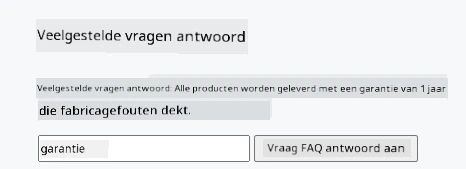
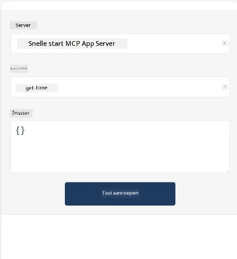
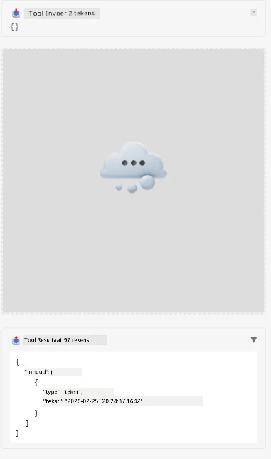

Hier is een voorbeeld dat MCP App demonstreert

## Installeren

1. Navigeer naar de map *mcp-app*
1. Voer `npm install` uit, dit zou frontend en backend afhankelijkheden moeten installeren

Controleer of de backend compileert door het volgende uit te voeren:

```sh
npx tsc --noEmit
```

Er zou geen output moeten zijn als alles in orde is.

## Start backend

> Dit vergt wat extra werk als je op een Windows-machine werkt omdat de MCP Apps oplossing de `concurrently` bibliotheek gebruikt die je moet vervangen. Hier is de betreffende regel in *package.json* van de MCP App:

```json
"start": "concurrently \"cross-env NODE_ENV=development INPUT=mcp-app.html vite build --watch\" \"tsx watch main.ts\""
```

Deze app heeft twee delen, een backend deel en een host deel.

Start de backend door het volgende aan te roepen:

```sh
npm start
```

Dit zou de backend moeten starten op `http://localhost:3001/mcp`.

> Let op, als je in een Codespace werkt, moet je mogelijk de poortzichtbaarheid op publiek zetten. Controleer of je de endpoint kunt bereiken in de browser via https://<name van Codespace>.app.github.dev/mcp

## Keuze -1 Test de app in Visual Studio Code

Om de oplossing in Visual Studio Code te testen, doe je het volgende:

- Voeg een server entry toe aan `mcp.json` zoals hieronder:

    ```json
    {
        "servers": {
            "my-mcp-server-7178eca7": {
                "url": "http://localhost:3001/mcp",
                "type": "http"
            }
        },
        "inputs": []
    }
    ```

1. Klik op de "start" knop in *mcp.json*
1. Zorg dat een chatvenster open is en typ `get-faq`, je zou een resultaat moeten zien zoals hieronder:

    

## Keuze -2- Test de app met een host

De repo <https://github.com/modelcontextprotocol/ext-apps> bevat verschillende hosts die je kunt gebruiken om je MVP Apps te testen.

We geven je hier twee verschillende opties:

### Lokale machine

- Navigeer naar *ext-apps* nadat je de repo hebt gekloond.

- Installeer afhankelijkheden

   ```sh
   npm install
   ```

- Open in een apart terminalvenster de map *ext-apps/examples/basic-host*

    > als je een Codespace gebruikt, moet je naar serve.ts en regel 27 navigeren en http://localhost:3001/mcp vervangen door je Codespace URL voor de backend, bijvoorbeeld https://psychic-xylophone-657rpjgvxpc5g64-3001.app.github.dev/mcp

- Start de host:

    ```sh
    npm start
    ```

    Dit zou de host met de backend moeten verbinden en je zou de app draaiend moeten zien zoals hieronder:

    

### Codespace

Het vergt wat extra werk om een Codespace omgeving te laten werken. Om een host te gebruiken via Codespace:

- Zie de *ext-apps* directory en navigeer naar *examples/basic-host*.
- Voer `npm install` uit om afhankelijkheden te installeren
- Voer `npm start` uit om de host te starten.

## Test de app

Probeer de app op de volgende manier:

- Selecteer de knop "Call Tool" en je zou de resultaten moeten zien zoals hieronder:

    

Geweldig, alles werkt.

---

<!-- CO-OP TRANSLATOR DISCLAIMER START -->
**Disclaimer**:
Dit document is vertaald met behulp van de AI vertaaldienst [Co-op Translator](https://github.com/Azure/co-op-translator). Hoewel we streven naar nauwkeurigheid, dient u er rekening mee te houden dat geautomatiseerde vertalingen fouten of onnauwkeurigheden kunnen bevatten. Het originele document in de oorspronkelijke taal moet worden beschouwd als de gezaghebbende bron. Voor kritieke informatie wordt professionele menselijke vertaling aanbevolen. Wij zijn niet aansprakelijk voor eventuele misverstanden of verkeerde interpretaties die voortvloeien uit het gebruik van deze vertaling.
<!-- CO-OP TRANSLATOR DISCLAIMER END -->