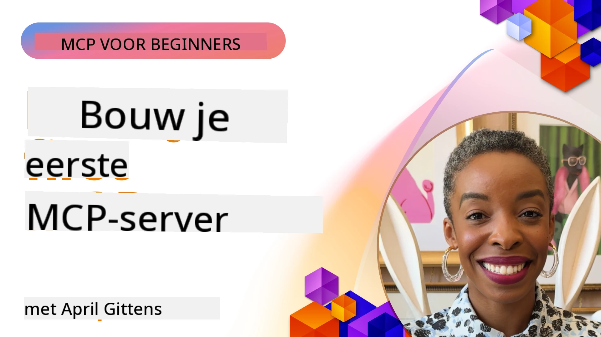

## Aan de slag  

_(Klik op de afbeelding hierboven om de video van deze les te bekijken)_

Deze sectie bestaat uit verschillende lessen:

- **1 Je eerste server**, in deze eerste les leer je hoe je je eerste server maakt en deze inspecteert met de inspector tool, een waardevolle manier om je server te testen en debuggen, [naar de les](01-first-server/README.md)

- **2 Client**, in deze les leer je hoe je een client schrijft die verbinding kan maken met je server, [naar de les](02-client/README.md)

- **3 Client met LLM**, een nog betere manier om een client te schrijven is door er een LLM aan toe te voegen zodat deze met je server kan "onderhandelen" over wat te doen, [naar de les](03-llm-client/README.md)

- **4 Het gebruik van de GitHub Copilot Agent-modus van de server in Visual Studio Code**. Hier kijken we naar het draaien van onze MCP-server vanuit Visual Studio Code, [naar de les](04-vscode/README.md)

- **5 stdio Transport Server** stdio transport is de aanbevolen standaard voor lokale MCP server-naar-client communicatie, waarbij veilige subprocess-communicatie met ingebouwde procesisolatie wordt geboden [naar de les](05-stdio-server/README.md)

- **6 HTTP streaming met MCP (Streamable HTTP)**. Leer over de standaard
	remote transport in [MCP Specificatie 2026-07-28](https://modelcontextprotocol.io/specification/2026-07-28/basic/transports/streamable-http),
	plus de legacy sessiegebaseerde implementatie die blijft bestaan in de les.
	[naar de les](06-http-streaming/README.md)

- **7 Gebruik van Microsoft Foundry Toolkit voor Visual Studio Code** om je MCP-clients en -servers te gebruiken en testen [in deze les](07-aitk/README.md)

- **8 Testen**. Hier richten we ons vooral op hoe we onze server en client op verschillende manieren kunnen testen, [naar de les](08-testing/README.md)

- **9 Deployment**. Dit hoofdstuk kijkt naar verschillende manieren om je MCP-oplossingen te implementeren, [naar de les](09-deployment/README.md)

- **10 Geavanceerd servergebruik**. Dit hoofdstuk behandelt geavanceerd servergebruik, [naar de les](./10-advanced/README.md)

- **11 Auth**. Dit hoofdstuk behandelt hoe je eenvoudige authenticatie toevoegt, van Basic Auth tot het gebruik van JWT en RBAC. Je wordt aangemoedigd hier te beginnen en dan naar Geavanceerde onderwerpen te kijken in Hoofdstuk 5 en extra beveiligingsverharding uit te voeren volgens aanbevelingen in Hoofdstuk 2, [naar de les](./11-simple-auth/README.md)

- **12 MCP Hosts**. Configureer en gebruik populaire MCP host-clients zoals Claude Desktop, Cursor, Cline, en Windsurf. Leer over transporttypes en probleemoplossing, [naar de les](./12-mcp-hosts/README.md)

- **13 MCP Inspector**. Debug en test je MCP-servers interactief met behulp van de MCP Inspector tool. Leer tools, bronnen en protocolberichten te troubleshooten, [naar de les](./13-mcp-inspector/README.md)

- **14 Sampling**. Leer de legacy Sampling primitief voor `2025-11-25` en
	hoe nieuwe ontwerpen te migreren naar directe LLM-provider integratie. Sampling is
	verouderd in MCP `2026-07-28`. [naar de les](./14-sampling/README.md)

- **15 MCP Apps**. Bouw MCP-servers die ook reageren met UI-instructies, [naar de les](./15-mcp-apps/README.md)

Het Model Context Protocol (MCP) is een open protocol dat standaardiseert hoe applicaties context bieden aan LLM's. Zie MCP als een USB-C poort voor AI-toepassingen - het biedt een gestandaardiseerde manier om AI-modellen te verbinden met verschillende databronnen en tools.

## Leerdoelen

Aan het einde van deze les kun je:

- Ontwikkelomgevingen voor MCP opzetten in C#, Java, Python, TypeScript en JavaScript
- Basis MCP-servers bouwen en implementeren met aangepaste functies (bronnen, prompts en tools)
- Hostapplicaties maken die verbinding maken met MCP-servers
- MCP-implementaties testen en debuggen
- Veelvoorkomende setup-uitdagingen begrijpen en hun oplossingen
- Je MCP-implementaties verbinden met populaire LLM-diensten

## Je MCP-omgeving instellen

Voordat je begint met MCP is het belangrijk om je ontwikkelomgeving voor te bereiden en de basisworkflow te begrijpen. Deze sectie begeleidt je door de eerste instellingen om een soepele start met MCP te garanderen.

### Vereisten

Voordat je duikt in MCP-ontwikkeling, zorg ervoor dat je:

- **Ontwikkelomgeving**: Voor je gekozen taal (C#, Java, Python, TypeScript, of JavaScript)
- **IDE/Editor**: Visual Studio, Visual Studio Code, IntelliJ, Eclipse, PyCharm, of een moderne code-editor
- **Pakketbeheerders**: NuGet, Maven/Gradle, pip, of npm/yarn
- **API-sleutels**: Voor alle AI-diensten die je wilt gebruiken in je hostapplicaties

### Officiële SDK's

In de aankomende hoofdstukken zie je oplossingen gebouwd met Python, TypeScript,
Java en .NET. Hier zijn de officiële SDK's.

SDK-ondersteuning voor MCP `2026-07-28` wordt onafhankelijk per taal uitgerold.
Controleer voor het uitvoeren van een voorbeeld de versie van het pakket en de release-opmerkingen van de SDK
voor ondersteunde protocolrevisies. Zie de
[officiële SDK-lijst](https://modelcontextprotocol.io/docs/sdk):
- [C# SDK](https://github.com/modelcontextprotocol/csharp-sdk) - Geïntegreerd in samenwerking met Microsoft
- [Java SDK](https://github.com/modelcontextprotocol/java-sdk) - Geïntegreerd in samenwerking met Spring AI
- [TypeScript SDK](https://github.com/modelcontextprotocol/typescript-sdk) - De officiële TypeScript-implementatie
- [Python SDK](https://github.com/modelcontextprotocol/python-sdk) - De officiële Python-implementatie (FastMCP)
- [Kotlin SDK](https://github.com/modelcontextprotocol/kotlin-sdk) - De officiële Kotlin-implementatie
- [Swift SDK](https://github.com/modelcontextprotocol/swift-sdk) - Geïntegreerd in samenwerking met Loopwork AI
- [Rust SDK](https://github.com/modelcontextprotocol/rust-sdk) - De officiële Rust-implementatie
- [Go SDK](https://github.com/modelcontextprotocol/go-sdk) - De officiële Go-implementatie

## Belangrijkste punten

- Het opzetten van een MCP-ontwikkelomgeving is eenvoudig met taalspecifieke SDK's
- MCP-servers bouwen omvat het creëren en registreren van tools met duidelijke schema's
- MCP-clients maken verbinding met servers en modellen om uitgebreide mogelijkheden te benutten
- Testen en debuggen zijn essentieel voor betrouwbare MCP-implementaties
- Implementatie-opties variëren van lokale ontwikkeling tot cloudoplossingen

## Oefenen

We hebben een reeks voorbeelden die de oefeningen aanvullen die je in alle hoofdstukken in deze sectie zult zien. Daarnaast heeft elk hoofdstuk ook eigen oefeningen en opdrachten

- [Java Calculator](./samples/java/calculator/README.md)
- [.NET Calculator](../../../03-GettingStarted/samples/csharp)
- [JavaScript Calculator](./samples/javascript/README.md)
- [TypeScript Calculator](./samples/typescript/README.md)
- [Python Calculator](../../../03-GettingStarted/samples/python)

## Extra bronnen

- [Agents bouwen met Model Context Protocol op Azure](https://learn.microsoft.com/azure/developer/ai/intro-agents-mcp)
- [Remote MCP met Azure Container Apps (Node.js/TypeScript/JavaScript)](https://learn.microsoft.com/samples/azure-samples/mcp-container-ts/mcp-container-ts/)
- [.NET OpenAI MCP Agent](https://learn.microsoft.com/samples/azure-samples/openai-mcp-agent-dotnet/openai-mcp-agent-dotnet/)

## Wat nu

Begin met de eerste les: [Je eerste MCP-server maken](01-first-server/README.md)

Zodra je deze module hebt afgerond, ga verder met: [Module 4: Praktische implementatie](../04-PracticalImplementation/README.md)

---

<!-- CO-OP TRANSLATOR DISCLAIMER START -->
**Disclaimer**:
Dit document is vertaald met behulp van de AI vertaaldienst [Co-op Translator](https://github.com/Azure/co-op-translator). Hoewel we streven naar nauwkeurigheid, dient u er rekening mee te houden dat geautomatiseerde vertalingen fouten of onnauwkeurigheden kunnen bevatten. Het originele document in de oorspronkelijke taal moet worden beschouwd als de gezaghebbende bron. Voor kritieke informatie wordt professionele menselijke vertaling aanbevolen. Wij zijn niet aansprakelijk voor eventuele misverstanden of verkeerde interpretaties die voortvloeien uit het gebruik van deze vertaling.
<!-- CO-OP TRANSLATOR DISCLAIMER END -->