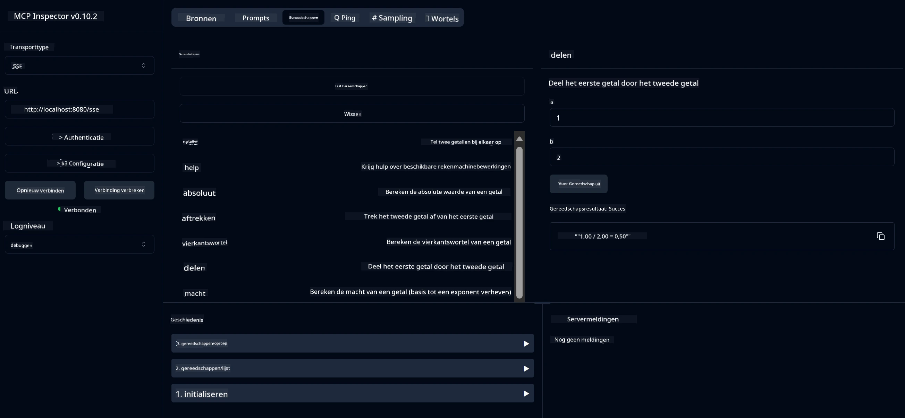

# Basisrekenmachine MCP-service

> [!NOTE]
> Dit voorbeeld gebruikt het verouderde HTTP+SSE transport en richt zich op een SDK die compatibel is
> met MCP `2025-11-25`. Nieuwe externe servers moeten gebruikmaken van `2026-07-28` Streamable
> HTTP-ondersteuning.

Deze service biedt basis rekenmachinebewerkingen via het Model Context Protocol (MCP) met Spring Boot en WebFlux-transport. Het is ontworpen als een eenvoudig voorbeeld voor beginners die MCP-implementaties leren.

Voor meer informatie, zie de referentiedocumentatie van de [MCP Server Boot Starter](https://docs.spring.io/spring-ai/reference/api/mcp/mcp-server-boot-starter-docs.html).

## Overzicht

De service toont:
- Ondersteuning voor SSE (Server-Sent Events)
- Automatische toolregistratie via Spring AI's `@Tool` annotatie
- Basis rekenmachinefuncties:
  - Optellen, aftrekken, vermenigvuldigen, delen
  - Machtsberekening en vierkantswortel
  - Modulus (rest) en absolute waarde
  - Helpfunctie voor beschrijvingen van bewerkingen

## Kenmerken

Deze rekenmachineservice biedt de volgende mogelijkheden:

1. **Basisrekenkundige bewerkingen**:
   - Optellen van twee getallen
   - Aftrekken van het tweede getal van het eerste
   - Vermenigvuldigen van twee getallen
   - Delen van het eerste getal door het tweede (met controle op nul)

2. **Geavanceerde bewerkingen**:
   - Machtsberekening (basis tot exponent verheffen)
   - Vierkantswortelberekening (met controle op negatieve getallen)
   - Modulus (rest) berekening
   - Berekening van absolute waarde

3. **Hulpsysteem**:
   - Ingebouwde helpfunctie die alle beschikbare bewerkingen uitlegt

## Gebruik van de service

De service biedt de volgende API-eindpunten via het MCP-protocol:

- `add(a, b)`: Tel twee getallen bij elkaar op
- `subtract(a, b)`: Trek het tweede getal af van het eerste
- `multiply(a, b)`: Vermenigvuldig twee getallen
- `divide(a, b)`: Deel het eerste getal door het tweede (met nulcontrole)
- `power(base, exponent)`: Bereken de macht van een getal
- `squareRoot(number)`: Bereken de vierkantswortel (met negatieve getalcontrole)
- `modulus(a, b)`: Bereken de rest bij deling
- `absolute(number)`: Bereken de absolute waarde
- `help()`: Verkrijg informatie over beschikbare bewerkingen

## Testclient

Een eenvoudige testclient is inbegrepen in het `com.microsoft.mcp.sample.client`-pakket. De `SampleCalculatorClient`-klasse demonstreert de beschikbare bewerkingen van de rekenmachineservice.

## Gebruik van de LangChain4j-client

Het project bevat een LangChain4j voorbeeldclient in
`com.microsoft.mcp.sample.client.LangChain4jClient` die laat zien hoe
je de rekenmachineservice integreert met een Microsoft Foundry-model.

### Vereisten

1. Maak een Microsoft Foundry-resource aan en implementeer een actief model zoals
   `gpt-5.1`.
2. Stel het model eindpunt, de API-sleutel en de implementatienaam in:

   ```bash
   export AZURE_OPENAI_ENDPOINT="https://<resource-name>.openai.azure.com"
   export AZURE_OPENAI_API_KEY="<api-key>"
   export AZURE_OPENAI_DEPLOYMENT="gpt-5.1"
   ```

3. Controleer de
   [Microsoft Foundry model stopzettingsschema](https://learn.microsoft.com/azure/foundry/openai/concepts/model-retirement-schedule)
   voordat je een implementatie selecteert.
4. Zorg dat de rekenmachineserver draait op `localhost:8080`.

### Uitvoeren van de LangChain4j-client

Dit voorbeeld demonstreert:
- Verbinding maken met de calculator MCP-server via SSE-transport
- LangChain4j gebruiken om een chatbot te maken die rekenmachinebewerkingen benut
- Integratie met een geïmplementeerd Microsoft Foundry-model

De client verstuurt de volgende voorbeeldqueries om functionaliteit te demonstreren:
1. Optellen van twee getallen
2. Berekenen van de vierkantswortel van een getal
3. Verkrijgen van helpinformatie over beschikbare rekenmachinebewerkingen

Voer het voorbeeld uit en controleer de console-uitvoer om te zien hoe het AI-model de rekenmachinetools gebruikt om te reageren op queries.

### Microsoft Foundry modelconfiguratie

De LangChain4j-client gebruikt het Azure OpenAI v1-compatibele eindpunt dat wordt aangeboden door
Microsoft Foundry:

```java
String endpoint = System.getenv("AZURE_OPENAI_ENDPOINT");
ChatLanguageModel model = OpenAiOfficialChatModel.builder()
   .baseUrl(endpoint.replaceAll("/+$", "") + "/openai/v1/")
   .apiKey(System.getenv("AZURE_OPENAI_API_KEY"))
   .isAzure(true)
   .modelName(System.getenv().getOrDefault("AZURE_OPENAI_DEPLOYMENT", "gpt-5.1"))
    .timeout(Duration.ofSeconds(60))
    .build();
```

`AZURE_OPENAI_DEPLOYMENT` moet overeenkomen met de naam die is toegewezen bij het
implementeren van het model, wat kan verschillen van de onderliggende modelnaam.

## Afhankelijkheden

Het project vereist de volgende kernafhankelijkheden:

```xml
<!-- For MCP Server -->
<dependency>
    <groupId>org.springframework.ai</groupId>
    <artifactId>spring-ai-starter-mcp-server-webflux</artifactId>
</dependency>

<!-- For LangChain4j integration -->
<dependency>
    <groupId>dev.langchain4j</groupId>
    <artifactId>langchain4j-mcp</artifactId>
    <version>${langchain4j.version}</version>
</dependency>

<!-- For Microsoft Foundry's OpenAI-compatible endpoint -->
<dependency>
    <groupId>dev.langchain4j</groupId>
   <artifactId>langchain4j-open-ai-official</artifactId>
    <version>${langchain4j.version}</version>
</dependency>
```

## Project bouwen

Bouw het project met Maven:
```bash
./mvnw clean install -DskipTests
```

## Server uitvoeren

### Gebruik van Java

```bash
java -jar target/calculator-server-0.0.1-SNAPSHOT.jar
```

### Gebruik van MCP Inspector

De MCP Inspector is een handig hulpmiddel om met MCP-services te communiceren. Om het te gebruiken met deze rekenmachineservice:

1. **Installeer en start MCP Inspector** in een nieuw terminalvenster:
   ```bash
   npx @modelcontextprotocol/inspector
   ```

2. **Toegang tot de web-UI** door op de URL te klikken die door de app wordt getoond (meestal http://localhost:6274)

3. **Configureer de verbinding**:
   - Stel het transporttype in op "SSE"
   - Stel de URL in op het SSE-eindpunt van je draaiende server: `http://localhost:8080/sse`
   - Klik op "Connect"

4. **Gebruik de tools**:
   - Klik op "List Tools" om beschikbare rekenmachinebewerkingen te zien
   - Selecteer een tool en klik op "Run Tool" om een bewerking uit te voeren



### Gebruik van Docker

Het project bevat een Dockerfile voor containerimplementatie:

1. **Bouw de Docker-afbeelding**:
   ```bash
   docker build -t calculator-mcp-service .
   ```

2. **Start de Docker-container**:
   ```bash
   docker run -p 8080:8080 calculator-mcp-service
   ```

Dit zal:
- Een multi-stage Docker-image bouwen met Maven 3.9.9 en Eclipse Temurin 24 JDK
- Een geoptimaliseerde containerafbeelding aanmaken
- De service blootstellen op poort 8080
- De MCP rekenmachineservice binnen de container starten

Je kunt de service bereiken op `http://localhost:8080` zodra de container draait.

## Problemen oplossen

### Veelvoorkomende verbindingsproblemen met het model

1. **Authenticatiefouten**: Bevestig dat `AZURE_OPENAI_API_KEY` hoort bij de
   resource die wordt geïdentificeerd door `AZURE_OPENAI_ENDPOINT`.
2. **Implementatie niet gevonden**: Bevestig dat `AZURE_OPENAI_DEPLOYMENT` exact overeenkomt met
   de implementatienaam in Microsoft Foundry.
3. **Beperkingen in het aantal verzoeken**: Bekijk de implementatiequota en probeer het opnieuw na het interval
   dat door de service wordt teruggegeven.

Voor meer hulp, zie de
[LangChain4j documentatie](https://github.com/langchain4j/langchain4j) en
[Microsoft Foundry documentatie](https://learn.microsoft.com/azure/ai-foundry/).

---

<!-- CO-OP TRANSLATOR DISCLAIMER START -->
**Disclaimer**:
Dit document is vertaald met behulp van de AI vertaaldienst [Co-op Translator](https://github.com/Azure/co-op-translator). Hoewel we streven naar nauwkeurigheid, dient u er rekening mee te houden dat geautomatiseerde vertalingen fouten of onnauwkeurigheden kunnen bevatten. Het originele document in de oorspronkelijke taal moet worden beschouwd als de gezaghebbende bron. Voor kritieke informatie wordt professionele menselijke vertaling aanbevolen. Wij zijn niet aansprakelijk voor eventuele misverstanden of verkeerde interpretaties die voortvloeien uit het gebruik van deze vertaling.
<!-- CO-OP TRANSLATOR DISCLAIMER END -->