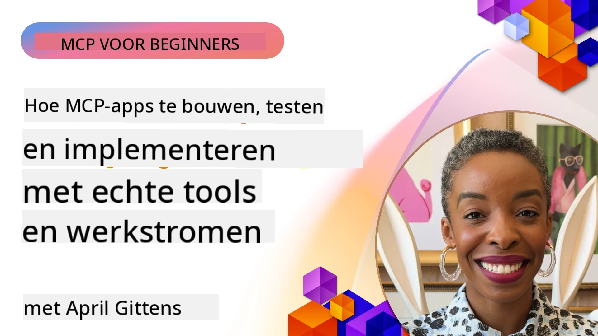
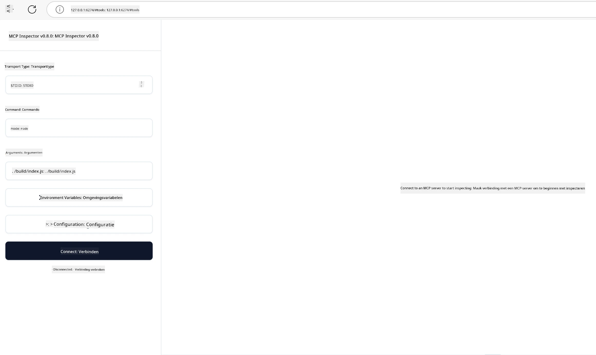

# Praktische Implementatie

[](https://youtu.be/vCN9-mKBDfQ)

_(Klik op de afbeelding hierboven om de video van deze les te bekijken)_

Praktische implementatie is waar de kracht van het Model Context Protocol (MCP) tastbaar wordt. Terwijl het begrijpen van de theorie en architectuur achter MCP belangrijk is, ontstaat de echte waarde wanneer je deze concepten toepast om oplossingen te bouwen, te testen en te implementeren die echte problemen oplossen. Dit hoofdstuk overbrugt de kloof tussen conceptuele kennis en praktische ontwikkeling en begeleidt je in het proces van het tot leven brengen van MCP-gebaseerde applicaties.

Of je nu slimme assistenten ontwikkelt, AI integreert in bedrijfsworkflows of aangepaste tools bouwt voor gegevensverwerking, MCP biedt een flexibele basis. Het taalonafhankelijke ontwerp en de officiële SDK's voor populaire programmeertalen maken het toegankelijk voor een breed scala aan ontwikkelaars. Door gebruik te maken van deze SDK's kun je snel prototypes maken, itereren en je oplossingen schalen over verschillende platforms en omgevingen.

In de volgende secties vind je praktische voorbeelden, voorbeeldcode en implementatiestrategieën die laten zien hoe je MCP implementeert in C#, Java met Spring, TypeScript, JavaScript en Python. Je leert ook hoe je je MCP-servers debugt en test, API's beheert en oplossingen naar de cloud implementeert met Azure. Deze praktische middelen zijn ontworpen om je leerproces te versnellen en je te helpen vol vertrouwen robuuste, productieklare MCP-applicaties te bouwen.

## Overzicht

Deze les richt zich op praktische aspecten van MCP-implementatie in meerdere programmeertalen. We zullen onderzoeken hoe je MCP-SDK's gebruikt in C#, Java met Spring, TypeScript, JavaScript en Python om robuuste applicaties te bouwen, MCP-servers te debuggen en testen, en herbruikbare bronnen, prompts en tools te creëren.

## Leerdoelen

Aan het einde van deze les kun je:

- MCP-oplossingen implementeren met officiële SDK's in verschillende programmeertalen
- MCP-servers systematisch debuggen en testen
- Serverfuncties creëren en gebruiken (Bronnen, Prompts en Tools)
- Effectieve MCP-workflows ontwerpen voor complexe taken
- MCP-implementaties optimaliseren voor prestaties en betrouwbaarheid

## Officiële SDK-bronnen

Het Model Context Protocol biedt officiële SDK’s voor meerdere talen. SDK-
ondersteuning voor MCP `2026-07-28` wordt onafhankelijk uitgerold, controleer daarom de
releasenotes van elke SDK en de pakketversie van het voorbeeld voordat je compatibiliteit van het protocol veronderstelt. Zie de [officiële SDK-lijst](https://modelcontextprotocol.io/docs/sdk):


- [C# SDK](https://github.com/modelcontextprotocol/csharp-sdk)
- [Java met Spring SDK](https://github.com/modelcontextprotocol/java-sdk) **Opmerking:** vereist afhankelijkheid van [Project Reactor](https://projectreactor.io). (Zie [discussie-issue 246](https://github.com/orgs/modelcontextprotocol/discussions/246).)
- [TypeScript SDK](https://github.com/modelcontextprotocol/typescript-sdk)
- [Python SDK](https://github.com/modelcontextprotocol/python-sdk)
- [Kotlin SDK](https://github.com/modelcontextprotocol/kotlin-sdk)
- [Go SDK](https://github.com/modelcontextprotocol/go-sdk)

## Werken met MCP SDK's

Deze sectie biedt praktische voorbeelden van het implementeren van MCP in meerdere programmeertalen. Je kunt voorbeeldcode vinden in de `samples`-map, georganiseerd per taal.

### Beschikbare Voorbeelden

De repository bevat [voorbeeldimplementaties](../../../04-PracticalImplementation/samples) in de volgende talen:

- [C#](./samples/csharp/README.md)
- [Java met Spring](./samples/java/containerapp/README.md)
- [TypeScript](./samples/typescript/README.md)
- [JavaScript](./samples/javascript/README.md)
- [Python](./samples/python/README.md)

Elk voorbeeld toont belangrijke MCP-concepten en implementatiepatronen voor die specifieke taal en ecosysteem.

### Praktische Gidsen

Aanvullende gidsen voor praktische MCP-implementatie:

- [Paginering en Grote Resultaatsverzamelingen](./pagination/README.md) - Beheer cursor-gebaseerde paginering voor tools, bronnen en grote datasets

## Kernserverfuncties

MCP-servers kunnen elke combinatie van deze functies implementeren:

### Bronnen

Bronnen bieden context en gegevens voor de gebruiker of AI-model om te gebruiken:

- Documentrepositories
- Kennisbases
- Gestructureerde gegevensbronnen
- Bestandsystemen

### Prompts

Prompts zijn sjabloongebaseerde berichten en workflows voor gebruikers:

- Vooraf gedefinieerde gespreksjablonen
- Geleide interactiepatronen
- Gespecialiseerde dialoogstructuren

### Tools

Tools zijn functies die het AI-model kan uitvoeren:

- Hulpmiddelen voor gegevensverwerking
- Externe API-integraties
- Computationale mogelijkheden
- Zoekfunctionaliteit

## Voorbeeldimplementaties: C# Implementatie

De officiële C# SDK-repository bevat meerdere voorbeeldimplementaties die verschillende aspecten van MCP demonstreren:

- **Basis MCP Client**: Eenvoudig voorbeeld om te laten zien hoe je een MCP-client maakt en tools aanroept
- **Basis MCP Server**: Minimale serverimplementatie met basis tool-registratie
- **Geavanceerde MCP Server**: Volledig uitgeruste server met tool-registratie, authenticatie en foutafhandeling
- **ASP.NET Integratie**: Voorbeelden die integratie met ASP.NET Core demonstreren
- **Tool Implementatiepatronen**: Verschillende patronen voor het implementeren van tools met uiteenlopende complexiteit

De MCP C# SDK is in preview en API's kunnen nog veranderen. We zullen deze blog continu bijwerken naarmate de SDK evolueert.

### Belangrijke Kenmerken

- [C# MCP Nuget ModelContextProtocol](https://www.nuget.org/packages/ModelContextProtocol)
- Bouw je [eerste MCP Server](https://devblogs.microsoft.com/dotnet/build-a-model-context-protocol-mcp-server-in-csharp/).

Voor volledige C# implementatievoorbeelden, bezoek de [officiële C# SDK-voorbeeldrepository](https://github.com/modelcontextprotocol/csharp-sdk)

## Voorbeeldimplementatie: Java met Spring Implementation

De Java met Spring SDK biedt robuuste MCP-implementatie-opties met enterprise-klasse functies.

### Belangrijke Kenmerken

- Integratie met Spring Framework
- Sterke typeveiligheid
- Ondersteuning voor reactief programmeren
- Uitgebreide foutafhandeling

Voor een complete Java met Spring implementatievoorbeelden, zie [Java met Spring voorbeeld](samples/java/containerapp/README.md) in de voorbeeldmap.

## Voorbeeldimplementatie: JavaScript Implementation

De JavaScript SDK biedt een lichtgewicht en flexibele benadering voor MCP-implementatie.

### Belangrijke Kenmerken

- Node.js- en browserondersteuning
- Promise-gebaseerde API
- Gemakkelijke integratie met Express en andere frameworks
- WebSocket-ondersteuning voor streaming

Voor een complete JavaScript implementatievoorbeeld, zie [JavaScript voorbeeld](samples/javascript/README.md) in de voorbeeldmap.

## Voorbeeldimplementatie: Python Implementation

De Python SDK biedt een Pythonische aanpak van MCP-implementatie met uitstekende integraties van ML-frameworks.

### Belangrijke Kenmerken

- Async/await ondersteuning met asyncio
- FastAPI-integratie``
- Eenvoudige tool-registratie
- Native integratie met populaire ML-bibliotheken

Voor een complete Python implementatievoorbeeld, zie [Python voorbeeld](samples/python/README.md) in de voorbeeldmap.

## API-beheer

Azure API Management is een geweldig antwoord op de vraag hoe we MCP Servers kunnen beveiligen. Het idee is om een Azure API Management-instance voor je MCP Server te plaatsen en deze te laten beheren functies die je waarschijnlijk wilt, zoals:

- rate limiting
- tokenbeheer
- monitoring
- load balancing
- beveiliging

### Azure Voorbeeld

Hier is een Azure-voorbeeld dat precies dat doet, namelijk [een MCP Server maken en beveiligen met Azure API Management](https://github.com/Azure-Samples/remote-mcp-apim-functions-python).

Bekijk hoe de autorisatiestroom plaatsvindt in de onderstaande afbeelding:


In de bovenstaande afbeelding gebeurt het volgende:

- Authenticatie/Autorisatie vindt plaats via Microsoft Entra.
- Azure API Management fungeert als gateway en gebruikt beleidsregels om verkeer te sturen en te beheren.
- Azure Monitor logt alle verzoeken voor nadere analyse.

#### Autorisatiestroom

Laten we de autorisatiestroom nader bekijken:


#### MCP-autorisatiespecificatie

Lees meer over de
[MCP Autorisatiespecificatie](https://modelcontextprotocol.io/specification/2026-07-28/basic/authorization/).

## Remote MCP Server implementeren op Azure

Laten we kijken of we het eerder genoemde voorbeeld kunnen implementeren:

1. Clone de repo

    ```bash
    git clone https://github.com/Azure-Samples/remote-mcp-apim-functions-python.git
    cd remote-mcp-apim-functions-python
    ```

1. Registreer de `Microsoft.App` resource provider.

   - Als je Azure CLI gebruikt, voer dan `az provider register --namespace Microsoft.App --wait` uit.
   - Als je Azure PowerShell gebruikt, voer dan `Register-AzResourceProvider -ProviderNamespace Microsoft.App` uit. Voer daarna `(Get-AzResourceProvider -ProviderNamespace Microsoft.App).RegistrationState` uit na enige tijd om te controleren of de registratie is voltooid.

1. Voer dit [azd](https://aka.ms/azd) commando uit om de API-beheer service, function app (met code) en alle andere benodigde Azure-resources te voorzien

    ```shell
    azd up
    ```

    Dit commando zou alle cloudresources op Azure moeten implementeren

### Test je server met MCP Inspector

1. Open een **nieuw terminalvenster**, installeer en start MCP Inspector

    ```shell
    npx @modelcontextprotocol/inspector
    ```

    Je zou een interface moeten zien vergelijkbaar met:

    

1. CTRL-klik om de MCP Inspector-webapp te laden vanaf de URL die door de app wordt weergegeven (bijv. [http://127.0.0.1:6274/#resources](http://127.0.0.1:6274/#resources))
1. Stel het transporttype in op `SSE`
1. Stel de URL in op je draaiende API Management SSE-eindpunt dat wordt weergegeven na `azd up` en **Verbinden**:

    ```shell
    https://<apim-servicename-from-azd-output>.azure-api.net/mcp/sse
    ```

1. **Lijst Tools**. Klik op een tool en **Voer Tool uit**.  

Als alle stappen zijn gelukt, ben je nu verbonden met de MCP-server en heb je een tool kunnen aanroepen.

## MCP-servers voor Azure

[Remote-mcp-functions](https://github.com/Azure-Samples/remote-mcp-functions-dotnet): Deze set van repositories zijn snelstarttemplates voor het bouwen en implementeren van aangepaste remote MCP (Model Context Protocol) servers met Azure Functions met Python, C# .NET of Node/TypeScript.

De voorbeelden bieden een complete oplossing waarmee ontwikkelaars kunnen:

- Lokaal bouwen en draaien: Ontwikkel en debug een MCP-server op een lokale machine
- Implementeren op Azure: Eenvoudig implementeren naar de cloud met een simpel azd up-commando
- Verbinden vanaf clients: Verbinding maken met de MCP-server vanaf verschillende clients, waaronder VS Code's Copilot-agentmodus en de MCP Inspector-tool

### Belangrijke Kenmerken

- Security by design: De MCP-server is beveiligd met sleutels en HTTPS
- Authenticatieopties: Ondersteunt OAuth met ingebouwde authenticatie en/of API Management
- Netwerkisolatie: Ondersteunt netwerkisolatie via Azure Virtual Networks (VNET)
- Serverless architectuur: Maakt gebruik van Azure Functions voor schaalbare, event-gedreven uitvoering
- Lokale ontwikkeling: Uitgebreide ondersteuning voor lokale ontwikkeling en debugging
- Eenvoudige implementatie: Gestroomlijnd implementatieproces naar Azure

De repository bevat alle benodigde configuratiebestanden, broncode en infrastructuurdefinities om snel aan de slag te gaan met een productieklare MCP-serverimplementatie.

- [Azure Remote MCP Functions Python](https://github.com/Azure-Samples/remote-mcp-functions-python) - Voorbeeldimplementatie van MCP met Azure Functions in Python

- [Azure Remote MCP Functions .NET](https://github.com/Azure-Samples/remote-mcp-functions-dotnet) - Voorbeeldimplementatie van MCP met Azure Functions in C# .NET

- [Azure Remote MCP Functions Node/Typescript](https://github.com/Azure-Samples/remote-mcp-functions-typescript) - Voorbeeldimplementatie van MCP met Azure Functions in Node/TypeScript.

## Belangrijkste Leerpunten

- MCP SDK's bieden taalspecifieke tools voor het implementeren van robuuste MCP-oplossingen
- Het debuggen en testen is cruciaal voor betrouwbare MCP-toepassingen
- Herbruikbare promptsjablonen zorgen voor consistente AI-interacties
- Goed ontworpen workflows kunnen complexe taken coördineren met meerdere tools
- Het implementeren van MCP-oplossingen vraagt aandacht voor beveiliging, prestaties en foutafhandeling

## Oefening

Ontwerp een praktische MCP-workflow die een reëel probleem in jouw vakgebied aanpakt:

1. Identificeer 3-4 tools die nuttig zouden zijn om dit probleem op te lossen
2. Maak een workflowdiagram waarin wordt weergegeven hoe deze tools met elkaar samenwerken
3. Implementeer een basisversie van één van de tools in jouw voorkeursprogrammeertaal
4. Maak een promptsjabloon die het model helpt om jouw tool effectief te gebruiken

## Aanvullende Bronnen

---

## Wat Nu?

Volgende: [Geavanceerde Onderwerpen](../05-AdvancedTopics/README.md)

---

<!-- CO-OP TRANSLATOR DISCLAIMER START -->
**Disclaimer**:
Dit document is vertaald met behulp van de AI vertaaldienst [Co-op Translator](https://github.com/Azure/co-op-translator). Hoewel we streven naar nauwkeurigheid, dient u er rekening mee te houden dat geautomatiseerde vertalingen fouten of onnauwkeurigheden kunnen bevatten. Het originele document in de oorspronkelijke taal moet worden beschouwd als de gezaghebbende bron. Voor kritieke informatie wordt professionele menselijke vertaling aanbevolen. Wij zijn niet aansprakelijk voor eventuele misverstanden of verkeerde interpretaties die voortvloeien uit het gebruik van deze vertaling.
<!-- CO-OP TRANSLATOR DISCLAIMER END -->