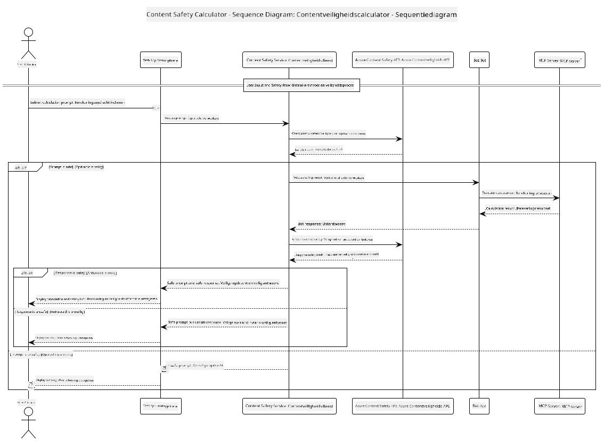

## Systeemarchitectuur

Dit project demonstreert een webapplicatie die inhoudsveiligheidscontrole uitvoert voordat gebruikersinvoer wordt doorgegeven aan een rekenmachineservice via het Model Context Protocol (MCP).



### Hoe Het Werkt

1. **Gebruikersinvoer**: De gebruiker voert een rekenopdracht in via de webinterface
2. **Inhoudsveiligheidsscreening (Invoer)**: De opdracht wordt geanalyseerd door de Azure Content Safety API
3. **Veiligheidsbeslissing (Invoer)**:
   - Als de inhoud veilig is (ernst < 2 in alle categorieën), gaat deze door naar de rekenmachine
   - Als de inhoud als potentieel schadelijk wordt aangeduid, stopt het proces en wordt een waarschuwing geretourneerd
4. **Integratie rekenmachine**: Veilige inhoud wordt verwerkt door LangChain4j, die communiceert met de MCP rekenmachineserver
5. **Inhoudsveiligheidsscreening (Uitvoer)**: De reactie van de bot wordt geanalyseerd door de Azure Content Safety API
6. **Veiligheidsbeslissing (Uitvoer)**:
   - Als de botreactie veilig is, wordt deze aan de gebruiker getoond
   - Als de botreactie als potentieel schadelijk wordt aangeduid, wordt deze vervangen door een waarschuwing
7. **Reactie**: Resultaten (indien veilig) worden aan de gebruiker getoond samen met beide veiligheidsanalyses

## Gebruik van Model Context Protocol (MCP) met Rekenmachineservices

Dit project demonstreert hoe Model Context Protocol (MCP) gebruikt kan worden om rekenmachine-MCP-diensten aan te roepen vanuit LangChain4j. De implementatie gebruikt een lokale MCP-server die draait op poort 8080 om rekenmachinebewerkingen te verzorgen.

### Het opzetten van Azure Content Safety Service

Voordat je de inhoudsveiligheidsfuncties gebruikt, moet je een Azure Content Safety-serviceresource aanmaken:

1. Meld je aan bij het [Azure Portal](https://portal.azure.com)
2. Klik op "Een resource maken" en zoek naar "Content Safety"
3. Selecteer "Content Safety" en klik op "Maken"
4. Voer een unieke naam in voor je resource
5. Selecteer je abonnement en resourcegroep (of maak een nieuwe aan)
6. Kies een ondersteunde regio (controleer [Beschikbaarheid regio's](https://azure.microsoft.com/en-us/global-infrastructure/services/?products=cognitive-services) voor details)
7. Selecteer een passend prijsniveau
8. Klik op "Maken" om de resource te implementeren
9. Zodra de implementatie voltooid is, klik je op "Ga naar resource"
10. Selecteer in het linker menu onder "Resourcebeheer" de optie "Sleutels en eindpunt"
11. Kopieer een van de sleutels en de eindpunt-URL voor gebruik in de volgende stap

### Configureren van omgevingsvariabelen

Stel het Microsoft Foundry model-eindpunt, API-sleutel en implementatienaam in:
```sh
export AZURE_OPENAI_ENDPOINT="https://<resource-name>.openai.azure.com"
export AZURE_OPENAI_API_KEY="<api-key>"
export AZURE_OPENAI_DEPLOYMENT="gpt-5.1"
```

Voor inhoudsveiligheidsfuncties, stel in:
```sh
export CONTENT_SAFETY_ENDPOINT=<your_content_safety_endpoint>
export CONTENT_SAFETY_KEY=<your_content_safety_key>
```

Deze omgevingsvariabelen worden door de applicatie gebruikt om te authenticeren bij de Azure Content Safety-service. Als deze variabelen niet zijn ingesteld, gebruikt de applicatie voorbeeldwaarden voor demonstratiedoeleinden, maar zullen de inhoudsveiligheidsfuncties niet correct werken.

### Het starten van de Calculator MCP-server

Voordat je de client start, moet je de rekenmachine MCP-server in SSE-modus starten op localhost:8080.

## Projectbeschrijving

Dit project demonstreert de integratie van Model Context Protocol (MCP) met LangChain4j om rekenmachineservices aan te roepen. Belangrijke kenmerken zijn:

- Gebruik van MCP voor verbinding met een rekenmachineservice voor basiswiskundige bewerkingen
- Dubbele inhoudsveiligheidscontrole op zowel gebruikersopdrachten als botreacties
- Integratie met een geïmplementeerd Microsoft Foundry-model via LangChain4j
- Gebruik van Server-Sent Events (SSE) voor MCP-transport

## Integratie inhoudsveiligheid

Het project bevat uitgebreide inhoudsveiligheidsfuncties om te garanderen dat zowel gebruikersinvoer als systeemreacties vrij zijn van schadelijke inhoud:

1. **Invoerscreening**: Alle gebruikersopdrachten worden geanalyseerd op schadelijke inhoudscategorieën zoals haatspraak, geweld, zelfbeschadiging en seksuele inhoud voordat ze worden verwerkt.

2. **Uitvoerscreening**: Zelfs bij het gebruik van mogelijk ongecensureerde modellen controleert het systeem alle gegenereerde reacties via dezelfde inhoudsveiligheidsfilters voordat ze aan de gebruiker worden getoond.

Deze dubbele laag zorgt ervoor dat het systeem veilig blijft, ongeacht welk AI-model wordt gebruikt, en beschermt gebruikers tegen zowel schadelijke invoer als potentieel problematische AI-gegenereerde uitvoer.

## Webclient

De applicatie bevat een gebruiksvriendelijke webinterface die gebruikers in staat stelt te communiceren met het Content Safety Calculator-systeem:

### Kenmerken van de webinterface

- Eenvoudig, intuïtief formulier voor het invoeren van rekenopdrachten
- Dubbele inhoudsveiligheidsvalidatie (invoer en uitvoer)
- Directe feedback over veiligheid van opdracht en reactie
- Met kleur gecodeerde veiligheidsindicatoren voor gemakkelijke interpretatie
- Schone, responsieve vormgeving die werkt op verschillende apparaten
- Voorbeeldopdrachten die veilig zijn om gebruikers te begeleiden

### Gebruik van de webclient

1. Start de applicatie:
   ```sh
   mvn spring-boot:run
   ```

2. Open je browser en navigeer naar `http://localhost:8087`

3. Voer een rekenopdracht in het aangeboden tekstvak in (bijv. "Bereken de som van 24,5 en 17,3")

4. Klik op "Verzenden" om je verzoek te verwerken

5. Bekijk de resultaten, die het volgende bevatten:
   - Inhoudsveiligheidsanalyse van je opdracht
   - Het berekende resultaat (als de opdracht veilig was)
   - Inhoudsveiligheidsanalyse van de reactie van de bot
   - Eventuele veiligheidswaarschuwingen als de invoer of uitvoer werd gemarkeerd

De webclient verwerkt automatisch beide inhoudsveiligheidscontroles, waardoor alle interacties veilig en passend zijn ongeacht welk AI-model wordt gebruikt.

---

<!-- CO-OP TRANSLATOR DISCLAIMER START -->
**Disclaimer**:
Dit document is vertaald met behulp van de AI vertaaldienst [Co-op Translator](https://github.com/Azure/co-op-translator). Hoewel we streven naar nauwkeurigheid, dient u er rekening mee te houden dat geautomatiseerde vertalingen fouten of onnauwkeurigheden kunnen bevatten. Het originele document in de oorspronkelijke taal moet worden beschouwd als de gezaghebbende bron. Voor kritieke informatie wordt professionele menselijke vertaling aanbevolen. Wij zijn niet aansprakelijk voor eventuele misverstanden of verkeerde interpretaties die voortvloeien uit het gebruik van deze vertaling.
<!-- CO-OP TRANSLATOR DISCLAIMER END -->