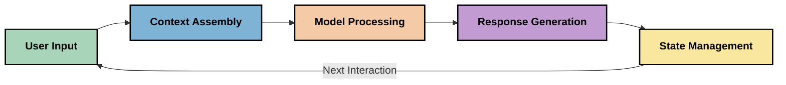
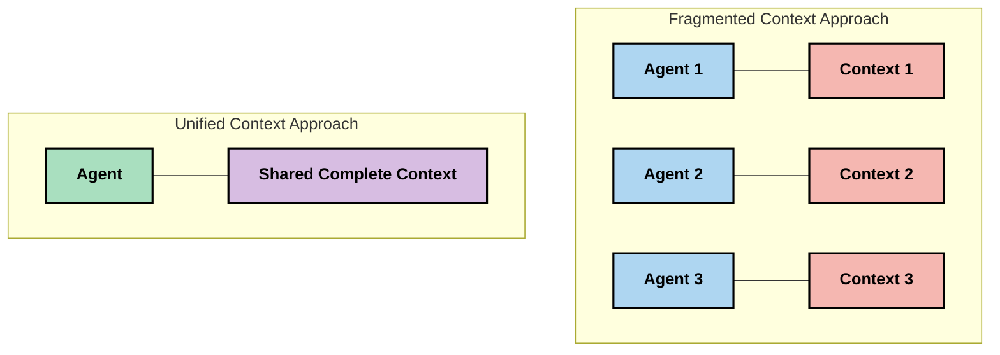
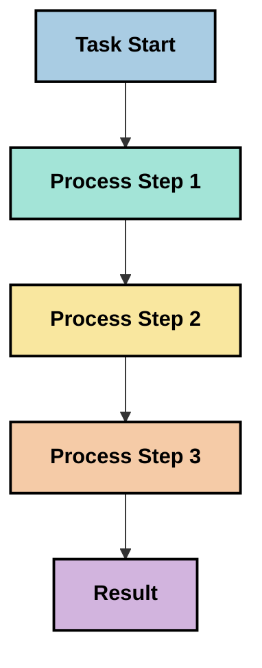
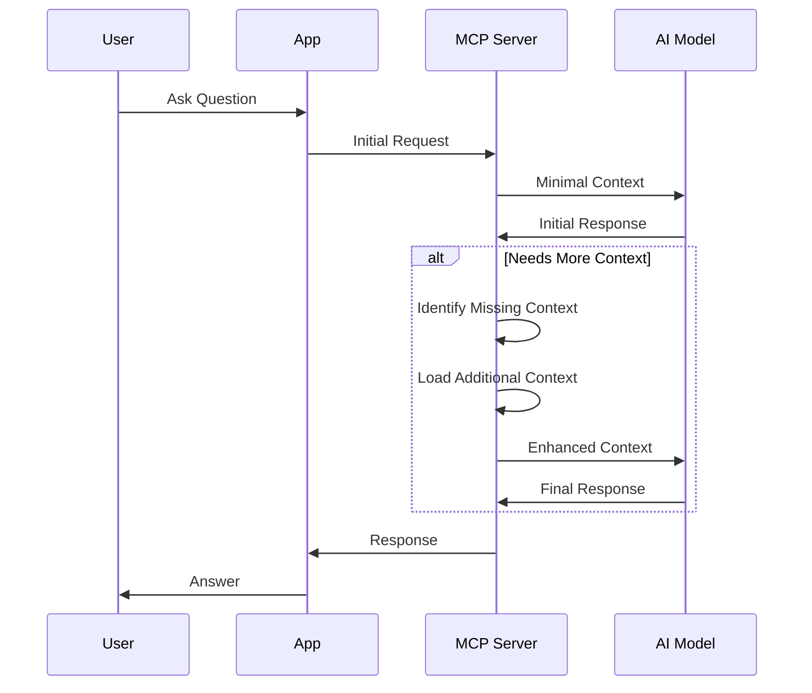
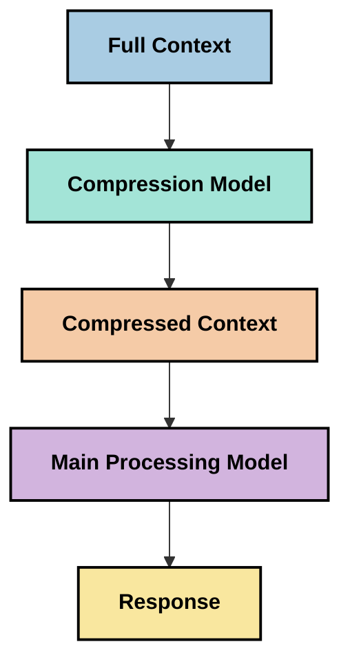
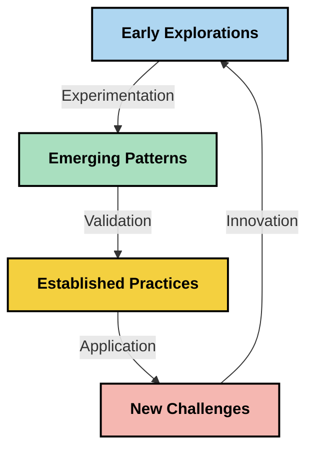

# Context Engineering: Een Opkomend Concept in het MCP Ecosysteem

## Overzicht

Context engineering is een opkomend concept in de AI-ruimte dat onderzoekt hoe informatie wordt gestructureerd, geleverd en onderhouden tijdens interacties tussen cliënten en AI-diensten. Naarmate het Model Context Protocol (MCP) ecosysteem zich ontwikkelt, wordt het steeds belangrijker om te begrijpen hoe context effectief kan worden beheerd. Deze module introduceert het concept context engineering en verkent de potentiële toepassingen binnen MCP-implementaties.

## Leerdoelen

Aan het einde van deze module zul je in staat zijn om:

- Het opkomende concept van context engineering en de potentiële rol ervan in MCP-toepassingen te begrijpen
- Belangrijke uitdagingen in contextbeheer te identificeren die het MCP-protocolontwerp aanpakt
- Technieken te verkennen om de modelprestaties te verbeteren door beter contextbeheer
- Benaderingen te overwegen om contexteffectiviteit te meten en evalueren
- Deze opkomende concepten toe te passen om AI-ervaringen te verbeteren via het MCP-framework

## Introductie tot Context Engineering

Context engineering is een opkomend concept gericht op het doelbewust ontwerpen en beheren van informatiestromen tussen gebruikers, applicaties en AI-modellen. In tegenstelling tot gevestigde vakgebieden zoals prompt engineering wordt context engineering nog gedefinieerd door praktijkmensen terwijl zij werken aan het oplossen van de unieke uitdagingen om AI-modellen op het juiste moment de juiste informatie te bieden.

Naarmate grote taalmodellen (LLMs) zijn geëvolueerd, is het belang van context steeds duidelijker geworden. De kwaliteit, relevantie en structuur van de context die we bieden, beïnvloedt rechtstreeks de modeluitvoer. Context engineering onderzoekt deze relatie en zoekt naar principes voor effectief contextbeheer.

> "In 2025 zijn de modellen buitengewoon intelligent. Maar zelfs de slimste mens kan zijn werk niet effectief doen zonder de context van wat hen wordt gevraagd te doen... 'Context engineering' is het volgende niveau van prompt engineering. Het gaat om dit automatisch te doen in een dynamisch systeem." — Walden Yan, Cognition AI

Context engineering kan omvatten:

1. **Contextselectie**: Bepalen welke informatie relevant is voor een bepaalde taak
2. **Contextstructurering**: Organiseren van informatie om maximale modelbegrip te bevorderen
3. **Contextlevering**: Optimaliseren van hoe en wanneer informatie naar modellen wordt gestuurd
4. **Contextonderhoud**: Beheren van de staat en evolutie van context in de tijd
5. **Contextevaluatie**: Meten en verbeteren van de effectiviteit van context

Deze aandachtsgebieden zijn bijzonder relevant voor het MCP-ecosysteem, dat een gestandaardiseerde wijze biedt voor applicaties om context aan LLM's te verstrekken.


## Het Perspectief van de Contextreis

Een manier om context engineering te visualiseren is door de reis te volgen die informatie aflegt door een MCP-systeem:



### Belangrijke Fasen in de Contextreis:

1. **Gebruikersinvoer**: Rauwe informatie van de gebruiker (tekst, afbeeldingen, documenten)
2. **Contextassemblage**: Combineren van gebruikersinvoer met systeemcontext, gespreksgeschiedenis en andere opgehaalde informatie
3. **Modelverwerking**: Het AI-model verwerkt de samengestelde context
4. **Responsgeneratie**: Het model produceert uitvoer op basis van de gegeven context
5. **Staatbeheer**: Het systeem werkt zijn interne staat bij op basis van de interactie

Dit perspectief benadrukt het dynamische karakter van context in AI-systemen en roept belangrijke vragen op over hoe informatie in elke fase het beste beheerd kan worden.

## Opkomende Principes in Context Engineering

Naarmate het vakgebied context engineering vorm krijgt, beginnen enkele vroege principes naar voren te komen van praktijkmensen. Deze principes kunnen de keuze voor MCP-implementaties informeren:

### Principe 1: Deel Context Volledig

Context moet volledig gedeeld worden tussen alle componenten van een systeem in plaats van gefragmenteerd over meerdere agenten of processen. Wanneer context verspreid is, kunnen beslissingen die in één deel van het systeem worden genomen conflicteren met beslissingen elders.



In MCP-toepassingen suggereert dit systemen te ontwerpen waarbij context naadloos door de hele pijplijn stroomt in plaats van gecompartimenteerd te zijn.

### Principe 2: Erken Dat Acties Impliciete Beslissingen Dragen

Elke actie die een model uitvoert bevat impliciete beslissingen over hoe de context geïnterpreteerd wordt. Wanneer meerdere componenten op verschillende contexten acteren, kunnen deze impliciete beslissingen conflicteren en leiden tot inconsistente uitkomsten.

Dit principe heeft belangrijke implicaties voor MCP-toepassingen:
- Geef de voorkeur aan lineaire verwerking van complexe taken boven parallelle uitvoering met gefragmenteerde context
- Zorg dat alle beslissingspunten toegang hebben tot dezelfde contextuele informatie
- Ontwerp systemen waarbij latere stappen de volledige context van eerdere beslissingen kunnen zien

### Principe 3: Balanceer Contextdiepte met Windowbeperkingen

Naarmate gesprekken en processen langer worden, overlopen contextvensters uiteindelijk. Effectieve context engineering onderzoekt benaderingen om deze spanning tussen uitgebreide context en technische beperkingen te beheren.

Potentiële benaderingen die worden onderzocht omvatten:
- Contextcompressie die essentiële informatie behoudt terwijl tokengebruik wordt verminderd
- Progressieve contextlading op basis van relevantie voor huidige behoeften
- Samenvatting van voorgaande interacties met behoud van sleutelbeslissingen en feiten

## Contextuitdagingen en MCP-Protocolontwerp

Het Model Context Protocol (MCP) is ontworpen met bewustzijn van de unieke uitdagingen van contextbeheer. Het begrijpen van deze uitdagingen helpt om belangrijke aspecten van het MCP-protocolontwerp te verklaren:


### Uitdaging 1: Beperkingen van Contextvensters
De meeste AI-modellen hebben vaste contextvenstergroottes die limiteren hoeveel informatie ze tegelijk kunnen verwerken.

**MCP-ontwerpreactie:** 
- Het protocol ondersteunt gestructureerde context gebaseerd op bronnen die efficiënt geraadpleegd kunnen worden
- Bronnen kunnen pagina-gewijs en progressief worden geladen

### Uitdaging 2: Bepaling van Relevantie
Het bepalen welke informatie het meest relevant is om in context op te nemen is lastig.

**MCP-ontwerpreactie:**
- Flexibele tools maken dynamische informatieophaling op basis van behoeften mogelijk
- Gestructureerde prompts zorgen voor consistente contextorganisatie

### Uitdaging 3: Contextpersistentie
Staatbeheer over interacties heen vereist nauwkeurige tracking van context.

**MCP-ontwerpreactie:**
- Gestandaardiseerd sessiebeheer
- Duidelijk gedefinieerde interactiepatronen voor contextevolutie

### Uitdaging 4: Multimodale Context
Verschillende typen data (tekst, afbeeldingen, gestructureerde data) vereisen verschillende afhandeling.

**MCP-ontwerpreactie:**
- Protocolontwerp ondersteunt verschillende inhoudstypen
- Gestandaardiseerde representatie van multimodale informatie

### Uitdaging 5: Veiligheid en Privacy
Context bevat vaak gevoelige informatie die beschermd moet worden.

**MCP-ontwerpreactie:**
- Duidelijke scheiding tussen client- en serververantwoordelijkheden
- Lokale verwerkingsopties om gegevensblootstelling te minimaliseren

Het begrijpen van deze uitdagingen en hoe MCP ze aanpakt vormt een basis om geavanceerdere technieken in context engineering te verkennen.

## Opkomende Benaderingen voor Context Engineering

Naarmate het veld context engineering zich ontwikkelt, komen er verschillende veelbelovende benaderingen naar voren. Deze vertegenwoordigen huidige denkwijzen en geen gevestigde best practices, en zullen waarschijnlijk evolueren naarmate we meer ervaring opdoen met MCP-implementaties.

### 1. Lineaire verwerking in één draad

In tegenstelling tot multi-agent architecturen die context verdelen, ontdekken sommige praktijkmensen dat lineaire verwerking in één draad consistentere resultaten produceert. Dit sluit aan bij het principe van het behouden van een eenduidige context.



Hoewel deze benadering wellicht minder efficiënt lijkt dan parallelle verwerking, levert zij vaak meer coherente en betrouwbare resultaten op omdat elke stap voortbouwt op een volledig begrip van eerdere beslissingen.

### 2. Context opsplitsen en prioriteren

Grote contexten opsplitsen in beheersbare stukken en prioriteren wat het belangrijkste is.

```python
# Conceptual Example: Context Chunking and Prioritization
def process_with_chunked_context(documents, query):
    # 1. Break documents into smaller chunks
    chunks = chunk_documents(documents)
    
    # 2. Calculate relevance scores for each chunk
    scored_chunks = [(chunk, calculate_relevance(chunk, query)) for chunk in chunks]
    
    # 3. Sort chunks by relevance score
    sorted_chunks = sorted(scored_chunks, key=lambda x: x[1], reverse=True)
    
    # 4. Use the most relevant chunks as context
    context = create_context_from_chunks([chunk for chunk, score in sorted_chunks[:5]])
    
    # 5. Process with the prioritized context
    return generate_response(context, query)
```

Het bovenstaande concept illustreert hoe we grote documenten kunnen opsplitsen in beheersbare stukken en alleen de meest relevante delen kunnen selecteren voor context. Deze benadering helpt binnen contextvensterbeperkingen te werken terwijl grote kennisbanken benut blijven.

### 3. Progressieve contextlading

Context progressief laden indien nodig in plaats van alles tegelijk.



Progressieve contextlading begint met minimale context en breidt alleen uit wanneer noodzakelijk. Dit kan tokengebruik bij eenvoudige vragen aanzienlijk verminderen terwijl het vermogen om complexe vragen te behandelen behouden blijft.

### 4. Contextcompressie en samenvatting

De context verkleinen terwijl essentiële informatie behouden blijft.



Contextcompressie richt zich op:
- Het verwijderen van overbodige informatie
- Het samenvatten van lange inhoud
- Het extraheren van sleutelgegevens en details
- Het behouden van kritieke contextelementen
- Optimalisatie voor token-efficiëntie

Deze benadering kan bijzonder waardevol zijn voor het behouden van lange gesprekken binnen contextvensters of voor efficiënt verwerken van grote documenten. Sommige praktijkmensen gebruiken gespecialiseerde modellen specifiek voor contextcompressie en samenvatting van gespreksgeschiedenis.


## Verkennende Overwegingen voor Context Engineering

Terwijl we het opkomende veld context engineering verkennen, zijn er verschillende overwegingen die de moeite waard zijn om in gedachten te houden bij het werken met MCP-implementaties. Dit zijn geen voorschrijvende best practices maar eerder verkenningsgebieden die tot verbeteringen kunnen leiden in jouw specifieke use case.

### Overweeg je Contextdoelen

Formuleer duidelijk wat je probeert te bereiken voordat je complexe contextbeheeroplossingen implementeert:
- Welke specifieke informatie heeft het model nodig om succesvol te zijn?
- Welke informatie is essentieel versus aanvullend?
- Wat zijn je prestatiebeperkingen (latentie, tokenlimieten, kosten)?

### Verken Gelaagde Contextbenaderingen

Sommige praktijkmensen hebben succes met context die georganiseerd is in conceptuele lagen:
- **Kernlaag**: Essentiële informatie die het model altijd nodig heeft
- **Situationele laag**: Context die specifiek is voor de huidige interactie
- **Ondersteunende laag**: Aanvullende informatie die nuttig kan zijn
- **Fallbacklaag**: Informatie die alleen wordt geraadpleegd wanneer nodig

### Onderzoek Ophaalstrategieën

De effectiviteit van je context hangt vaak af van hoe je informatie opvraagt:
- Semantische zoekopdrachten en embeddings om conceptueel relevante informatie te vinden
- Trefwoordgerichte zoekopdrachten voor specifieke feitelijke details
- Hybride benaderingen die meerdere ophaalmethoden combineren
- Metadatafiltering om scope te beperken op basis van categorieën, data of bronnen

### Experimenteer met Contextcoherentie

De structuur en de stroom van je context kunnen het begrip van het model beïnvloeden:
- Gerelateerde informatie bij elkaar groeperen
- Consistente opmaak en organisatie gebruiken
- Logische of chronologische ordening waar gepast aanhouden
- Tegenstrijdige informatie vermijden

### Weeg de Afwegingen van Multi-Agent Architecturen

Hoewel multi-agent architecturen populair zijn in veel AI-frameworks, brengen ze aanzienlijke uitdagingen mee voor contextbeheer:
- Contextfragmentatie kan leiden tot inconsistente beslissingen over agents heen
- Parallelle verwerking kan conflicten introduceren die moeilijk te verzoenen zijn
- Communicatie-overhead tussen agents kan prestatieverbeteringen tenietdoen
- Complex staatbeheer is vereist om coherentie te behouden

In veel gevallen kan een enkel-agent benadering met uitgebreid contextbeheer betrouwbaardere resultaten opleveren dan meerdere gespecialiseerde agents met gefragmenteerde context.

### Ontwikkel Evaluatiemethoden

Om context engineering in de loop van tijd te verbeteren, overweeg hoe je succes zult meten:
- A/B-testen van verschillende contextstructuren
- Monitoren van tokenverbruik en responstijden
- Bijhouden van gebruikers tevredenheid en taakvoltooiingspercentage
- Analyseren wanneer en waarom contextstrategieën falen

Deze overwegingen vertegenwoordigen actieve verkenningsgebieden in het veld context engineering. Naarmate het vakgebied rijpt, zullen waarschijnlijk meer definitieve patronen en praktijk ontstaan.

## Meten van Contexteffectiviteit: Een Evoluerend Kader

Terwijl context engineering zich ontwikkelt als concept, beginnen praktijkmensen te onderzoeken hoe we de effectiviteit ervan kunnen meten. Er bestaat nog geen vastgesteld kader, maar diverse metrics worden overwogen die toekomstige ontwikkelingen kunnen sturen.

### Potentiële Meetdimensies


#### 1. Overwegingen rondom Invoerefficiëntie

- **Context-tot-respons verhouding**: Hoeveel context is nodig ten opzichte van de omvang van de respons?
- **Tokengebruik**: Welk percentage van de contexttokens lijkt de respons te beïnvloeden?
- **Contextreductie**: Hoe effectief kunnen we rauwe informatie comprimeren?

#### 2. Prestatie-overwegingen

- **Latentie-impact**: Hoe beïnvloedt contextbeheer de responstijd?
- **Tokeneconomie**: Optimaliseren we het tokengebruik effectief?
- **Ophaalprecisie**: Hoe relevant is de opgehaalde informatie?
- **Resourcegebruik**: Welke computationele middelen zijn vereist?

#### 3. Kwaliteitsoverwegingen

- **Relevantie van respons**: Hoe goed sluit de respons aan bij de vraag?
- **Feitelijke nauwkeurigheid**: Verbetert contextbeheer de feitelijke juistheid?
- **Consistentie**: Zijn reacties consistent bij vergelijkbare vragen?
- **Hallucinatiepercentage**: Vermindert betere context modelhallucinaties?

#### 4. Overwegingen rondom gebruikerservaring

- **Nabevraagpercentage**: Hoe vaak hebben gebruikers verduidelijking nodig?
- **Taakvoltooiing**: Volbrengen gebruikers succesvol hun doel?
- **Tevredenheidsindicatoren**: Hoe beoordelen gebruikers hun ervaring?

### Verkennende Benaderingen voor Meting

Bij experimenteren met context engineering in MCP-implementaties, overweeg deze verkennende benaderingen:

1. **Baselinevergelijkingen**: Stel een basislijn op met eenvoudige contextbenaderingen voordat je meer geavanceerde methoden test

2. **Incrementele wijzigingen**: Verander telkens één aspect van contextbeheer om de effecten te isoleren

3. **Gebruikersgerichte evaluatie**: Combineer kwantitatieve metrics met kwalitatieve gebruikersfeedback

4. **Faalaanalyse**: Onderzoek gevallen waarin contextstrategieën falen om mogelijke verbeteringen te begrijpen

5. **Multidimensionale beoordeling**: Overweeg afwegingen tussen efficiëntie, kwaliteit en gebruikerservaring

Deze experimentele, veelzijdige benadering van meting sluit aan bij het opkomende karakter van context engineering.

## Afsluitende Gedachten

Context engineering is een opkomend verkenningsgebied dat centraal kan komen te staan in effectieve MCP-toepassingen. Door zorgvuldig na te denken over hoe informatie door je systeem stroomt, kun je AI-ervaringen creëren die efficiënter, nauwkeuriger en waardevoller zijn voor gebruikers.

De technieken en benaderingen in deze module vertegenwoordigen vroege denkwijzen in dit veld en geen gevestigde praktijken. Context engineering kan zich ontwikkelen tot een meer gedefinieerde discipline naarmate AI-capaciteiten evolueren en ons begrip verdiept. Voor nu lijkt experimenteren gecombineerd met zorgvuldige meting de meest productieve aanpak.

## Potentiële Toekomstige Richtingen

Het veld context engineering staat nog in de kinderschoenen, maar er komen verschillende veelbelovende richtingen naar voren:

- Context engineering-principes kunnen significante impact hebben op modelprestaties, efficiëntie, gebruikerservaring en betrouwbaarheid
- Single-thread benaderingen met uitgebreid contextbeheer kunnen multi-agent architecturen overtreffen voor veel use cases
- Gespecialiseerde contextcompressiemodellen kunnen standaardonderdelen worden in AI-pijplijnen
- De spanning tussen contextvolledigheid en tokenlimieten zal waarschijnlijk innovatie stimuleren in contextbeheer
- Naarmate modellen beter worden in efficiënte mensachtige communicatie, kan echte multi-agent samenwerking haalbaarder worden
- MCP-implementaties kunnen evolueren om contextbeheerpatronen die uit experimenten voortkomen te standaardiseren



## Bronnen

### Officiële MCP-bronnen
- [Model Context Protocol Website](https://modelcontextprotocol.io/)
- [Model Context Protocol Specificatie](https://github.com/modelcontextprotocol/modelcontextprotocol)
- [MCP Documentatie](https://modelcontextprotocol.io/docs)
- [MCP C# SDK](https://github.com/modelcontextprotocol/csharp-sdk)
- [MCP Python SDK](https://github.com/modelcontextprotocol/python-sdk)
- [MCP TypeScript SDK](https://github.com/modelcontextprotocol/typescript-sdk)
- [MCP Inspector](https://github.com/modelcontextprotocol/inspector) - Visuele testtool voor MCP-servers

### Context Engineering Artikelen
- [Bouw Geen Multi-Agenten: Principes van Context Engineering](https://cognition.ai/blog/dont-build-multi-agents) - Walden Yans inzichten over principes van context engineering
- [Een Praktische Gids voor het Bouwen van Agenten](https://cdn.openai.com/business-guides-and-resources/a-practical-guide-to-building-agents.pdf) - OpenAI's gids voor effectief agentontwerp
- [Effectieve Agenten Bouwen](https://www.anthropic.com/engineering/building-effective-agents) - Anthropics benadering van agentontwikkeling

### Gerelateerd Onderzoek
- [Dynamische Retrieval Augmentatie voor Grote Taalmodellen](https://arxiv.org/abs/2310.01487) - Onderzoek naar dynamische retrieval-methoden
- [Verdwaald in het Midden: Hoe Taalmodellen Lange Contexten Gebruiken](https://arxiv.org/abs/2307.03172) - Belangrijk onderzoek naar patronen in contextverwerking
- [Hiërarchische Tekst-Gestuurde Beeldgeneratie met CLIP Latents](https://arxiv.org/abs/2204.06125) - DALL-E 2 publicatie met inzichten over contextstructurering
- [De Rol van Context in Grote Taalmodelarchitecturen Verkennen](https://aclanthology.org/2023.findings-emnlp.124/) - Recent onderzoek naar contextverwerking
- [Multi-Agent Samenwerking: Een Overzicht](https://arxiv.org/abs/2304.03442) - Onderzoek naar multi-agent systemen en hun uitdagingen

### Aanvullende Bronnen
- [Optimalisatietechnieken voor Contextvensters](https://learn.microsoft.com/en-us/azure/ai-services/openai/concepts/context-window)
- [Geavanceerde RAG-technieken](https://www.microsoft.com/en-us/research/blog/retrieval-augmented-generation-rag-and-frontier-models/)
- [Semantic Kernel Documentatie](https://github.com/microsoft/semantic-kernel)
- [Microsoft Foundry Toolkit voor Visual Studio Code](https://github.com/microsoft/vscode-ai-toolkit)

## Wat nu

- [5.15 MCP Custom Transport](../mcp-transport/README.md)

---

<!-- CO-OP TRANSLATOR DISCLAIMER START -->
**Disclaimer**:
Dit document is vertaald met behulp van de AI vertaaldienst [Co-op Translator](https://github.com/Azure/co-op-translator). Hoewel we streven naar nauwkeurigheid, dient u er rekening mee te houden dat geautomatiseerde vertalingen fouten of onnauwkeurigheden kunnen bevatten. Het originele document in de oorspronkelijke taal moet worden beschouwd als de gezaghebbende bron. Voor kritieke informatie wordt professionele menselijke vertaling aanbevolen. Wij zijn niet aansprakelijk voor eventuele misverstanden of verkeerde interpretaties die voortvloeien uit het gebruik van deze vertaling.
<!-- CO-OP TRANSLATOR DISCLAIMER END -->