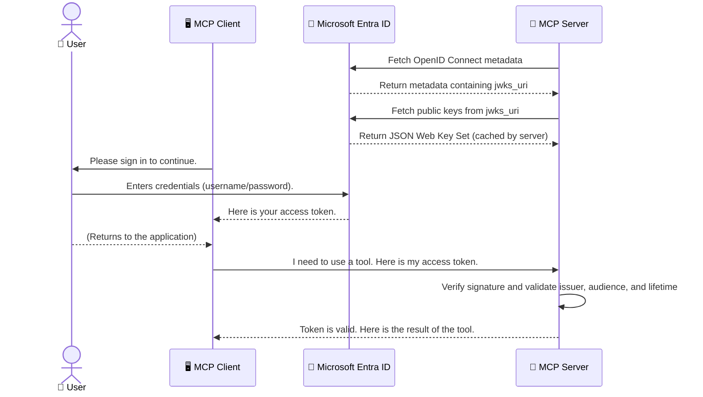

# AI-workflows beveiligen: Entra ID-authenticatie voor Model Context Protocol-servers

> [!NOTE]
> De code voor de externe server in deze les beschermt legacy `/sse` en `/message`
> eindpunten en richt zich op MCP `2025-11-25`. Houd de identiteit en token-validatiepraktijken aan,
> maar gebruik een `2026-07-28`-compatibele Streamable HTTP-transport voor nieuwe
> implementaties.

## Inleiding
Het beveiligen van je Model Context Protocol (MCP)-server is net zo belangrijk als het op slot doen van de voordeur van je huis. Als je je MCP-server onbeveiligd laat, stel je je tools en gegevens bloot aan onbevoegde toegang, wat kan leiden tot beveiligingsinbreuken. Microsoft Entra ID biedt een robuuste cloudgebaseerde identiteits- en toegangsbeheeroplossing, waarmee wordt gegarandeerd dat alleen geautoriseerde gebruikers en applicaties met je MCP-server kunnen interageren. In deze sectie leer je hoe je je AI-workflows beschermt met behulp van Entra ID-authenticatie.

## Leerdoelen
Aan het einde van deze sectie kun je:

- Het belang van het beveiligen van MCP-servers begrijpen.
- De basis van Microsoft Entra ID en OAuth 2.0-authenticatie uitleggen.
- Het verschil tussen publieke en vertrouwelijke clients herkennen.
- Entra ID-authenticatie implementeren in zowel lokale (publieke client) als externe (vertrouwelijke client) MCP-server scenario's.
- Beveiligingsbest practices toepassen bij het ontwikkelen van AI-workflows.

## Beveiliging en MCP

Net zoals je de voordeur van je huis niet ontgrendeld zou laten, moet je ook je MCP-server niet openlaten voor iedereen. Het beveiligen van je AI-workflows is essentieel om robuuste, betrouwbare en veilige applicaties te bouwen. Dit hoofdstuk introduceert het gebruik van Microsoft Entra ID om je MCP-servers te beveiligen, zodat alleen geautoriseerde gebruikers en applicaties met je tools en gegevens kunnen interageren.

## Waarom beveiliging belangrijk is voor MCP-servers

Stel je voor dat je MCP-server een tool heeft die e-mails kan verzenden of toegang heeft tot een klantenbestand. Een onbeveiligde server zou betekenen dat iedereen die tool kan gebruiken, wat leidt tot onbevoegde gegevensinzicht, spam of andere kwaadwillige activiteiten.

Door authenticatie te implementeren, zorg je ervoor dat elk verzoek aan je server wordt geverifieerd en wordt bevestigd wie de gebruiker of applicatie is die het verzoek doet. Dit is de eerste en belangrijkste stap om je AI-workflows te beveiligen.

## Introductie tot Microsoft Entra ID

[**Microsoft Entra ID**](https://adoption.microsoft.com/microsoft-security/entra/) is een cloudgebaseerde identiteits- en toegangsbeheerdienst. Zie het als een universele beveiligingsbeveiliger voor je applicaties. Het beheert het complexe proces van het verifiëren van gebruikersidentiteiten (authenticatie) en het bepalen wat ze mogen doen (autorisatie).

Met Entra ID kun je:

- Veilige aanmelding voor gebruikers mogelijk maken.
- API's en services beschermen.
- Toegangsbeleid centraal beheren.

Voor MCP-servers biedt Entra ID een robuuste en algemeen vertrouwde oplossing om te regelen wie toegang heeft tot de functionaliteiten van je server.

---

## Het mysterie begrijpen: hoe Entra ID-authenticatie werkt

Entra ID gebruikt open standaarden zoals **OAuth 2.0** voor de authenticatie. Hoewel de details complex kunnen zijn, is het kernconcept eenvoudig en kan het worden begrepen met een analogie.

### Een zachte introductie tot OAuth 2.0: de valet key

Zie OAuth 2.0 als een valet-service voor je auto. Wanneer je bij een restaurant aankomt, geef je de valet niet je hoofdsleutel. In plaats daarvan geef je een **valet key** met beperkte rechten — deze kan de auto starten en de deuren vergrendelen, maar kan de kofferbak of het handschoenenkastje niet openmaken.

In deze analogie:

- **Jij** bent de **Gebruiker**.
- **Je auto** is de **MCP-server** met waardevolle tools en gegevens.
- De **Valet** is **Microsoft Entra ID**.
- De **parkeerwachter** is de **MCP-client** (de applicatie die probeert toegang te krijgen tot de server).
- De **valet key** is het **toegangstoken**.

Het toegangstoken is een veilige tekststring die de MCP-client ontvangt van Entra ID nadat jij bent ingelogd. De client presenteert dan dit token aan de MCP-server bij elk verzoek. De server kan het token verifiëren om te bevestigen dat het verzoek legitiem is en dat de client de benodigde rechten heeft, allemaal zonder jouw daadwerkelijke inloggegevens (zoals je wachtwoord) te hoeven verwerken.

### De authenticatiestroom

Zo werkt het proces in de praktijk:



De MCP-server roept Entra ID niet aan om elk toegangstoken te valideren. Het
verifieert cryptografisch de JWT-handtekening met Entra ID's gecachte publieke sleutel
en valideert de claims van het token, waaronder de uitgever, doelgroep en levensduur.
De server leest `jwks_uri` uit de OpenID Connect-metadata, haalt de publieke
sleutels op van die URI en vernieuwt deze periodiek om sleutelrotatie te ondersteunen. Gebruik
een ondersteunde tokenvalidatiebibliotheek in plaats van deze logica zelf te implementeren.
Voor details, zie
[Tokens valideren in het Microsoft identity platform](https://learn.microsoft.com/entra/identity-platform/access-tokens#validate-tokens).

### Introductie tot de Microsoft Authentication Library (MSAL)

Voordat we de code induiken, is het belangrijk om een kerncomponent te introduceren die je in de voorbeelden zult zien: de **Microsoft Authentication Library (MSAL)**.

MSAL is een bibliotheek ontwikkeld door Microsoft die het voor ontwikkelaars veel gemakkelijker maakt om authenticatie te regelen. In plaats van zelf al de complexe code te schrijven om beveiligingstokens te beheren, aanmeldingen te beheren en sessies te vernieuwen, neemt MSAL dat zware werk uit handen.

Het gebruik van een bibliotheek zoals MSAL wordt sterk aanbevolen omdat:

- **Het is veilig:** Het implementeert industriestandaard protocollen en beveiligingsbest practices, wat het risico op kwetsbaarheden in jouw code vermindert.
- **Het vereenvoudigt ontwikkeling:** Het maakt de complexiteit van de OAuth 2.0- en OpenID Connect-protocollen onzichtbaar, zodat je robuuste authenticatie aan je applicatie kunt toevoegen met slechts een paar regels code.
- **Het wordt onderhouden:** Microsoft onderhoudt en werkt MSAL actief bij om nieuwe beveiligingsbedreigingen en platformwijzigingen aan te pakken.

MSAL ondersteunt een breed scala aan talen en applicatiekaders, waaronder .NET, JavaScript/TypeScript, Python, Java, Go en mobiele platforms zoals iOS en Android. Dat betekent dat je dezelfde consistente authenticatiepatronen kunt gebruiken in je hele technologiestack.

Meer informatie over MSAL vind je in de officiële [MSAL overzichtdocumentatie](https://learn.microsoft.com/entra/identity-platform/msal-overview).

---

## Je MCP-server beveiligen met Entra ID: een stapsgewijze handleiding

Laten we nu bekijken hoe je een lokale MCP-server (die communiceert via `stdio`) kunt beveiligen met Entra ID. Dit voorbeeld gebruikt een **publieke client**, geschikt voor applicaties die draaien op de machine van een gebruiker, zoals een desktop-app of een lokale ontwikkelserver.

### Scenario 1: Het beveiligen van een lokale MCP-server (met een publieke client)

In dit scenario bekijken we een MCP-server die lokaal draait, communiceert via `stdio`, en Entra ID gebruikt om de gebruiker te authenticeren voordat toegang tot de tools wordt toegestaan. De server beschikt over een enkele tool die profielinformatie van de gebruiker ophaalt via de Microsoft Graph API.

#### 1. De applicatie instellen in Entra ID

Voordat je code schrijft, moet je je applicatie registreren in Microsoft Entra ID. Dit meldt je applicatie aan Entra ID en geeft toestemming om de authenticatiedienst te gebruiken.

1. Ga naar het **[Microsoft Entra-portaal](https://entra.microsoft.com/)**.
2. Ga naar **App-registraties** en klik op **Nieuwe registratie**.
3. Geef je applicatie een naam (bijv. "Mijn lokale MCP-server").
4. Kies bij **Ondersteunde accounttypen** voor **Accounts in deze organisatorische directory alleen**.
5. Je kunt de **Redirect URI** voor dit voorbeeld leeg laten.
6. Klik op **Registreren**.

Zodra geregistreerd, noteer je de **Applicatie (client) ID** en de **Directory (tenant) ID**. Je hebt deze nodig in je code.

#### 2. De code: een overzicht

Laten we kijken naar de belangrijkste onderdelen van de code die de authenticatie afhandelen. De volledige code voor dit voorbeeld is beschikbaar in de map [Entra ID - Local - WAM](https://github.com/Azure-Samples/mcp-auth-servers/tree/main/src/entra-id-local-wam) van de [mcp-auth-servers GitHub-repository](https://github.com/Azure-Samples/mcp-auth-servers).

**`AuthenticationService.cs`**

Deze klasse is verantwoordelijk voor de interactie met Entra ID.

- **`CreateAsync`**: Deze methode initialiseert de `PublicClientApplication` van de MSAL (Microsoft Authentication Library). Deze is geconfigureerd met de `clientId` en `tenantId` van je applicatie.
- **`WithBroker`**: Hiermee kan gebruik worden gemaakt van een broker (zoals de Windows Web Account Manager), wat zorgt voor een veiligere en naadloze single sign-on-ervaring.
- **`AcquireTokenAsync`**: Dit is de kernmethode. Die probeert eerst geruisloos een token te verkrijgen (de gebruiker hoeft in dat geval niet opnieuw in te loggen als er al een geldige sessie is). Als een geruisloos token niet mogelijk is, wordt de gebruiker gevraagd zich interactief aan te melden.

```csharp
// Simplified for clarity
public static async Task<AuthenticationService> CreateAsync(ILogger<AuthenticationService> logger)
{
    var msalClient = PublicClientApplicationBuilder
        .Create(_clientId) // Your Application (client) ID
        .WithAuthority(AadAuthorityAudience.AzureAdMyOrg)
        .WithTenantId(_tenantId) // Your Directory (tenant) ID
        .WithBroker(new BrokerOptions(BrokerOptions.OperatingSystems.Windows))
        .Build();

    // ... cache registration ...

    return new AuthenticationService(logger, msalClient);
}

public async Task<string> AcquireTokenAsync()
{
    try
    {
        // Try silent authentication first
        var accounts = await _msalClient.GetAccountsAsync();
        var account = accounts.FirstOrDefault();

        AuthenticationResult? result = null;

        if (account != null)
        {
            result = await _msalClient.AcquireTokenSilent(_scopes, account).ExecuteAsync();
        }
        else
        {
            // If no account, or silent fails, go interactive
            result = await _msalClient.AcquireTokenInteractive(_scopes).ExecuteAsync();
        }

        return result.AccessToken;
    }
    catch (Exception ex)
    {
        _logger.LogError(ex, "An error occurred while acquiring the token.");
        throw; // Optionally rethrow the exception for higher-level handling
    }
}
```

**`Program.cs`**

Hier wordt de MCP-server opgezet en de authenticatiedienst geïntegreerd.

- **`AddSingleton<AuthenticationService>`**: Dit registreert de `AuthenticationService` in de dependency injection-container, zodat deze door andere delen van de applicatie kan worden gebruikt (zoals onze tool).
- **`GetUserDetailsFromGraph` tool**: Deze tool heeft een instantie van `AuthenticationService` nodig. Voordat hij iets doet, roept hij `authService.AcquireTokenAsync()` aan om een geldig toegangstoken te krijgen. Als de authenticatie slaagt, gebruikt hij het token om de Microsoft Graph API aan te roepen en de gegevens van de gebruiker op te halen.

```csharp
// Simplified for clarity
[McpServerTool(Name = "GetUserDetailsFromGraph")]
public static async Task<string> GetUserDetailsFromGraph(
    AuthenticationService authService)
{
    try
    {
        // This will trigger the authentication flow
        var accessToken = await authService.AcquireTokenAsync();

        // Use the token to create a GraphServiceClient
        var graphClient = new GraphServiceClient(
            new BaseBearerTokenAuthenticationProvider(new TokenProvider(authService)));

        var user = await graphClient.Me.GetAsync();

        return System.Text.Json.JsonSerializer.Serialize(user);
    }
    catch (Exception ex)
    {
        return $"Error: {ex.Message}";
    }
}
```

#### 3. Hoe het samenwerkt

1. Wanneer de MCP-client probeert de `GetUserDetailsFromGraph` tool te gebruiken, roept de tool eerst `AcquireTokenAsync` aan.
2. `AcquireTokenAsync` zorgt ervoor dat de MSAL-bibliotheek controleert op een geldig token.
3. Als er geen token wordt gevonden, zal MSAL, via de broker, de gebruiker vragen zich aan te melden met zijn Entra ID-account.
4. Zodra de gebruiker is aangemeld, geeft Entra ID een toegangstoken uit.
5. De tool ontvangt het token en gebruikt het om een beveiligde oproep te doen naar de Microsoft Graph API.
6. De gegevens van de gebruiker worden teruggegeven aan de MCP-client.

Dit proces zorgt ervoor dat alleen geauthenticeerde gebruikers de tool kunnen gebruiken, waardoor je lokale MCP-server effectief beveiligd is.

### Scenario 2: Het beveiligen van een externe MCP-server (met een vertrouwelijke client)

Wanneer je MCP-server draait op een externe machine (zoals een cloudserver) en communiceert via een protocol als HTTP Streaming, zijn de beveiligingseisen anders. In dit geval moet je een **vertrouwelijke client** en de **Authorization Code Flow** gebruiken. Dit is een veiliger methode omdat de geheimen van de applicatie nooit aan de browser worden blootgesteld.

Dit voorbeeld gebruikt een TypeScript-gebaseerde MCP-server die Express.js gebruikt om HTTP-verzoeken af te handelen.

#### 1. De applicatie instellen in Entra ID

De setup in Entra ID lijkt op die van de publieke client, maar met één belangrijk verschil: je moet een **client secret** aanmaken.

1. Ga naar het **[Microsoft Entra-portaal](https://entra.microsoft.com/)**.
2. Ga in je app-registratie naar het tabblad **Certificates & secrets**.
3. Klik op **New client secret**, geef een omschrijving en klik op **Toevoegen**.
4. **Belangrijk:** Kopieer meteen de waarde van het geheim. Je kunt deze niet opnieuw zien.
5. Je moet ook een **Redirect URI** configureren. Ga naar het tabblad **Authentication**, klik op **Add a platform**, selecteer **Web** en voer de redirect URI van je applicatie in (bijv. `http://localhost:3001/auth/callback`).

> **⚠️ Belangrijke beveiligingsopmerking:** Voor productieapplicaties raadt Microsoft sterk aan om **secretless authenticatie**-methoden te gebruiken zoals **Managed Identity** of **Workload Identity Federation** in plaats van client secrets. Client secrets vormen beveiligingsrisico's omdat ze blootgesteld of gecompromitteerd kunnen worden. Managed identities bieden een veiliger aanpak door het elimineren van de noodzaak om referenties op te slaan in je code of configuratie.
>
> Voor meer informatie over managed identities en hoe je ze implementeert, zie het [Overzicht van Managed identities voor Azure-resources](https://learn.microsoft.com/entra/identity/managed-identities-azure-resources/overview).

#### 2. De code: een overzicht

Dit voorbeeld gebruikt een sessie-gebaseerde aanpak. Wanneer de gebruiker zich authenticeren, slaat de server het toegangstoken en het verversingstoken op in een sessie en geeft de gebruiker een sessietoken. Dit sessietoken wordt dan gebruikt voor volgende verzoeken. De volledige code voor dit voorbeeld is beschikbaar in de map [Entra ID - Confidential client](https://github.com/Azure-Samples/mcp-auth-servers/tree/main/src/entra-id-cca-session) van de [mcp-auth-servers GitHub-repository](https://github.com/Azure-Samples/mcp-auth-servers).

**`Server.ts`**

Dit bestand zet de Express-server en de MCP-transpoortlaag op.

- **`requireBearerAuth`**: Dit is middleware die de `/sse` en `/message` eindpunten beschermt. Het controleert op een geldig bearer-token in de `Authorization`-header van het verzoek.
- **`EntraIdServerAuthProvider`**: Dit is een aangepaste klasse die de `McpServerAuthorizationProvider` interface implementeert. Het beheert de OAuth 2.0-flow.
- **`/auth/callback`**: Dit eindpunt handelt de redirect af vanuit Entra ID nadat de gebruiker zich heeft geauthenticeerd. Het wisselt de autorisatiecode in voor een toegangstoken en verversingstoken.

```typescript
// Simplified for clarity
const app = express();
const { server } = createServer();
const provider = new EntraIdServerAuthProvider();

// Protect the SSE endpoint
app.get("/sse", requireBearerAuth({
  provider,
  requiredScopes: ["User.Read"]
}), async (req, res) => {
  // ... connect to the transport ...
});

// Protect the message endpoint
app.post("/message", requireBearerAuth({
  provider,
  requiredScopes: ["User.Read"]
}), async (req, res) => {
  // ... handle the message ...
});

// Handle the OAuth 2.0 callback
app.get("/auth/callback", (req, res) => {
  provider.handleCallback(req.query.code, req.query.state)
    .then(result => {
      // ... handle success or failure ...
    });
});
```

**`Tools.ts`**

Dit bestand definieert de tools die de MCP-server biedt. De `getUserDetails` tool is vergelijkbaar met die in het vorige voorbeeld, maar haalt het toegangstoken uit de sessie.

```typescript
// Simplified for clarity
server.setRequestHandler(CallToolRequestSchema, async (request) => {
  const { name } = request.params;
  const context = request.params?.context as { token?: string } | undefined;
  const sessionToken = context?.token;

  if (name === ToolName.GET_USER_DETAILS) {
    if (!sessionToken) {
      throw new AuthenticationError("Authentication token is missing or invalid. Ensure the token is provided in the request context.");
    }

    // Get the Entra ID token from the session store
    const tokenData = tokenStore.getToken(sessionToken);
    const entraIdToken = tokenData.accessToken;

    const graphClient = Client.init({
      authProvider: (done) => {
        done(null, entraIdToken);
      }
    });

    const user = await graphClient.api('/me').get();

    // ... return user details ...
  }
});
```

**`auth/EntraIdServerAuthProvider.ts`**

Deze klasse behandelt de logica voor:

- Het omleiden van de gebruiker naar de Entra ID-aanmeldpagina.
- Het inwisselen van de autorisatiecode voor een toegangstoken.
- Het opslaan van de tokens in de `tokenStore`.
- Het vernieuwen van het toegangstoken wanneer het verloopt.

#### 3. Hoe het allemaal samenwerkt

1. Wanneer een gebruiker voor het eerst probeert verbinding te maken met de MCP-server, ziet de `requireBearerAuth` middleware dat ze geen geldige sessie hebben en wordt de gebruiker omgeleid naar de Entra ID-aanmeldpagina.
2. De gebruiker meldt zich aan met zijn Entra ID-account.
3. Entra ID leidt de gebruiker terug naar de `/auth/callback` endpoint met een autorisatiecode.
4. De server wisselt de code in voor een toegangstoken en een verversingstoken, slaat deze op en creëert een sessietoken dat naar de client wordt gestuurd.
5. De client kan dit sessietoken nu gebruiken in de `Authorization` header voor alle toekomstige verzoeken naar de MCP-server.
6. Wanneer de `getUserDetails` tool wordt aangeroepen, gebruikt deze het sessietoken om het Entra ID-toegangstoken op te zoeken en gebruikt dat vervolgens voor het aanroepen van de Microsoft Graph API.

Deze flow is complexer dan de public client flow, maar is vereist voor endpoints die internet-facing zijn. Aangezien externe MCP-servers toegankelijk zijn via het openbare internet, hebben ze sterkere beveiligingsmaatregelen nodig om ongeautoriseerde toegang en mogelijke aanvallen te voorkomen.


## Beveiligingsbest practices

- **Gebruik altijd HTTPS**: Versleutel de communicatie tussen client en server om tokens te beschermen tegen onderschepping.
- **Implementeer Role-Based Access Control (RBAC)**: Controleer niet alleen *of* een gebruiker is geverifieerd; controleer ook *wat* ze mogen doen. Je kunt rollen definiëren in Entra ID en deze controleren in je MCP-server.
- **Monitor en audit**: Log alle authenticatiegebeurtenissen zodat je verdachte activiteiten kunt detecteren en erop reageren.
- **Ga om met rate limiting en throttling**: Microsoft Graph en andere API’s implementeren rate limiting om misbruik te voorkomen. Implementeer exponential backoff en retry-logica in je MCP-server om netjes om te gaan met HTTP 429 (Too Many Requests) responses. Overweeg caching van vaak opgevraagde data om API-aanroepen te verminderen.
- **Beveilig veilige tokenopslag**: Sla toegangstokens en verversingstokens veilig op. Voor lokale applicaties gebruik de beveiligde opslagmechanismen van het systeem. Voor serverapplicaties overweeg het gebruik van versleutelde opslag of beveiligde sleutelbeheerdiensten zoals Azure Key Vault.
- **Tokenvervalafhandeling**: Toegangstokens hebben een beperkte levensduur. Implementeer automatische tokenvernieuwing met verversingtokens om een naadloze gebruikerservaring te behouden zonder dat herauthenticatie nodig is.
- **Overweeg het gebruik van Azure API Management**: Hoewel het implementeren van beveiliging direct in je MCP-server fijne controle geeft, kunnen API-gateways zoals Azure API Management veel van deze beveiligingsproblemen automatisch afhandelen, inclusief authenticatie, autorisatie, rate limiting en monitoring. Ze bieden een gecentraliseerde beveiligingslaag tussen uw clients en MCP-servers. Voor meer details over het gebruik van API-gateways met MCP, zie onze [Azure API Management Your Auth Gateway For MCP Servers](https://techcommunity.microsoft.com/blog/integrationsonazureblog/azure-api-management-your-auth-gateway-for-mcp-servers/4402690).


## Belangrijke aandachtspunten

- Het beveiligen van je MCP-server is cruciaal voor het beschermen van je data en tools.
- Microsoft Entra ID biedt een robuuste en schaalbare oplossing voor authenticatie en autorisatie.
- Gebruik een **public client** voor lokale applicaties en een **confidential client** voor externe servers.
- De **Authorization Code Flow** is de veiligste optie voor webapplicaties.


## Oefening

1. Denk aan een MCP-server die je zou kunnen bouwen. Zou dat een lokale server zijn of een externe server?
2. Op basis van jouw antwoord, zou je dan een public client of confidential client gebruiken?
3. Welke machtiging zou jouw MCP-server aanvragen om acties uit te voeren tegen Microsoft Graph?


## Praktijkoefeningen

### Oefening 1: Registreer een Applicatie in Entra ID
Navigeer naar de Microsoft Entra-portal.
Registreer een nieuwe applicatie voor jouw MCP-server.
Noteer de Application (client) ID en Directory (tenant) ID.

### Oefening 2: Beveilig een Lokale MCP-server (Public Client)
- Volg het codevoorbeeld om MSAL (Microsoft Authentication Library) te integreren voor gebruikersauthenticatie.
- Test de authenticatieflow door de MCP-tool aan te roepen die gebruikersgegevens van Microsoft Graph ophaalt.

### Oefening 3: Beveilig een Externe MCP-server (Confidential Client)
- Registreer een confidential client in Entra ID en maak een clientgeheim aan.
- Configureer je Express.js MCP-server om de Authorization Code Flow te gebruiken.
- Test de beveiligde endpoints en bevestig toegang met tokens.

### Oefening 4: Pas Beveiligingsbest practices toe
- Schakel HTTPS in voor je lokale of externe server.
- Implementeer role-based access control (RBAC) in je serverlogica.
- Voeg afhandeling van tokenverval en veilige tokenopslag toe.

## Bronnen

1. **MSAL Overzicht Documentatie**  
   Leer hoe de Microsoft Authentication Library (MSAL) veilige tokenverwerving over platforms mogelijk maakt:  
   [MSAL Overview on Microsoft Learn](https://learn.microsoft.com/en-gb/entra/msal/overview)

2. **Azure-Samples/mcp-auth-servers GitHub Repository**  
   Referentie-implementaties van MCP-servers die authenticatieflows demonstreren:  
   [Azure-Samples/mcp-auth-servers on GitHub](https://github.com/Azure-Samples/mcp-auth-servers)

3. **Managed Identities voor Azure Resources Overzicht**  
   Begrijp hoe je geheime gegevens elimineert door systeem- of gebruiker-toegewezen managed identities te gebruiken:  
   [Managed Identities Overview on Microsoft Learn](https://learn.microsoft.com/en-us/entra/identity/managed-identities-azure-resources/)

4. **Azure API Management: Je Auth Gateway voor MCP-servers**  
   Een diepgaande uitleg over het gebruik van APIM als een veilige OAuth2-gateway voor MCP-servers:  
   [Azure API Management Your Auth Gateway For MCP Servers](https://techcommunity.microsoft.com/blog/integrationsonazureblog/azure-api-management-your-auth-gateway-for-mcp-servers/4402690)

5. **Microsoft Graph Machtigingen Referentie**  
   Uitgebreide lijst van gedelegeerde en applicatiemachtigingen voor Microsoft Graph:  
   [Microsoft Graph Permissions Reference](https://learn.microsoft.com/zh-tw/graph/permissions-reference)


## Leerresultaten
Na het voltooien van deze sectie zal je in staat zijn om:

- Uit te leggen waarom authenticatie cruciaal is voor MCP-servers en AI-workflows.
- Entra ID-authenticatie op te zetten en te configureren voor zowel lokale als externe MCP-serverscenario’s.
- Het juiste clienttype te kiezen (public of confidential) op basis van de implementatie van je server.
- Veilige programmeerpraktijken toe te passen, inclusief tokenopslag en rolgebaseerde autorisatie.
- Met vertrouwen je MCP-server en tools te beschermen tegen ongeautoriseerde toegang.

## Wat is de volgende stap

- [5.13 Model Context Protocol (MCP) Integratie met Microsoft Foundry](../mcp-foundry-agent-integration/README.md)

---

<!-- CO-OP TRANSLATOR DISCLAIMER START -->
**Disclaimer**:
Dit document is vertaald met behulp van de AI vertaaldienst [Co-op Translator](https://github.com/Azure/co-op-translator). Hoewel we streven naar nauwkeurigheid, dient u er rekening mee te houden dat geautomatiseerde vertalingen fouten of onnauwkeurigheden kunnen bevatten. Het originele document in de oorspronkelijke taal moet worden beschouwd als de gezaghebbende bron. Voor kritieke informatie wordt professionele menselijke vertaling aanbevolen. Wij zijn niet aansprakelijk voor eventuele misverstanden of verkeerde interpretaties die voortvloeien uit het gebruik van deze vertaling.
<!-- CO-OP TRANSLATOR DISCLAIMER END -->