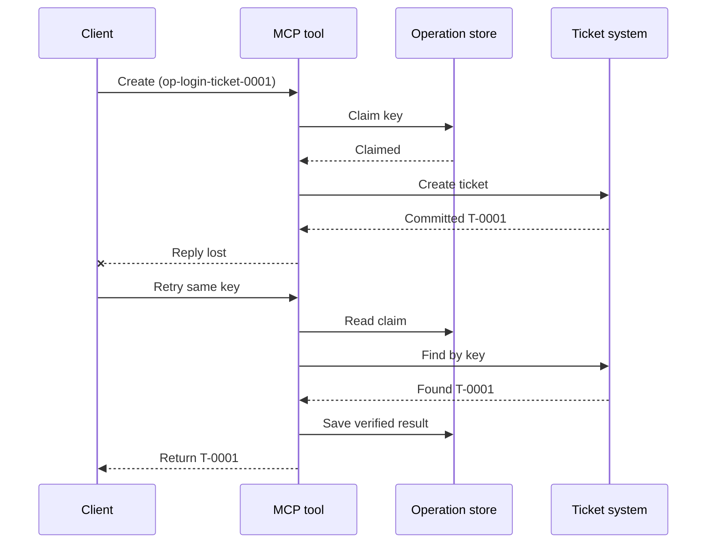
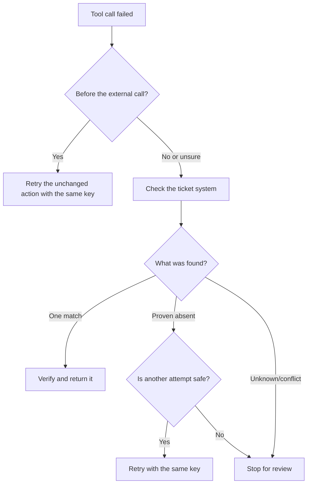

# Veilige retries voor MCP-tools: een betrouwbaarheid-sidecarpatroon

Een ontbrekend antwoord betekent niet dat de actie ontbreekt. Een support-ticket tool
kan ticket `T-0001` aanmaken en vervolgens de verbinding verliezen voordat de client het
resultaat ziet. Als de client blindelings opnieuw probeert, kan het `T-0002` creëren.

Deze les laat zien hoe je die onzekere uitkomst herkent, één stabiele
identiteit voor de bedoelde actie behoudt, en het ticketsysteem controleert voordat je opnieuw probeert.
De bijbehorende Python-oefening draait lokaal met de standaardbibliotheek
en SQLite.

## Waarom een timeout betekent "uitkomst onbekend"

Stel dat de client `create_support_ticket` aanroept met operatie-sleutel
`op-login-ticket-0001`:



De verbinding faalt nadat het ticket is vastgelegd maar voordat het resultaat aankomt.
De client weet alleen dat het antwoord ontbreekt. Het weet niet of het
ticket ontbreekt. Het hergebruiken van de operatie-sleutel laat de tool vinden en teruggeven
`T-0001` in plaats van een `T-0002` te creëren.

## Wat een betrouwbaarheid-sidecar doet

Een betrouwbaarheid-sidecar is applicatiecode die herstelstatus rond een
tool bewaart. Het kan een bibliotheek, middleware, een database-ondersteunde service zijn, of simpelweg
een onderdeel van de tool-implementatie. Het hoeft geen apart proces te zijn,
en het is geen MCP-protocolfunctie.

De sidecar heeft vier taken:

1. bewaar de bedoelde actie voordat het externe systeem wordt aangeroepen;
2. laat slechts één worker die actie claimen;
3. onthoud voldoende status om te herstellen na een crash; en
4. controleer het externe systeem wanneer de uitkomst onzeker is.

Deze les richt zich op de laatste MCP-specificatie `2026-07-28`. MCP heeft geen
protocolniveau-sessie, dus de operatie-sleutel is een gewone tool-parameter
die wordt ondersteund door duurzame applicatiestatus. Hetzelfde patroon werkt ook met eerdere
MCP-versies.

## Vier ID’s die verschillende problemen oplossen

Deze identificatoren zijn gerelateerd, maar niet uitwisselbaar:

| Identificatie | Waarvoor het identificeert | Overleeft een retry? |
| --- | --- | --- |
| JSON-RPC ID | Eén verzoek en antwoord | Nee; gebruik een nieuw verzoek-ID |
| MCP Task ID | Eén langlopende taak | Ja; houd het voor polling |
| Operatie-sleutel | Eén bedoelde actie | Ja; hergebruik voor die actie |
| Ticket ID | Het opgeslagen resultaat | Ja; geef het terug na verificatie |

Voortgangsnotificaties en trace context helpen je een verzoek te observeren.
Annulering vraagt het werk te stoppen. Geen van hen voorkomt een duplicaat-ticket.

## Bouw de beveiliging

Maak de operatie-sleutel aan vóór de eerste tool-aanroep en sla deze op met de
workflow. Elke poging om hetzelfde bedoelde ticket te maken, gebruikt dezelfde sleutel:

```json
{
  "operation_key": "op-login-ticket-0001",
  "title": "Cannot sign in"
}
```

Een ander bedoeld ticket krijgt een nieuwe sleutel. In productie genereer je een ondoorzichtige,
onraadpleegbare waarde in plaats van klantgegevens in de sleutel te plaatsen.

Hier is het volledige MCP-tool-schema dat in deze les wordt gebruikt:

```json
{
  "name": "create_support_ticket",
  "title": "Create support ticket",
  "description": "Creates or recovers one support ticket for an operation key.",
  "inputSchema": {
    "$schema": "https://json-schema.org/draft/2020-12/schema",
    "type": "object",
    "properties": {
      "operation_key": {
        "type": "string",
        "minLength": 16,
        "maxLength": 128,
        "description": "Stable key reused for the same intended action."
      },
      "title": {
        "type": "string",
        "minLength": 1,
        "maxLength": 200
      }
    },
    "required": ["operation_key", "title"],
    "additionalProperties": false
  },
  "outputSchema": {
    "$schema": "https://json-schema.org/draft/2020-12/schema",
    "type": "object",
    "properties": {
      "ticket_id": {
        "type": "string"
      },
      "operation_key": {
        "type": "string"
      },
      "status": {
        "type": "string",
        "const": "verified"
      }
    },
    "required": ["ticket_id", "operation_key", "status"],
    "additionalProperties": false
  }
}
```

De geauthenticeerde aanroeperidentiteit komt uit de servercontext, niet uit
model-geleverde tool-input. Scope elke opgeslagen operatie naar:

- die aanroeper, tenant of serviceaccount;
- de toolnaam en versie; en
- een hash van de genormaliseerde inputs die de externe actie definiëren.

De input-hash beantwoordt een simpele vraag: "Vraagt deze retry om hetzelfde
ticket?" Als de sleutel al bij een andere titel hoort, wijs dan de aanroep af.
Het teruggeven van een eerder resultaat bij gewijzigde input zou een contractfout verbergen.

Sla de claim op met één atomische databasebewerkingen. "Atomisch" betekent dat twee workers
niet beide een lege record kunnen zien en beide eigenaar kunnen worden. Een lokaal
lock is niet genoeg als een andere serverinstantie de retry kan ontvangen.

De workflow maakt de sleutel aan terwijl de actie `planned` is. Het voorbeeld
slaat dan deze statussen op:

- `claimed`: één worker heeft de operatie gereserveerd;
- `completed`: het ticketsysteem gaf een resultaat terug; en
- `verified`: een lezing van het ticketsysteem bevestigt het resultaat.

Een crash kan de opgeslagen status achterlaten op `claimed` zelfs nadat het ticket
is aangemaakt. Behandel elke niet-terminale claim als onzeker totdat extern bewijs
het bevestigt. Ga niet uit van `claimed` als "er is niets gebeurd."

## Herstel voordat je opnieuw probeert

Als een tool-aanroep faalt, bepaal wat bekend is voordat je een nieuwe externe
schrijfoperatie stuurt:



Validatie die faalt vóórdat de ticket-API wordt aangeroepen is een bekende fout.
Probeer een onveranderde actie opnieuw met dezelfde operatie-sleutel. Als het corrigeren van de input
het bedoelde ticket verandert, maak dan een nieuwe sleutel voor die nieuwe actie.

Als het verzoek mogelijk het ticketsysteem heeft bereikt, reconciliëer dat eerst.
Reconciëring betekent het vergelijken van de opgeslagen claim met het gezaghebbende ticket-
record. Geef het bestaande ticket terug wanneer precies één overeenkomende record wordt gevonden.
Probeer alleen opnieuw als het ticket ondubbelzinnig ontbreekt en het downstream contract
een nieuwe poging veilig maakt.

"Niet gevonden" is niet altijd definitief. Een provider met uiteindelijk consistente
zoekopdracht kan een begrensde wachttijd en een nieuwe controle nodig hebben. Als het systeem niet
doorzocht kan worden, tegenstrijdige resultaten geeft, of een volgende poging niet veilig
kan dedupliceren, stop dan en rapporteer `outcome unknown`. Stoppen hier wordt soms "fail closed" genoemd:
de workflow weigert te raden.

## Bewijs, taken en annulering

Een tool-antwoord zegt wat de tool meldde. Een opgeslagen checkpoint zegt wat de
workflow optekende. Het sterkst bewijs komt van het systeem dat eigenaar is van het
resultaat: voor dit voorbeeld, een lezing van het ticketsysteem die precies één
overeenkomend ticket vindt.

Pas het bewijs aan de risico's aan. Een providerbericht-ID kan genoeg zijn voor een
laag risico notificatie. Betalingen, uitrol en destructieve acties kunnen
providerstatus, grootboek of handmatig beoordelingsbewijs nodig hebben.

De MCP Tasks-extensie vult dit patroon aan voor langlopende werkzaamheden. Een Task
ID laat de client hervatten met pollen na een verbreking, maar het identificeert
of dedupliceert het ticket zelf niet. Wanneer Tasks gebruikt wordt, verbinden de identiteiten
zich als volgt:

```text
operation key -> Task ID -> ticket ID -> verification evidence
```

Annulering is cooperatief, geen rollback. Het ticket kan nog steeds worden aangemaakt
nadat annulering is erkend, dus een onzekere uitkomst heeft nog steeds
reconciliatie nodig.

## Voer de failure-injectie-oefening uit

Het voorbeeld gebruikt twee SQLite-bestanden: één voor de operatie-opslag en de
ander voor het externe ticketsysteem. Er is geen transactie die
beide bestanden overspant. De fout wordt geïnjecteerd nadat het ticket is vastgelegd maar voor de
sidecar de voltooiing registreert.

De directe Python-methode accepteert `caller_id` als vervanging voor geauthenticeerde
servercontext. Voeg `caller_id` niet toe aan het model-gestuurde MCP-input
schema.

Voorzie het resultaat voordat je de tests uitvoert:

| Pad | Resultaat na retry | Aantal tickets |
| --- | --- | --- |
| Blinde retry | Creëert `T-0002` nadat het antwoord voor `T-0001` verloren ging | 2 |
| Beveiligde retry | Vindt en geeft `T-0001` terug | 1 |

Voer uit:

```bash
cd 08-BestPractices/reliability-sidecars/python
python -m unittest discover -p "test_*.py" -v
```

De zes tests tonen aan dat:

1. een blinde retry een duplicaat creëert;
2. verlies van antwoord plus een herstart één ticket herstelt van een duurzame claim;
3. een geverifieerde retry het opgeslagen resultaat hergebruikt;
4. gewijzigde input of tegenstrijdig extern bewijs wordt afgewezen;
5. een bestaande claim zonder extern bewijs veilig stopt; en
6. gelijktijdige claims één eigenaar toelaten zonder terugval van een geverifieerd resultaat.

Open het voorbeeld:

- [Python-implementatie](../../../../08-BestPractices/reliability-sidecars/python/reliability_sidecar.py)
- [Deterministische tests](../../../../08-BestPractices/reliability-sidecars/python/test_reliability_sidecar.py)

Het voorbeeld laat bewust verlopen-claim leases weg. Een productietakeover-
beleid heeft een begrensde lease, atomische eigendomsoverdracht en een extra externe
controle nodig vóór uitvoering.

## Optionele community-implementatie

Agent Enhancer Utilities is een community-implementatie van dit
applicatieniveaupatroon. De planner kiest een herstelbenadering, terwijl het
checkpoint claim- en onzeker-resultaatstatussen optekent. De domeintool of MCP
server voert nog steeds de echte actie uit en verifieert deze. Deze service maakt geen deel uit
van de MCP-specificatie en is niet vereist voor deze les.

| Lesconcept | Agent Enhancer stuk | Belangrijke beperking |
| --- | --- | --- |
| Herstelplan | `workflow-guard-planner` | Roept de domeintool niet aan |
| Claim en herstel | `workflow-checkpoint` | `external_proof` blijft `false` |
| Exacte sidecar herhaling | `lab.invoke_tool` | Gebruikt een aparte idempotentiesleutel |
| Verifieer de echte actie | Bestemmingszoek-/teruglezing | Domein MCP is eigenaar |

Voor een exacte retry van één sidecar-aanroep accepteert `lab.invoke_tool` een buitenste
`idempotency_key`. Die sleutel identificeert de sidecar-aanroep; het is niet de
zakelijke `operation_key` gebruikt voor het ticket.

Het getagde openbare contract en een optioneel netwerkvoorbeeld zijn beschikbaar
hier:

- [Betrouwbaarheid Sidecar Contract v1](https://github.com/artiehinz/Agent-Enhancer-Utilities/blob/v1.6.0/docs/RELIABILITY_SIDECAR_CONTRACT_V1.md)
- [Planner en mock-domein voorbeeld](https://github.com/artiehinz/Agent-Enhancer-Utilities/tree/v1.6.0/examples/reliability-sidecar)

Deze koppelingen illustreren het applicatiepatroon. Ze beweren niet dat de
gehoste service zich houdt aan MCP `2026-07-28`, en checkpointstatus telt nooit
als extern bewijs van het ticket.

## Productie-checklist

- [ ] Maak en sla de operatie-sleutel op vóór de eerste externe poging.
- [ ] Koppel de sleutel aan aanroeper, toolversie en genormaliseerde input-hash.
- [ ] Wijs gewijzigde input onder een bestaande sleutel af.
- [ ] Sta één eigenaar toe met een atomische gedeelde opslagbewerking.
- [ ] Stuur de sleutel door naar de downstream provider als die idempotentie ondersteunt.
- [ ] Reconcileer onzekere uitkomsten vóór een nieuwe schrijfoperatie.
- [ ] Bewaar geverifieerde resultaten en bewijs gedurende het volledige retry-venster.
- [ ] Stop voor controle als de externe uitkomst niet veilig kan worden vastgesteld.

## Referenties

- [MCP-specificatie `2026-07-28`](https://modelcontextprotocol.io/specification/2026-07-28)
- [MCP `2026-07-28` toolrichtlijnen](https://modelcontextprotocol.io/specification/2026-07-28/server/tools)
- [MCP Tasks-extensie](https://modelcontextprotocol.io/extensions/tasks/overview)
- [JSON-RPC 2.0-specificatie](https://www.jsonrpc.org/specification)

---

<!-- CO-OP TRANSLATOR DISCLAIMER START -->
**Disclaimer**:
Dit document is vertaald met behulp van de AI vertaaldienst [Co-op Translator](https://github.com/Azure/co-op-translator). Hoewel we streven naar nauwkeurigheid, dient u er rekening mee te houden dat geautomatiseerde vertalingen fouten of onnauwkeurigheden kunnen bevatten. Het originele document in de oorspronkelijke taal moet worden beschouwd als de gezaghebbende bron. Voor kritieke informatie wordt professionele menselijke vertaling aanbevolen. Wij zijn niet aansprakelijk voor eventuele misverstanden of verkeerde interpretaties die voortvloeien uit het gebruik van deze vertaling.
<!-- CO-OP TRANSLATOR DISCLAIMER END -->