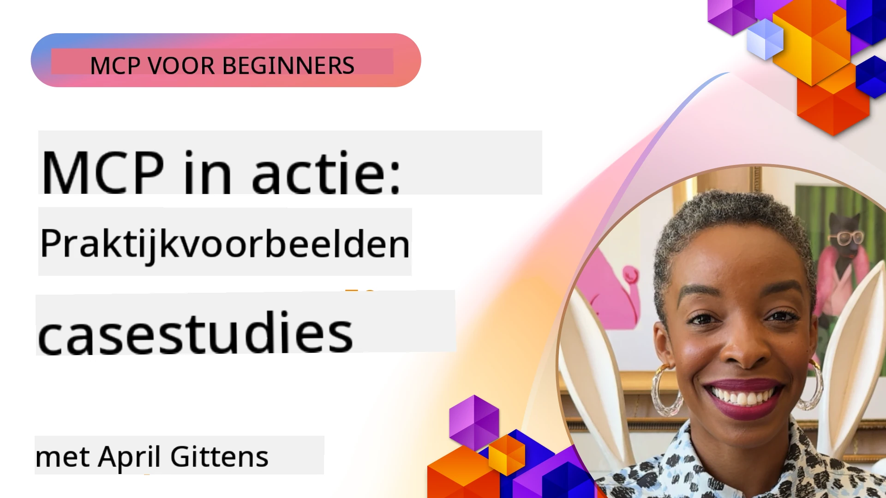

# MCP in Actie: Praktijkstudies uit de echte wereld

_(Klik op de afbeelding hierboven om de video van deze les te bekijken)_

Het Model Context Protocol (MCP) transformeert hoe AI-toepassingen omgaan met data, tools en diensten. Dit gedeelte presenteert praktijkstudies uit de echte wereld die aantonen hoe MCP in diverse bedrijfsomgevingen praktisch wordt toegepast.

## Overzicht

Dit gedeelte toont concrete voorbeelden van MCP-implementaties en benadrukt hoe organisaties dit protocol gebruiken om complexe zakelijke uitdagingen op te lossen. Door deze praktijkstudies te bestuderen, krijg je inzicht in de veelzijdigheid, schaalbaarheid en praktische voordelen van MCP in realistische scenario's.

## Belangrijkste Leerdoelen

Door deze praktijkstudies te verkennen, zul je:

- Begrijpen hoe MCP kan worden toegepast om specifieke zakelijke problemen op te lossen
- Leren over verschillende integratiepatronen en architecturale benaderingen
- Herkennen van best practices voor het implementeren van MCP in bedrijfsomgevingen
- Inzicht krijgen in de uitdagingen en oplossingen die zich voordoen bij implementaties in de praktijk
- Mogelijkheden identificeren om soortgelijke patronen in je eigen projecten toe te passen

## Uitgelichte Praktijkstudies

### 1. [Azure AI Reisagenten – Referentie-implementatie](./travelagentsample.md)

Deze praktijkstudie onderzoekt de uitgebreide referentieoplossing van Microsoft die laat zien hoe je een multi-agent, AI-gestuurde reisplanningsapplicatie bouwt met MCP, Azure OpenAI en Azure AI Search. Het project laat zien:

- Multi-agent orkestratie via MCP
- Integratie van bedrijfsdata met Azure AI Search
- Veilige, schaalbare architectuur met Azure-diensten
- Uitbreidbare tooling met herbruikbare MCP-componenten
- Gespreksgerichte gebruikerservaring aangedreven door Azure OpenAI

De architectuur- en implementatiedetails bieden waardevolle inzichten in het bouwen van complexe multi-agent systemen met MCP als de coördinatielaag.

### 2. [Azure DevOps Items bijwerken vanuit YouTube Data](./UpdateADOItemsFromYT.md)

Deze praktijkstudie toont een praktische toepassing van MCP voor het automatiseren van workflowprocessen. Het laat zien hoe MCP-tools kunnen worden gebruikt om:

- Data te extraheren van online platforms (YouTube)
- Werkitems bij te werken in Azure DevOps-systemen
- Herhaalbare automatiseringsworkflows te creëren
- Data te integreren over uiteenlopende systemen

Dit voorbeeld illustreert hoe zelfs relatief eenvoudige MCP-implementaties aanzienlijke efficiëntiewinst kunnen opleveren door routinetaken te automatiseren en de dataconsistentie tussen systemen te verbeteren.

### 3. [Realtime Documentatie Ophalen met MCP](./docs-mcp/README.md)

Deze praktijkstudie begeleidt je bij het verbinden van een Python-consoleclient met een Model Context Protocol (MCP) server om realtime, contextbewuste Microsoft-documentatie op te halen en te loggen. Je leert hoe je:

- Verbindt met een MCP-server met behulp van een Python-client en de officiële MCP SDK
- Streaming HTTP-clients gebruikt voor efficiënte, realtime gegevensverzameling
- Documentatietools op de server aanroept en reacties direct naar de console logt
- Actuele Microsoft-documentatie integreert in je workflow zonder de terminal te verlaten

Het hoofdstuk bevat een praktijkopdracht, een minimale werkende codevoorbeeld en links naar aanvullende bronnen voor diepere studie. Bekijk de volledige doorloop en code in het gekoppelde hoofdstuk om te begrijpen hoe MCP de toegang tot documentatie en de productiviteit van ontwikkelaars in console-gebaseerde omgevingen kan transformeren.

### 4. [Interactieve Studieplangenerator Webapp met MCP](./docs-mcp/README.md)

Deze praktijkstudie demonstreert hoe een interactieve webapplicatie te bouwen met Chainlit en het Model Context Protocol (MCP) om gepersonaliseerde studieplannen voor elk onderwerp te genereren. Gebruikers kunnen een onderwerp opgeven (zoals "AI-900 certificering") en een studieduur (bijv. 8 weken), en de app geeft een week-tot-week overzicht van aanbevolen inhoud. Chainlit maakt een gespreksinterface mogelijk, wat de ervaring boeiend en adaptief maakt.

- Gespreksgerichte webapp aangedreven door Chainlit
- Gebruikersgestuurde prompts voor onderwerp en duur
- Week-tot-week inhoudsaanbevelingen met MCP
- Realtime, adaptieve reacties in een chatinterface

Het project illustreert hoe conversatie-AI en MCP kunnen worden gecombineerd om dynamische, door gebruikers aangestuurde educatieve tools in een moderne webomgeving te creëren.

### 5. [Documentatie in de Editor met MCP Server in VS Code](./docs-mcp/README.md)

Deze praktijkstudie toont hoe je Microsoft Learn Docs rechtstreeks in je VS Code-omgeving kunt brengen met de MCP-server—geen gedoe meer met het wisselen van browsertabbladen! Je ziet hoe je:

- Direct kunt zoeken en documenten lezen binnen VS Code met het MCP-paneel of de opdrachtpalet
- Documentatie kunt raadplegen en links direct in je README- of cursusmarkdownbestanden kunt invoegen
- GitHub Copilot en MCP samen kunt gebruiken voor naadloze, AI-gedreven documentatie- en codeworkflows
- Je documentatie kunt valideren en verbeteren met realtime feedback en door Microsoft geleverde nauwkeurigheid
- MCP kunt integreren met GitHub-workflows voor continue documentatievalidatie

De implementatie omvat:

- Voorbeeldconfiguratie `.vscode/mcp.json` voor eenvoudige setup
- Doorloopt screenshots van de editor-ervaring
- Tips voor het combineren van Copilot en MCP voor maximale productiviteit

Dit scenario is ideaal voor cursusmakers, documentatieschrijvers en ontwikkelaars die zich willen concentreren in hun editor terwijl ze werken met documenten, Copilot en validatietools—allemaal aangedreven door MCP.

### 6. [APIM MCP Server Creatie](./apimsample.md)

Deze praktijkstudie geeft een stapsgewijze handleiding voor het aanmaken van een MCP-server met Azure API Management (APIM). Het behandelt:

- Het opzetten van een MCP-server in Azure API Management
- Het blootstellen van API-operaties als MCP-tools
- Het configureren van beleidsregels voor snelheidsbeperking en beveiliging
- Het testen van de MCP-server met Visual Studio Code en GitHub Copilot

Dit voorbeeld laat zien hoe je de mogelijkheden van Azure kunt benutten om een robuuste MCP-server te maken die in verschillende toepassingen gebruikt kan worden, ter verbetering van de integratie van AI-systemen met bedrijfs-API's.

### 7. [GitHub MCP Registry — Versnellen van Agentgebaseerde Integratie](https://github.com/mcp)

Deze praktijkstudie onderzoekt hoe het GitHub MCP Registry, gelanceerd in september 2025, een cruciale uitdaging in het AI-ecosysteem aanpakt: het gefragmenteerd ontdekken en implementeren van Model Context Protocol (MCP) servers.

#### Overzicht
Het **MCP Registry** lost het groeiende probleem van verspreide MCP-servers over repositories en registries op, wat eerder integratie traag en foutgevoelig maakte. Deze servers maken het mogelijk dat AI-agenten communiceren met externe systemen zoals API's, databases en documentatiebronnen.

#### Probleemstelling
Ontwikkelaars die agentgebaseerde workflows bouwen, stonden voor diverse uitdagingen:
- **Slechte vindbaarheid** van MCP-servers op verschillende platforms
- **Dubbele opzetvragen** verspreid over forums en documentatie
- **Beveiligingsrisico's** door niet-geverifieerde en niet-vertrouwde bronnen
- **Ontbreken van standaardisatie** in serverkwaliteit en compatibiliteit

#### Oplossingsarchitectuur
GitHub's MCP Registry centraliseert vertrouwde MCP-servers met kernfuncties:
- **Installatie met één klik** integratie via VS Code voor gestroomlijnde setup
- **Signaal-over-ruis sorting** op sterren, activiteit en communityvalidatie
- **Directe integratie** met GitHub Copilot en andere MCP-compatibele tools
- **Open contributiemodel** waardoor zowel de community als zakelijke partners kunnen bijdragen

#### Zakelijke Impact
Het registry heeft meetbare verbeteringen geleverd:
- **Snellere onboarding** voor ontwikkelaars met tools zoals de Microsoft Learn MCP Server, die officiële documentatie direct in agenten streamt
- **Verbeterde productiviteit** via gespecialiseerde servers als `github-mcp-server`, die natural language GitHub automatisering mogelijk maken (PR creatie, CI herstarts, code scanning)
- **Sterker ecosysteemvertrouwen** door gecureerde lijsten en transparante configuratiestandaarden

#### Strategische Waarde
Voor professionals gespecialiseerd in agent levenscyclusbeheer en reproduceerbare workflows biedt het MCP Registry:
- **Modulaire agent-implementatie** mogelijkheden met gestandaardiseerde componenten
- **Registry-ondersteunde evaluatiepijplijnen** voor consistente testen en validatie
- **Cross-tool interoperabiliteit** die naadloze integratie tussen verschillende AI-platforms mogelijk maakt

Deze praktijkstudie toont aan dat het MCP Registry meer is dan slechts een directory—het is een fundamenteel platform voor schaalbare, realistische modelintegratie en agentgebaseerde systeemuitrol.

### 8. [Publiceren op Sociale Netwerken vanuit een Agent](./publora-social-publishing.md)

Deze praktijkstudie loopt door een **schrijfbare externe MCP-server** — een waarvan de tools onomkeerbare acties namens een gebruiker uitvoeren — met sociale publicatie als uitgewerkt voorbeeld. Een agent stelt een bericht op, een mens keurt het goed, en de server plant het in op de netwerken.

Het interessante deel zijn de ontwerpbeperkingen die publicatie oplegt, die gelden voor elke server die schrijft in plaats van leest:

- **Open ontdekking, geauthenticeerde uitvoering** — `tools/list` wordt beantwoord zonder inloggegevens zodat registries en clients kunnen introspecteren, terwijl elke `tools/call` een token vereist en anders `401` teruggeeft met een `WWW-Authenticate` header
- **OAuth-registratie zonder out-of-band stap** — dynamische clientregistratie vandaag, met Client ID Metadata Documenten als richting waar de `2026-07-28` specificatie naar wijst
- **Toolannotaties** (`readOnlyHint`, `destructiveHint`, `idempotentHint`) die clients gebruiken om te beslissen wat te bevestigen — hints in plaats van afdwinging, en iets wat connector directories nu bij beoordeling verwachten
- **Onverzinbare identifiers**, zodat een gefantaseerde waarde luidruchtig faalt in plaats van op een plausibel ogende te handelen
- **Idempotentiesleutels op de post-creërende tools**, zodat een retry van een agent runtime niet resulteert in dubbele publicatie
- **Een no-op doel beschreven in het toolschema** dat het volledige schrijfpad oefent en niets publiceert, voor beoordelaars en CI

Het hoofdstuk sluit af met een korte checklist die je kunt toepassen op een server die je aan het bouwen bent.

## Conclusie

Deze acht uitgebreide praktijkstudies demonstreren de opmerkelijke veelzijdigheid en praktische toepassingen van het Model Context Protocol in diverse realistische scenario's. Van complexe multi-agent reisplanningssystemen en bedrijfs-API-beheer tot gestroomlijnde documentatieworkflows en het baanbrekende GitHub MCP Registry, tonen deze voorbeelden aan hoe MCP een gestandaardiseerde, schaalbare manier biedt om AI-systemen te koppelen aan de tools, data en diensten die ze nodig hebben om uitzonderlijke waarde te leveren.

De praktijkstudies beslaan meerdere dimensies van MCP-implementatie:
- **Bedrijfsintegratie**: Azure API Management en automatisering van Azure DevOps
- **Multi-Agent Orkestratie**: Reisplanning met gecoördineerde AI-agenten
- **Ontwikkelaar Productiviteit**: VS Code-integratie en realtime documentatietoegang
- **Ecosysteemontwikkeling**: GitHub's MCP Registry als fundamenteel platform
- **Educatieve Toepassingen**: Interactieve studieplangeneratoren en gespreksinterfaces

Door deze implementaties te bestuderen, krijg je cruciale inzichten in:
- **Architectonische patronen** voor verschillende schaalgroottes en gebruikssituaties
- **Implementatiestrategieën** die functionaliteit en onderhoudbaarheid in balans brengen
- **Beveiligings- en schaalbaarheidsaspecten** voor productiesystemen
- **Best practices** voor MCP-serverontwikkeling en clientintegratie
- **Ecosysteemdenken** voor het bouwen van onderling verbonden AI-gedreven oplossingen

Deze voorbeelden tonen gezamenlijk aan dat MCP niet slechts een theoretisch kader is, maar een volwassen, productieklare protocol dat praktische oplossingen mogelijk maakt voor complexe zakelijke uitdagingen. Of je nu eenvoudige automatiseringstools bouwt of geavanceerde multi-agent systemen, de patronen en benaderingen die hier worden geïllustreerd, bieden een solide basis voor je eigen MCP-projecten.

## Aanvullende Bronnen

- [Azure AI Reisagenten GitHub Repository](https://github.com/Azure-Samples/azure-ai-travel-agents)
- [Azure DevOps MCP Tool](https://github.com/microsoft/azure-devops-mcp)
- [Playwright MCP Tool](https://github.com/microsoft/playwright-mcp)
- [Microsoft Docs MCP Server](https://github.com/MicrosoftDocs/mcp)
- [GitHub MCP Registry — Versnellen van Agentgebaseerde Integratie](https://github.com/mcp)
- [MCP Community Voorbeelden](https://github.com/microsoft/mcp)

## Wat Nu

- Vorige: [Module 8: Best Practices](../08-BestPractices/README.md)
- Volgende: [Module 10: Het stroomlijnen van AI-workflows: Het bouwen van een MCP-server met Microsoft Foundry Toolkit](../10-StreamliningAIWorkflowsBuildingAnMCPServerWithAIToolkit/README.md)

---

<!-- CO-OP TRANSLATOR DISCLAIMER START -->
**Disclaimer**:
Dit document is vertaald met behulp van de AI vertaaldienst [Co-op Translator](https://github.com/Azure/co-op-translator). Hoewel we streven naar nauwkeurigheid, dient u er rekening mee te houden dat geautomatiseerde vertalingen fouten of onnauwkeurigheden kunnen bevatten. Het originele document in de oorspronkelijke taal moet worden beschouwd als de gezaghebbende bron. Voor kritieke informatie wordt professionele menselijke vertaling aanbevolen. Wij zijn niet aansprakelijk voor eventuele misverstanden of verkeerde interpretaties die voortvloeien uit het gebruik van deze vertaling.
<!-- CO-OP TRANSLATOR DISCLAIMER END -->