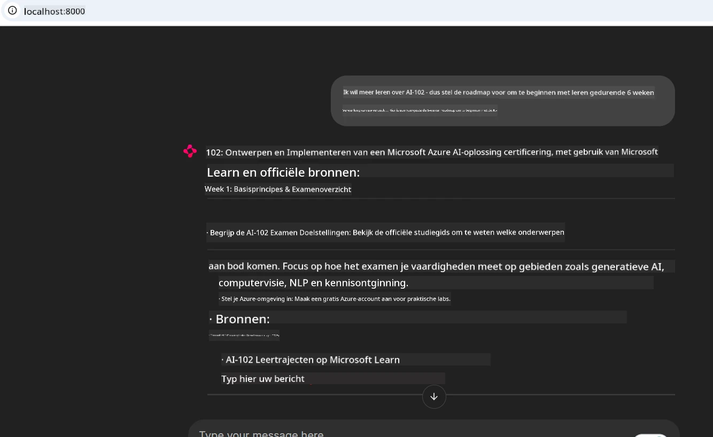
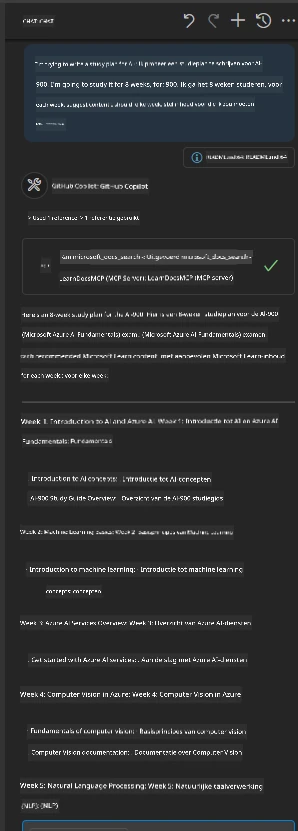

# Case Study: Verbinden met de Microsoft Learn Docs MCP-server vanaf een client

Heb je jezelf ooit betrapt op het jongleren tussen documentatiesites, Stack Overflow en eindeloze tabbladen van zoekmachines, terwijl je probeert een probleem in je code op te lossen? Misschien houd je een tweede monitor speciaal voor documentatie bij de hand, of wissel je constant tussen je IDE en een browser. Zou het niet beter zijn als je de documentatie rechtstreeks in je workflow kon brengen—geïntegreerd in je apps, je IDE, of zelfs je eigen aangepaste tools? In deze case study onderzoeken we hoe je precies dat kunt doen door rechtstreeks verbinding te maken met de Microsoft Learn Docs MCP-server vanuit je eigen clientapplicatie.

## Overzicht

Moderne ontwikkeling is meer dan alleen code schrijven—het gaat erom de juiste informatie op het juiste moment te vinden. Documentatie is overal, maar bijna nooit op de plek waar je hem het meest nodig hebt: binnen je tools en workflows. Door documentatieopvraging direct in je applicaties te integreren, kun je tijd besparen, het schakelen tussen context verminderen en de productiviteit verhogen. In deze sectie laten we je zien hoe je een client verbindt met de Microsoft Learn Docs MCP-server, zodat je real-time, contextbewuste documentatie kunt openen zonder ooit je app te verlaten.

We lopen door het proces van het tot stand brengen van een verbinding, het verzenden van een verzoek en het efficiënt verwerken van streamingreacties. Deze aanpak stroomlijnt niet alleen je workflow, maar opent ook de deur naar het bouwen van slimmere, behulpzamere ontwikkelaarstools.

## Leerdoelen

Waarom doen we dit? Omdat de beste ontwikkelaarservaringen die zijn die wrijving wegnemen. Stel je een wereld voor waarin je code-editor, chatbot of webapp direct je documentatievragen kan beantwoorden met de nieuwste inhoud van Microsoft Learn. Aan het einde van dit hoofdstuk weet je hoe je:

- De basisprincipes van MCP-server-client communicatie voor documentatie begrijpt
- Een console- of webapplicatie implementeert om verbinding te maken met de Microsoft Learn Docs MCP-server
- Streaming HTTP-clients gebruikt voor realtime documentatieopvraging
- Documentatieresponses logt en interpreteert in je applicatie

Je zult zien hoe deze vaardigheden je kunnen helpen tools te bouwen die niet alleen reactief zijn, maar echt interactief en contextbewust.

## Scenario 1 - Real-time documentatieopvraging met MCP

In dit scenario laten we je zien hoe je een client verbindt met de Microsoft Learn Docs MCP-server, zodat je real-time, contextbewuste documentatie kunt openen zonder ooit je app te verlaten.

Laten we dit in de praktijk brengen. Je taak is om een app te schrijven die verbinding maakt met de Microsoft Learn Docs MCP-server, de `microsoft_docs_search` tool aanroept en de streamingreactie naar de console logt.

### Waarom deze aanpak?
Omdat het de basis is voor het bouwen van geavanceerdere integraties—of je nu een chatbot, een IDE-extensie of een webdashboard wilt aandrijven.

Je vindt de code en instructies voor dit scenario in de [`solution`](./solution/README.md) map binnen deze case study. De stappen leiden je door het opzetten van de verbinding:
- Gebruik de officiële MCP SDK en een streamable HTTP-client voor verbinding
- Roep de `microsoft_docs_search` tool aan met een queryparameter om documentatie op te halen
- Implementeer goede logging en foutafhandeling
- Maak een interactieve console-interface waarmee gebruikers meerdere zoekvragen kunnen invoeren

Dit scenario laat zien hoe je:
- Verbindt met de Docs MCP-server
- Een query verzendt
- De resultaten analyseert en afdrukt

Zo kan het eruitzien als je de oplossing uitvoert:

```
Prompt> What is Azure Key Vault?
Answer> Azure Key Vault is a cloud service for securely storing and accessing secrets. ...
```

Hieronder zie je een minimale voorbeeldoplossing. De volledige code en details zijn beschikbaar in de oplossingsmap.

<details>
<summary>Python</summary>

```python
import asyncio
from mcp.client.streamable_http import streamablehttp_client
from mcp import ClientSession

async def main():
    async with streamablehttp_client("https://learn.microsoft.com/api/mcp") as (read_stream, write_stream, _):
        async with ClientSession(read_stream, write_stream) as session:
            await session.initialize()
            result = await session.call_tool("microsoft_docs_search", {"query": "Azure Functions best practices"})
            print(result.content)

if __name__ == "__main__":
    asyncio.run(main())
```

- Voor de volledige implementatie en logging, zie [`scenario1.py`](../../../../09-CaseStudy/docs-mcp/solution/python/scenario1.py).
- Voor installatie- en gebruiksinstructies, zie het [`README.md`](./solution/python/README.md) bestand in dezelfde map.
</details>


## Scenario 2 - Interactieve Studieplangenerator Webapp met MCP

In dit scenario leer je hoe je Docs MCP integreert in een webontwikkelingsproject. Het doel is om gebruikers in staat te stellen Microsoft Learn-documentatie direct vanuit een webinterface te doorzoeken, zodat documentatie onmiddellijk toegankelijk is binnen je app of site.

Je ziet hoe je:
- Een webapp opzet
- Verbindt met de Docs MCP-server
- Gebruikersinvoer verwerkt en resultaten toont

Zo kan het eruitzien als je de oplossing uitvoert:

```
User> I want to learn about AI102 - so suggest the roadmap to get it started from learn for 6 weeks

Assistant> Here’s a detailed 6-week roadmap to start your preparation for the AI-102: Designing and Implementing a Microsoft Azure AI Solution certification, using official Microsoft resources and focusing on exam skills areas:

---
## Week 1: Introduction & Fundamentals
- **Understand the Exam**: Review the [AI-102 exam skills outline](https://learn.microsoft.com/en-us/credentials/certifications/exams/ai-102/).
- **Set up Azure**: Sign up for a free Azure account if you don't have one.
- **Learning Path**: [Introduction to Azure AI services](https://learn.microsoft.com/en-us/training/modules/intro-to-azure-ai/)
- **Focus**: Get familiar with Azure portal, AI capabilities, and necessary tools.

....more weeks of the roadmap...

Let me know if you want module-specific recommendations or need more customized weekly tasks!
```

Hieronder zie je een minimale voorbeeldoplossing. De volledige code en details zijn beschikbaar in de oplossingsmap.



<details>
<summary>Python (Chainlit)</summary>

Chainlit is een framework voor het bouwen van conversationale AI-webapps. Het maakt het gemakkelijk om interactieve chatbots en assistenten te creëren die MCP-tools kunnen aanroepen en resultaten in real time kunnen tonen. Het is ideaal voor snelle prototyping en gebruiksvriendelijke interfaces.

```python
import chainlit as cl
import requests

MCP_URL = "https://learn.microsoft.com/api/mcp"

@cl.on_message
def handle_message(message):
    query = {"question": message}
    response = requests.post(MCP_URL, json=query)
    if response.ok:
        result = response.json()
        cl.Message(content=result.get("answer", "No answer found.")).send()
    else:
        cl.Message(content="Error: " + response.text).send()
```

- Voor de volledige implementatie, zie [`scenario2.py`](../../../../09-CaseStudy/docs-mcp/solution/python/scenario2.py).
- Voor installatie- en uitvoeringsinstructies, zie de [`README.md`](./solution/python/README.md).
</details>


## Scenario 3: In-Editor Docs met MCP Server in VS Code

Als je Microsoft Learn Docs rechtstreeks binnen je VS Code wilt krijgen (in plaats van steeds tussen browser-tabbladen te wisselen), kun je de MCP-server in je editor gebruiken. Hiermee kun je:
- Documentatie doorzoeken en lezen in VS Code zonder je codeeromgeving te verlaten.
- Documentatie verwijzen en links direct invoegen in je README- of cursusbestanden.
- GitHub Copilot en MCP samen gebruiken voor een naadloze, AI-aangedreven documentatieworkflow.

**Je leert hoe je:**
- Een geldig `.vscode/mcp.json` bestand toevoegt aan de root van je werkruimte (zie onderstaand voorbeeld).
- Het MCP-paneel opent of de commandopalet in VS Code gebruikt om documentatie te zoeken en in te voegen.
- Documentatie rechtstreeks in je markdown-bestanden verwijst terwijl je werkt.
- Deze workflow combineert met GitHub Copilot voor nog meer productiviteit.

Hier is een voorbeeld van hoe je de MCP-server in VS Code instelt:

```json
{
  "servers": {
    "LearnDocsMCP": {
      "url": "https://learn.microsoft.com/api/mcp"
    }
  }
}
```

</details>

> Voor een gedetailleerde walkthrough met screenshots en stapsgewijze gids, zie [`README.md`](./solution/scenario3/README.md).



Deze aanpak is ideaal voor iedereen die technische cursussen bouwt, documentatie schrijft of code ontwikkelt met frequente referentiebehoeften.

## Belangrijkste conclusies

Documentatie direct in je tools integreren is niet zomaar een gemak—het is een gamechanger voor productiviteit. Door verbinding te maken met de Microsoft Learn Docs MCP-server vanuit je client, kun je:

- Het schakelen tussen context van code en documentatie elimineren
- Up-to-date, contextbewuste documentatie in real time ophalen
- Slimmere, meer interactieve ontwikkelaarstools bouwen

Deze vaardigheden helpen je oplossingen te maken die niet alleen efficiënt, maar ook plezierig in gebruik zijn.

## Aanvullende bronnen

Om je begrip te verdiepen, verken deze officiële bronnen:

- [Microsoft Learn Docs MCP Server (GitHub)](https://github.com/MicrosoftDocs/mcp)
- [Begin met Azure MCP Server (mcp-python)](https://learn.microsoft.com/en-us/azure/developer/azure-mcp-server/get-started#create-the-python-app)
- [Wat is de Azure MCP Server?](https://learn.microsoft.com/en-us/azure/developer/azure-mcp-server/)
- [Model Context Protocol (MCP) Introductie](https://modelcontextprotocol.io/introduction)
- [Plugins toevoegen vanuit een MCP Server (Python)](https://learn.microsoft.com/en-us/semantic-kernel/concepts/plugins/adding-mcp-plugins)

## Wat nu

- Terug naar: [Overzicht Case Studies](../README.md)
- Ga verder naar: [Module 10: AI-workflows stroomlijnen met Microsoft Foundry Toolkit](../../10-StreamliningAIWorkflowsBuildingAnMCPServerWithAIToolkit/README.md)

---

<!-- CO-OP TRANSLATOR DISCLAIMER START -->
**Disclaimer**:
Dit document is vertaald met behulp van de AI vertaaldienst [Co-op Translator](https://github.com/Azure/co-op-translator). Hoewel we streven naar nauwkeurigheid, dient u er rekening mee te houden dat geautomatiseerde vertalingen fouten of onnauwkeurigheden kunnen bevatten. Het originele document in de oorspronkelijke taal moet worden beschouwd als de gezaghebbende bron. Voor kritieke informatie wordt professionele menselijke vertaling aanbevolen. Wij zijn niet aansprakelijk voor eventuele misverstanden of verkeerde interpretaties die voortvloeien uit het gebruik van deze vertaling.
<!-- CO-OP TRANSLATOR DISCLAIMER END -->