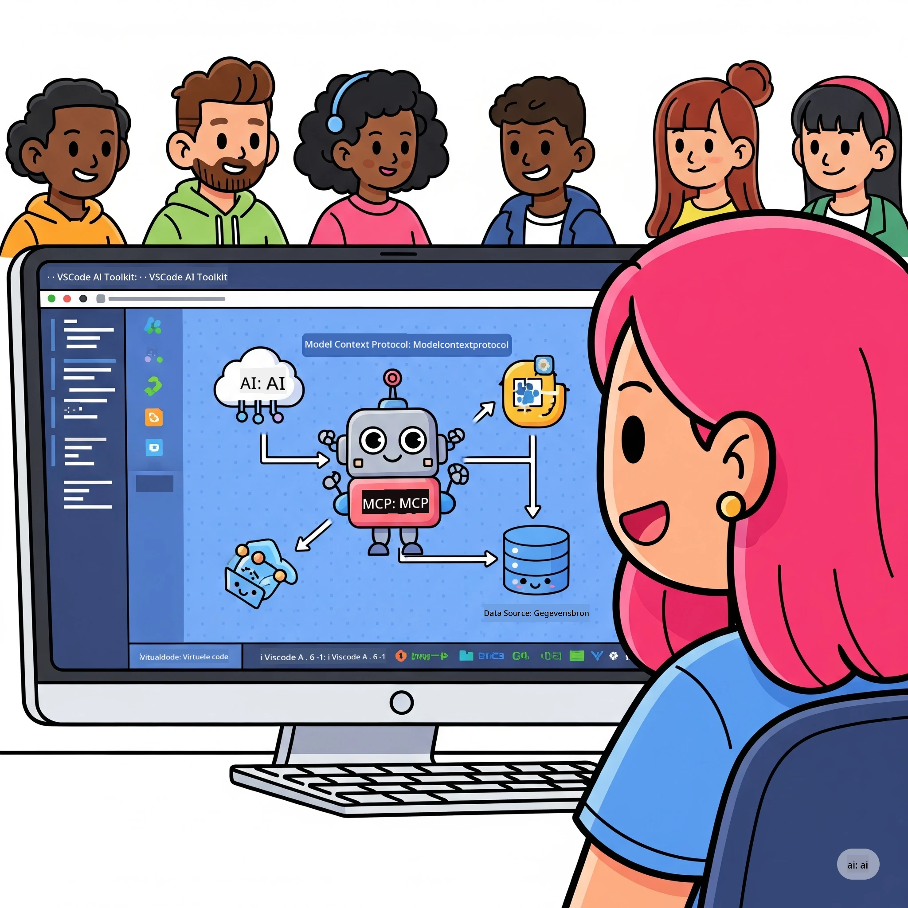
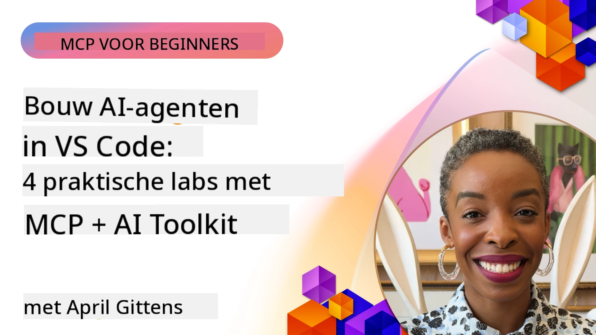

# AI-workflows stroomlijnen: Een MCP-server bouwen met Microsoft Foundry Toolkit

## 🎯 Overzicht

_(Klik op de afbeelding hierboven om de video van deze les te bekijken)_

Welkom bij de **Model Context Protocol (MCP) Workshop**! Deze uitgebreide praktijkworkshop combineert twee baanbrekende technologieën om de ontwikkeling van AI-toepassingen te revolutioneren:

> **Compatibiliteitsnotitie:** de workshopcode is gebouwd en getest met MCP
> `2025-11-25`, zoals aangegeven door het badge hierboven. Gebruik de
> [huidige `2026-07-28` specificatie](https://modelcontextprotocol.io/specification/2026-07-28/)
> voor nieuwe protocolimplementaties en bekijk de SDK-release-opmerkingen voordat je
> de labs migreert.

- **🔗 Model Context Protocol (MCP)**: Een open standaard voor naadloze AI-toolintegratie
- **🛠️ Microsoft Foundry Toolkit-extensie voor VS Code**: Microsofts krachtige AI-ontwikkel-extensie

### 🎓 Wat je gaat leren

Aan het einde van deze workshop beheers je het bouwen van intelligente applicaties die AI-modellen verbinden met echte tools en diensten. Van geautomatiseerd testen tot aangepaste API-integraties, je krijgt praktische vaardigheden om complexe zakelijke uitdagingen op te lossen.

## 🏗️ Technologie Stack

### 🔌 Model Context Protocol (MCP)

MCP is de **"USB-C voor AI"** - een universele standaard die AI-modellen koppelt aan externe tools en databronnen.

**✨ Belangrijkste Kenmerken:**

- 🔄 **Gestandaardiseerde Integratie**: Universele interface voor AI-tool verbindingen
- 🏛️ **Flexibele Architectuur**: Lokale en externe servers via stdio/SSE-transport
- 🧰 **Rijk Ecosysteem**: Tools, prompts en bronnen samengebracht in één protocol
- 🔒 **Enterprise-Ready**: Ingebouwde beveiliging en betrouwbaarheid

**🎯 Waarom MCP Belangrijk Is:**
Net zoals USB-C kabelchaos heeft geëlimineerd, elimineert MCP de complexiteit van AI-integraties. Eén protocol, oneindig veel mogelijkheden.

### 🤖 Microsoft Foundry Toolkit-extensie voor VS Code

Microsofts toonaangevende AI-ontwikkel-extensie die VS Code transformeert tot een AI-krachtpatser.

**🚀 Kernmogelijkheden:**

- 📦 **Modelcatalogus**: Toegang tot modellen van Azure AI, GitHub, Hugging Face, Ollama
- ⚡ **Lokale Inferentie**: ONNX-geoptimaliseerde CPU/GPU/NPU-uitvoering
- 🏗️ **Agent Builder**: Visuele AI-agentontwikkeling met MCP-integratie
- 🎭 **Multi-Modal**: Ondersteuning voor tekst, visie en gestructureerde output

**💡 Ontwikkelvoordelen:**

- Zero-config modelimplementatie
- Visuele prompt-engineering
- Real-time testomgeving
- Naadloze integratie van MCP-servers

## 📚 Leertraject

### [🚀 Module 1: Microsoft Foundry Toolkit Fundamentals](./lab1/README.md)

**Duur**: 15 minuten

- 🛠️ Installeer en configureer Microsoft Foundry Toolkit voor VS Code
- 🗂️ Verken de Modelcatalogus (100+ modellen van GitHub, ONNX, OpenAI, Anthropic, Google)
- 🎮 Beheers de interactieve playground voor real-time modeltesten
- 🤖 Bouw je eerste AI-agent met Agent Builder
- 📊 Evalueer modelprestaties met ingebouwde metrics (F1, relevantie, gelijkenis, coherentie)
- ⚡ Leer batchverwerking en multi-modale ondersteuning

**🎯 Leerresultaat**: Creëer een functionele AI-agent met een uitgebreid begrip van Microsoft Foundry Toolkit-mogelijkheden

### [🌐 Module 2: MCP met Microsoft Foundry Toolkit Fundamentals](./lab2/README.md)

**Duur**: 20 minuten

- 🧠 Beheers de Model Context Protocol (MCP)-architectuur en concepten
- 🌐 Verken Microsofts MCP-server ecosysteem
- 🤖 Bouw een browserautomatiseringsagent met Playwright MCP-server
- 🔧 Integreer MCP-servers met Microsoft Foundry Toolkit Agent Builder
- 📊 Configureer en test MCP-tools binnen je agents
- 🚀 Exporteer en zet MCP-aangedreven agents in voor productiegebruik

**🎯 Leerresultaat**: Zet een AI-agent in die is opgevoerd met externe tools via MCP

### [🔧 Module 3: Geavanceerde MCP-ontwikkeling met Microsoft Foundry Toolkit](./lab3/README.md)

**Duur**: 20 minuten

- 💻 Maak aangepaste MCP-servers met Microsoft Foundry Toolkit
- 🐍 Configureer en gebruik de nieuwste MCP Python SDK (v1.9.3)
- 🔍 Stel MCP Inspector in voor debugging
- 🛠️ Bouw een Weather MCP Server met professionele debugging-workflows
- 🧪 Debug MCP-servers in zowel Agent Builder als Inspector omgevingen

**🎯 Leerresultaat**: Ontwikkel en debug aangepaste MCP-servers met moderne tools

### [🐙 Module 4: Praktische MCP-ontwikkeling - Aangepaste GitHub Clone Server](./lab4/README.md)

**Duur**: 30 minuten

- 🏗️ Bouw een praktische GitHub Clone MCP Server voor ontwikkelworkflows
- 🔄 Implementeer slimme repository cloning met validatie en foutafhandeling
- 📁 Creëer intelligente directorybeheer en VS Code-integratie
- 🤖 Gebruik GitHub Copilot Agent Mode met aangepaste MCP-tools
- 🛡️ Pas productieklare betrouwbaarheid en platformcompatibiliteit toe

**🎯 Leerresultaat**: Zet een productieklare MCP-server in die echte ontwikkelworkflows vereenvoudigt

## 💡 Praktijktoepassingen & impact

### 🏢 Enterprise Use Cases

#### 🔄 DevOps-automatisering

Transformeer je ontwikkelworkflow met intelligente automatisering:

- **Slim Repositorybeheer**: AI-gestuurde code review en merge-beslissingen
- **Intelligente CI/CD**: Geautomatiseerde pipeline-optimalisatie op basis van codewijzigingen
- **Issue Triage**: Automatische bugclassificatie en toewijzing

#### 🧪 Kwaliteitsborging Revolutie

Verhoog testen met AI-gestuurde automatisering:

- **Intelligente Testgeneratie**: Maak automatisch uitgebreide testsets
- **Visuele Regresietests**: AI-gestuurde detectie van UI-wijzigingen
- **Prestatiemeting**: Proactieve probleemidentificatie en oplossing

#### 📊 Data Pipeline Intelligent

Bouw slimmere gegevensverwerkingsworkflows:

- **Adaptieve ETL-processen**: Zelfoptimaliserende datatransformaties
- **Anomaliedetectie**: Real-time monitoring van datakwaliteit
- **Intelligente Routering**: Slim beheer van datastromen

#### 🎧 Klantbeleving Verbetering

Creëer uitzonderlijke klantinteracties:

- **Contextbewuste Ondersteuning**: AI-agents met toegang tot klantgeschiedenis
- **Proactieve Probleemoplossing**: Voorspellende klantenservice
- **Multi-Channel Integratie**: Geünificeerde AI-ervaring over platforms

## 🛠️ Vereisten & Setup

### 💻 Systeemvereisten

| Component | Vereiste | Opmerkingen |
|-----------|----------|------------|
| **Besturingssysteem** | Windows 10+, macOS 10.15+, Linux | Elk modern OS |
| **Visual Studio Code** | Laatste stabiele versie | Vereist voor Microsoft Foundry Toolkit |
| **Node.js** | v18.0+ en npm | Voor ontwikkeling van MCP-server |
| **Python** | 3.10+ | Optioneel voor Python MCP-servers |
| **Geheugen** | Minimaal 8GB RAM | 16GB aanbevolen voor lokale modellen |

### 🔧 Ontwikkelomgeving

#### Aanbevolen VS Code-extensies

- **Microsoft Foundry Toolkit** (ms-windows-ai-studio.windows-ai-studio)
- **Python** (ms-python.python)
- **Python Debugger** (ms-python.debugpy)
- **GitHub Copilot** (GitHub.copilot) - Optioneel maar nuttig

#### Optionele Tools

- **uv**: Moderne Python package manager
- **MCP Inspector**: Visuele debugtool voor MCP-servers
- **Playwright**: Voor webautomatiseringsvoorbeelden

## 🎖️ Leerresultaten & Certificeringspad

### 🏆 Vaardigheids-checklist

Door deze workshop te voltooien, behaal je meesterschap in:

#### 🎯 Kerncompetenties

- [ ] **MCP Protocol Meesterschap**: Diep inzicht in architectuur en implementatiepatronen
- [ ] **Microsoft Foundry Toolkit Vaardigheid**: Expertgebruik van Microsoft Foundry Toolkit voor snelle ontwikkeling
- [ ] **Aangepaste Serverontwikkeling**: Bouw, zet in en onderhoud productie-MCP-servers
- [ ] **Toolintegratie-excellentie**: Naadloze verbinding van AI met bestaande ontwikkelworkflows
- [ ] **Probleemoplossende Toepassing**: Pas geleerde vaardigheden toe op echte zakelijke uitdagingen

#### 🔧 Technische Vaardigheden

- [ ] Stel Microsoft Foundry Toolkit in en configureer in VS Code
- [ ] Ontwerp en implementeer aangepaste MCP-servers
- [ ] Integreer Microsoft Foundry-modellen met MCP-architectuur
- [ ] Bouw geautomatiseerde testworkflows met Playwright
- [ ] Zet AI-agents in voor productiegebruik
- [ ] Debug en optimaliseer MCP-serverprestaties

#### 🚀 Geavanceerde Mogelijkheden

- [ ] Ontwerp bedrijfsschaal AI-integraties
- [ ] Implementeer beste beveiligingspraktijken voor AI-toepassingen
- [ ] Ontwerp schaalbare MCP-serverarchitecturen
- [ ] Creëer aangepaste toolketens voor specifieke domeinen
- [ ] Begeleid anderen in AI-native ontwikkeling

## 📖 Aanvullende Bronnen

- [MCP Specificatie (2026-07-28)](https://modelcontextprotocol.io/specification/2026-07-28/)
- [Microsoft Foundry Toolkit GitHub Repositorium](https://github.com/microsoft/vscode-ai-toolkit)
- [Voorbeeld MCP-servers Verzameling](https://github.com/modelcontextprotocol/servers)
- [Gids voor Best Practices](https://modelcontextprotocol.io/docs/best-practices)
- [OWASP MCP Top 10](https://microsoft.github.io/mcp-azure-security-guide/mcp/) - Beveiligingsbest practices

---

**🚀 Klaar om je AI-ontwikkelworkflow te revolutioneren?**

Laten we samen de toekomst van intelligente applicaties bouwen met MCP en Microsoft Foundry Toolkit!

## Wat Nu

Ga verder naar: [Module 11: MCP Server Praktijklabs](../11-MCPServerHandsOnLabs/README.md)

---

<!-- CO-OP TRANSLATOR DISCLAIMER START -->
**Disclaimer**:
Dit document is vertaald met behulp van de AI vertaaldienst [Co-op Translator](https://github.com/Azure/co-op-translator). Hoewel we streven naar nauwkeurigheid, dient u er rekening mee te houden dat geautomatiseerde vertalingen fouten of onnauwkeurigheden kunnen bevatten. Het originele document in de oorspronkelijke taal moet worden beschouwd als de gezaghebbende bron. Voor kritieke informatie wordt professionele menselijke vertaling aanbevolen. Wij zijn niet aansprakelijk voor eventuele misverstanden of verkeerde interpretaties die voortvloeien uit het gebruik van deze vertaling.
<!-- CO-OP TRANSLATOR DISCLAIMER END -->