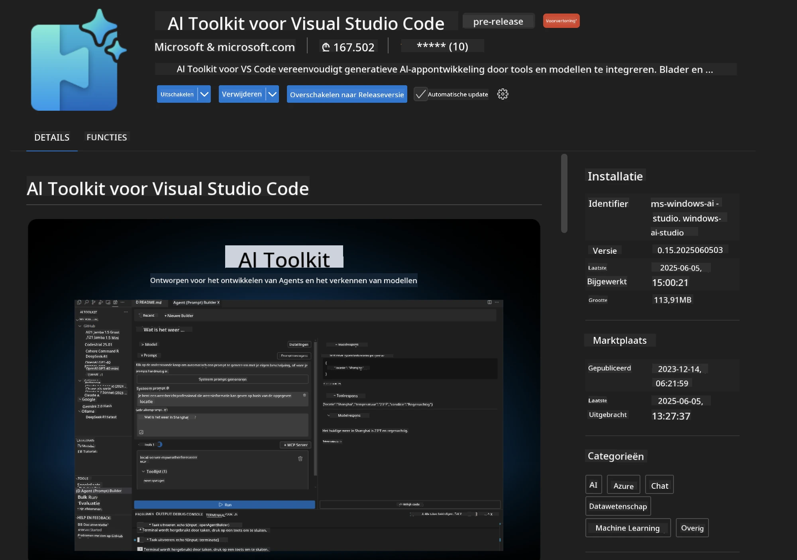
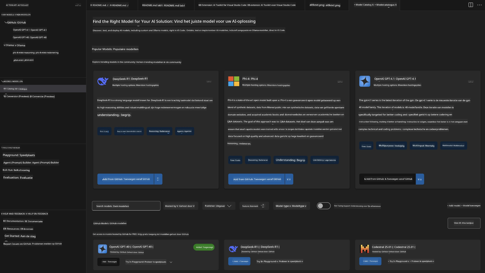
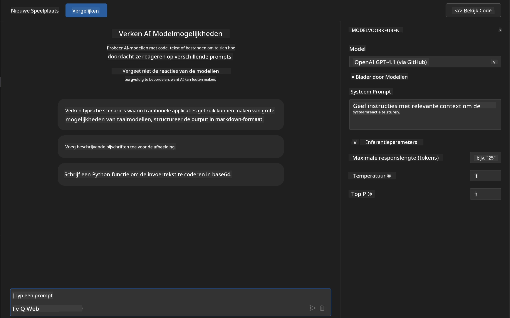
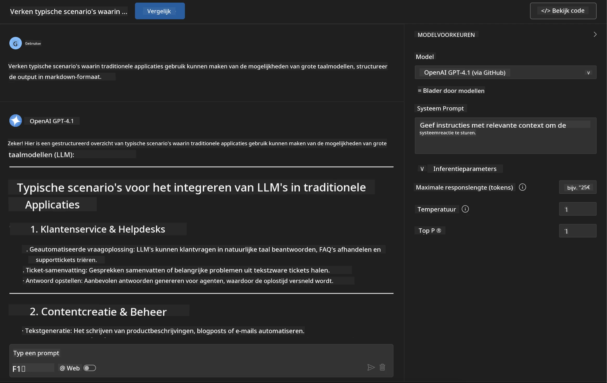
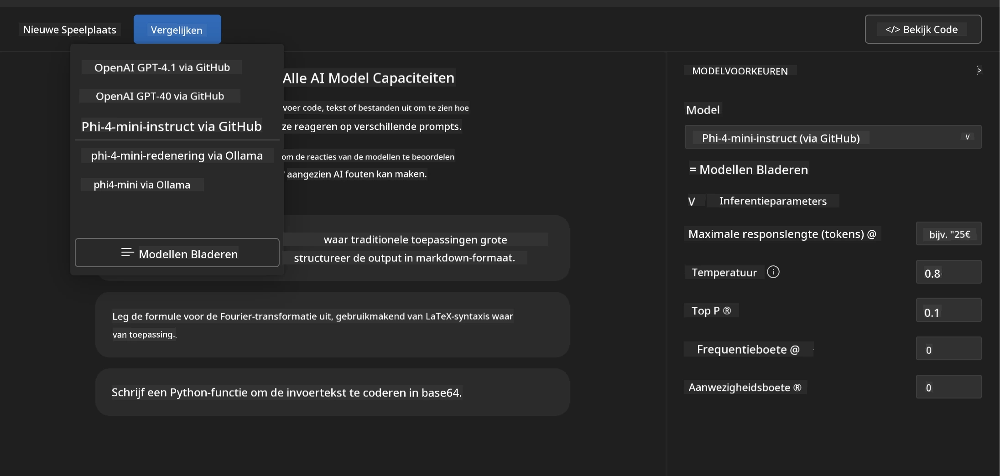
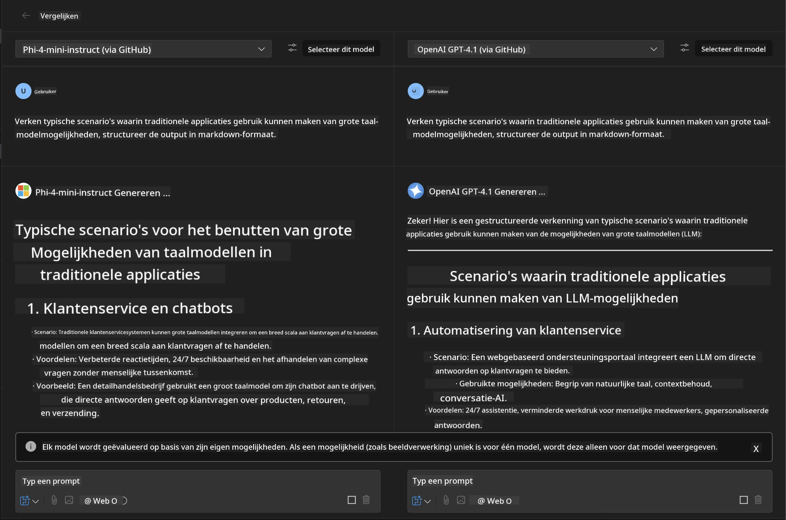
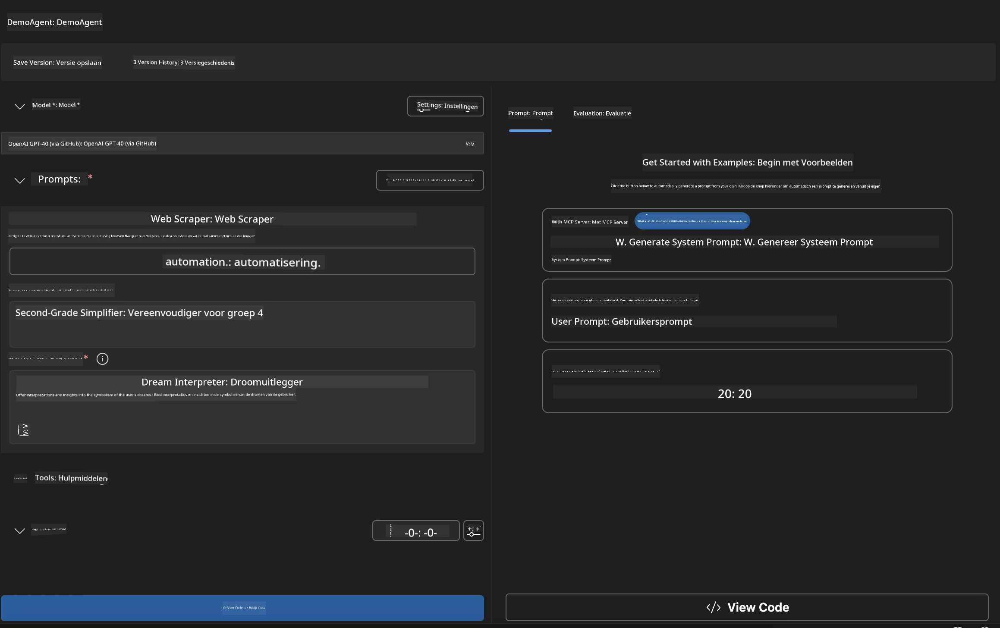
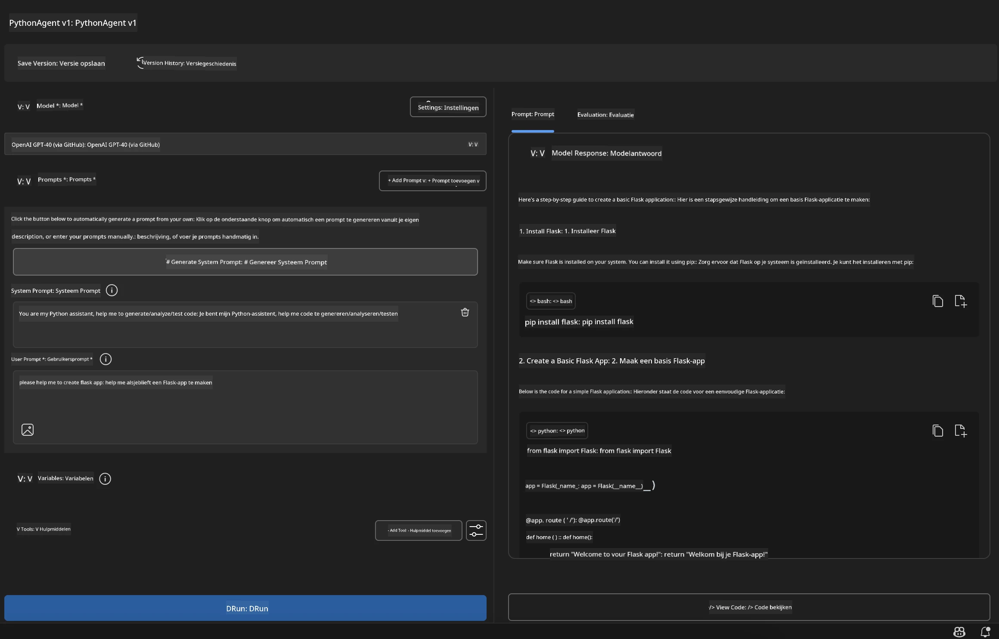

# 🚀 Module 1: Microsoft Foundry Toolkit Basisprincipes

[]()
[]()
[]()

## 📋 Leerdoelen

Aan het einde van deze module kun je:
- ✅ Microsoft Foundry Toolkit-extensie voor VS Code installeren en configureren
- ✅ Door de Modelcatalogus navigeren en verschillende modelbronnen begrijpen
- ✅ De Playground gebruiken voor modeltesten en -experimenten
- ✅ Aangepaste AI-agenten maken met Agent Builder
- ✅ Modelprestaties vergelijken tussen verschillende aanbieders
- ✅ Best practices toepassen voor prompt engineering

## 🧠 Introductie tot Microsoft Foundry Toolkit

De **Microsoft Foundry Toolkit-extensie voor VS Code** is Microsofts toonaangevende extensie die VS Code transformeert in een uitgebreide AI-ontwikkelomgeving. Het overbrugt de kloof tussen AI-onderzoek en praktische applicatieontwikkeling, waardoor generatieve AI toegankelijk is voor ontwikkelaars van alle vaardigheidsniveaus.

### 🌟 Belangrijkste Mogelijkheden

| Kenmerk | Beschrijving | Gebruikssituatie |
|---------|-------------|----------|
| **🗂️ Modelcatalogus** | Toegang tot 100+ modellen van GitHub, ONNX, OpenAI, Anthropic, Google | Modelontdekking en selectie |
| **🔌 BYOM-ondersteuning** | Integreer je eigen modellen (lokaal/extern) | Aangepaste modelimplementatie |
| **🎮 Interactieve Playground** | Realtime modeltesten met chatinterface | Snelle prototyping en testen |
| **📎 Multi-modale Ondersteuning** | Verwerk tekst, afbeeldingen en bijlagen | Complexe AI-toepassingen |
| **⚡ Batchverwerking** | Voer meerdere prompts tegelijkertijd uit | Efficiënte testworkflows |
| **📊 Modellevaluatie** | Ingebouwde metrics (F1, relevantie, gelijkenis, coherentie) | Prestatiebeoordeling |

### 🎯 Waarom Microsoft Foundry Toolkit Belangrijk Is

- **🚀 Versnelde ontwikkeling**: Van idee tot prototype in minuten
- **🔄 Geünificeerde workflow**: Eén interface voor meerdere AI-aanbieders
- **🧪 Gemakkelijke experimentatie**: Vergelijk modellen zonder complexe setup
- **📈 Productieklaar**: Naadloze overgang van prototype naar implementatie

## 🛠️ Vereisten & Setup

### 📦 Installatie Microsoft Foundry Toolkit-extensie

**Stap 1: Toegang tot Extensions Marketplace**
1. Open Visual Studio Code
2. Navigeer naar het Extensies-venster (`Ctrl+Shift+X` of `Cmd+Shift+X`)
3. Zoek op "Microsoft Foundry Toolkit"

**Stap 2: Kies je versie**
- **🟢 Release**: Aanbevolen voor productiegebruik
- **🔶 Vooruitblik**: Vroege toegang tot baanbrekende functies

**Stap 3: Installeren en activeren**



### ✅ Controlelijst ter verificatie
- [ ] Microsoft Foundry Toolkit-pictogram verschijnt in de VS Code-zijbalk
- [ ] Extensie is ingeschakeld en geactiveerd
- [ ] Geen installatieproblemen in het uitvoervenster

## 🧪 Praktijkopdracht 1: Microsoft Foundry Modellen Verkennen

**🎯 Doel**: Beheers de Modelcatalogus en test je eerste AI-model

### 📊 Stap 1: Navigeer door de Modelcatalogus

De Modelcatalogus is je toegangspoort tot het AI-ecosysteem. Het verzamelt modellen van meerdere aanbieders, waardoor je eenvoudig opties kunt ontdekken en vergelijken.

**🔍 Navigatiehandleiding:**

Klik op **MODELLEN - Catalogus** in de Microsoft Foundry Toolkit-zijbalk



**💡 Pro tip**: Zoek naar modellen met specifieke mogelijkheden die bij je gebruikssituatie passen (bijv. codegeneratie, creatief schrijven, analyse).

> [!NOTE]
> GitHub-modellen zijn op 30 juli 2026 uitgefaseerd. Gebruik een Microsoft Foundry-model
> implementatie en authenticeer met Microsoft Entra ID of een Azure API-sleutel.

### 🚀 Stap 2: Voeg je eerste model toe en configureer het

**Modelselectiestrategie:**
- **GPT-5.1**: Aanbevolen algemeen model voor toolgebruik en redeneren
- **Phi-4-mini**: Lichtgewicht, snelle reacties voor eenvoudige taken

**🔧 Configuratieproces:**
1. Selecteer **OpenAI GPT-5.1** in de catalogus
2. Klik **Toevoegen aan Mijn Modellen** - hiermee registreer je het model voor gebruik
3. Kies **Probeer in Playground** om de testomgeving te starten
4. Wacht op modelinitialisatie (de eerste keer kan even duren)



**⚙️ Modelparameters Begrijpen:**
- **Temperatuur**: Bepaalt creativiteit (0 = deterministisch, 1 = creatief)
- **Max Tokens**: Maximale responslengte
- **Top-p**: Nucleus-sampling voor diversiteit in reacties

### 🎯 Stap 3: Beheers de Playground-interface

De Playground is je AI-experimentatielab. Zo haal je het meeste eruit:

**🎨 Best practices voor prompt engineering:**
1. **Wees specifiek**: Duidelijke, gedetailleerde instructies leveren betere resultaten
2. **Geef context**: Voeg relevante achtergrondinformatie toe
3. **Gebruik voorbeelden**: Laat het model zien wat je wilt met voorbeelden
4. **Itereer**: Verbeter prompts op basis van eerste resultaten

**🧪 Testsituaties:**
```markdown
# Example 1: Code Generation
"Write a Python function that calculates the factorial of a number using recursion. Include error handling and docstrings."

# Example 2: Creative Writing
"Write a professional email to a client explaining a project delay, maintaining a positive tone while being transparent about challenges."

# Example 3: Data Analysis
"Analyze this sales data and provide insights: [paste your data]. Focus on trends, anomalies, and actionable recommendations."
```



### 🏆 Uitdagingsopdracht: Modelprestaties Vergelijken

**🎯 Doel**: Vergelijk verschillende modellen met identieke prompts om hun sterke punten te begrijpen

**📋 Instructies:**
1. Voeg **Phi-4-mini** toe aan je werkomgeving
2. Gebruik dezelfde prompt voor zowel GPT-5.1 als Phi-4-mini



3. Vergelijk kwaliteit, snelheid en nauwkeurigheid van reacties
4. Documenteer je bevindingen in het resultatenoverzicht



**💡 Belangrijke Inzichten om te Ontdekken:**
- Wanneer gebruik je LLM vs SLM
- Kosten versus prestatieafwegingen
- Gespecialiseerde mogelijkheden van verschillende modellen

## 🤖 Praktijkopdracht 2: Aangepaste Agenten Bouwen met Agent Builder

**🎯 Doel**: Creëer gespecialiseerde AI-agenten op maat voor specifieke taken en workflows

### 🏗️ Stap 1: Agent Builder Begrijpen

Agent Builder is waar Microsoft Foundry Toolkit echt uitblinkt. Het stelt je in staat doelgerichte AI-assistenten te maken die de kracht van grote taalmodellen combineren met aangepaste instructies, specifieke parameters en gespecialiseerde kennis.

**🧠 Componenten van de Agent Architectuur:**
- **Kernmodel**: De fundamentele LLM (GPT-5.1, Phi, enz.)
- **Systeem Prompt**: Bepaalt de persoonlijkheid en het gedrag van de agent
- **Parameters**: Fijn afgestelde instellingen voor optimale prestaties
- **Tools-integratie**: Verbinden met externe API's en MCP-diensten
- **Geheugen**: Conversatiecontext en sessiebehoud



### ⚙️ Stap 2: Diepgaande Agentconfiguratie

**🎨 Effectieve Systeem Prompts Creëren:**
```markdown
# Template Structure:
## Role Definition
You are a [specific role] with expertise in [domain].

## Capabilities
- List specific abilities
- Define scope of knowledge
- Clarify limitations

## Behavior Guidelines
- Response style (formal, casual, technical)
- Output format preferences
- Error handling approach

## Examples
Provide 2-3 examples of ideal interactions
```

*Natuurlijk kun je ook Genereer Systeem Prompt gebruiken om AI te laten helpen bij het genereren en optimaliseren van prompts*

**🔧 Parameteroptimalisatie:**
| Parameter | Aanbevolen Bereik | Gebruikssituatie |
|-----------|------------------|----------|
| **Temperatuur** | 0.1-0.3 | Technische/factuele reacties |
| **Temperatuur** | 0.7-0.9 | Creatieve/brainstorming taken |
| **Max Tokens** | 500-1000 | Bondige reacties |
| **Max Tokens** | 2000-4000 | Gedetailleerde uitleg |

### 🐍 Stap 3: Praktijkopdracht - Python Programmeringsagent

**🎯 Missie**: Maak een gespecialiseerde Python codeerassistent

**📋 Configuratiestappen:**

1. **Modelselectie**: Kies **Claude 3.5 Sonnet** (uitstekend voor code)

2. **Systeem prompt ontwerp**:
```markdown
# Python Programming Expert Agent

## Role
You are a senior Python developer with 10+ years of experience. You excel at writing clean, efficient, and well-documented Python code.

## Capabilities
- Write production-ready Python code
- Debug complex issues
- Explain code concepts clearly
- Suggest best practices and optimizations
- Provide complete working examples

## Response Format
- Always include docstrings
- Add inline comments for complex logic
- Suggest testing approaches
- Mention relevant libraries when applicable

## Code Quality Standards
- Follow PEP 8 style guidelines
- Use type hints where appropriate
- Handle exceptions gracefully
- Write readable, maintainable code
```

3. **Parameterconfiguratie**:
   - Temperatuur: 0.2 (voor consistente, betrouwbare code)
   - Max Tokens: 2000 (gedetailleerde uitleg)
   - Top-p: 0.9 (gebalanceerde creativiteit)



### 🧪 Stap 4: Test je Python-agent

**Testsituaties:**
1. **Basisfunctie**: "Maak een functie om priemgetallen te vinden"
2. **Complex algoritme**: "Implementeer een binaire zoekboom met invoegen, verwijderen en zoekmethodes"
3. **Probleem uit de praktijk**: "Bouw een web scraper die ratelimiting en herhaalde pogingen afhandelt"
4. **Debuggen**: "Los deze code op [plak buggy code]"

**🏆 Succescriteria:**
- ✅ Code draait zonder fouten
- ✅ Bevat juiste documentatie
- ✅ Volgt Python best practices
- ✅ Biedt duidelijke uitleg
- ✅ Doet verbetersuggesties

## 🎓 Afsluiting Module 1 & Volgende Stappen

### 📊 Kennischeck

Test je begrip:
- [ ] Kun je het verschil uitleggen tussen modellen in de catalogus?
- [ ] Heb je met succes een aangepaste agent gemaakt en getest?
- [ ] Begrijp je hoe je parameters optimaliseert voor verschillende gebruikssituaties?
- [ ] Kun je effectieve systeem prompts ontwerpen?

### 📚 Aanvullende Bronnen

- **Microsoft Foundry Toolkit Documentatie**: [Officiële Microsoft Documentatie](https://github.com/microsoft/vscode-ai-toolkit)
- **Prompt Engineering Gids**: [Best Practices](https://platform.openai.com/docs/guides/prompt-engineering)
- **Modellen in Microsoft Foundry Toolkit**: [Modellen in Ontwikkeling](https://github.com/microsoft/vscode-ai-toolkit/blob/main/doc/models.md)

**🎉 Gefeliciteerd!** Je hebt de basis van Microsoft Foundry Toolkit onder de knie en bent klaar om geavanceerdere AI-toepassingen te bouwen!

### 🔜 Ga door naar de volgende module

Klaar voor geavanceerdere mogelijkheden? Ga verder met **[Module 2: MCP met Microsoft Foundry Toolkit Basisprincipes](../lab2/README.md)** waar je leert hoe je:
- Je agenten verbindt met externe tools via Model Context Protocol (MCP)
- Browserautomatiseringsagenten bouwt met Playwright
- MCP-servers integreert met je Microsoft Foundry Toolkit-agenten
- Je agenten versterkt met externe data en mogelijkheden

---

<!-- CO-OP TRANSLATOR DISCLAIMER START -->
**Disclaimer**:
Dit document is vertaald met behulp van de AI vertaaldienst [Co-op Translator](https://github.com/Azure/co-op-translator). Hoewel we streven naar nauwkeurigheid, dient u er rekening mee te houden dat geautomatiseerde vertalingen fouten of onnauwkeurigheden kunnen bevatten. Het originele document in de oorspronkelijke taal moet worden beschouwd als de gezaghebbende bron. Voor kritieke informatie wordt professionele menselijke vertaling aanbevolen. Wij zijn niet aansprakelijk voor eventuele misverstanden of verkeerde interpretaties die voortvloeien uit het gebruik van deze vertaling.
<!-- CO-OP TRANSLATOR DISCLAIMER END -->