# 🌐 Module 2: MCP met Microsoft Foundry Toolkit Fundamentals


## 📋 Leerdoelen

Aan het einde van deze module kun je:

- ✅ De architectuur en voordelen van het Model Context Protocol (MCP) begrijpen
- ✅ Het MCP-serverecosysteem van Microsoft verkennen
- ✅ MCP-servers integreren met Microsoft Foundry Toolkit Agent Builder
- ✅ Een functionele browserautomatiseringsagent bouwen met Playwright MCP
- ✅ MCP-tools configureren en testen binnen je agents
- ✅ MCP-aangedreven agents exporteren en inzetten voor productiegebruik

## 🎯 Verder bouwen op Module 1

In Module 1 hebben we de basis van Microsoft Foundry Toolkit onder de knie gekregen en onze
eerste Python Agent gemaakt. Nu gaan we je agents **superchargen** door ze te verbinden
met externe tools en diensten via het revolutionaire
**Model Context Protocol (MCP)**.

Zie dit als een upgrade van een eenvoudige rekenmachine naar een volledige computer. Je AI
agents krijgen de mogelijkheid om:

- 🌐 Websites te browsen en ermee te interacteren
- 📁 Toegang te hebben tot en bestanden te manipuleren
- 🔧 Te integreren met enterprise-systemen
- 📊 Real-time data van API’s te verwerken

## 🧠 Het Model Context Protocol (MCP) begrijpen

### 🔍 Wat is MCP?

Model Context Protocol (MCP) is de **"USB-C voor AI-toepassingen"**: een open
standaard die Large Language Models (LLM's) verbindt met externe tools, datasources
en diensten. Net zoals USB-C één universele connector biedt, vermindert MCP
de complexiteit van AI-integraties via één gestandaardiseerd protocol.

### 🎯 Het probleem dat MCP oplost

**Voor MCP:**

- 🔧 Maatwerkintegraties voor elke tool
- 🔄 Vendor lock-in met propriëtaire oplossingen  
- 🔒 Beveiligingsrisico's door ad-hoc verbindingen
- ⏱️ Maanden ontwikkeling voor basisintegraties

**Met MCP:**

- ⚡ Plug-and-play toolintegratie
- 🔄 Vendor-neutrale architectuur
- 🛡️ Ingebouwde beste beveiligingspraktijken
- 🚀 Minuten om nieuwe mogelijkheden toe te voegen

### 🏗️ Diepgaande MCP-architectuur

MCP volgt een **client-serverarchitectuur** die een veilig, schaalbaar ecosysteem creëert:

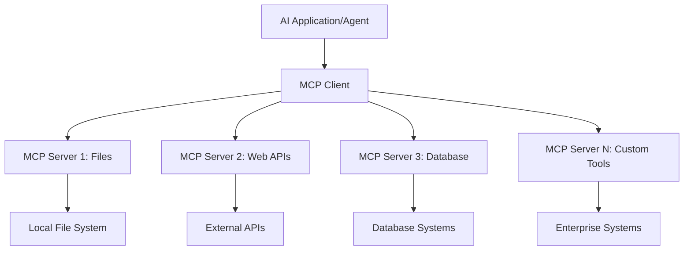

**🔧 Kerncomponenten:**

| Component | Rol | Voorbeelden |
| --------- | ---- | -------- |
| **MCP Hosts** | MCP-diensten consumeren | VS Code, Foundry Toolkit |
| **MCP Clients** | Protocolverbindingen afhandelen | Ingebouwd in hosts |
| **MCP Servers** | Mogelijkheden bieden | Playwright, Files, Azure, GitHub |
| **Transportlaag** | Verbindt clients en servers | stdio, HTTP, WebSockets |

## 🏢 Microsoft’s MCP Serverecosysteem

Microsoft leidt het MCP-ecosysteem met een uitgebreide set
enterprise-grade servers die alle bedrijfsbehoeften aanpakken.

### 🌟 Uitgelichte Microsoft MCP-servers

#### 1. ☁️ Azure MCP-server

**🔗 Reposi­tory**: [azure/azure-mcp](https://github.com/azure/azure-mcp)
**🎯 Doel**: Uitgebreid Azure resourcebeheer met AI-integratie

**✨ Belangrijkste kenmerken:**

- Declaratieve infrastructuurvoorziening
- Real-time monitoring van resources
- Aanbevelingen voor kostenoptimalisatie
- Beveiligingscompliancecontrole

**🚀 Toepassingen:**

- Infrastructure-as-Code met AI-ondersteuning
- Geautomatiseerde schaalvergroting van resources
- Cloudkostenoptimalisatie
- Automatisering van DevOps workflows

#### 2. 📊 Microsoft Dataverse MCP

**📚 Documentatie**: [Microsoft Dataverse Integratie](https://go.microsoft.com/fwlink/?linkid=2320176)
**🎯 Doel**: Natuurlijke taalinterface voor bedrijfsdata

**✨ Belangrijkste kenmerken:**

- Databasqueries in natuurlijke taal
- Begrip van zakelijke context
- Aangepaste prompt-sjablonen
- Enterprise databeheer

**🚀 Toepassingen:**

- Rapportages in business intelligence
- Analyse van klantdata
- Inzichten in sales pipeline
- Voldoen aan compliancedata-verzoeken

#### 3. 🌐 Playwright MCP-server

**🔗 Reposi­tory**: [microsoft/playwright-mcp](https://github.com/microsoft/playwright-mcp)
**🎯 Doel**: Browserautomatisering en webinteractiecapaciteiten

**✨ Belangrijkste kenmerken:**

- Cross-browser automatisering (Chrome, Firefox, Safari)
- Intelligente elementdetectie
- Screenshot- en PDF-generatie
- Monitoring van netwerkverkeer

**🚀 Toepassingen:**

- Geautomatiseerde testworkflows
- Webscraping en data-extractie
- UI/UX monitoring
- Automatisering van concurrentieanalyse

#### 4. 📁 Files MCP-server

**🔗 Reposi­tory**: [microsoft/files-mcp-server](https://github.com/microsoft/files-mcp-server)
**🎯 Doel**: Intelligente bestandsysteemoperaties

**✨ Belangrijkste kenmerken:**

- Declaratief bestandbeheer
- Inhoudssynchronisatie
- Integratie van versiebeheer
- Extractie van metadata

**🚀 Toepassingen:**

- Documentbeheer
- Organisatie van code-repositories
- Publicatieworkflows voor content
- Bestandsbeheer in datapijplijnen

#### 5. 📝 MarkItDown MCP-server

**🔗 Reposi­tory**: [microsoft/markitdown](https://github.com/microsoft/markitdown)
**🎯 Doel**: Geavanceerde Markdownverwerking en -manipulatie

**✨ Belangrijkste kenmerken:**

- Uitgebreide Markdown-parsing
- Formaatconversies (MD ↔ HTML ↔ PDF)
- Analyse van contentstructuur
- Verwerking van sjablonen

**🚀 Toepassingen:**

- Workflows voor technische documentatie
- Contentmanagementsystemen
- Generatie van rapporten
- Automatisering van kennisbanken

#### 6. 📈 Clarity MCP-server

**📦 Package**: [@microsoft/clarity-mcp-server](https://www.npmjs.com/package/@microsoft/clarity-mcp-server)
**🎯 Doel**: Webanalytics en gebruiksinzichten

**✨ Belangrijkste kenmerken:**

- Analyse van heatmapgegevens
- Opnames van gebruikerssessies
- Prestatiestatistieken
- Analyse van conversietrechters

**🚀 Toepassingen:**

- Websiteoptimalisatie
- Onderzoek naar gebruikerservaring
- A/B-testanalyse
- Business intelligence dashboards

### 🌍 Community Ecosysteem

Naast Microsoft’s servers omvat het MCP-ecosysteem:

- **🐙 GitHub MCP**: Repositori­beheer en code-analyse
- **🗄️ Database MCP's**: Integraties met PostgreSQL, MySQL, MongoDB
- **☁️ Cloud Provider MCP's**: Tools voor AWS, GCP, Digital Ocean
- **📧 Communicatie MCP's**: Integraties met Slack, Teams, Email

## 🛠️ Praktijklab: Een browserautomatiseringsagent bouwen

**🎯 Projectdoel**: Een intelligente browserautomatiseringsagent creëren met
Playwright MCP-server die websites kan navigeren, informatie kan extraheren en
complexe webinteracties kan uitvoeren.

### 🚀 Fase 1: Agentbasis opzetten

#### Stap 1: Initialiseer je agent

1. **Open Microsoft Foundry Toolkit Agent Builder**
2. **Maak een nieuwe agent aan** met de volgende configuratie:
   - **Naam**: `BrowserAgent`
   - **Model**: Kies GPT-5.1. Zie de
      [Microsoft Foundry modelpensioenplanning](https://learn.microsoft.com/azure/foundry/openai/concepts/model-retirement-schedule)
      voor actuele informatie over de levenscyclus van modellen.

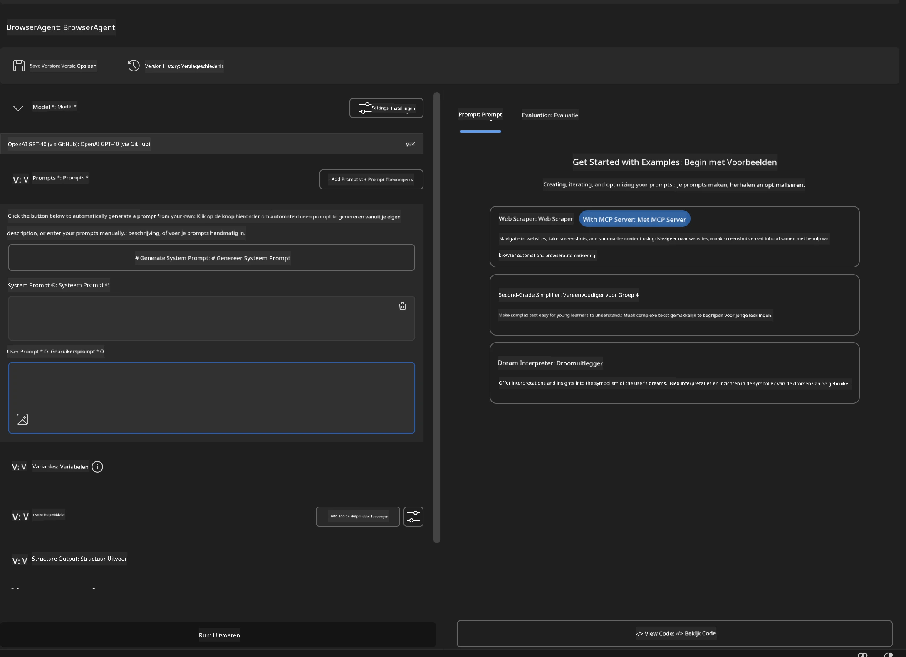

### 🔧 Fase 2: MCP-integratieworkflow

#### Stap 3: MCP-serverintegratie toevoegen

1. **Ga naar het gedeelte Tools** in Agent Builder
2. **Klik op "Tool toevoegen"** om het integratiemenu te openen
3. **Selecteer "MCP Server"** uit de beschikbare opties

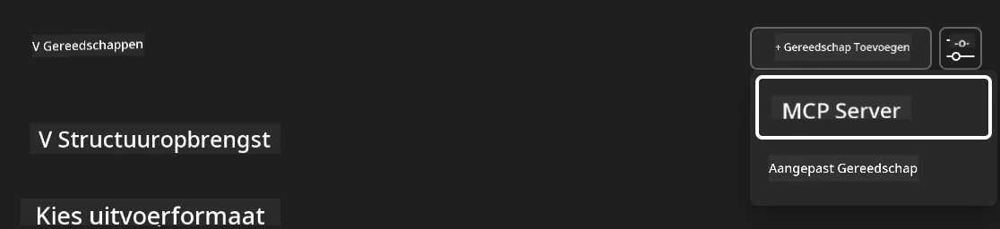

**🔍 Tooltypes begrijpen:**

- **Ingebouwde tools**: Vooraf geconfigureerde Microsoft Foundry Toolkit functies
- **MCP Servers**: Integraties met externe diensten
- **Aangepaste API's**: Je eigen service-eindpunten
- **Function Calling**: Directe model-functietoegang

#### Stap 4: MCP-serverselectie

1. **Kies de optie "MCP Server"** om door te gaan
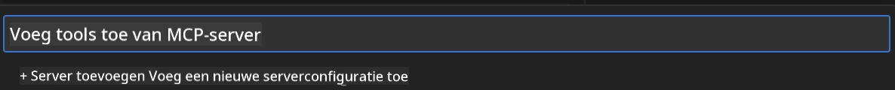

2. **Blader door de MCP-catalogus** om beschikbare integraties te bekijken
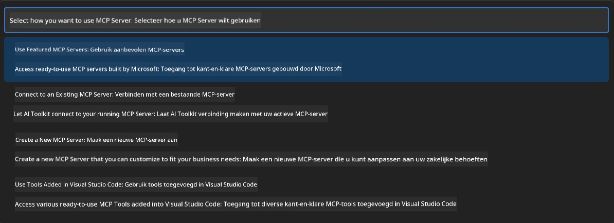

### 🎮 Fase 3: Playwright MCP-configuratie

#### Stap 5: Playwright selecteren en configureren

1. **Klik op "Gebruik uitgelichte MCP-servers"** om Microsoft’s geverifieerde servers te openen
2. **Selecteer "Playwright"** uit de uitgelichte lijst
3. **Accepteer de standaard MCP-ID** of pas deze aan voor je omgeving

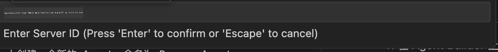

#### Stap 6: Playwright-capaciteiten inschakelen

**🔑 Kritieke stap**: Selecteer **ALLE** beschikbare Playwright-methoden voor maximale functionaliteit

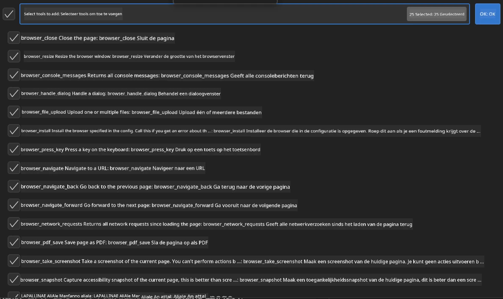

**🛠️ Essentiële Playwright-tools:**

- **Navigatie**: `goto`, `goBack`, `goForward`, `reload`
- **Interactie**: `click`, `fill`, `press`, `hover`, `drag`
- **Extractie**: `textContent`, `innerHTML`, `getAttribute`
- **Validatie**: `isVisible`, `isEnabled`, `waitForSelector`
- **Capture**: `screenshot`, `pdf`, `video`
- **Netwerk**: `setExtraHTTPHeaders`, `route`, `waitForResponse`

#### Stap 7: Verifieer integratiesucces

**✅ Succesindicatoren:**

- Alle tools verschijnen in de Agent Builder-interface
- Geen foutmeldingen in het integratievenster
- Playwright-serverstatus toont "Verbonden"

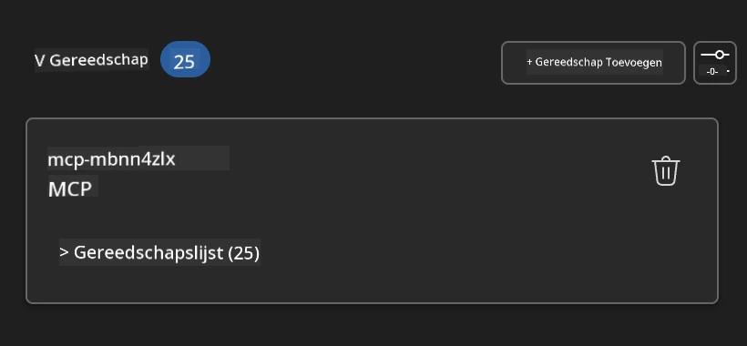

**🔧 Veelvoorkomende problemen oplossen:**

- **Verbinding mislukt**: Controleer internetverbinding en firewall-instellingen
- **Ontbrekende tools**: Zorg dat tijdens de setup alle mogelijkheden geselecteerd waren
- **Toestemmingsfouten**: Controleer of VS Code de benodigde systeemrechten heeft

### 🎯 Fase 4: Geavanceerde promptengineering

#### Stap 8: Ontwerp intelligente systeem-prompts

Maak geavanceerde prompts die de volledige mogelijkheden van Playwright benutten:

```markdown
# Web Automation Expert System Prompt

## Core Identity
You are an advanced web automation specialist with deep expertise in browser
automation, web scraping, and user experience analysis. You have access to
Playwright tools for comprehensive browser control.

## Capabilities & Approach
### Navigation Strategy
- Always start with screenshots to understand page layout
- Use semantic selectors (text content, labels) when possible
- Implement wait strategies for dynamic content
- Handle single-page applications (SPAs) effectively

### Error Handling
- Retry failed operations with exponential backoff
- Provide clear error descriptions and solutions
- Suggest alternative approaches when primary methods fail
- Always capture diagnostic screenshots on errors

### Data Extraction
- Extract structured data in JSON format when possible
- Provide confidence scores for extracted information
- Validate data completeness and accuracy
- Handle pagination and infinite scroll scenarios

### Reporting
- Include step-by-step execution logs
- Provide before/after screenshots for verification
- Suggest optimizations and alternative approaches
- Document any limitations or edge cases encountered

## Ethical Guidelines
- Respect robots.txt and rate limiting
- Avoid overloading target servers
- Only extract publicly available information
- Follow website terms of service
```

#### Stap 9: Creëer dynamische gebruikersprompts

Ontwerp prompts die verschillende mogelijkheden demonstreren:

**🌐 Voorbeeld webanalyse:**

```markdown
Navigate to github.com/kinfey and provide a comprehensive analysis including:
1. Repository structure and organization
2. Recent activity and contribution patterns  
3. Documentation quality assessment
4. Technology stack identification
5. Community engagement metrics
6. Notable projects and their purposes

Include screenshots at key steps and provide actionable insights.
```

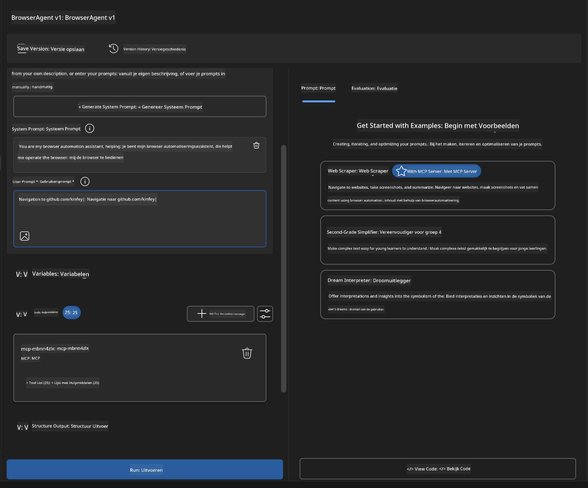

### 🚀 Fase 5: Uitvoering en testen

#### Stap 10: Voer je eerste automatisering uit

1. **Klik op "Run"** om de automatiseringsreeks te starten
2. **Monitor de uitvoering in realtime**:
   - De Chrome-browser wordt automatisch gestart
   - De agent navigeert naar de doelsite
   - Screenshots worden van elke belangrijke stap gemaakt
   - Analyse-resultaten stromen in realtime binnen

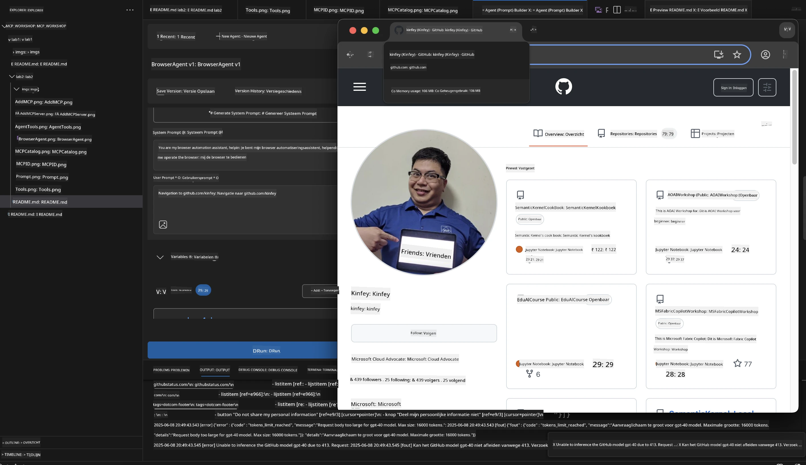

#### Stap 11: Analyseer resultaten en inzichten

Bekijk uitgebreide analyses in de interface van Agent Builder:

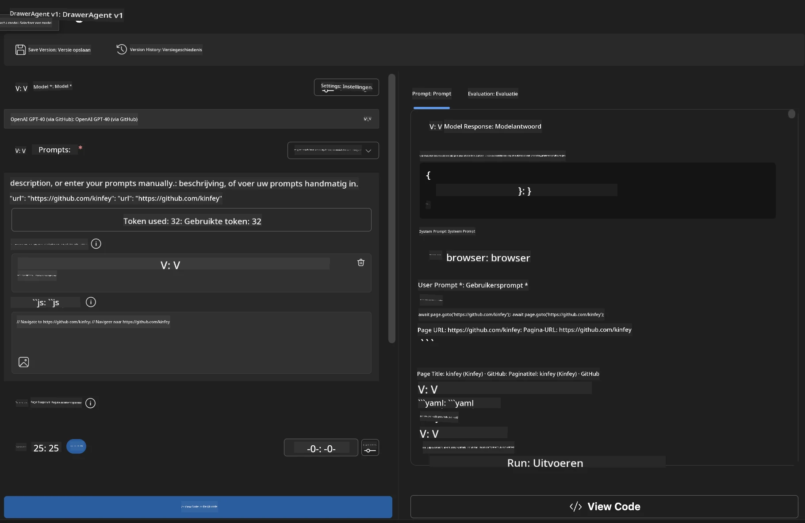

### 🌟 Fase 6: Geavanceerde mogelijkheden en uitrol

#### Stap 12: Export en productie-uitrol

Agent Builder ondersteunt diverse uitrolopties:

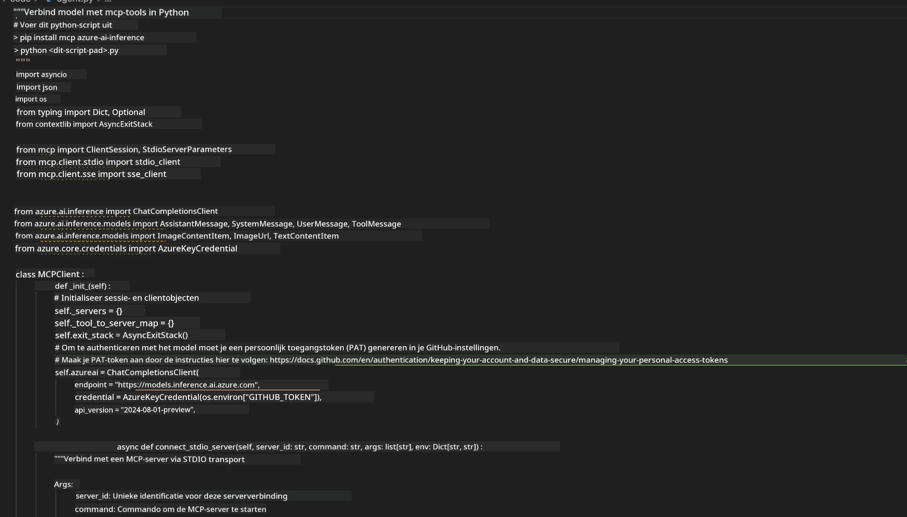

## 🎓 Samenvatting Module 2 & Volgende stappen

### 🏆 Prestatie behaald: MCP-integratiemeester

**✅ Beheersde vaardigheden:**

- [ ] MCP-architectuur en voordelen begrijpen
- [ ] Navigeren door Microsofts MCP-serverecosysteem
- [ ] Playwright MCP integreren met Microsoft Foundry Toolkit
- [ ] Geavanceerde browserautomatiseringsagents bouwen
- [ ] Geavanceerde promptengineering voor webautomatisering

### 📚 Aanvullende bronnen

- **🔗 MCP-specificatie**: [Officiële protocoldocumentatie](https://modelcontextprotocol.io/)
- **🛠️ Playwright API**: [Volledige methodereferentie](https://playwright.dev/docs/api/class-playwright)
- **🏢 Microsoft MCP-servers**:
   [Enterprise Integratiehandleiding](https://github.com/microsoft/mcp-servers)
- **🌍 Communityvoorbeelden**: [MCP-servergalerij](https://github.com/modelcontextprotocol/servers)

**🎉 Gefeliciteerd!** Je hebt MCP-integratie succesvol onder de knie en kunt nu
productieklare AI-agents bouwen met externe toolmogelijkheden!

### 🔜 Ga door naar de volgende module

Klaar om je MCP-vaardigheden naar een hoger niveau te tillen? Ga verder naar
**[Module 3: Geavanceerde MCP-ontwikkeling met Microsoft Foundry Toolkit](../lab3/README.md)**
waar je leert:

- Je eigen aangepaste MCP-servers creëren
- De nieuwste MCP Python SDK configureren en gebruiken
- De MCP Inspector instellen voor debugging
- Geavanceerde workflows voor MCP-serverontwikkeling beheersen
- Een Weather MCP-server helemaal zelf bouwen

---

<!-- CO-OP TRANSLATOR DISCLAIMER START -->
**Disclaimer**:
Dit document is vertaald met behulp van de AI vertaaldienst [Co-op Translator](https://github.com/Azure/co-op-translator). Hoewel we streven naar nauwkeurigheid, dient u er rekening mee te houden dat geautomatiseerde vertalingen fouten of onnauwkeurigheden kunnen bevatten. Het originele document in de oorspronkelijke taal moet worden beschouwd als de gezaghebbende bron. Voor kritieke informatie wordt professionele menselijke vertaling aanbevolen. Wij zijn niet aansprakelijk voor eventuele misverstanden of verkeerde interpretaties die voortvloeien uit het gebruik van deze vertaling.
<!-- CO-OP TRANSLATOR DISCLAIMER END -->