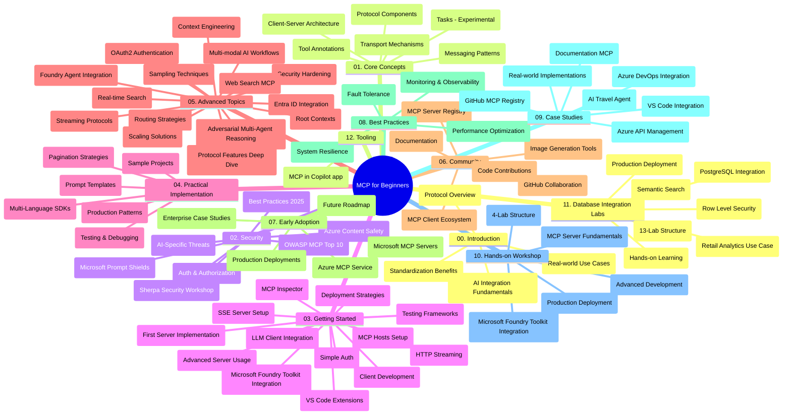

# Model Context Protocol (MCP) voor Beginners - Studiegids

Deze studiegids geeft een overzicht van de repository-structuur en inhoud voor het curriculum "Model Context Protocol (MCP) voor Beginners". Gebruik deze gids om efficiënt door de repository te navigeren en het maximale uit de beschikbare bronnen te halen.

## Overzicht Repository

Het Model Context Protocol (MCP) is een gestandaardiseerd raamwerk voor interacties tussen AI-modellen en clientapplicaties. Oorspronkelijk gemaakt door Anthropic, wordt MCP nu onderhouden door de bredere MCP-community via de officiële GitHub-organisatie. Deze repository biedt een uitgebreid curriculum met praktische codevoorbeelden in C#, Java, JavaScript, Python en TypeScript, ontworpen voor AI-ontwikkelaars, systeemarchitecten en software-engineers.

## Visuele Curriculumkaart

## Repositorystructuur

De repository is georganiseerd in twaalf hoofdsecties, die elk focussen op verschillende aspecten van MCP:

1. **Introductie (00-Introduction/)**
   - Overzicht van het Model Context Protocol
   - Waarom standaardisatie belangrijk is in AI-pijplijnen
   - Praktische use cases en voordelen

2. **Kernconcepten (01-CoreConcepts/)**
   - Client-server architectuur
   - Belangrijke protocolcomponenten
   - Messagingpatronen in MCP
   - Huidige specificatie: [Wat is er veranderd in MCP: De 2026-07-28 Specificatie](./01-CoreConcepts/mcp-2026-07-28.md) — de stateless protocolkern, Extensies-framework, en Roots/Sampling/Logging-uitschakelingen

3. **Beveiliging (02-Security/)**
   - Beveiligingsbedreigingen in MCP-gebaseerde systemen
   - Best practices voor het beveiligen van implementaties
   - Authenticatie- en autorisatiestrategieën
   - Praktijkvoorbeeld [CIMD- en DCR-autorisatie](./02-Security/samples/cimd-dcr-auth/README.md)
   - **Uitgebreide beveiligingsdocumentatie**:
     - MCP Security Best Practices
     - Azure Content Safety Implementatiegids
     - MCP Security Controls en technieken
     - MCP Best Practices Quick Reference
   - **Belangrijke beveiligingsthema’s**:
     - Prompt-injectie- en toolvergiftigingsaanvallen
     - Sessiekaping en confused deputy-problemen
     - Token passthrough-kwetsbaarheden
     - Overmatige permissies en toegangscontrole
     - Supply chain-beveiliging voor AI-componenten
     - Integratie van Microsoft Prompt Shields

4. **Aan de slag (03-GettingStarted/)**
   - Omgevingsconfiguratie en setup
   - Het creëren van basis-MCP-servers en -clients
   - Integratie met bestaande applicaties
   - Inclusief secties voor:
     - Eerste serverimplementatie
     - Clientontwikkeling
     - LLM-clientintegratie
     - VS Code-integratie
     - Server-Sent Events (SSE) server
     - Geavanceerd servergebruik
     - HTTP-streaming
    - Integratie Microsoft Foundry Toolkit
     - Teststrategieën
     - Deployment-richtlijnen

5. **Praktische Implementatie (04-PracticalImplementation/)**
   - Gebruik van SDK's in verschillende programmeertalen
   - Debugging-, test- en validatietechnieken
   - Het maken van herbruikbare promptsjablonen en workflows
   - Voorbeeldprojecten met implementatievoorbeelden

6. **Geavanceerde Onderwerpen (05-AdvancedTopics/)**
   - Context-engineeringstechnieken
   - Foundry-agentintegratie
   - Multi-modale AI-workflows 
   - OAuth2 authenticatiedemo’s
   - Real-time zoekmogelijkheden
   - Real-time streaming
   - Implementatie van Root-contexten
   - Routingstrategieën
   - Samplingtechnieken
   - Scaleeraanpakken
   - Beveiligingsoverwegingen
   - Entra ID beveiligingsintegratie
   - Web zoekintegratie
   - Adversarial multi-agent reasoning (debatpatronen)

7. **Community Bijdragen (06-CommunityContributions/)**
   - Hoe code en documentatie bij te dragen
   - Samenwerken via GitHub
   - Community-gestuurde verbeteringen en feedback
   - Gebruik van diverse MCP-clients (Claude Desktop, Cline, VSCode)
   - Werken met populaire MCP-servers inclusief beeldgeneratie

8. **Lessen uit vroege adoptie (07-LessonsfromEarlyAdoption/)**
   - Praktijkimplementaties en succesverhalen
   - Bouwen en uitrollen van MCP-gebaseerde oplossingen
   - Trends en toekomstroutekaart
   - **Microsoft MCP Servers Gids**: Uitgebreide gids voor 10 productieklare Microsoft MCP-servers inclusief:
     - Microsoft Learn Docs MCP Server
     - Azure MCP Server (15+ gespecialiseerde connectors)
     - GitHub MCP Server
     - Azure DevOps MCP Server
     - MarkItDown MCP Server
     - SQL Server MCP Server
     - Playwright MCP Server
     - Dev Box MCP Server
     - Microsoft Foundry MCP Server
     - Microsoft 365 Agents Toolkit MCP Server

9. **Best Practices (08-BestPractices/)**
   - Prestatieoptimalisatie en afstemming
   - Ontwerpen van fouttolerante MCP-systemen
   - Test- en veerkrachtstrategieën

10. **Case Studies (09-CaseStudy/)**
    - **Zeven uitgebreide case studies** die de veelzijdigheid van MCP in diverse scenario's tonen:
    - **Azure AI Travel Agents**: Multi-agent orkestratie met Azure OpenAI en AI Search
    - **Azure DevOps Integratie**: Automatisering van workflowprocessen met YouTube-data-updates
    - **Realtime documentopvraging**: Python console client met streaming HTTP
    - **Interactieve studieplangenerator**: Chainlit webapp met converserende AI
    - **In-Editor Documentatie**: VS Code-integratie met GitHub Copilot-workflows
    - **Azure API Management**: Enterprise API-integratie met MCP-servercreatie
    - **GitHub MCP Registry**: Ecosysteemontwikkeling en agentische integratieplatform
    - Implementatievoorbeelden variërend van enterprise-integratie, ontwikkelaarproductiviteit tot ecosysteemontwikkeling

11. **Praktische Workshop (10-StreamliningAIWorkflowsBuildingAnMCPServerWithAIToolkit/)**
    - Uitgebreide praktijkworkshop die MCP combineert met Microsoft Foundry Toolkit
    - Bouwen van intelligente applicaties die AI-modellen koppelen aan tools uit de echte wereld
    - Praktische modules over fundamenten, aangepaste serverontwikkeling en productie-uitrolstrategieën
    - **Labstructuur**:
      - Lab 1: MCP Server Fundamentals
      - Lab 2: Geavanceerde MCP Serverontwikkeling
      - Lab 3: Integratie Microsoft Foundry Toolkit
      - Lab 4: Productie-uitrol en schaalvergroting
    - Lab-gebaseerde leerbenadering met stapsgewijze instructies

12. **MCP Server Database Integratie Labs (11-MCPServerHandsOnLabs/)**
    - **Uitgebreid 13-labs leertraject** voor het bouwen van productieklare MCP-servers met PostgreSQL-integratie
    - **Praktijkimplementatie retail analytics** met de Zava Retail use case
    - **Enterprise-grade patronen** zoals Row Level Security (RLS), semantisch zoeken en multi-tenant data toegang
    - **Volledige labstructuur**:
      - **Labs 00-03: Fundamenten** - Introductie, Architectuur, Beveiliging, Omgeving Setup
      - **Labs 04-06: Het bouwen van de MCP Server** - Databaseontwerp, MCP Serverimplementatie, Toolontwikkeling
      - **Labs 07-09: Geavanceerde functies** - Semantisch zoeken, testen & debuggen, VS Code-integratie
      - **Labs 10-12: Productie & best practices** - Deployment, monitoring, optimalisatie
    - **Behandelde technologieën**: FastMCP framework, PostgreSQL, Azure OpenAI, Azure Container Apps, Application Insights
    - **Leeruitkomsten**: Productieklare MCP-servers, database-integratiepatronen, AI-gestuurde analytics, enterprise beveiliging

13. **Tooling (12-tooling/)**
    - Leer hoe je MCP gebruikt in Copilot-apps en andere tools

## Aanvullende bronnen

De repository bevat ondersteunende middelen:

- **Afbeeldingenmap**: Bevat diagrammen en illustraties die door het curriculum worden gebruikt
- **Vertalingen**: Meertalige ondersteuning met automatische vertalingen van documentatie
- **Officiële MCP-bronnen**:
  - [MCP Documentatie](https://modelcontextprotocol.io/)
  - [MCP Specificatie](https://modelcontextprotocol.io/specification/2026-07-28/)
  - [MCP GitHub Repository](https://github.com/modelcontextprotocol)

## Hoe deze repository te gebruiken

1. **Sequentieel Leren**: Volg de hoofdstukken in volgorde (00 tot en met 11) voor een gestructureerde leerervaring.
2. **Taalgerichte focus**: Als je geïnteresseerd bent in een specifieke programmeertaal, verken dan de sampledirectories voor implementaties in je voorkeursprogrammeeromgeving.
3. **Praktische implementatie**: Begin met de sectie "Aan de slag" om je omgeving in te stellen en je eerste MCP-server en -client te maken.
4. **Geavanceerde verkenning**: Zodra je comfortabel bent met de basis, duik je in de geavanceerde onderwerpen om je kennis uit te breiden.
5. **Communitybetrokkenheid**: Word lid van de MCP-community via GitHub-discussies en Discord-kanalen om in contact te komen met experts en mede-ontwikkelaars.

## MCP-clients en tools

Het curriculum behandelt verschillende MCP-clients en tools:

1. **Officiële Clients**:
   - Visual Studio Code 
   - MCP in Visual Studio Code
   - Claude Desktop
   - Claude in VSCode 
   - Claude API

2. **Community Clients**:
   - Cline (terminal-gebaseerd)
   - Cursor (code-editor)
   - ChatMCP
   - Windsurf

3. **MCP Management Tools**:
   - MCP CLI
   - MCP Manager
   - MCP Linker
   - MCP Router

## Populaire MCP-servers

De repository introduceert verschillende MCP-servers, waaronder:

1. **Officiële Microsoft MCP-servers**:
   - Microsoft Learn Docs MCP Server
   - Azure MCP Server (15+ gespecialiseerde connectors)
   - GitHub MCP Server
   - Azure DevOps MCP Server
   - MarkItDown MCP Server
   - SQL Server MCP Server
   - Playwright MCP Server
   - Dev Box MCP Server
   - Microsoft Foundry MCP Server
   - Microsoft 365 Agents Toolkit MCP Server

2. **Officiële referentieservers**:
   - Filesysteem
   - Fetch
   - Geheugen
   - Sequentieel denken

3. **Beeldgeneratie**:
   - Azure OpenAI DALL-E 3
   - Stable Diffusion WebUI
   - Replicate

4. **Ontwikkeltools**:
   - Git MCP
   - Terminal Control
   - Code Assistant

5. **Gespecialiseerde servers**:
   - Salesforce
   - Microsoft Teams
   - Jira & Confluence

## Bijdragen

Deze repository verwelkomt bijdragen vanuit de community. Zie de sectie Community Contributions voor richtlijnen over hoe effectief bij te dragen aan het MCP-ecosysteem.

----

*Deze studiegids is voor het laatst bijgewerkt op 9 september 2026. Het weerspiegelt MCP
Specificatie `2026-07-28`, de huidige protocolrevisie. Sommige praktische
voorbeelden blijven expliciet geversioneerd op `2025-11-25` terwijl hun SDK's en tools
de stateless protocol-API's overnemen.*

---

<!-- CO-OP TRANSLATOR DISCLAIMER START -->
**Disclaimer**:
Dit document is vertaald met behulp van de AI vertaaldienst [Co-op Translator](https://github.com/Azure/co-op-translator). Hoewel we streven naar nauwkeurigheid, dient u er rekening mee te houden dat geautomatiseerde vertalingen fouten of onnauwkeurigheden kunnen bevatten. Het originele document in de oorspronkelijke taal moet worden beschouwd als de gezaghebbende bron. Voor kritieke informatie wordt professionele menselijke vertaling aanbevolen. Wij zijn niet aansprakelijk voor eventuele misverstanden of verkeerde interpretaties die voortvloeien uit het gebruik van deze vertaling.
<!-- CO-OP TRANSLATOR DISCLAIMER END -->