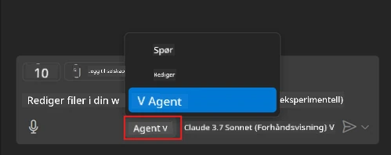
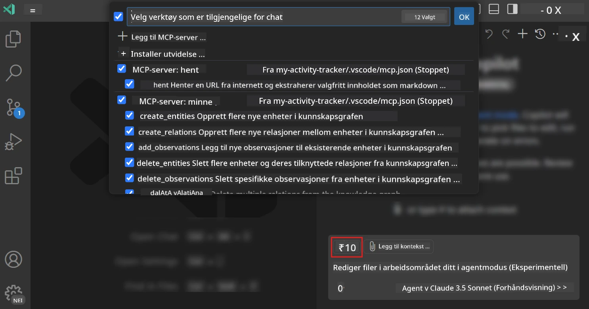
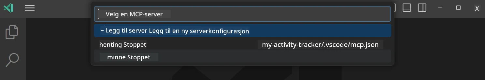
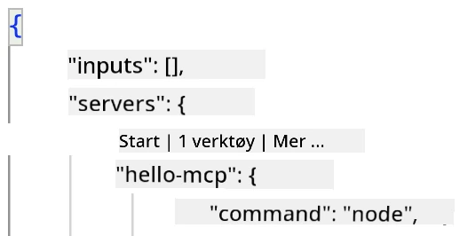
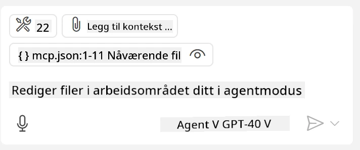
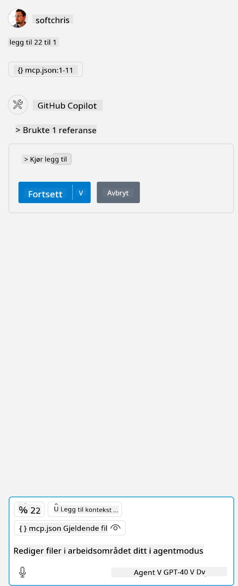

# Bruke en server fra GitHub Copilot Agent-modus

Visual Studio Code og GitHub Copilot kan fungere som en klient og bruke en MCP-server. Hvorfor skulle vi ønske å gjøre det, lurer du kanskje på? Vel, det betyr at uansett hvilke funksjoner MCP-serveren har, kan de nå brukes fra IDE-en din. Tenk deg at du legger til for eksempel GitHubs MCP-server, dette vil gjøre det mulig å kontrollere GitHub via forespørsler i stedet for å skrive spesifikke kommandoer i terminalen. Eller tenk generelt på noe som kan forbedre utvikleropplevelsen din, alt styrt av naturlig språk. Nå begynner du å se fordelen, ikke sant?

## Oversikt

Denne leksjonen dekker hvordan du bruker Visual Studio Code og GitHub Copilot sin Agent-modus som klient for din MCP-server.

## Læringsmål

Mot slutten av denne leksjonen vil du kunne:

- Bruke en MCP-server via Visual Studio Code.
- Kjøre funksjoner som verktøy via GitHub Copilot.
- Konfigurere Visual Studio Code for å finne og administrere MCP-serveren din.

## Bruk

Du kan kontrollere MCP-serveren din på to forskjellige måter:

- Brukergrensesnitt, du vil se hvordan dette gjøres senere i dette kapitlet.
- Terminal, det er mulig å kontrollere ting fra terminalen ved å bruke `code`-kjørbar fil:

  For å legge til en MCP-server til brukerprofilen din, bruk kommandolinjealternativet --add-mcp, og oppgi JSON-serverkonfigurasjonen i form av {\"name\":\"server-navn\",\"command\":...}.

  ```
  code --add-mcp "{\"name\":\"my-server\",\"command\": \"uvx\",\"args\": [\"mcp-server-fetch\"]}"
  ```

### Skjermbilder





La oss snakke mer om hvordan vi bruker det visuelle grensesnittet i neste del.

## Tilnærming

Slik må vi tilnærme oss dette på et overordnet nivå:

- Konfigurer en fil for å finne MCP-serveren vår.
- Start opp/koble til nevnte server for å få den til å liste opp funksjonene sine.
- Bruk disse funksjonene gjennom GitHub Copilot Chat-grensesnittet.

Flott, nå som vi forstår flyten, la oss prøve å bruke en MCP-server gjennom Visual Studio Code med en øvelse.

## Øvelse: Bruke en server

I denne øvelsen skal vi konfigurere Visual Studio Code til å finne MCP-serveren din slik at den kan brukes fra GitHub Copilot Chat-grensesnittet.

### -0- Forberedelse, aktiver oppdagelse av MCP-server

Du må kanskje aktivere oppdagelse av MCP-servere.

1. Gå til `File -> Preferences -> Settings` i Visual Studio Code.

1. Søk etter "MCP" og aktiver `chat.mcp.discovery.enabled` i filen settings.json.

### -1- Opprett konfigurasjonsfil

Start med å opprette en konfigurasjonsfil i prosjektets rotmappe, du trenger en fil som heter MCP.json og som må plasseres i en mappe kalt .vscode. Den skal se slik ut:

```text
.vscode
|-- mcp.json
```

Neste, la oss se hvordan vi kan legge til en serveroppføring.

### -2- Konfigurer en server

Legg til følgende innhold i *mcp.json*:

```json
{
    "inputs": [],
    "servers": {
       "hello-mcp": {
           "command": "node",
           "args": [
               "build/index.js"
           ]
       }
    }
}
```

Her er et enkelt eksempel ovenfor på hvordan du starter en server skrevet i Node.js, for andre kjøretider angir du riktig kommando for å starte serveren ved bruk av `command` og `args`.

### -3- Start serveren

Nå som du har lagt til en oppføring, la oss starte serveren:

1. Finn oppføringen din i *mcp.json* og sørg for at du ser "spill"-ikonet:

    

1. Klikk på "spill"-ikonet, du bør se at verktøyikonet i GitHub Copilot Chat øker antall tilgjengelige verktøy. Om du klikker på dette verktøyikonet, vil du se en liste over registrerte verktøy. Du kan sjekke/avkrysse hvert verktøy avhengig av om du ønsker at GitHub Copilot skal bruke dem som kontekst:

  

1. For å kjøre et verktøy, skriv inn en prompt som du vet passer beskrivelsen av et av verktøyene dine, for eksempel en slik prompt: "legg til 22 på 1":

  

  Du bør se et svar som sier 23.

## Oppgave

Prøv å legge til en serveroppføring i filen *mcp.json* og sørg for at du kan starte/stoppe serveren. Sørg også for at du kan kommunisere med verktøyene på serveren via GitHub Copilot Chat-grensesnittet.

## Løsning

[Løsning](./solution/README.md)

## Viktige punkter

De viktigste punktene fra dette kapitlet er følgende:

- Visual Studio Code er en flott klient som lar deg bruke flere MCP-servere og deres verktøy.
- GitHub Copilot Chat-grensesnittet er hvordan du samhandler med serverne.
- Du kan be brukeren om inndata som API-nøkler som kan sendes til MCP-serveren når du konfigurerer serveroppføringen i filen *mcp.json*.

## Eksempler

- [Java-kalkulator](../samples/java/calculator/README.md)
- [.NET-kalkulator](../../../../03-GettingStarted/samples/csharp)
- [JavaScript-kalkulator](../samples/javascript/README.md)
- [TypeScript-kalkulator](../samples/typescript/README.md)
- [Python-kalkulator](../../../../03-GettingStarted/samples/python)

## Ytterligere ressurser

- [Visual Studio-dokumentasjon](https://code.visualstudio.com/docs/copilot/chat/mcp-servers)

## Hva nå

- Neste: [Opprette en stdio-server](../05-stdio-server/README.md)

---

<!-- CO-OP TRANSLATOR DISCLAIMER START -->
**Ansvarsfraskrivelse**:
Dette dokumentet er oversatt ved hjelp av AI-oversettelsestjenesten [Co-op Translator](https://github.com/Azure/co-op-translator). Selv om vi streber etter nøyaktighet, vær oppmerksom på at automatiske oversettelser kan inneholde feil eller unøyaktigheter. Det opprinnelige dokumentet på originalspråket skal betraktes som den autoritative kilden. For kritisk informasjon anbefales profesjonell menneskelig oversettelse. Vi er ikke ansvarlige for eventuelle misforståelser eller feiltolkninger som oppstår ved bruk av denne oversettelsen.
<!-- CO-OP TRANSLATOR DISCLAIMER END -->