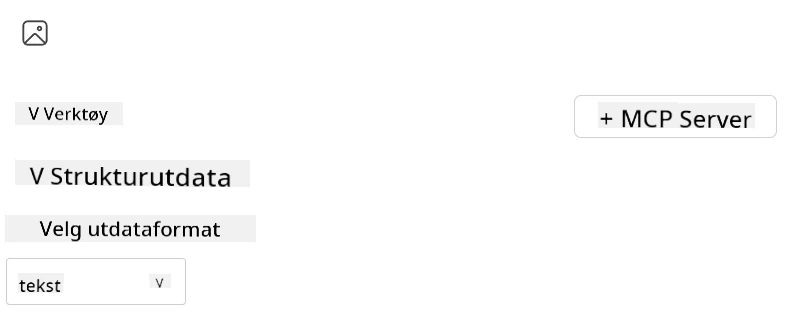
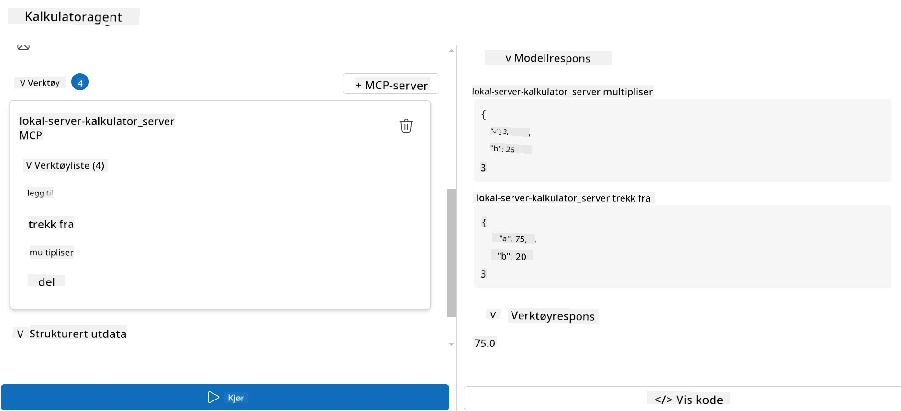

# Forbruke en server med Microsoft Foundry Toolkit for Visual Studio Code

Når du bygger en AI-agent handler det ikke bare om å generere smarte svar; det handler også om å gi agenten din evnen til å utføre handlinger. Det er her Model Context Protocol (MCP) kommer inn. MCP gjør det enkelt for agenter å få tilgang til eksterne verktøy og tjenester på en konsistent måte. Tenk på det som å koble agenten din til en verktøykasse den *faktisk* kan bruke.

La oss si at du kobler en agent til din kalkulator MCP-server. Plutselig kan agenten din utføre matteoperasjoner bare ved å motta en prompt som «Hva er 47 ganger 89?» — uten behov for å hardkode logikk eller bygge tilpassede API-er.

## Oversikt

Denne leksjonen dekker hvordan du kobler en kalkulator MCP-server til en agent med
[Microsoft Foundry Toolkit for Visual Studio Code](https://aka.ms/AIToolkit),
slik at agenten din kan utføre matteoperasjoner gjennom naturlig språk.

Microsoft Foundry Toolkit strømlinjeformer utvikling og testing av generative
AI-applikasjoner med lokale og skybaserte modeller.

*Merk*: Toolkit støtter for øyeblikket Python og TypeScript MCP-maler.

## Læringsmål

Når du er ferdig med denne leksjonen, vil du kunne:

- Forbruke en MCP-server med Microsoft Foundry Toolkit.
- Konfigurere en agentkonfigurasjon for å gjøre den i stand til å oppdage og bruke verktøy levert av MCP-serveren.
- Bruke MCP-verktøy via naturlig språk.

## Fremgangsmåte

Slik må vi tilnærme oss dette på et overordnet nivå:

- Lag en agent og definer dens systemprompt.
- Lag en MCP-server med kalkulatorverktøy.
- Koble Agent Builder til MCP-serveren.
- Test agentens verktøysanrop via naturlig språk.

Flott, nå som vi forstår flyten, la oss konfigurere en AI-agent til å utnytte eksterne verktøy gjennom MCP, og forbedre dens kapasiteter!

## Forutsetninger

- [Visual Studio Code](https://code.visualstudio.com/)
- [Microsoft Foundry Toolkit for Visual Studio Code](https://aka.ms/AIToolkit)

## Øvelse: Forbruke en server

> [!WARNING]
> Merk for macOS-brukere. Vi undersøker for øyeblikket et problem som påvirker installasjon av avhengigheter på macOS. Som et resultat vil ikke macOS-brukere kunne fullføre denne veiledningen for øyeblikket. Vi vil oppdatere instruksjonene så snart en løsning er tilgjengelig. Takk for din tålmodighet og forståelse!

I denne øvelsen vil du bygge, kjøre og forbedre en AI-agent med verktøy fra
en MCP-server i Visual Studio Code ved hjelp av Microsoft Foundry Toolkit.

### -0- Forberedelse, legg til en Microsoft Foundry GPT-5.1 distribusjon

Opprett en Microsoft Foundry-ressurs, distribuer **GPT-5.1**, og legg til distribusjonen
i **Mine modeller**. Se over
[modellsensureringsplanen](https://learn.microsoft.com/azure/foundry/openai/concepts/model-retirement-schedule)
når du velger en distribusjon.

1. Åpne **Microsoft Foundry Toolkit** fra **Aktivitetslinjen**.
1. I **Katalog**-delen, velg **Modeller** for å åpne **Modellkatalogen**. Å velge **Modeller** åpner **Modellkatalogen** i en ny redigertab.
1. Koble til ditt Microsoft Foundry-prosjekt og velg din **GPT-5.1** distribusjon.
1. Klikk **+ Legg til** for å legge distribusjonen til listen **Mine modeller**.
1. I **Aktivitetslinjen**, bekreft at distribusjonen vises i listen.

### -1- Lag en agent

**Agent (Prompt) Builder** gjør det mulig for deg å lage og tilpasse dine egne AI-drevne agenter. I denne delen vil du lage en ny agent og tildele en modell for å styre samtalen.

1. Åpne **Microsoft Foundry Toolkit** fra **Aktivitetslinjen**.
1. I **Verktøy**-delen, velg **Agent (Prompt) Builder**. Å velge **Agent (Prompt) Builder** åpner **Agent (Prompt) Builder** i en ny redigertab.
1. Klikk på knappen **+ Ny Agent**. Utvidelsen vil starte en oppsettsveiviser via **Kommandomenyen**.
1. Tast inn navnet **Calculator Agent** og trykk **Enter**.
1. I **Agent (Prompt) Builder**, velg din **GPT-5.1** Foundry-distribusjon.

### -2- Lag en systemprompt for agenten

Nå som agenten er satt opp, er det på tide å definere personlighet og hensikt. I denne delen skal du bruke funksjonen **Generer systemprompt** for å beskrive agentens tiltenkte atferd — i dette tilfellet en kalkulatoragent — og la modellen skrive systemprompten for deg.

1. For delen **Prompt**, klikk på knappen **Generer systemprompt**. Denne knappen åpner promptbyggeren, som bruker AI til å generere en systemprompt for agenten.
1. I vinduet **Generer en prompt**, tast inn følgende: `You are a helpful and efficient math assistant. When given a problem involving basic arithmetic, you respond with the correct result.`
1. Klikk på knappen **Generer**. En notifikasjon vil vises i nedre høyre hjørne og bekrefte at systemprompten genereres. Når genereringen er fullført, vises prompten i feltet **Systemprompt** i **Agent (Prompt) Builder**.
1. Gå gjennom **Systemprompt** og gjør endringer hvis nødvendig.

### -3- Lag en MCP-server

Nå som du har definert agentens systemprompt — som styrer adferd og svar — er det på tide å utruste agenten med praktiske funksjoner. I denne delen lager du en kalkulator MCP-server med verktøy for å utføre addisjon, subtraksjon, multiplikasjon og divisjon. Denne serveren vil gjøre det mulig for agenten å utføre matteoperasjoner i sanntid som svar på naturlige språk-prompt.



Microsoft Foundry Toolkit inkluderer maler for å lage MCP-servere. Vi vil
bruke Python-malen for kalkulator MCP-serveren.

*Merk*: Toolkit støtter for øyeblikket Python og TypeScript MCP-maler.

1. I **Verktøy**-delen i **Agent (Prompt) Builder**, klikk på knappen **+ MCP Server**. Utvidelsen vil starte en oppsettsveiviser via **Kommandomenyen**.
1. Velg **+ Legg til server**.
1. Velg **Opprett en ny MCP-server**.
1. Velg **python-weather** som malen.
1. Velg **Standard mappe** for å lagre MCP-servermalen.
1. Skriv inn følgende navn for serveren: **Calculator**
1. Et nytt Visual Studio Code-vindu vil åpne. Velg **Ja, jeg stoler på forfatterne**.
1. Bruk terminalen (**Terminal** > **Ny terminal**) og opprett et virtuelt miljø: `python -m venv .venv`
1. Bruk terminalen og aktiver det virtuelle miljøet:
    1. Windows - `.venv\Scripts\activate`
    1. macOS/Linux - `source .venv/bin/activate`
1. Bruk terminalen for å installere avhengighetene: `pip install -e .[dev]`
1. I **Utforsker**-visningen i **Aktivitetslinjen**, utvid **src**-mappen og velg **server.py** for å åpne filen i editoren.
1. Erstatt koden i filen **server.py** med følgende og lagre:

    ```python
    """
    Sample MCP Calculator Server implementation in Python.

    
    This module demonstrates how to create a simple MCP server with calculator tools
    that can perform basic arithmetic operations (add, subtract, multiply, divide).
    """
    
    from mcp.server.fastmcp import FastMCP
    
    server = FastMCP("calculator")
    
    @server.tool()
    def add(a: float, b: float) -> float:
        """Add two numbers together and return the result."""
        return a + b
    
    @server.tool()
    def subtract(a: float, b: float) -> float:
        """Subtract b from a and return the result."""
        return a - b
    
    @server.tool()
    def multiply(a: float, b: float) -> float:
        """Multiply two numbers together and return the result."""
        return a * b
    
    @server.tool()
    def divide(a: float, b: float) -> float:
        """
        Divide a by b and return the result.
        
        Raises:
            ValueError: If b is zero
        """
        if b == 0:
            raise ValueError("Cannot divide by zero")
        return a / b
    ```

### -4- Kjør agenten med kalkulator MCP-serveren

Nå som agenten din har verktøy, er det på tide å bruke dem! I denne delen skal du sende promter til agenten for å teste og validere om agenten bruker riktig verktøy fra kalkulator MCP-serveren.



Du vil kjøre kalkulator MCP-serveren på din lokale utviklingsmaskin via **Agent Builder** som MCP-klient.

1. Trykk `F5` for å starte feilsøking av MCP-serveren. **Agent (Prompt) Builder** vil åpne i en ny redigertab. Status for serveren vises i terminalen.
1. I feltet **Brukerpåminnelse** i **Agent (Prompt) Builder**, tast inn følgende prompt: `I bought 3 items priced at $25 each, and then used a $20 discount. How much did I pay?`
1. Klikk på knappen **Kjør** for å generere agentens svar.
1. Gå gjennom agentens output. Modellen skal konkludere med at du betalte **$55**.
1. Her er en oversikt over hva som bør skje:
    - Agenten velger verktøyene **multiply** og **subtract** for å hjelpe i kalkulasjonen.
    - De respektive `a` og `b` verdiene er tildelt for verktøyet **multiply**.
    - De respektive `a` og `b` verdiene er tildelt for verktøyet **subtract**.
    - Svaret fra hvert verktøy vises i den respektive **Tool Response**.
    - Det endelige output fra modellen vises i slutt **Model Response**.
1. Send flere promter for å teste agenten ytterligere. Du kan endre den eksisterende prompten i **Brukerpåminnelse** ved å klikke i feltet og erstatte prompten.
1. Når du er ferdig med å teste agenten, kan du stoppe serveren via **terminalen** ved å taste **CTRL/CMD+C** for å avslutte.

## Oppgave

Prøv å legge til et ekstra verktøy i din fil **server.py** (for eksempel: returner kvadratroten av et tall). Send flere promter som krever at agenten bruker ditt nye verktøy (eller eksisterende verktøy). Husk å restarte serveren for å laste inn de nylig lagde verktøyene.

## Løsning

[Løsning](./solution/README.md)

## Viktige punkter

De viktigste punktene fra dette kapitlet er følgende:

- Microsoft Foundry Toolkit kan forbruke MCP-servere og deres verktøy.
- Du kan legge til nye verktøy til MCP-servere, og dermed utvide agentens kapasiteter for å møte endrede krav.
- Microsoft Foundry Toolkit inkluderer MCP-servermaler for å lage tilpassede verktøy.

## Ytterligere ressurser

- [Microsoft Foundry Toolkit dokumentasjon](https://aka.ms/AIToolkit/doc)

## Hva nå
- Neste: [Testing og feilsøking](../08-testing/README.md)

---

<!-- CO-OP TRANSLATOR DISCLAIMER START -->
**Ansvarsfraskrivelse**:
Dette dokumentet er oversatt ved hjelp av AI-oversettelsestjenesten [Co-op Translator](https://github.com/Azure/co-op-translator). Selv om vi streber etter nøyaktighet, vær oppmerksom på at automatiske oversettelser kan inneholde feil eller unøyaktigheter. Det opprinnelige dokumentet på originalspråket skal betraktes som den autoritative kilden. For kritisk informasjon anbefales profesjonell menneskelig oversettelse. Vi er ikke ansvarlige for eventuelle misforståelser eller feiltolkninger som oppstår ved bruk av denne oversettelsen.
<!-- CO-OP TRANSLATOR DISCLAIMER END -->