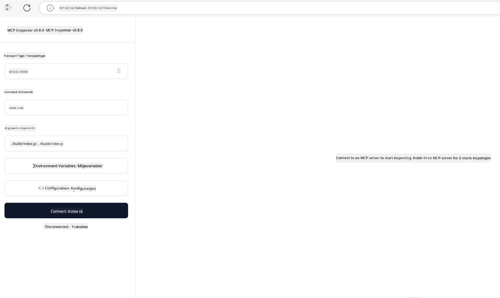

## Testing og feilsøking

Før du begynner å teste MCP-serveren din, er det viktig å forstå tilgjengelige verktøy og beste praksis for feilsøking. Effektiv testing sikrer at serveren din oppfører seg som forventet og hjelper deg med å raskt identifisere og løse problemer. Følgende seksjon skisserer anbefalte tilnærminger for å validere din MCP-implementering.

## Oversikt

Denne leksjonen dekker hvordan du velger riktig testtilnærming og det mest effektive testverktøyet.

## Læringsmål

Ved slutten av denne leksjonen vil du kunne:

- Beskrive ulike tilnærminger for testing.
- Bruke forskjellige verktøy for å effektivt teste koden din.


## Testing av MCP-servere

MCP tilbyr verktøy som hjelper deg med å teste og feilsøke serverne dine:

- **MCP Inspector**: Et kommandolinjeverktøy som kan kjøres både som CLI-verktøy og som et visuelt verktøy.
- **Manuell testing**: Du kan bruke et verktøy som curl for å kjøre nettverksforespørsler, men hvilket som helst verktøy som kan kjøre HTTP vil fungere.
- **Enhetstesting**: Det er mulig å bruke ditt foretrukne testingsrammeverk for å teste funksjonene til både server og klient.

### Bruke MCP Inspector

Vi har beskrevet bruken av dette verktøyet i tidligere leksjoner, men la oss snakke litt om det på et høyt nivå. Det er et verktøy bygget i Node.js, og du kan bruke det ved å kalle `npx` kjørbare fil som vil laste ned og installere verktøyet midlertidig og vil rydde opp etter seg når forespørselen din er kjørt.

Inspektøren [MCP Inspector](https://github.com/modelcontextprotocol/inspector) hjelper deg med å:

- **Oppdag serverkapasiteter**: Oppdag automatisk tilgjengelige ressurser, verktøy og instruksjoner
- **Test verktøykjøring**: Prøv forskjellige parametere og se svarene i sanntid
- **Se servermetadata**: Undersøk serverinformasjon, skjemaer og konfigurasjoner

En typisk kjøring av verktøyet ser slik ut:

```bash
npx @modelcontextprotocol/inspector node build/index.js
```

Kommandoen ovenfor starter en MCP og dens visuelle grensesnitt og åpner et lokalt webgrensesnitt i nettleseren din. Du kan forvente å se et dashbord som viser dine registrerte MCP-servere, deres tilgjengelige verktøy, ressurser og forespørsler. Grensesnittet lar deg interaktivt teste verktøykjøring, inspisere servermetadata og se sanntidssvar, noe som gjør det enklere å validere og feilsøke implementeringene av MCP-serverne dine.

Slik kan det se ut: 

Du kan også kjøre dette verktøyet i CLI-modus, i så fall legger du til `--cli`-attributtet. Her er et eksempel på å kjøre verktøyet i "CLI"-modus som lister opp alle verktøyene på serveren:

```sh
npx @modelcontextprotocol/inspector --cli node build/index.js --method tools/list
```

### Manuell Testing

I tillegg til å kjøre inspektørverktøyet for å teste serverkapabiliteter, er en annen lignende tilnærming å kjøre en klient som kan bruke HTTP, for eksempel curl.

Med curl kan du teste MCP-servere direkte ved hjelp av HTTP-forespørsler:

```bash
# Example: Test server metadata
curl http://localhost:3000/v1/metadata

# Example: Execute a tool
curl -X POST http://localhost:3000/v1/tools/execute \
  -H "Content-Type: application/json" \
  -d '{"name": "calculator", "parameters": {"expression": "2+2"}}'
```

Som du kan se fra bruken av curl ovenfor, bruker du en POST-forespørsel for å påkalle et verktøy ved å sende med en nyttelast som består av verktøyets navn og dets parametere. Bruk den tilnærmingen som passer deg best. CLI-verktøy generelt pleier å være raskere å bruke og egner seg for skripting, noe som kan være nyttig i et CI/CD-miljø.

### Enhetstesting

Lag enhetstester for dine verktøy og ressurser for å sikre at de fungerer som forventet. Her er noe eksempeltestkode.

```python
import pytest

from mcp.server.fastmcp import FastMCP
from mcp.shared.memory import (
    create_connected_server_and_client_session as create_session,
)

# Mark the whole module for async tests
pytestmark = pytest.mark.anyio


async def test_list_tools_cursor_parameter():
    """Test that the cursor parameter is accepted for list_tools.

    Note: FastMCP doesn't currently implement pagination, so this test
    only verifies that the cursor parameter is accepted by the client.
    """

 server = FastMCP("test")

    # Create a couple of test tools
    @server.tool(name="test_tool_1")
    async def test_tool_1() -> str:
        """First test tool"""
        return "Result 1"

    @server.tool(name="test_tool_2")
    async def test_tool_2() -> str:
        """Second test tool"""
        return "Result 2"

    async with create_session(server._mcp_server) as client_session:
        # Test without cursor parameter (omitted)
        result1 = await client_session.list_tools()
        assert len(result1.tools) == 2

        # Test with cursor=None
        result2 = await client_session.list_tools(cursor=None)
        assert len(result2.tools) == 2

        # Test with cursor as string
        result3 = await client_session.list_tools(cursor="some_cursor_value")
        assert len(result3.tools) == 2

        # Test with empty string cursor
        result4 = await client_session.list_tools(cursor="")
        assert len(result4.tools) == 2
    
```

Den foregående koden gjør følgende:

- Utnytter pytest-rammeverket som lar deg lage tester som funksjoner og bruke assert-setninger.
- Oppretter en MCP Server med to forskjellige verktøy.
- Bruker `assert`-setningen for å sjekke at visse betingelser er oppfylt.

Ta en titt på [hele filen her](https://github.com/modelcontextprotocol/python-sdk/blob/main/tests/client/test_list_methods_cursor.py)

Med den ovenstående filen kan du teste din egen server for å sikre at funksjonene opprettes som de skal.

Alle store SDK-er har lignende testseksjoner slik at du kan tilpasse til ditt valgte runtime.

## Eksempler 

- [Java Kalkulator](../samples/java/calculator/README.md)
- [.NET Kalkulator](../../../../03-GettingStarted/samples/csharp)
- [JavaScript Kalkulator](../samples/javascript/README.md)
- [TypeScript Kalkulator](../samples/typescript/README.md)
- [Python Kalkulator](../../../../03-GettingStarted/samples/python) 

## Ytterligere ressurser

- [Python SDK](https://github.com/modelcontextprotocol/python-sdk)

## Hva skjer videre

- Neste: [Distribusjon](../09-deployment/README.md)

---

<!-- CO-OP TRANSLATOR DISCLAIMER START -->
**Ansvarsfraskrivelse**:
Dette dokumentet er oversatt ved hjelp av AI-oversettelsestjenesten [Co-op Translator](https://github.com/Azure/co-op-translator). Selv om vi streber etter nøyaktighet, vær oppmerksom på at automatiske oversettelser kan inneholde feil eller unøyaktigheter. Det opprinnelige dokumentet på originalspråket skal betraktes som den autoritative kilden. For kritisk informasjon anbefales profesjonell menneskelig oversettelse. Vi er ikke ansvarlige for eventuelle misforståelser eller feiltolkninger som oppstår ved bruk av denne oversettelsen.
<!-- CO-OP TRANSLATOR DISCLAIMER END -->