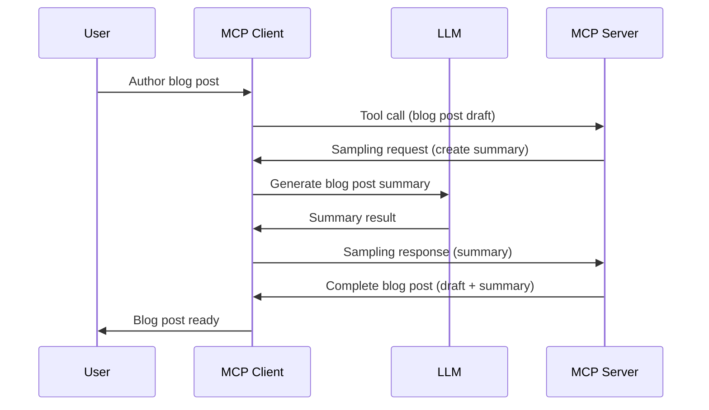

> [!WARNING]
> Sampling er avviklet i MCP `2026-07-28`. Denne leksjonen beholdes for
> eldre implementasjoner. Nye servere bør integreres direkte med en LLM
> leverandør-API.

# Sampling - delegere funksjoner til klienten

> Sampling forblir i `2026-07-28`-spesifikasjonen for kompatibilitet og er
> aktuell for fjerning i første revisjon utgitt 28. juli 2027 eller senere.
> Eksempler i denne leksjonen kan bruke SDK-APIer som implementerer `2025-11-25`.
> Se [Hva som er endret i MCP: Spesifikasjonen 2026-07-28](../../01-CoreConcepts/mcp-2026-07-28.md).

I eldre implementasjoner lar Sampling en MCP-server be om hjelp fra en LLM
som administreres av klienten. For nye implementasjoner bør du ringe den valgte LLM-leverandøren
direkte i stedet.

La oss utforske noen bruksområder og hvordan man bygger en løsning med sampling.

## Oversikt

I denne leksjonen fokuserer vi på å forklare når og hvor man skal bruke Sampling og hvordan konfigurere det.

## Læringsmål

I dette kapitlet vil vi:

- Forklare hva Sampling er og når man skal bruke det.
- Vise hvordan man konfigurerer Sampling i MCP.
- Gi eksempler på Sampling i bruk.

## Hva er Sampling og hvorfor bruke det?

Sampling er en avansert funksjon som fungerer på følgende måte:



### Sampling-forespørsel

Ok, nå har vi et overordnet bilde av et troverdig scenario, la oss snakke om sampling-forespørselen serveren sender tilbake til klienten. Slik kan en slik forespørsel se ut i JSON-RPC-format:

```json
{
  "jsonrpc": "2.0",
  "id": 1,
  "method": "sampling/createMessage",
  "params": {
    "messages": [
      {
        "role": "user",
        "content": {
          "type": "text",
          "text": "Create a blog post summary of the following blog post: <BLOG POST>"
        }
      }
    ],
    "modelPreferences": {
      "hints": [
        {
          "name": "gpt-5.1"
        }
      ],
      "intelligencePriority": 0.8,
      "speedPriority": 0.5
    },
    "systemPrompt": "You are a helpful assistant.",
    "maxTokens": 100
  }
}
```

Det er noen ting her som er verdt å nevne:

- Prompt, under content -> text, er vår prompt som er en instruksjon for at LLM skal oppsummere blogginnhold.

- **modelPreferences**. Denne seksjonen er nettopp det, et preferansefelt, en anbefaling om hvilken konfigurasjon som bør brukes med LLM. Brukeren kan velge om disse anbefalingene skal følges eller endres. I dette tilfellet er det anbefalinger om modell å bruke samt prioritering av hastighet og intelligens.
- **systemPrompt**, dette er din vanlige systemprompt som gir LLM-en din en personlighet og inneholder veiledende instruksjoner.
- **maxTokens**, dette er en annen egenskap som angir hvor mange tokens som anbefales brukt til denne oppgaven.

### Sampling-svar

Dette svaret er det MCP-klienten ender opp med å sende tilbake til MCP-serveren og er resultatet av at klienten kaller LLM, venter på svaret og deretter bygger denne meldingen. Slik kan det se ut i JSON-RPC:

```json
{
  "jsonrpc": "2.0",
  "id": 1,
  "result": {
    "role": "assistant",
    "content": {
      "type": "text",
      "text": "Here's your abstract <ABSTRACT>"
    },
    "model": "gpt-5.1",
    "stopReason": "endTurn"
  }
}
```

Svaret er et sammendrag av blogginnlegget, akkurat som forespurt. Klienten
valgte den aktive `gpt-5.1`-utrullingen fra serverens modellpreferanse;
modellpreferanser er anbefalinger, så klienten kan velge en annen aktiv
utrulling når det kreves.

Ok, nå som vi forstår hovedflyten, og det nyttige oppdraget å bruke det til "blogginnlegg + sammendrag", la oss se hva som trengs for å få det til å fungere.

### Meldings typer

Sampling-meldinger er ikke begrenset til bare tekst, men du kan også sende bilder og lyd. Slik ser JSON-RPC ut annerledes ut:

**Tekst**

```json
{
  "type": "text",
  "text": "The message content"
}
```

**Bildeinnhold**

```json
{
  "type": "image",
  "data": "base64-encoded-image-data",
  "mimeType": "image/jpeg"
}
```

**Lydinnhold**

```json
{
  "type": "audio",
  "data": "base64-encoded-audio-data",
  "mimeType": "audio/wav"
}
```

> NOTE: For gjeldende status og migrasjonsveiledning, se
> [avviklet Sampling-dokumentasjon](https://modelcontextprotocol.io/specification/2026-07-28/client/sampling).

## Hvordan konfigurere Sampling i klienten

> Merk: hvis du kun bygger en server, trenger du ikke gjøre mye her.

I en klient må du spesifisere følgende funksjon slik:

```json
{
  "capabilities": {
    "sampling": {}
  }
}
```

Dette vil da bli fanget opp når din valgte klient initialiserer med serveren.

## Eksempel på Sampling i praksis – Lag et blogginnlegg

La oss kode en sampling-server sammen, vi må gjøre følgende:

1. Lag et verktøy på serveren.
1. Det nevnte verktøyet skal lage en sampling-forespørsel.
1. Verktøyet skal vente på at klientens sampling-forespørsel blir besvart.
1. Deretter skal verktøy-resultatet produseres.

La oss se koden steg for steg:

### -1- Lag verktøyet

**python**

```python
@mcp.tool()
async def create_blog(title: str, content: str, ctx: Context[ServerSession, None]) -> str:
    """Create a blog post and generate a summary"""

```

### -2- Lag en sampling-forespørsel

Utvid verktøyet ditt med følgende kode:

**python**

```python
post = BlogPost(
        id=len(posts) + 1,
        title=title,
        content=content,
        abstract=""
    )

prompt = f"Create an abstract of the following blog post: title: {title} and draft: {content} "

result = await ctx.session.create_message(
        messages=[
            SamplingMessage(
                role="user",
                content=TextContent(type="text", text=prompt),
            )
        ],
        max_tokens=100,
)

```

### -3- Vent på respons og returner respons

**python**

```python
post.abstract = result.content.text

posts.append(post)

# return the complete product
return json.dumps({
    "id": post.title,
    "abstract": post.abstract
})
```

### -4- Full kode

**python**

```python
from starlette.applications import Starlette
from starlette.routing import Mount, Host

from mcp.server.fastmcp import Context, FastMCP

from mcp.server.session import ServerSession
from mcp.types import SamplingMessage, TextContent

import json


from uuid import uuid4
from typing import List
from pydantic import BaseModel


mcp = FastMCP("Blog post generator")

# app = FastAPI()

posts = []

class BlogPost(BaseModel):
    id: int
    title: str
    content: str
    abstract: str

posts: List[BlogPost] = []

@mcp.tool()
async def create_blog(title: str, content: str, ctx: Context[ServerSession, None]) -> str:
    """Create a blog post and generate a summary"""

    post = BlogPost(
        id=len(posts) + 1,
        title=title,
        content=content,
        abstract=""
    )

    prompt = f"Create an abstract of the following blog post: title: {title} and draft: {content} "

    result = await ctx.session.create_message(
        messages=[
            SamplingMessage(
                role="user",
                content=TextContent(type="text", text=prompt),
            )
        ],
        max_tokens=100,
    )

    post.abstract = result.content.text

    posts.append(post)

    # return the complete blog post
    return json.dumps({
        "id": post.title,
        "abstract": post.abstract
    })

if __name__ == "__main__":
    print("Starting server...")
    # mcp.run()
    mcp.run(transport="streamable-http")

# run app with: python server.py
```

### -5- Teste det i Visual Studio Code

For å teste dette i Visual Studio Code, gjør følgende:

1. Start server i terminalen
1. Legg det til i *mcp.json* (og sørg for at det starter) f.eks. noe slikt:

   ```json
   "servers": {
      "blog-server": {
        "type": "http",
        "url": "http://localhost:8000/mcp"
      }
   }
   ```

1. Skriv inn en prompt:

   ```text
   create a blog post named "Where Python comes from", the content is "Python is actually named after Monty Python Flying Circus"
   ```

1. La sampling skje. Første gang du tester dette vil du bli presentert for en ekstra dialog du må godta, deretter vil du se den vanlige dialogen som spør om du vil kjøre et verktøy

1. Inspiser resultater. Du vil se resultatene både pent gjengitt i GitHub Copilot Chat, men du kan også inspisere det rå JSON-svaret.

**Bonus**. Visual Studio Code-verktøy tilbyr god støtte for sampling. Du kan konfigurere Sampling-tilgang på din installerte server ved å navigere slik:

1. Naviger til utvidelsesdelen.
1. Velg tannhjulikonet for din installerte server under "MCP SERVERS - INSTALLED".
1 Velg "Configure Model Access", her kan du velge hvilke Modeller GitHub Copilot får bruke når sampling utføres. Du kan også se alle sampling-forespørsler som har skjedd nylig ved å velge "Show Sampling requests".

## Oppgave

I denne oppgaven skal du bygge en litt annen Sampling, nemlig en sampling-integrasjon som støtter generering av en produktbeskrivelse. Her er ditt scenario:

**Scenario**: Backoffice-medarbeideren i en e-handel trenger hjelp, det tar altfor lang tid å lage produktbeskrivelser. Derfor skal du bygge en løsning hvor du kan ringe et verktøy "create_product" med "title" og "keywords" som argumenter, og det skal produsere et komplett produkt inkludert et "description"-felt som skal fylles ut av en klients LLM.

TIP: bruk det du lærte tidligere for å konstruere denne serveren og dens verktøy ved hjelp av en sampling-forespørsel.

## Løsning

[Løsning](./solution/README.md)

## Viktige poeng

Sampling er en kraftfull funksjon som lar serveren delegere oppgaver til klienten når den trenger hjelp fra en LLM.

## Hva nå

- [Kapittel 4 - Praktisk implementering](../../04-PracticalImplementation/README.md)

---

<!-- CO-OP TRANSLATOR DISCLAIMER START -->
**Ansvarsfraskrivelse**:
Dette dokumentet er oversatt ved hjelp av AI-oversettelsestjenesten [Co-op Translator](https://github.com/Azure/co-op-translator). Selv om vi streber etter nøyaktighet, vær oppmerksom på at automatiske oversettelser kan inneholde feil eller unøyaktigheter. Det opprinnelige dokumentet på originalspråket skal betraktes som den autoritative kilden. For kritisk informasjon anbefales profesjonell menneskelig oversettelse. Vi er ikke ansvarlige for eventuelle misforståelser eller feiltolkninger som oppstår ved bruk av denne oversettelsen.
<!-- CO-OP TRANSLATOR DISCLAIMER END -->