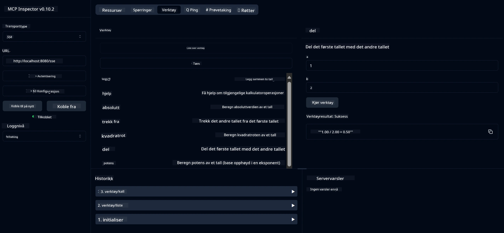

# Grunnleggende Kalkulator MCP-tjeneste

> [!NOTE]
> Dette eksempelet bruker den eldre HTTP+SSE-transporten og er rettet mot en SDK-kompatibel
> med MCP `2025-11-25`. Nye eksterne servere bør bruke `2026-07-28` Streamable
> HTTP-støtte.

Denne tjenesten tilbyr grunnleggende kalkulatoroperasjoner gjennom Model Context Protocol (MCP) ved bruk av Spring Boot med WebFlux-transport. Den er designet som et enkelt eksempel for nybegynnere som lærer om MCP-implementasjoner.

For mer informasjon, se [MCP Server Boot Starter](https://docs.spring.io/spring-ai/reference/api/mcp/mcp-server-boot-starter-docs.html) referansedokumentasjonen.

## Oversikt

Tjenesten viser:
- Støtte for SSE (Server-Sent Events)
- Automatisk verktøyregistrering ved bruk av Spring AI sin `@Tool`-annotasjon
- Grunnleggende kalkulatorfunksjoner:
  - Addisjon, subtraksjon, multiplikasjon, divisjon
  - Potensberegning og kvadratrot
  - Modulus (rest) og absoluttverdi
  - Hjelpefunksjon for operasjonsbeskrivelser

## Funksjoner

Denne kalkulatortjenesten tilbyr følgende muligheter:

1. **Grunnleggende aritmetiske operasjoner**:
   - Addisjon av to tall
   - Subtraksjon av ett tall fra et annet
   - Multiplikasjon av to tall
   - Divisjon av ett tall med et annet (med null-divisjonskontroll)

2. **Avanserte operasjoner**:
   - Potensberegning (heve en base til en eksponent)
   - Kvadratrotberegning (med kontroll for negative tall)
   - Modulus (rest) beregning
   - Beregning av absoluttverdi

3. **Hjelpesystem**:
   - Innebygd hjelpefunksjon som forklarer alle tilgjengelige operasjoner

## Bruke tjenesten

Tjenesten eksponerer følgende API-endepunkter gjennom MCP-protokollen:

- `add(a, b)`: Legg sammen to tall
- `subtract(a, b)`: Trekk det andre tallet fra det første
- `multiply(a, b)`: Multipliser to tall
- `divide(a, b)`: Del det første tallet på det andre (med nullkontroll)
- `power(base, exponent)`: Beregn potens av et tall
- `squareRoot(number)`: Beregn kvadratroten (med kontroll for negative tall)
- `modulus(a, b)`: Beregn resten ved divisjon
- `absolute(number)`: Beregn absoluttverdien
- `help()`: Få informasjon om tilgjengelige operasjoner

## Testklient

En enkel testklient er inkludert i `com.microsoft.mcp.sample.client`-pakken. Klassen `SampleCalculatorClient` demonstrerer de tilgjengelige operasjonene i kalkulatortjenesten.

## Bruke LangChain4j-klienten

Prosjektet inkluderer en eksempelklient for LangChain4j i
`com.microsoft.mcp.sample.client.LangChain4jClient` som viser hvordan man
integrerer kalkulatortjenesten med en Microsoft Foundry-modell.

### Forutsetninger

1. Opprett en Microsoft Foundry-ressurs og deployer en aktiv modell som
   `gpt-5.1`.
2. Sett modellendepunkt, API-nøkkel og deployeringsnavn:

   ```bash
   export AZURE_OPENAI_ENDPOINT="https://<resource-name>.openai.azure.com"
   export AZURE_OPENAI_API_KEY="<api-key>"
   export AZURE_OPENAI_DEPLOYMENT="gpt-5.1"
   ```

3. Sjekk
   [Microsoft Foundry model retirement schedule](https://learn.microsoft.com/azure/foundry/openai/concepts/model-retirement-schedule)
   før du velger en deployment.
4. Sørg for at kalkulatorserveren kjører på `localhost:8080`.

### Kjøre LangChain4j-klienten

Dette eksempelet viser:
- Tilkobling til kalkulator MCP-server via SSE-transport
- Bruke LangChain4j for å lage en chatbot som bruker kalkulatoroperasjoner
- Integrasjon med en deployert Microsoft Foundry-modell

Klienten sender følgende eksempelspørringer for å demonstrere funksjonalitet:
1. Beregning av summen av to tall
2. Finne kvadratroten av et tall
3. Få hjelp med informasjon om tilgjengelige kalkulatoroperasjoner

Kjør eksempelet og sjekk konsollutgangen for å se hvordan AI-modellen bruker kalkulatorverktøyene til å svare på spørringer.

### Microsoft Foundry-modellkonfigurasjon

LangChain4j-klienten bruker Azure OpenAI v1-kompatibelt endepunkt eksponert av
Microsoft Foundry:

```java
String endpoint = System.getenv("AZURE_OPENAI_ENDPOINT");
ChatLanguageModel model = OpenAiOfficialChatModel.builder()
   .baseUrl(endpoint.replaceAll("/+$", "") + "/openai/v1/")
   .apiKey(System.getenv("AZURE_OPENAI_API_KEY"))
   .isAzure(true)
   .modelName(System.getenv().getOrDefault("AZURE_OPENAI_DEPLOYMENT", "gpt-5.1"))
    .timeout(Duration.ofSeconds(60))
    .build();
```

`AZURE_OPENAI_DEPLOYMENT` må samsvare med navnet gitt ved deployering av modellen,
som kan avvike fra det underliggende modellnavnet.

## Avhengigheter

Prosjektet krever følgende nøkkelavhengigheter:

```xml
<!-- For MCP Server -->
<dependency>
    <groupId>org.springframework.ai</groupId>
    <artifactId>spring-ai-starter-mcp-server-webflux</artifactId>
</dependency>

<!-- For LangChain4j integration -->
<dependency>
    <groupId>dev.langchain4j</groupId>
    <artifactId>langchain4j-mcp</artifactId>
    <version>${langchain4j.version}</version>
</dependency>

<!-- For Microsoft Foundry's OpenAI-compatible endpoint -->
<dependency>
    <groupId>dev.langchain4j</groupId>
   <artifactId>langchain4j-open-ai-official</artifactId>
    <version>${langchain4j.version}</version>
</dependency>
```

## Bygge prosjektet

Bygg prosjektet med Maven:
```bash
./mvnw clean install -DskipTests
```

## Kjøre serveren

### Bruke Java

```bash
java -jar target/calculator-server-0.0.1-SNAPSHOT.jar
```

### Bruke MCP Inspector

MCP Inspector er et nyttig verktøy for interaksjon med MCP-tjenester. For å bruke det med denne kalkulatortjenesten:

1. **Installer og kjør MCP Inspector** i et nytt terminalvindu:
   ```bash
   npx @modelcontextprotocol/inspector
   ```

2. **Åpne webgrensesnittet** ved å klikke på URL som vises av appen (vanligvis http://localhost:6274)

3. **Konfigurer tilkoblingen**:
   - Sett transporttypen til "SSE"
   - Sett URL til kjørende servers SSE-endepunkt: `http://localhost:8080/sse`
   - Klikk "Koble til"

4. **Bruk verktøyene**:
   - Klikk "List Tools" for å se tilgjengelige kalkulatoroperasjoner
   - Velg et verktøy og klikk "Run Tool" for å utføre en operasjon



### Bruke Docker

Prosjektet inkluderer en Dockerfile for containerisert deployering:

1. **Bygg Docker-bildet**:
   ```bash
   docker build -t calculator-mcp-service .
   ```

2. **Kjør Docker-containeren**:
   ```bash
   docker run -p 8080:8080 calculator-mcp-service
   ```

Dette vil:
- Bygge et multi-stadium Docker-bilde med Maven 3.9.9 og Eclipse Temurin 24 JDK
- Lage et optimalisert containerbilde
- Eksponere tjenesten på port 8080
- Starte MCP kalkulatortjenesten inne i containeren

Du kan få tilgang til tjenesten på `http://localhost:8080` når containeren kjører.

## Feilsøking

### Vanlige problemer med modelltilkobling

1. **Autentiseringsfeil**: Bekreft at `AZURE_OPENAI_API_KEY` tilhører
   ressursen identifisert av `AZURE_OPENAI_ENDPOINT`.
2. **Deployment ikke funnet**: Bekreft at `AZURE_OPENAI_DEPLOYMENT` samsvarer
   nøyaktig med deployeringsnavnet i Microsoft Foundry.
3. **Hastighetsbegrensning**: Se over deployeringskvoten og prøv igjen etter intervall
   oppgitt av tjenesten.

For mer hjelp, se
[LangChain4j-dokumentasjon](https://github.com/langchain4j/langchain4j) og
[Microsoft Foundry-dokumentasjon](https://learn.microsoft.com/azure/ai-foundry/).

---

<!-- CO-OP TRANSLATOR DISCLAIMER START -->
**Ansvarsfraskrivelse**:
Dette dokumentet er oversatt ved hjelp av AI-oversettelsestjenesten [Co-op Translator](https://github.com/Azure/co-op-translator). Selv om vi streber etter nøyaktighet, vær oppmerksom på at automatiske oversettelser kan inneholde feil eller unøyaktigheter. Det opprinnelige dokumentet på originalspråket skal betraktes som den autoritative kilden. For kritisk informasjon anbefales profesjonell menneskelig oversettelse. Vi er ikke ansvarlige for eventuelle misforståelser eller feiltolkninger som oppstår ved bruk av denne oversettelsen.
<!-- CO-OP TRANSLATOR DISCLAIMER END -->