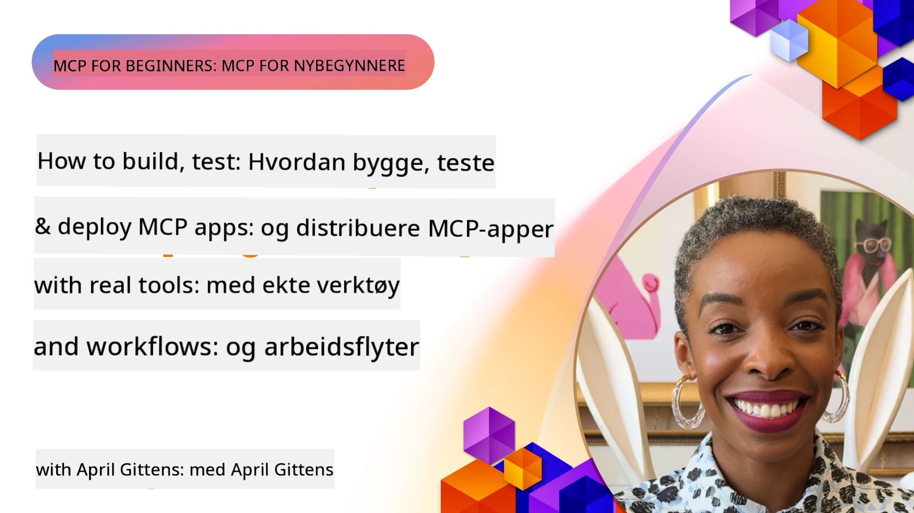
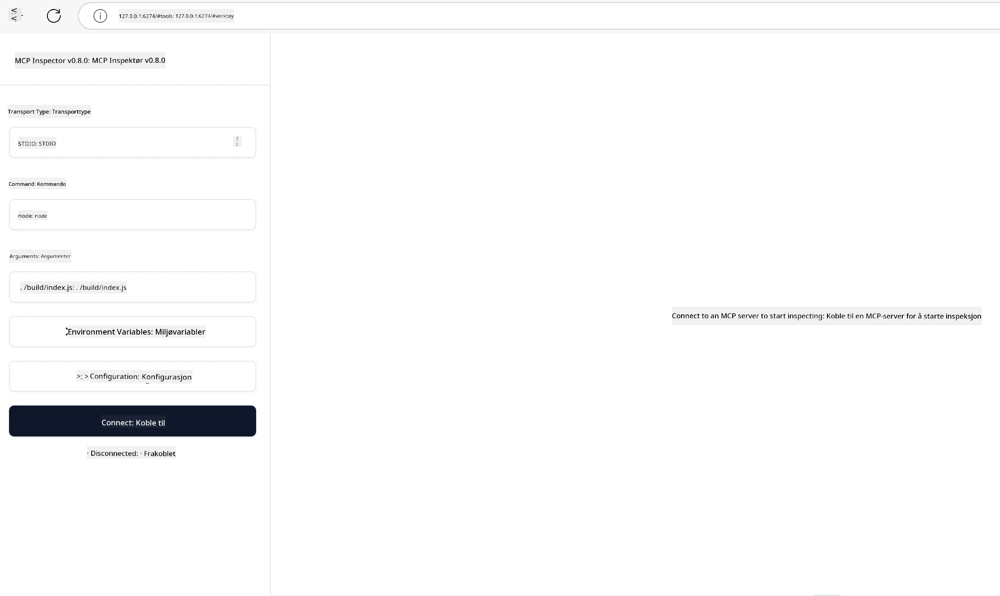

# Praktisk implementering

[](https://youtu.be/vCN9-mKBDfQ)

_(Klikk på bildet over for å se video av denne leksjonen)_

Praktisk implementering er der kraften til Model Context Protocol (MCP) blir håndgripelig. Selv om det er viktig å forstå teorien og arkitekturen bak MCP, oppstår den virkelige verdien når du anvender disse konseptene for å bygge, teste og distribuere løsninger som løser virkelige problemer. Dette kapitlet brobygger gapet mellom konseptuell kunnskap og praktisk utvikling, og leder deg gjennom prosessen med å realisere MCP-baserte applikasjoner.

Enten du utvikler intelligente assistenter, integrerer AI i forretningsprosesser, eller bygger tilpassede verktøy for databehandling, gir MCP et fleksibelt grunnlag. Dens språkagnostiske design og offisielle SDK-er for populære programmeringsspråk gjør den tilgjengelig for et bredt spekter av utviklere. Ved å benytte disse SDK-ene kan du raskt prototype, iterere og skalere løsningene dine på tvers av forskjellige plattformer og miljøer.

I de følgende seksjonene finner du praktiske eksempler, eksempel kode og distribusjonsstrategier som demonstrerer hvordan man implementerer MCP i C#, Java med Spring, TypeScript, JavaScript og Python. Du vil også lære hvordan du feilsøker og tester dine MCP-servere, administrerer API-er, og distribuerer løsninger til skyen ved hjelp av Azure. Disse praktiske ressursene er designet for å akselerere læringen din og hjelpe deg med å bygge robuste MCP-applikasjoner klare for produksjon.

## Oversikt

Denne leksjonen fokuserer på praktiske aspekter ved MCP-implementering på flere programmeringsspråk. Vi skal utforske hvordan man bruker MCP SDK-er i C#, Java med Spring, TypeScript, JavaScript og Python for å bygge robuste applikasjoner, feilsøke og teste MCP-servere, og lage gjenbrukbare ressurser, prompts og verktøy.

## Læringsmål

Innen slutten av denne leksjonen skal du kunne:

- Implementere MCP-løsninger ved bruk av offisielle SDK-er i ulike programmeringsspråk
- Systematisk feilsøke og teste MCP-servere
- Lage og bruke serverfunksjoner (Ressurser, Prompts og Verktøy)
- Designe effektive MCP-arbeidsflyter for komplekse oppgaver
- Optimere MCP-implementeringer for ytelse og pålitelighet

## Offisielle SDK-ressurser

Model Context Protocol tilbyr offisielle SDK-er for flere språk. SDK
støtten for MCP `2026-07-28` rulles ut uavhengig, så sjekk hver SDKs
utgivelsesnotater og pakkens versjon før du antar protokoll
kompatibilitet. Se den [offisielle SDK-listen](https://modelcontextprotocol.io/docs/sdk):

- [C# SDK](https://github.com/modelcontextprotocol/csharp-sdk)
- [Java med Spring SDK](https://github.com/modelcontextprotocol/java-sdk) **Merk:** krever avhengighet til [Project Reactor](https://projectreactor.io). (Se [diskusjon issue 246](https://github.com/orgs/modelcontextprotocol/discussions/246).)
- [TypeScript SDK](https://github.com/modelcontextprotocol/typescript-sdk)
- [Python SDK](https://github.com/modelcontextprotocol/python-sdk)
- [Kotlin SDK](https://github.com/modelcontextprotocol/kotlin-sdk)
- [Go SDK](https://github.com/modelcontextprotocol/go-sdk)

## Arbeide med MCP SDK-er

Denne seksjonen gir praktiske eksempler på å implementere MCP på flere programmeringsspråk. Du finner eksempel kode i `samples`-katalogen organisert etter språk.

### Tilgjengelige eksempler

Repositoryet inkluderer [eksempelsimplementasjoner](../../../04-PracticalImplementation/samples) i følgende språk:

- [C#](./samples/csharp/README.md)
- [Java med Spring](./samples/java/containerapp/README.md)
- [TypeScript](./samples/typescript/README.md)
- [JavaScript](./samples/javascript/README.md)
- [Python](./samples/python/README.md)

Hver eksempel demonstrerer sentrale MCP-konsepter og implementeringsmønstre for det spesifikke språket og økosystemet.

### Praktiske veiledninger

Ytterligere veiledninger for praktisk MCP-implementering:

- [Paginering og store resultatssett](./pagination/README.md) - Håndter paginering basert på markør for verktøy, ressurser og store datasett

## Kjerne-serverfunksjoner

MCP-servere kan implementere en hvilken som helst kombinasjon av disse funksjonene:

### Ressurser

Ressurser gir kontekst og data for brukeren eller AI-modellen å bruke:

- Dokumentlager
- Kunnskapsbaser
- Strukturerte datakilder
- Filsystemer

### Prompts

Prompts er malte meldinger og arbeidsflyter for brukere:

- Forhåndsdefinerte samtalemaler
- Veiledede interaksjonsmønstre
- Spesialiserte dialogstrukturer

### Verktøy

Verktøy er funksjoner som AI-modellen kan utføre:

- Verktøy for databehandling
- Integrasjoner med eksterne API-er
- Beregningsfunksjoner
- Søke-funksjonalitet

## Eksempelsimplementasjoner: C#-implementasjon

Det offisielle C# SDK-repositoryet inneholder flere eksempelsimplementasjoner som viser ulike sider av MCP:

- **Grunnleggende MCP-klient**: Enkelt eksempel som viser hvordan opprette en MCP-klient og kalle verktøy
- **Grunnleggende MCP-server**: Minimal serverimplementasjon med grunnleggende verktøyregistrering
- **Avansert MCP-server**: Fullverdig server med verktøyregistrering, autentisering og feilbehandling
- **ASP.NET-integrasjon**: Eksempler som viser integrasjon med ASP.NET Core
- **Verktøyimplementeringsmønstre**: Ulike mønstre for å implementere verktøy med varierende kompleksitetsnivå

MCP C# SDK er i forhåndsvisning og API-er kan endres. Vi oppdaterer denne bloggen kontinuerlig etter hvert som SDK-en utvikler seg.

### Viktige funksjoner

- [C# MCP Nuget ModelContextProtocol](https://www.nuget.org/packages/ModelContextProtocol)
- Bygge din [første MCP-server](https://devblogs.microsoft.com/dotnet/build-a-model-context-protocol-mcp-server-in-csharp/).

For komplette C# implementeringseksempler, besøk det [offisielle C# SDK-eksempelsrepositoryet](https://github.com/modelcontextprotocol/csharp-sdk)

## Eksempelsimplementasjon: Java med Spring-implementasjon

Java med Spring SDK tilbyr robuste MCP-implementeringsmuligheter med virksomhetsnivåfunksjoner.

### Viktige funksjoner

- Integrasjon med Spring Framework
- Sterk typesikkerhet
- Støtte for reaktiv programmering
- Omfattende feilbehandling

For et komplett Java med Spring implementeringseksempel, se [Java med Spring-eksempel](samples/java/containerapp/README.md) i eksempelkatalogen.

## Eksempelsimplementasjon: JavaScript-implementasjon

JavaScript SDK gir et lettvekts og fleksibelt tilnærming til MCP-implementering.

### Viktige funksjoner

- Støtte for Node.js og nettlesere
- Promise-basert API
- Enkel integrasjon med Express og andre rammeverk
- WebSocket-støtte for streaming

For et komplett JavaScript implementeringseksempel, se [JavaScript-eksempel](samples/javascript/README.md) i eksempelkatalogen.

## Eksempelsimplementasjon: Python-implementasjon

Python SDK tilbyr en Pythonisk tilnærming til MCP-implementering med utmerket ML-rammeverksintegrasjon.

### Viktige funksjoner

- Async/await støtte med asyncio
- FastAPI-integrasjon``
- Enkel verktøyregistrering
- Nativ integrasjon med populære ML-biblioteker

For et komplett Python implementeringseksempel, se [Python-eksempel](samples/python/README.md) i eksempelkatalogen.

## API-administrasjon

Azure API Management er en utmerket løsning for hvordan vi kan sikre MCP-servere. Ideen er å plassere en Azure API Management-instans foran MCP-serveren din og la den håndtere funksjoner du sannsynligvis vil ha, slik som:

- ratelimiting
- token-administrasjon
- overvåkning
- lastbalansering
- sikkerhet

### Azure-eksempel

Her er et Azure-eksempel som gjør nettopp dette, altså [oppretter en MCP-server og sikrer den med Azure API Management](https://github.com/Azure-Samples/remote-mcp-apim-functions-python).

Se hvordan autorisasjonsflyten skjer i bildet under:


I bildet ovenfor skjer følgende:

- Autentisering/autorisasjon skjer ved bruk av Microsoft Entra.
- Azure API Management fungerer som en gateway og bruker policyer for å styre og administrere trafikken.
- Azure Monitor logger alle forespørsler for videre analyse.

#### Autorisasjonsflyt

La oss se nærmere på autorisasjonsflyten:


#### MCP-autorisasjonsspesifikasjon

Lær mer om
[MCP-autorisasjonsspesifikasjonen](https://modelcontextprotocol.io/specification/2026-07-28/basic/authorization/).

## Distribuer fjernstyrt MCP-server til Azure

La oss se om vi kan distribuere eksemplet vi nevnte tidligere:

1. Klon repoet

    ```bash
    git clone https://github.com/Azure-Samples/remote-mcp-apim-functions-python.git
    cd remote-mcp-apim-functions-python
    ```

1. Registrer `Microsoft.App` ressursleverandør.

   - Hvis du bruker Azure CLI, kjør `az provider register --namespace Microsoft.App --wait`.
   - Hvis du bruker Azure PowerShell, kjør `Register-AzResourceProvider -ProviderNamespace Microsoft.App`. Deretter kjør `(Get-AzResourceProvider -ProviderNamespace Microsoft.App).RegistrationState` etter en stund for å sjekke om registreringen er fullført.

1. Kjør denne [azd](https://aka.ms/azd) kommandoen for å provisjonere api management-tjenesten, funksjonsapp (med kode) og alle andre nødvendige Azure-ressurser

    ```shell
    azd up
    ```

    Denne kommandoen skal distribuere alle skytjenestene på Azure

### Teste serveren din med MCP Inspector

1. I et **nytt terminalvindu**, installer og kjør MCP Inspector

    ```shell
    npx @modelcontextprotocol/inspector
    ```

    Du bør se et grensesnitt likt dette:

    

1. CTRL-klikk for å laste MCP Inspector web-app fra URL-en som vises av appen (f.eks. [http://127.0.0.1:6274/#resources](http://127.0.0.1:6274/#resources))
1. Sett transporttypen til `SSE`
1. Sett URL til din kjørende API Management SSE-endepunkt vist etter `azd up` og **Koble til**:

    ```shell
    https://<apim-servicename-from-azd-output>.azure-api.net/mcp/sse
    ```

1. **List verktøy**. Klikk på et verktøy og **Kjør verktøy**.

Hvis alle trinnene har fungert, skal du nå være koblet til MCP-serveren og ha kunnet kalle et verktøy.

## MCP-servere for Azure

[Remote-mcp-functions](https://github.com/Azure-Samples/remote-mcp-functions-dotnet): Dette settet av repositoryer er raskstartmaler for å bygge og distribuere tilpassede eksterne MCP (Model Context Protocol) servere ved bruk av Azure Functions med Python, C# .NET eller Node/TypeScript.

Eksemplene gir en komplett løsning som lar utviklere:

- Bygge og kjøre lokalt: utvikle og feilsøke en MCP-server på en lokal maskin
- Distribuere til Azure: enkelt distribuere til skyen med en enkel azd up-kommando
- Koble fra klienter: koble til MCP-serveren fra ulike klienter inkludert VS Codes Copilot agent-modus og MCP Inspector-verktøyet

### Viktige funksjoner

- Sikkerhet ved design: MCP-serveren er sikret med nøkler og HTTPS
- Autentiseringsmuligheter: Støtter OAuth med innebygd autentisering og/eller API Management
- Nettverksisolasjon: Tillater nettverksisolasjon ved bruk av Azure Virtual Networks (VNET)
- Serverløs arkitektur: Utnytter Azure Functions for skalerbar, hendelsesdrevet kjøring
- Lokal utvikling: Omfattende støtte for lokal utvikling og feilsøking
- Enkel distribusjon: Strømlinjeformet distribusjonsprosess til Azure

Repositoryet inkluderer alle nødvendige konfigurasjonsfiler, kildekode og infrastrukturbeskrivelser for å raskt komme i gang med en produksjonsklar MCP-serverimplementasjon.

- [Azure Remote MCP Functions Python](https://github.com/Azure-Samples/remote-mcp-functions-python) - Eksempelsimplementasjon av MCP ved bruk av Azure Functions med Python

- [Azure Remote MCP Functions .NET](https://github.com/Azure-Samples/remote-mcp-functions-dotnet) - Eksempelsimplementasjon av MCP ved bruk av Azure Functions med C# .NET

- [Azure Remote MCP Functions Node/Typescript](https://github.com/Azure-Samples/remote-mcp-functions-typescript) - Eksempelsimplementasjon av MCP ved bruk av Azure Functions med Node/TypeScript.

## Viktige punkter

- MCP SDK-er gir språkspesifikke verktøy for å implementere robuste MCP-løsninger
- Feilsøkings- og testprosessen er kritisk for pålitelige MCP-applikasjoner
- Gjenbrukbare promptmaler muliggjør konsistente AI-interaksjoner
- Godt designede arbeidsflyter kan orkestrere komplekse oppgaver med flere verktøy
- Implementering av MCP-løsninger krever hensyn til sikkerhet, ytelse og feilbehandling

## Øvelse

Design en praktisk MCP-arbeidsflyt som tar for seg et virkelig problem i ditt domene:

1. Identifiser 3-4 verktøy som vil være nyttige for å løse dette problemet
2. Lag et arbeidsflytdiagram som viser hvordan disse verktøyene samhandler
3. Implementer en grunnleggende versjon av ett av verktøyene med ditt foretrukne språk
4. Lag en promptmal som hjelper modellen med å effektivt bruke verktøyet ditt

## Ytterligere ressurser

---

## Hva er neste

Neste: [Avanserte emner](../05-AdvancedTopics/README.md)

---

<!-- CO-OP TRANSLATOR DISCLAIMER START -->
**Ansvarsfraskrivelse**:
Dette dokumentet er oversatt ved hjelp av AI-oversettelsestjenesten [Co-op Translator](https://github.com/Azure/co-op-translator). Selv om vi streber etter nøyaktighet, vær oppmerksom på at automatiske oversettelser kan inneholde feil eller unøyaktigheter. Det opprinnelige dokumentet på originalspråket skal betraktes som den autoritative kilden. For kritisk informasjon anbefales profesjonell menneskelig oversettelse. Vi er ikke ansvarlige for eventuelle misforståelser eller feiltolkninger som oppstår ved bruk av denne oversettelsen.
<!-- CO-OP TRANSLATOR DISCLAIMER END -->