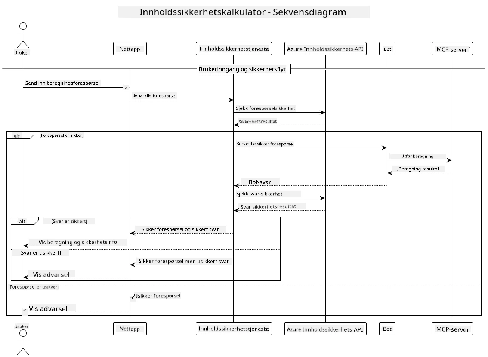

## Systemarkitektur

Dette prosjektet demonstrerer en webapplikasjon som bruker innholdssikkerhetssjekk før brukerforespørsler sendes til en kalkulatortjeneste via Model Context Protocol (MCP).



### Hvordan det fungerer

1. **Brukerinndata**: Brukeren skriver inn et beregningsspørsmål i webgrensesnittet
2. **Innholdssikkerhetsscreening (Inndata)**: Spørsmålet blir analysert av Azure Content Safety API
3. **Sikkerhetsvurdering (Inndata)**:
   - Hvis innholdet er trygt (alvorlighetsgrad < 2 i alle kategorier), går det videre til kalkulatoren
   - Hvis innholdet er merket som potensielt skadelig, stopper prosessen og returnerer en advarsel
4. **Integrasjon med kalkulator**: Trygt innhold behandles av LangChain4j, som kommuniserer med MCP kalkulatortjeneren
5. **Innholdssikkerhetsscreening (Utdata)**: Botens svar blir analysert av Azure Content Safety API
6. **Sikkerhetsvurdering (Utdata)**:
   - Hvis botsvaret er trygt, vises det til brukeren
   - Hvis botsvaret er merket som potensielt skadelig, erstattes det med en advarsel
7. **Respons**: Resultater (hvis trygge) vises til brukeren sammen med begge sikkerhetsanalyser

## Bruke Model Context Protocol (MCP) med kalkulatortjenester

Dette prosjektet viser hvordan man bruker Model Context Protocol (MCP) for å kalle kalkulatortjenester via MCP fra LangChain4j. Implementeringen bruker en lokal MCP-tjener som kjører på port 8080 for å tilby kalkulatoroperasjoner.

### Sette opp Azure Content Safety-tjenesten

Før du bruker innholdssikkerhetsfunksjonene, må du opprette en Azure Content Safety-tjenesteressurs:

1. Logg inn på [Azure-portalen](https://portal.azure.com)
2. Klikk på "Create a resource" og søk etter "Content Safety"
3. Velg "Content Safety" og klikk på "Create"
4. Skriv inn et unikt navn for ressursen din
5. Velg abonnement og ressursgruppe (eller opprett en ny)
6. Velg en støttet region (sjekk [Region availability](https://azure.microsoft.com/en-us/global-infrastructure/services/?products=cognitive-services) for detaljer)
7. Velg en passende prismodell
8. Klikk "Create" for å distribuere ressursen
9. Når distribusjonen er fullført, klikk på "Go to resource"
10. I venstremenyen, under "Resource Management", velg "Keys and Endpoint"
11. Kopier en av nøklene og endepunkt-URL-en for bruk i neste steg

### Konfigurere miljøvariabler

Sett Microsoft Foundry-modellens endepunkt, API-nøkkel og distribusjonsnavn:
```sh
export AZURE_OPENAI_ENDPOINT="https://<resource-name>.openai.azure.com"
export AZURE_OPENAI_API_KEY="<api-key>"
export AZURE_OPENAI_DEPLOYMENT="gpt-5.1"
```

For innholdssikkerhetsfunksjoner, sett:
```sh
export CONTENT_SAFETY_ENDPOINT=<your_content_safety_endpoint>
export CONTENT_SAFETY_KEY=<your_content_safety_key>
```

Disse miljøvariablene brukes av applikasjonen for å autentisere mot Azure Content Safety-tjenesten. Hvis disse variablene ikke er satt, vil applikasjonen bruke plasseringsverdier for demonstrasjonsformål, men innholdssikkerhetsfunksjonene vil ikke fungere riktig.

### Starte kalkulatortjeneren MCP

Før du kjører klienten, må du starte kalkulatortjeneren MCP i SSE-modus på localhost:8080.

## Prosjektbeskrivelse

Dette prosjektet demonstrerer integrasjonen av Model Context Protocol (MCP) med LangChain4j for å kalle kalkulatortjenester. Viktige funksjoner inkluderer:

- Bruk av MCP for å koble til en kalkulatortjeneste for grunnleggende matteoperasjoner
- Dobbeltlags innholdssikkerhetssjekk både på brukerforespørsler og botsvar
- Integrasjon med en distribuert Microsoft Foundry-modell via LangChain4j
- Bruk av Server-Sent Events (SSE) for MCP transport

## Innholdssikkerhetsintegrasjon

Prosjektet inkluderer omfattende innholdssikkerhetsfunksjoner for å sikre at både brukerinnspill og systemresponser er fri for skadelig innhold:

1. **Innsjekk**: Alle brukerforespørsler analyseres for skadelige innholdskategorier som hatprat, vold, selvskading og seksuelt innhold før behandling.

2. **Utssjekk**: Selv når man bruker potensielt ukensurerte modeller, sjekker systemet alle genererte responser gjennom de samme innholdssikkerhetsfiltrene før de vises til brukeren.

Denne tolagsmetoden sikrer at systemet forblir trygt uansett hvilken AI-modell som brukes, og beskytter brukerne både mot skadelige innspill og potensielt problematiske AI-genererte utdata.

## Webklient

Applikasjonen inkluderer et brukervennlig webgrensesnitt som lar brukere samhandle med Content Safety Calculator-systemet:

### Funksjoner i webgrensesnittet

- Enkel, intuitiv form for innskriving av beregningsspørsmål
- Dobbeltlags innholdssikkerhetsvalidering (inn- og utdata)
- Tilbakemeldinger i sanntid på sikkerheten til spørring og svar
- Fargekodede sikkerhetsindikatorer for enkel tolkning
- Ren, responsiv design som fungerer på ulike enheter
- Eksempelspørsmål som er trygge for å veilede brukerne

### Bruke webklienten

1. Start applikasjonen:
   ```sh
   mvn spring-boot:run
   ```

2. Åpne nettleseren din og naviger til `http://localhost:8087`

3. Skriv inn et beregningsspørsmål i det angitte tekstområdet (f.eks. "Calculate the sum of 24.5 and 17.3")

4. Klikk på "Submit" for å sende forespørselen

5. Se resultatene, som vil inkludere:
   - Innholdssikkerhetsanalyse av spørsmålet ditt
   - Det kalkulerte resultatet (hvis spørsmålet var trygt)
   - Innholdssikkerhetsanalyse av botsvaret
   - Eventuelle sikkerhetsadvarsler hvis enten inndata eller utdata ble merket

Webklienten håndterer automatisk begge verifiseringsprosessene for innholdssikkerhet, noe som sikrer at all kommunikasjon er trygg og passende uansett hvilken AI-modell som brukes.

---

<!-- CO-OP TRANSLATOR DISCLAIMER START -->
**Ansvarsfraskrivelse**:
Dette dokumentet er oversatt ved hjelp av AI-oversettelsestjenesten [Co-op Translator](https://github.com/Azure/co-op-translator). Selv om vi streber etter nøyaktighet, vær oppmerksom på at automatiske oversettelser kan inneholde feil eller unøyaktigheter. Det opprinnelige dokumentet på originalspråket skal betraktes som den autoritative kilden. For kritisk informasjon anbefales profesjonell menneskelig oversettelse. Vi er ikke ansvarlige for eventuelle misforståelser eller feiltolkninger som oppstår ved bruk av denne oversettelsen.
<!-- CO-OP TRANSLATOR DISCLAIMER END -->