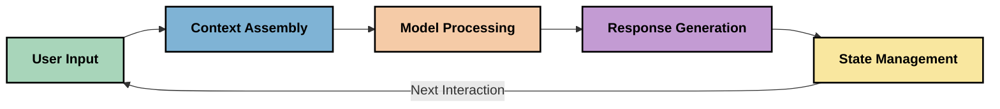
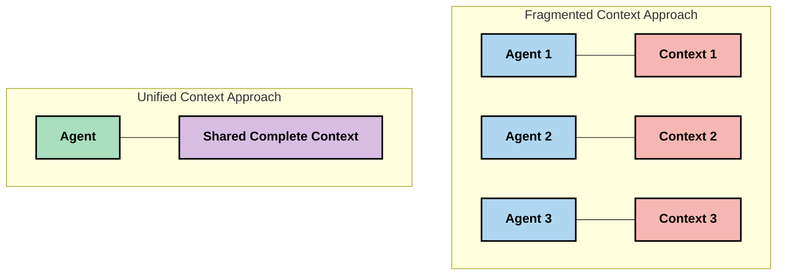
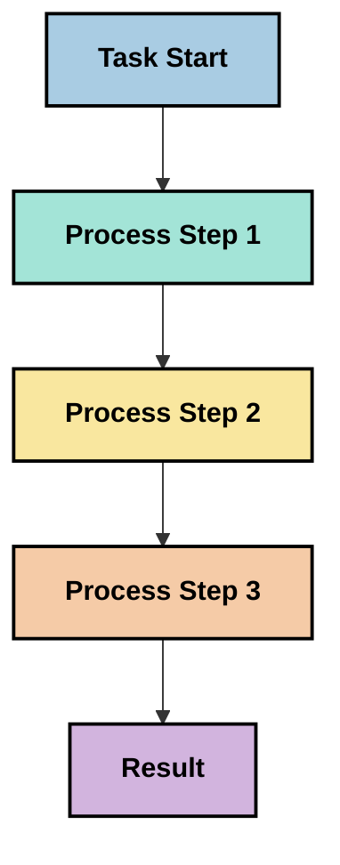
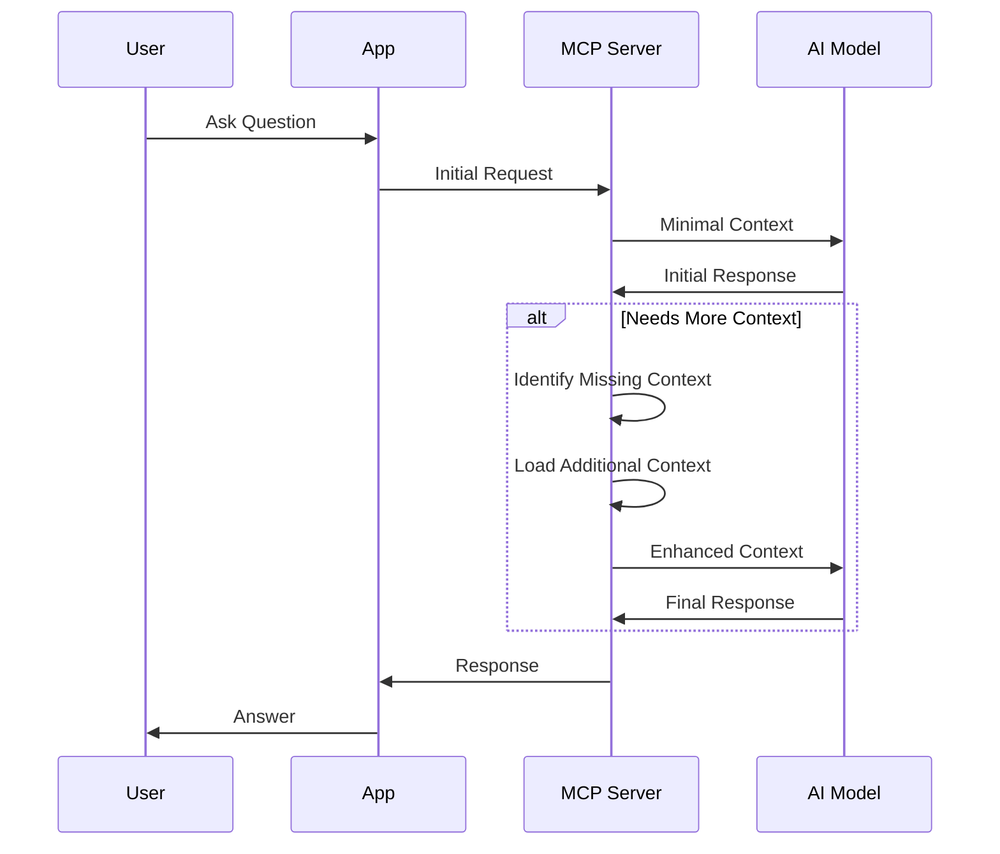
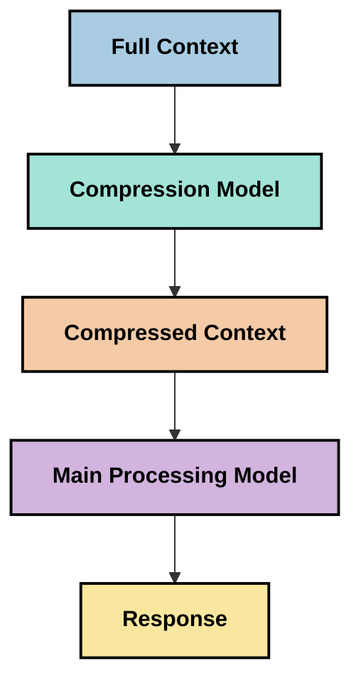
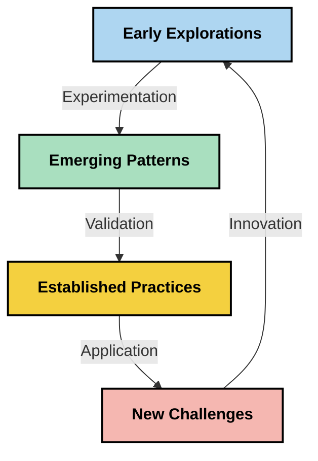

# Kontekstingeniørkunst: Et Fremvoksende Konsept i MCP-Økosystemet

## Oversikt

Kontekstingeniørkunst er et fremvoksende konsept innen AI-området som utforsker hvordan informasjon struktureres, leveres og vedlikeholdes gjennom interaksjoner mellom klienter og AI-tjenester. Etter hvert som Model Context Protocol (MCP)-økosystemet utvikler seg, blir det stadig viktigere å forstå hvordan man effektivt kan håndtere kontekst. Dette moduler introduserer begrepet kontekstingeniørkunst og utforsker dets potensielle anvendelser i MCP-implementasjoner.

## Læringsmål

Ved slutten av denne modulen vil du kunne:

- Forstå det fremvoksende konseptet kontekstingeniørkunst og dets potensielle rolle i MCP-applikasjoner
- Identifisere sentrale utfordringer innen konteksthåndtering som MCP-protokolldesignen adresserer
- Utforske teknikker for å forbedre modellens ytelse gjennom bedre konteksthåndtering
- Vurdere metoder for å måle og evaluere konteksteffektivitet
- Anvende disse fremvoksende konseptene for å forbedre AI-opplevelser gjennom MCP-rammeverket

## Introduksjon til Kontekstingeniørkunst

Kontekstingeniørkunst er et fremvoksende konsept med fokus på bevisst design og styring av informasjonsflyt mellom brukere, applikasjoner og AI-modeller. I motsetning til etablerte felt som promptingeniørkunst, er kontekstingeniørkunst fortsatt under definisjon av utøvere som arbeider for å løse de unike utfordringene med å gi AI-modeller riktig informasjon til rett tid.

Etter hvert som store språkmodeller (LLMs) har utviklet seg, har viktigheten av kontekst blitt stadig tydeligere. Kvaliteten, relevansen og strukturen på konteksten vi gir påvirker direkte modellens output. Kontekstingeniørkunst utforsker dette forholdet og søker å utvikle prinsipper for effektiv konteksthåndtering.

> "I 2025 er modellene der ute ekstremt intelligente. Men selv den smarteste menneske vil ikke kunne utføre jobben sin effektivt uten konteksten av hva de blir bedt om å gjøre... 'Kontekstingeniørkunst' er neste nivå av promptingeniørkunst. Det handler om å gjøre dette automatisk i et dynamisk system." — Walden Yan, Cognition AI

Kontekstingeniørkunst kan omfatte:

1. **Kontekstvalg**: Bestemme hvilken informasjon som er relevant for en gitt oppgave
2. **Kontekststrukturering**: Organisere informasjon for å maksimere modellens forståelse
3. **Kontekstlevering**: Optimalisere hvordan og når informasjon sendes til modeller
4. **Kontekstvedlikehold**: Håndtere tilstand og utvikling av kontekst over tid
5. **Kontekstevaluering**: Måle og forbedre effektiviteten til konteksten

Disse fokusområdene er spesielt relevante for MCP-økosystemet, som tilbyr en standardisert måte for applikasjoner å gi kontekst til LLM-er.


## Perspektivet til Kontekstreisen

En måte å visualisere kontekstingeniørkunst på er å spore reisen informasjon tar gjennom et MCP-system:



### Viktige Trinn i Kontekstreisen:

1. **Brukerinndata**: Rå informasjon fra brukeren (tekst, bilder, dokumenter)
2. **Kontekstsammensetning**: Kombinere brukerinndata med systemkontekst, samtalehistorikk og annen hentet informasjon
3. **Modellbehandling**: AI-modellen behandler den sammensatte konteksten
4. **Responsgenerering**: Modellen produserer output basert på den gitte konteksten
5. **Tilstandsadministrasjon**: Systemet oppdaterer sin interne tilstand basert på interaksjonen

Dette perspektivet fremhever den dynamiske naturen til kontekst i AI-systemer og reiser viktige spørsmål om hvordan man best kan håndtere informasjon på hvert trinn.

## Fremvoksende Prinsipper i Kontekstingeniørkunst

Etter hvert som feltet kontekstingeniørkunst tar form, begynner noen tidlige prinsipper å dukke opp fra utøvere. Disse prinsippene kan bidra til å informere MCP-implementeringsvalg:

### Prinsipp 1: Del Kontekst Fullstendig

Kontekst bør deles fullt ut mellom alle komponentene i et system i stedet for å være fragmentert på tvers av flere agenter eller prosesser. Når kontekst distribueres, kan beslutninger tatt i en del av systemet komme i konflikt med de som tas andre steder.



I MCP-applikasjoner antyder dette å designe systemer der kontekst flyter sømløst gjennom hele prosessen i stedet for å være oppdelt.

### Prinsipp 2: Erkjenn at Handlinger Bærer Implisitte Beslutninger

Hver handling en modell utfører innebærer implisitte beslutninger om hvordan konteksten skal tolkes. Når flere komponenter handler på forskjellige kontekster, kan disse implisitte beslutningene komme i konflikt og føre til inkonsistente resultater.

Dette prinsippet har viktige implikasjoner for MCP-applikasjoner:
- Foretrekke lineær behandling av komplekse oppgaver fremfor parallell utførelse med fragmentert kontekst
- Sikre at alle beslutningspunkter har tilgang til samme kontekstuelle informasjon
- Designe systemer der senere trinn kan se hele konteksten fra tidligere beslutninger

### Prinsipp 3: Balanser Kontekstdybde med Vindu-begrensninger

Etter hvert som samtaler og prosesser blir lengre, flommer kontekstvinduene til slutt over. Effektiv kontekstingeniørkunst utforsker tilnærminger for å håndtere denne spenningen mellom omfattende kontekst og tekniske begrensninger.

Mulige tilnærminger som utforskes inkluderer:
- Konstekstkomprimering som bevarer essensiell informasjon samtidig som token-bruken reduseres
- Progressiv lasting av kontekst basert på relevans for gjeldende behov
- Oppsummering av tidligere interaksjoner samtidig som viktige beslutninger og fakta bevares

## Kontekstutfordringer og MCP Protokolldesign

Model Context Protocol (MCP) ble designet med bevissthet om de unike utfordringene innen konteksthåndtering. Å forstå disse utfordringene hjelper med å forklare sentrale aspekter av MCP-protokolldesignen:


### Utfordring 1: Begrensninger i Kontekstvindu
De fleste AI-modeller har faste størrelser på kontekstvindu, noe som begrenser hvor mye informasjon de kan prosessere samtidig.

**MCP Designrespons:** 
- Protokollen støtter strukturert, ressursbasert kontekst som kan refereres til effektivt
- Ressurser kan pagineres og lastes progressivt

### Utfordring 2: Bestemmelse av Relevans
Det er vanskelig å avgjøre hvilken informasjon som er mest relevant å inkludere i konteksten.

**MCP Designrespons:**
- Fleksible verktøy tillater dynamisk innhenting av informasjon basert på behov
- Strukturerte prompts muliggjør konsistent kontekstorganisering

### Utfordring 3: Kontekstens Persistens
Å administrere tilstand på tvers av interaksjoner krever nøye sporing av konteksten.

**MCP Designrespons:**
- Standardisert øktadministrasjon
- Klart definerte interaksjonsmønstre for kontekstevolusjon

### Utfordring 4: Multimodal Kontekst
Ulike typer data (tekst, bilder, strukturert data) krever ulik behandling.

**MCP Designrespons:**
- Protokolldesignen tilrettelegger for ulike innholdstyper
- Standardisert representasjon av multimodal informasjon

### Utfordring 5: Sikkerhet og Personvern
Kontekst inneholder ofte sensitiv informasjon som må beskyttes.

**MCP Designrespons:**
- Klare grenser mellom klient- og serveransvar
- Lokale behandlingsalternativer for å minimere dataeksponering

Å forstå disse utfordringene og hvordan MCP adresserer dem gir et grunnlag for å utforske mer avanserte teknikker innen kontekstingeniørkunst.

## Fremvoksende Tilnærminger innen Kontekstingeniørkunst

Etter hvert som feltet kontekstingeniørkunst utvikler seg, dukker flere lovende tilnærminger opp. Disse representerer nåværende tankegang snarere enn etablerte beste praksiser, og vil sannsynligvis utvikle seg etter hvert som vi får mer erfaring med MCP-implementasjoner.

### 1. Enkelt-trådet Lineær Behandling

I motsetning til multi-agent-arkitekturer som distribuerer kontekst, opplever noen utøvere at enkelt-trådet lineær behandling gir mer konsistente resultater. Dette stemmer overens med prinsippet om å opprettholde en enhetlig kontekst.



Selv om denne tilnærmingen kan virke mindre effektiv enn parallell prosessering, gir den ofte mer sammenhengende og pålitelige resultater fordi hvert trinn bygger på en fullstendig forståelse av tidligere beslutninger.

### 2. Kontekstdeling og Prioritering

Å dele opp store kontekster i håndterbare deler og prioritere det som er mest viktig.

```python
# Conceptual Example: Context Chunking and Prioritization
def process_with_chunked_context(documents, query):
    # 1. Break documents into smaller chunks
    chunks = chunk_documents(documents)
    
    # 2. Calculate relevance scores for each chunk
    scored_chunks = [(chunk, calculate_relevance(chunk, query)) for chunk in chunks]
    
    # 3. Sort chunks by relevance score
    sorted_chunks = sorted(scored_chunks, key=lambda x: x[1], reverse=True)
    
    # 4. Use the most relevant chunks as context
    context = create_context_from_chunks([chunk for chunk, score in sorted_chunks[:5]])
    
    # 5. Process with the prioritized context
    return generate_response(context, query)
```

Konseptet ovenfor illustrerer hvordan vi kan bryte ned store dokumenter i håndterbare deler og velge ut bare de mest relevante delene for konteksten. Denne tilnærmingen kan hjelpe med å jobbe innenfor begrensningene i kontekstvinduet samtidig som man utnytter store kunnskapsbaser.

### 3. Progressiv Kontekstlasting

Laste kontektst gradvis etter behov i stedet for alt på en gang.



Progressiv kontekstlasting starter med minimal kontekst og utvides bare ved behov. Dette kan betydelig redusere bruk av tokens for enkle forespørsler samtidig som evnen til å håndtere komplekse spørsmål opprettholdes.

### 4. Kontekstkomprimering og Oppsummering

Redusere kontekststørrelse samtidig som essensiell informasjon bevares.



Kontekstkomprimering fokuserer på:
- Fjerning av overflødig informasjon
- Oppsummering av lengre innhold
- Utdrag av viktige fakta og detaljer
- Bevaring av kritiske kontekstelementer
- Optimalisering for token-effektivitet

Denne tilnærmingen kan være særlig verdifull for å opprettholde lange samtaler innen kontekstvinduene eller for effektiv behandling av store dokumenter. Noen utøvere bruker spesialiserte modeller spesielt for kontekstkomprimering og oppsummering av samtalehistorikk.


## Utforskende Betraktninger innen Kontekstingeniørkunst

Når vi utforsker det fremvoksende feltet kontekstingeniørkunst, er det flere betraktninger som er verdt å huske på når man arbeider med MCP-implementasjoner. Dette er ikke forskriftsmessige beste praksiser, men snarere områder for utforskning som kan gi forbedringer i ditt spesifikke brukstilfelle.

### Vurder Dine Kontekstmål

Før du implementerer komplekse løsninger for konteksthåndtering, formuler klart hva du prøver å oppnå:
- Hvilken spesifikk informasjon trenger modellen for å lykkes?
- Hvilken informasjon er essensiell vs. supplerende?
- Hva er dine ytelsesbegrensninger (latens, tokenbegrensninger, kostnader)?

### Utforsk Lagdelte Kontekstilnærminger

Noen utøvere lykkes med kontekst ordnet i konseptuelle lag:
- **Kjernelag**: Essensiell informasjon modellen alltid trenger
- **Situasjonslag**: Kontekst spesifikk for den nåværende interaksjonen
- **Støttelag**: Tilleggsinformasjon som kan være nyttig
- **Fallback-lag**: Informasjon som kun tilgås når det er nødvendig

### Undersøk Hentingsstrategier

Effektiviteten til din kontekst avhenger ofte av hvordan du henter informasjon:
- Semantisk søk og embeddings for å finne konseptuelt relevant informasjon
- Nøkkelordbasert søk for spesifikke faktuelle detaljer
- Hybride tilnærminger som kombinerer flere metoder for innhenting
- Metadatafiltrering for å begrense omfanget basert på kategorier, datoer eller kilder

### Eksperimenter med Kontekstkoherens

Strukturen og flyten i din kontekst kan påvirke modellforståelsen:
- Gruppering av relatert informasjon sammen
- Bruk av konsekvent formatering og organisering
- Opprettholde logisk eller kronologisk rekkefølge der det er hensiktsmessig
- Unngå motstridende informasjon

### Vei Fordeler og Ulemper ved Multi-Agent Arkitekturer

Selv om multi-agent arkitekturer er populære i mange AI-rammeverk, medfører de betydelige utfordringer for konteksthåndtering:
- Kontekstfragmentering kan føre til inkonsistente beslutninger på tvers av agenter
- Parallell prosessering kan introdusere konflikter som er vanskelige å forene
- Kommunikasjonskostnader mellom agenter kan oppveie ytelsesgevinster
- Kompleks tilstandsadministrasjon er nødvendig for å opprettholde koherens

I mange tilfeller kan en enkelt-agent-tilnærming med omfattende konteksthåndtering gi mer pålitelige resultater enn flere spesialiserte agenter med fragmentert kontekst.

### Utvikle Evalueringsmetoder

For å forbedre kontekstingeniørkunst over tid, vurder hvordan du vil måle suksess:
- A/B-testing av forskjellige kontekststrukturer
- Overvåking av tokenbruk og responstider
- Sporing av brukertilfredshet og oppgavefullføring
- Analyse av når og hvorfor kontekststrategier feiler

Disse betraktningene representerer aktive områder for utforskning innen kontekstingeniørkunst. Etter hvert som feltet modnes, vil mer definitive mønstre og praksiser sannsynligvis komme til syne.

## Måling av Konteksteffektivitet: Et Utviklende Rammeverk

Etter hvert som kontekstingeniørkunst vokser som konsept, begynner utøvere å undersøke hvordan vi kan måle effektiviteten. Det eksisterer ennå ikke et etablert rammeverk, men forskjellige målemetoder vurderes som kan hjelpe å styre fremtidig arbeid.

### Potensielle Måledimensjoner


#### 1. Inndatamålingsbetraktninger

- **Kontekst-til-Respons-forhold**: Hvor mye kontekst trengs i forhold til responsstørrelsen?
- **Tokenutnyttelse**: Hvor stor prosent av leverte kontekstkoder påvirker responsen?
- **Kontekstreduksjon**: Hvor effektivt kan vi komprimere rå informasjon?

#### 2. Ytelsesbetraktninger

- **Latenspåvirkning**: Hvordan påvirker konteksthåndtering responstiden?
- **Tokenøkonomi**: Optimaliserer vi tokenbruken effektivt?
- **Hentingspresisjon**: Hvor relevant er den hentede informasjonen?
- **Ressursbruk**: Hvilke beregningsressurser kreves?

#### 3. Kvalitetsbetraktninger

- **Responsrelevans**: Hvor godt adresserer responsen forespørselen?
- **Faktuell Nøyaktighet**: Forbedrer konteksthåndtering faktuell korrekthet?
- **Konsistens**: Er svarene konsistente på tvers av lignende forespørsler?
- **Hallusinasjonsrate**: Reduserer bedre kontekst modellhallusinasjoner?

#### 4. Brukeropplevelsesbetraktninger

- **Oppfølgingsrate**: Hvor ofte trenger brukere avklaringer?
- **Oppgavefullføring**: Klarer brukerne å fullføre målene sine?
- **Tilfredshetsindikatorer**: Hvordan vurderer brukere opplevelsen sin?

### Utforskende Tilnærminger til Måling

Når du eksperimenterer med kontekstingeniørkunst i MCP-implementasjoner, vurder disse utforskende tilnærmingene:

1. **Baseline-sammenligninger**: Etabler en baseline med enkle kontekstilnærminger før du tester mer sofistikerte metoder

2. **Inkrementelle endringer**: Endre én aspekt av konteksthåndtering om gangen for å isolere effektene

3. **Brukersentrert Evaluering**: Kombiner kvantitative metrikker med kvalitativ brukerfeedback

4. **Feilanalys**: Undersøk tilfeller hvor kontekststrategier feiler for å forstå potensielle forbedringer

5. **Multidimensjonal Vurdering**: Vurder avveininger mellom effektivitet, kvalitet og brukeropplevelse

Denne eksperimentelle, flerfasetterte tilnærmingen til måling er i tråd med den fremvoksende naturen til kontekstingeniørkunst.

## Avsluttende Tanker

Kontekstingeniørkunst er et fremvoksende utforskningsområde som kan vise seg å være sentralt for effektive MCP-applikasjoner. Ved å nøye vurdere hvordan informasjon flyter gjennom systemet ditt, kan du potensielt skape AI-opplevelser som er mer effektive, presise og verdifulle for brukere.

Teknikker og tilnærminger som skisseres i denne modulen representerer tidlige tanker på dette området, ikke etablerte praksiser. Kontekstingeniørkunst kan utvikle seg til en mer definert disiplin etter hvert som AI-kapasiteter utvikler seg og vår forståelse utdypes. For nå ser eksperimentering kombinert med nøye måling ut til å være den mest produktive tilnærmingen.

## Potensielle Fremtidige Retninger

Feltet kontekstingeniørkunst er fortsatt i sin tidlige fase, men flere lovende retninger begynner å ta form:

- Prinsippene for kontekstingeniørkunst kan ha betydelig innvirkning på modellens ytelse, effektivitet, brukeropplevelse og pålitelighet
- Enkelt-trådede tilnærminger med omfattende konteksthåndtering kan utkonkurrere multi-agent-arkitekturer for mange brukstilfeller
- Spesialiserte modeller for kontekstkomprimering kan bli standardkomponenter i AI-pipelines
- Spenningen mellom kontekstfullstendighet og tokenbegrensninger vil sannsynligvis drive innovasjon innen konteksthåndtering
- Etter hvert som modeller blir mer kapable til effektiv menneskelignende kommunikasjon, kan ekte multi-agent samarbeid bli mer levedyktig
- MCP-implementasjoner kan utvikle seg til å standardisere mønstre for konteksthåndtering som oppstår fra nåværende eksperimentering



## Ressurser

### Offisielle MCP-ressurser
- [Model Context Protocol Website](https://modelcontextprotocol.io/)
- [Model Context Protocol Specification](https://github.com/modelcontextprotocol/modelcontextprotocol)
- [MCP Dokumentasjon](https://modelcontextprotocol.io/docs)
- [MCP C# SDK](https://github.com/modelcontextprotocol/csharp-sdk)
- [MCP Python SDK](https://github.com/modelcontextprotocol/python-sdk)
- [MCP TypeScript SDK](https://github.com/modelcontextprotocol/typescript-sdk)
- [MCP Inspector](https://github.com/modelcontextprotocol/inspector) - Verktøy for visuell testing av MCP-servere

### Artikler om kontekstteknikk
- [Ikke bygg multi-agenter: Prinsipper for kontekstteknikk](https://cognition.ai/blog/dont-build-multi-agents) - Walden Yans innsikt om prinsipper for kontekstteknikk
- [En praktisk guide til å bygge agenter](https://cdn.openai.com/business-guides-and-resources/a-practical-guide-to-building-agents.pdf) - OpenAIs guide til effektiv agentdesign
- [Bygging av effektive agenter](https://www.anthropic.com/engineering/building-effective-agents) - Anthropics tilnærming til agentutvikling

### Relatert forskning
- [Dynamisk hentalgoritme til store språkmodeller](https://arxiv.org/abs/2310.01487) - Forskning på dynamiske hentemetoder
- [Tapt i midten: Hvordan språkmodeller bruker lange kontekster](https://arxiv.org/abs/2307.03172) - Viktig forskning på mønstre i kontekstbehandling
- [Hierarkisk tekstbetinget bilde-generering med CLIP Latents](https://arxiv.org/abs/2204.06125) - DALL-E 2-artikkel med innsikt i kontekststrukturering
- [Utforsking av kontekstens rolle i store språkmodellarkitekturer](https://aclanthology.org/2023.findings-emnlp.124/) - Ny forskning på kontekstbehandling
- [Samarbeid mellom multi-agenter: En oversikt](https://arxiv.org/abs/2304.03442) - Forskning på multi-agent systemer og deres utfordringer

### Ytterligere ressurser
- [Optimaliseringsteknikker for kontekstvindu](https://learn.microsoft.com/en-us/azure/ai-services/openai/concepts/context-window)
- [Avanserte RAG-teknikker](https://www.microsoft.com/en-us/research/blog/retrieval-augmented-generation-rag-and-frontier-models/)
- [Semantic Kernel dokumentasjon](https://github.com/microsoft/semantic-kernel)
- [Microsoft Foundry Toolkit for Visual Studio Code](https://github.com/microsoft/vscode-ai-toolkit)

## Hva er neste steg 

- [5.15 MCP Custom Transport](../mcp-transport/README.md)

---

<!-- CO-OP TRANSLATOR DISCLAIMER START -->
**Ansvarsfraskrivelse**:
Dette dokumentet er oversatt ved hjelp av AI-oversettelsestjenesten [Co-op Translator](https://github.com/Azure/co-op-translator). Selv om vi streber etter nøyaktighet, vær oppmerksom på at automatiske oversettelser kan inneholde feil eller unøyaktigheter. Det opprinnelige dokumentet på originalspråket skal betraktes som den autoritative kilden. For kritisk informasjon anbefales profesjonell menneskelig oversettelse. Vi er ikke ansvarlige for eventuelle misforståelser eller feiltolkninger som oppstår ved bruk av denne oversettelsen.
<!-- CO-OP TRANSLATOR DISCLAIMER END -->