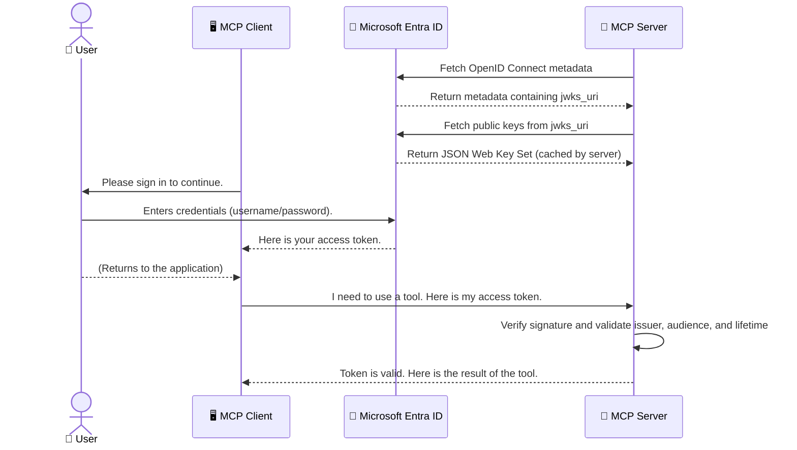

# Sikring av AI-arbeidsflyter: Entra ID-autentisering for Model Context Protocol-servere

> [!NOTE]
> Fjernserverkoden i denne leksjonen beskytter eldre `/sse` og `/message`
> endepunkter og retter seg mot MCP `2025-11-25`. Behold identitets- og tokenvaliderings-
> praksisene, men bruk en `2026-07-28`-kompatibel Streamable HTTP-transport for nye
> implementeringer.

## Introduksjon
Å sikre Model Context Protocol (MCP)-serveren din er like viktig som å låse inngangsdøren til huset ditt. Å la MCP-serveren være åpen eksponerer verktøyene og dataene dine for uautorisert tilgang, noe som kan føre til sikkerhetsbrudd. Microsoft Entra ID tilbyr en robust skybasert identitets- og tilgangsstyringsløsning som hjelper deg å sikre at kun autoriserte brukere og applikasjoner kan kommunisere med MCP-serveren din. I denne delen lærer du hvordan du beskytter AI-arbeidsflytene dine ved å bruke Entra ID-autentisering.

## Læringsmål
Når du er ferdig med denne delen, vil du kunne:

- Forstå viktigheten av å sikre MCP-servere.
- Forklare grunnleggende om Microsoft Entra ID og OAuth 2.0-autentisering.
- Gjenkjenne forskjellen mellom offentlige og konfidensielle klienter.
- Implementere Entra ID-autentisering i både lokale (offentlige klienter) og eksterne (konfidensielle klienter) MCP-server-scenarier.
- Bruke sikkerhets beste praksis ved utvikling av AI-arbeidsflyter.

## Sikkerhet og MCP

Akkurat som du ikke ville latt inngangsdøren stå ulåst, bør du ikke la MCP-serveren din være åpen for alle. Å sikre AI-arbeidsflytene dine er avgjørende for å bygge robuste, pålitelige og sikre applikasjoner. Dette kapitlet introduserer deg for hvordan du bruker Microsoft Entra ID til å sikre MCP-serverne dine, slik at kun autoriserte brukere og applikasjoner kan få tilgang til verktøyene og dataene dine.

## Hvorfor sikkerhet er viktig for MCP-servere

Tenk deg at MCP-serveren din har et verktøy som kan sende e-post eller få tilgang til en kundedatabase. En usikret server betyr at hvem som helst potensielt kan bruke det verktøyet, noe som kan føre til uautorisert tilgang til data, spam eller annen ondsinnet aktivitet.

Ved å implementere autentisering sikrer du at hver forespørsel til serveren din blir verifisert, og bekrefter identiteten til brukeren eller applikasjonen som gjør forespørselen. Dette er det første og viktigste steget i å sikre AI-arbeidsflytene dine.

## Introduksjon til Microsoft Entra ID

[**Microsoft Entra ID**](https://adoption.microsoft.com/microsoft-security/entra/) er en skybasert tjeneste for identitets- og tilgangsstyring. Se på det som en universell sikkerhetsvakt for applikasjonene dine. Den håndterer den komplekse prosessen med å verifisere brukeres identitet (autentisering) og avgjøre hva de har lov til å gjøre (autorisasjon).

Ved å bruke Entra ID kan du:

- Aktivere sikker innlogging for brukere.
- Beskytte API-er og tjenester.
- Administrere tilgangspolicyer fra ett sentralt sted.

For MCP-servere gir Entra ID en robust og mye brukt løsning for å styre hvem som kan få tilgang til serverens funksjonalitet.

---

## Forstå magien: Hvordan Entra ID-autentisering fungerer

Entra ID bruker åpne standarder som **OAuth 2.0** til å håndtere autentisering. Selv om detaljene kan være komplekse, er kjernkonseptet enkelt og kan forklares med en analogi.

### En enkel introduksjon til OAuth 2.0: Sjåførnøkkelen

Tenk på OAuth 2.0 som en sjåførtjeneste for bilen din. Når du ankommer en restaurant, gir du ikke sjåføren hovednøkkelen din. I stedet gir du en **sjåførnøkkel** som har begrensede rettigheter — den kan starte bilen og låse dørene, men den kan ikke åpne bagasjerommet eller hanskerommet.

I denne analogien:

- **Du** er **Brukeren**.
- **Bilen din** er **MCP-serveren** med sine verdifulle verktøy og data.
- **Sjåføren** er **Microsoft Entra ID**.
- **Bilparkeringen** er **MCP-klienten** (applikasjonen som prøver å få tilgang til serveren).
- **Sjåførnøkkelen** er **Access Token** (tilgangstoken).

Tilgangstokenet er en sikker tekststreng som MCP-klienten mottar fra Entra ID etter at du har logget inn. Klienten presenterer dette tokenet til MCP-serveren med hver forespørsel. Serveren kan verifisere tokenet for å sikre at forespørselen er gyldig og at klienten har nødvendige rettigheter, uten å noen gang måtte håndtere dine faktiske påloggingsdetaljer (som passordet ditt).

### Autentiseringsflyten

Slik fungerer prosessen i praksis:



MCP-serveren kontakter ikke Entra ID for å validere hvert tilgangstoken. Den
verifiserer kryptografisk JWT-signaturen med Entra IDs bufrede offentlige nøkkel
og sjekker tokenets krav, inkludert issuer, audience og levetid.
Serveren henter `jwks_uri` fra OpenID Connect-metadataen, laster ned de offentlige
nøklene fra den URI-en, og oppdaterer dem jevnlig for å håndtere nøkkelrotasjon. Bruk
et støttet bibliotek for tokenvalidering i stedet for å implementere denne logikken
selv. For detaljer, se
[Valider tokens i Microsoft identity platform](https://learn.microsoft.com/entra/identity-platform/access-tokens#validate-tokens).

### Introduksjon til Microsoft Authentication Library (MSAL)

Før vi går inn i koden, er det viktig å introdusere en nøkkelkomponent du vil se i eksemplene: **Microsoft Authentication Library (MSAL)**.

MSAL er et bibliotek utviklet av Microsoft som gjør det mye enklere for utviklere å håndtere autentisering. I stedet for at du må skrive all den komplekse koden for håndtering av sikkerhetstokener, innlogging og øktoppdatering, tar MSAL seg av det tunge arbeidet.

Bruken av et bibliotek som MSAL anbefales sterkt fordi:

- **Det er sikkert:** Det implementerer industristandardprotokoller og beste sikkerhetspraksis, noe som reduserer risikoen for sårbarheter i koden din.
- **Det forenkler utviklingen:** Det abstraherer kompleksiteten i OAuth 2.0 og OpenID Connect-protokollene, slik at du kan legge til robust autentisering i applikasjonen din med bare noen få kodelinjer.
- **Det vedlikeholdes:** Microsoft vedlikeholder og oppdaterer MSAL aktivt for å møte nye sikkerhetstrusler og plattformendringer.

MSAL støtter et bredt spekter av språk og applikasjonsrammeverk, inkludert .NET, JavaScript/TypeScript, Python, Java, Go og mobilplattformer som iOS og Android. Det betyr at du kan bruke de samme konsistente autentiseringsmønstrene på tvers av hele teknologi-stacken din.

For å lære mer om MSAL, kan du se den offisielle [MSAL-oversikten](https://learn.microsoft.com/entra/identity-platform/msal-overview).

---

## Sikring av MCP-serveren din med Entra ID: En trinn-for-trinn-veiledning

Nå skal vi gå gjennom hvordan du sikrer en lokal MCP-server (en som kommuniserer over `stdio`) ved bruk av Entra ID. Dette eksempelet bruker en **offentlig klient**, som passer for applikasjoner som kjører på en brukers maskin, for eksempel en skrivebordsapp eller en lokal utviklingsserver.

### Scenario 1: Sikring av en lokal MCP-server (med en offentlig klient)

I dette scenariet ser vi på en MCP-server som kjører lokalt, kommuniserer over `stdio`, og bruker Entra ID for å autentisere brukeren før tilgang til verktøyene gis. Serveren har ett verktøy som henter brukerens profilinformasjon fra Microsoft Graph API.

#### 1. Oppsett av applikasjonen i Entra ID

Før du skriver kode, må du registrere applikasjonen din i Microsoft Entra ID. Dette forteller Entra ID om applikasjonen din og gir den tillatelse til å bruke autentiseringstjenesten.

1. Gå til **[Microsoft Entra-portalen](https://entra.microsoft.com/)**.
2. Gå til **App-registreringer** og klikk på **Ny registrering**.
3. Gi applikasjonen et navn (f.eks. "Min lokale MCP-server").
4. For **Støttede kontotyper**, velg **Kontoer i denne organisasjonskatalogen bare**.
5. Du kan la **Redirect URI** stå tom i dette eksempelet.
6. Klikk på **Registrer**.

Når den er registrert, noter deg **Program-ID (klient-ID)** og **Katalog-ID (leietaker-ID)**. Du trenger disse i koden din.

#### 2. Koden: En gjennomgang

La oss se på nøkkeldelene i koden som håndterer autentisering. Fullstendig kode for dette eksempelet finnes i mappen [Entra ID - Lokal - WAM](https://github.com/Azure-Samples/mcp-auth-servers/tree/main/src/entra-id-local-wam) i [mcp-auth-servers GitHub-repositoriet](https://github.com/Azure-Samples/mcp-auth-servers).

**`AuthenticationService.cs`**

Denne klassen har ansvar for samspillet med Entra ID.

- **`CreateAsync`**: Denne metoden initialiserer `PublicClientApplication` fra MSAL (Microsoft Authentication Library). Den er konfigurert med applikasjonens `clientId` og `tenantId`.
- **`WithBroker`**: Dette aktiverer bruk av en broker (som Windows Web Account Manager), som gir en sikrere og sømløs enkeltpåloggingsopplevelse.
- **`AcquireTokenAsync`**: Dette er hovedmetoden. Den prøver først å hente token stille (uten at brukeren må logge inn igjen hvis gyldig økt finnes). Hvis det ikke lykkes, vil brukeren bli bedt om å logge inn interaktivt.

```csharp
// Simplified for clarity
public static async Task<AuthenticationService> CreateAsync(ILogger<AuthenticationService> logger)
{
    var msalClient = PublicClientApplicationBuilder
        .Create(_clientId) // Your Application (client) ID
        .WithAuthority(AadAuthorityAudience.AzureAdMyOrg)
        .WithTenantId(_tenantId) // Your Directory (tenant) ID
        .WithBroker(new BrokerOptions(BrokerOptions.OperatingSystems.Windows))
        .Build();

    // ... cache registration ...

    return new AuthenticationService(logger, msalClient);
}

public async Task<string> AcquireTokenAsync()
{
    try
    {
        // Try silent authentication first
        var accounts = await _msalClient.GetAccountsAsync();
        var account = accounts.FirstOrDefault();

        AuthenticationResult? result = null;

        if (account != null)
        {
            result = await _msalClient.AcquireTokenSilent(_scopes, account).ExecuteAsync();
        }
        else
        {
            // If no account, or silent fails, go interactive
            result = await _msalClient.AcquireTokenInteractive(_scopes).ExecuteAsync();
        }

        return result.AccessToken;
    }
    catch (Exception ex)
    {
        _logger.LogError(ex, "An error occurred while acquiring the token.");
        throw; // Optionally rethrow the exception for higher-level handling
    }
}
```

**`Program.cs`**

Her settes MCP-serveren opp og autentiseringstjenesten integreres.

- **`AddSingleton<AuthenticationService>`**: Registrerer `AuthenticationService` i dependency injection-containeren, slik at den kan brukes av andre deler av applikasjonen (som verktøyet vårt).
- **`GetUserDetailsFromGraph` verktøy**: Dette verktøyet krever en instans av `AuthenticationService`. Før den gjør noe, kaller den `authService.AcquireTokenAsync()` for å hente et gyldig tilgangstoken. Hvis autentiseringen er vellykket, bruker den tokenet til å kalle Microsoft Graph API og hente brukerens detaljer.

```csharp
// Simplified for clarity
[McpServerTool(Name = "GetUserDetailsFromGraph")]
public static async Task<string> GetUserDetailsFromGraph(
    AuthenticationService authService)
{
    try
    {
        // This will trigger the authentication flow
        var accessToken = await authService.AcquireTokenAsync();

        // Use the token to create a GraphServiceClient
        var graphClient = new GraphServiceClient(
            new BaseBearerTokenAuthenticationProvider(new TokenProvider(authService)));

        var user = await graphClient.Me.GetAsync();

        return System.Text.Json.JsonSerializer.Serialize(user);
    }
    catch (Exception ex)
    {
        return $"Error: {ex.Message}";
    }
}
```

#### 3. Hvordan det hele fungerer sammen

1. Når MCP-klienten prøver å bruke `GetUserDetailsFromGraph` verktøyet, kaller verktøyet først `AcquireTokenAsync`.
2. `AcquireTokenAsync` trigger MSAL-biblioteket til å sjekke etter et gyldig token.
3. Hvis token ikke finnes, vil MSAL gjennom broker be brukeren logge inn med sin Entra ID-konto.
4. Når brukeren logger inn, utsteder Entra ID et tilgangstoken.
5. Verktøyet mottar tokenet og bruker det til å gjøre en sikker forespørsel til Microsoft Graph API.
6. Brukerens detaljer returneres til MCP-klienten.

Denne prosessen sikrer at kun autentiserte brukere kan bruke verktøyet, og sikrer dermed effektivt den lokale MCP-serveren din.

### Scenario 2: Sikring av en ekstern MCP-server (med en konfidensiell klient)

Når MCP-serveren din kjører på en ekstern maskin (som en skyserver) og kommuniserer over en protokoll som HTTP Streaming, er sikkerhetskravene annerledes. I dette tilfellet bør du bruke en **konfidensiell klient** og **Authorization Code Flow**. Dette er en sikrere metode fordi applikasjonens hemmeligheter aldri eksponeres for nettleseren.

Dette eksempelet bruker en MCP-server basert på TypeScript som benytter Express.js for å håndtere HTTP-forespørsler.

#### 1. Oppsett av applikasjonen i Entra ID

Oppsettet i Entra ID er likt som for den offentlige klienten, men med én viktig forskjell: du må opprette en **klienthemmelighet**.

1. Gå til **[Microsoft Entra-portalen](https://entra.microsoft.com/)**.
2. I app-registreringen går du til fanen **Sertifikater og hemmeligheter**.
3. Klikk **Ny klienthemmelighet**, gi den en beskrivelse, og klikk **Legg til**.
4. **Viktig:** Kopier hemmelighetsverdien umiddelbart. Du vil ikke kunne se den igjen.
5. Du må også konfigurere en **Redirect URI**. Gå til fanen **Autentisering**, klikk **Legg til en plattform**, velg **Web**, og skriv inn redirect URI for applikasjonen (f.eks. `http://localhost:3001/auth/callback`).

> **⚠️ Viktig sikkerhetsmerknad:** For produksjonsapplikasjoner anbefaler Microsoft sterkt å bruke **hemmelighetsfrie autentiseringsmetoder** som **Administrert identitet** eller **Workload Identity Federation** i stedet for klienthemmeligheter. Klienthemmeligheter utgjør sikkerhetsrisikoer fordi de kan eksponeres eller kompromitteres. Administrerte identiteter gir en sikrere tilnærming ved å eliminere behovet for å lagre legitimasjon i koden eller konfigurasjonen.
>
> For mer informasjon om administrerte identiteter og hvordan implementere dem, se [Oversikt over administrerte identiteter for Azure-ressurser](https://learn.microsoft.com/entra/identity/managed-identities-azure-resources/overview).

#### 2. Koden: En gjennomgang

Dette eksempelet bruker en øktbasert tilnærming. Når brukeren autentiserer, lagrer serveren tilgangstoken og oppfriskningstoken i en økt og gir brukeren et økttoken. Dette økttokenet brukes for påfølgende forespørsler. Fullstendig kode for dette eksempelet finnes i mappen [Entra ID - Konfidensiell klient](https://github.com/Azure-Samples/mcp-auth-servers/tree/main/src/entra-id-cca-session) i [mcp-auth-servers GitHub-repositoriet](https://github.com/Azure-Samples/mcp-auth-servers).

**`Server.ts`**

Denne filen setter opp Express-serveren og MCP-transportlaget.

- **`requireBearerAuth`**: Dette er middleware som beskytter `/sse` og `/message` endepunktene. Den sjekker for et gyldig bearer-token i `Authorization`-headeren i forespørselen.
- **`EntraIdServerAuthProvider`**: Dette er en tilpasset klasse som implementerer `McpServerAuthorizationProvider`-grensesnittet. Den har ansvar for å håndtere OAuth 2.0-prosessen.
- **`/auth/callback`**: Dette endepunktet håndterer redirect fra Entra ID etter at brukeren har autentisert seg. Det bytter autorisasjonskoden mot et tilgangstoken og et oppfriskningstoken.

```typescript
// Simplified for clarity
const app = express();
const { server } = createServer();
const provider = new EntraIdServerAuthProvider();

// Protect the SSE endpoint
app.get("/sse", requireBearerAuth({
  provider,
  requiredScopes: ["User.Read"]
}), async (req, res) => {
  // ... connect to the transport ...
});

// Protect the message endpoint
app.post("/message", requireBearerAuth({
  provider,
  requiredScopes: ["User.Read"]
}), async (req, res) => {
  // ... handle the message ...
});

// Handle the OAuth 2.0 callback
app.get("/auth/callback", (req, res) => {
  provider.handleCallback(req.query.code, req.query.state)
    .then(result => {
      // ... handle success or failure ...
    });
});
```

**`Tools.ts`**

Denne filen definerer verktøyene som MCP-serveren tilbyr. `getUserDetails`-verktøyet ligner på det i det forrige eksemplet, men henter tilgangstokenet fra økten.

```typescript
// Simplified for clarity
server.setRequestHandler(CallToolRequestSchema, async (request) => {
  const { name } = request.params;
  const context = request.params?.context as { token?: string } | undefined;
  const sessionToken = context?.token;

  if (name === ToolName.GET_USER_DETAILS) {
    if (!sessionToken) {
      throw new AuthenticationError("Authentication token is missing or invalid. Ensure the token is provided in the request context.");
    }

    // Get the Entra ID token from the session store
    const tokenData = tokenStore.getToken(sessionToken);
    const entraIdToken = tokenData.accessToken;

    const graphClient = Client.init({
      authProvider: (done) => {
        done(null, entraIdToken);
      }
    });

    const user = await graphClient.api('/me').get();

    // ... return user details ...
  }
});
```

**`auth/EntraIdServerAuthProvider.ts`**

Denne klassen håndterer logikken for:

- Omdirigering av brukeren til Entra ID-påloggingssiden.
- Bytte autorisasjonskoden mot et tilgangstoken.
- Lagring av tokenene i `tokenStore`.
- Oppdatering av tilgangstokenet når det utløper.

#### 3. Hvordan Alt Fungerer Sammen

1. Når en bruker først prøver å koble til MCP-serveren, vil `requireBearerAuth` middleware se at de ikke har en gyldig økt og omdirigere dem til Entra ID-påloggingssiden.
2. Brukeren logger på med sin Entra ID-konto.
3. Entra ID omdirigerer brukeren tilbake til `/auth/callback`-endepunktet med en autorisasjonskode.
4. Serveren bytter koden mot et tilgangstoken og et oppfriskningstoken, lagrer dem og oppretter en økt-token som sendes til klienten.
5. Klienten kan nå bruke denne økt-token i `Authorization`-headeren for alle fremtidige forespørsler til MCP-serveren.
6. Når `getUserDetails`-verktøyet kalles, bruker det økt-tokenet til å hente Entra ID-tilgangstokenet og bruker det til å kalle Microsoft Graph API.

Dette flyten er mer kompleks enn flyten for offentlige klienter, men kreves for internettsynlige endepunkter. Siden eksterne MCP-servere er tilgjengelige over det offentlige internett, trenger de sterkere sikkerhetstiltak for å beskytte mot uautorisert tilgang og potensielle angrep.


## Beste sikkerhetspraksiser

- **Bruk alltid HTTPS**: Krypter kommunikasjonen mellom klient og server for å beskytte token mot å bli avlyttet.
- **Implementer rollebasert tilgangskontroll (RBAC)**: Sjekk ikke bare *om* en bruker er autentisert; sjekk *hva* de har rett til å gjøre. Du kan definere roller i Entra ID og sjekke for disse i MCP-serveren din.
- **Overvåk og revider**: Loggfør alle autentiseringshendelser slik at du kan oppdage og reagere på mistenkelig aktivitet.
- **Håndter ratebegrensning og struping**: Microsoft Graph og andre API-er implementerer ratebegrensning for å forhindre misbruk. Implementer eksponentiell tilbakekobling og omprøvingslogikk i MCP-serveren for å håndtere HTTP 429 (for mange forespørsler) på en elegant måte. Vurder å cache ofte tilgangne data for å redusere API-kall.
- **Sikker tokenlagring**: Lagre tilgangs- og oppfriskningstoken sikkert. For lokale applikasjoner, bruk systemets sikre lagringsmekanismer. For serverapplikasjoner, vurder å bruke kryptert lagring eller sikre nøkkelhåndteringstjenester som Azure Key Vault.
- **Håndtering av tokenutløp**: Tilgangstoken har begrenset levetid. Implementer automatisk tokenoppdatering ved hjelp av oppfriskningstoken for å opprettholde en sømløs brukeropplevelse uten krav om ny pålogging.
- **Vurder bruk av Azure API Management**: Selv om du kan implementere sikkerhet direkte i MCP-serveren din for finmasket kontroll, kan API-gatewayer som Azure API Management håndtere mange sikkerhetsaspekter automatisk, inkludert autentisering, autorisasjon, ratebegrensning og overvåking. De gir et sentralisert sikkerhetslag mellom klientene dine og MCP-serverne dine. For mer informasjon om bruk av API-gatewayer med MCP, se vår [Azure API Management Your Auth Gateway For MCP Servers](https://techcommunity.microsoft.com/blog/integrationsonazureblog/azure-api-management-your-auth-gateway-for-mcp-servers/4402690).


## Nøkkelpunkter

- Å sikre MCP-serveren din er avgjørende for å beskytte data og verktøy.
- Microsoft Entra ID tilbyr en robust og skalerbar løsning for autentisering og autorisasjon.
- Bruk en **offentlig klient** for lokale applikasjoner og en **konfidensiell klient** for eksterne servere.
- **Autorisasjonskodeflyten** er det sikreste alternativet for nettapplikasjoner.


## Øvelse

1. Tenk på en MCP-server du kan bygge. Vil det være en lokal server eller en ekstern server?
2. Basert på svaret, ville du brukt en offentlig eller konfidensiell klient?
3. Hvilken tillatelse vil MCP-serveren din be om for å utføre handlinger mot Microsoft Graph?


## Praktiske øvelser

### Øvelse 1: Registrer en applikasjon i Entra ID
Naviger til Microsoft Entra-portalen.
Registrer en ny applikasjon for MCP-serveren din.
Noter applikasjons-ID (klient-ID) og katalog-ID (leietaker-ID).

### Øvelse 2: Sikre en lokal MCP-server (offentlig klient)
- Følg kodeeksempelet for å integrere MSAL (Microsoft Authentication Library) for brukerpålogging.
- Test autentiseringsflyten ved å kalle MCP-verktøyet som henter brukerdetaljer fra Microsoft Graph.

### Øvelse 3: Sikre en ekstern MCP-server (konfidensiell klient)
- Registrer en konfidensiell klient i Entra ID og opprett en klienthemmelighet.
- Konfigurer Express.js MCP-serveren din til å bruke autorisasjonskodeflyten.
- Test de beskyttede endepunktene og bekreft token-basert tilgang.

### Øvelse 4: Bruk beste sikkerhetspraksiser
- Aktiver HTTPS for din lokale eller eksterne server.
- Implementer rollebasert tilgangskontroll (RBAC) i serverlogikken.
- Legg til håndtering av tokenutløp og sikker tokenlagring.

## Ressurser

1. **MSAL Oversiktsdokumentasjon**  
   Lær hvordan Microsoft Authentication Library (MSAL) muliggjør sikker tokeninnhenting på tvers av plattformer:  
   [MSAL Oversikt på Microsoft Learn](https://learn.microsoft.com/en-gb/entra/msal/overview)

2. **Azure-Samples/mcp-auth-servers GitHub-repositorium**  
   Referanseimplementasjoner av MCP-servere som demonstrerer autentiseringsflyter:  
   [Azure-Samples/mcp-auth-servers på GitHub](https://github.com/Azure-Samples/mcp-auth-servers)

3. **Oversikt over administrerte identiteter for Azure-ressurser**  
   Forstå hvordan du fjerner hemmeligheter ved å bruke system- eller brukertildelte administrerte identiteter:  
   [Oversikt over administrerte identiteter på Microsoft Learn](https://learn.microsoft.com/en-us/entra/identity/managed-identities-azure-resources/)

4. **Azure API Management: Din autentiseringsport for MCP-servere**  
   En grundig gjennomgang av bruk av APIM som en sikker OAuth2-gateway for MCP-servere:  
   [Azure API Management Din autentiseringsport for MCP-servere](https://techcommunity.microsoft.com/blog/integrationsonazureblog/azure-api-management-your-auth-gateway-for-mcp-servers/4402690)

5. **Microsoft Graph Tillatelsesreferanse**  
   Omfattende liste over delegerte og applikasjonstillatelser for Microsoft Graph:  
   [Microsoft Graph Tillatelsesreferanse](https://learn.microsoft.com/zh-tw/graph/permissions-reference)


## Læringsmål
Etter å ha fullført denne seksjonen vil du kunne:

- Forklare hvorfor autentisering er kritisk for MCP-servere og AI-arbeidsflyter.
- Sette opp og konfigurere Entra ID-autentisering for både lokale og eksterne MCP-server-scenarier.
- Velge riktig klienttype (offentlig eller konfidensiell) basert på serverens distribusjon.
- Implementere sikre kodingspraksiser, inkludert tokenlagring og rollebasert autorisasjon.
- Trygt beskytte MCP-serveren din og verktøyene fra uautorisert tilgang.

## Hva kommer nå

- [5.13 Model Context Protocol (MCP) Integrasjon med Microsoft Foundry](../mcp-foundry-agent-integration/README.md)

---

<!-- CO-OP TRANSLATOR DISCLAIMER START -->
**Ansvarsfraskrivelse**:
Dette dokumentet er oversatt ved hjelp av AI-oversettelsestjenesten [Co-op Translator](https://github.com/Azure/co-op-translator). Selv om vi streber etter nøyaktighet, vær oppmerksom på at automatiske oversettelser kan inneholde feil eller unøyaktigheter. Det opprinnelige dokumentet på originalspråket skal betraktes som den autoritative kilden. For kritisk informasjon anbefales profesjonell menneskelig oversettelse. Vi er ikke ansvarlige for eventuelle misforståelser eller feiltolkninger som oppstår ved bruk av denne oversettelsen.
<!-- CO-OP TRANSLATOR DISCLAIMER END -->